# 约翰霍普金斯大学数据科学课程4：《探索性数据分析》｜exploratory-data-analysis｜ - P17：16_网格绘图系统部分2.zh_en - GPT中英字幕课程资源 - BV1U94y1s7th

So lattice has what they' called panel function so you know when you have a multi panel plot。

 there's a function that gets called to kind of plot the data in each one of those panels and that controls what happens each one of these panels lattice package comes with the number of default panel functions。

 but you can supply your own if you want to customize what happens in each panel and so basically each panel function receives the x and the Y coordinates of the data points in that particular panel。

 remember each panel is going to represent a subset of the data which is defined by the conditioning variable that you give it。

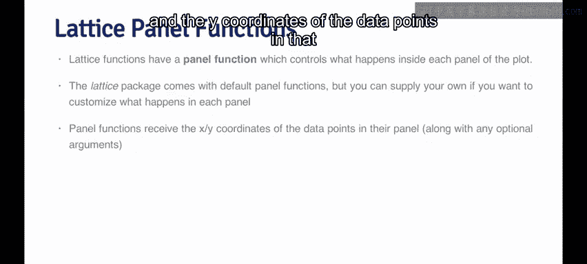

And so you each panel function will for every panel。

 the panel function will get the XY coordinates of the points that are in that plot。

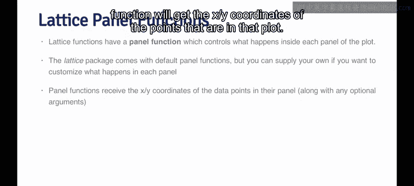

And so you can see here I'm generating some random data that are kind of follow linear model and I create a factor variable which is basically just separating out group1 and group 2。

 and now I want to plot X and Y by group and so here I've got two panels in group one。

 it looks like a strong linear relationship and in group two looks like there's no relationship。

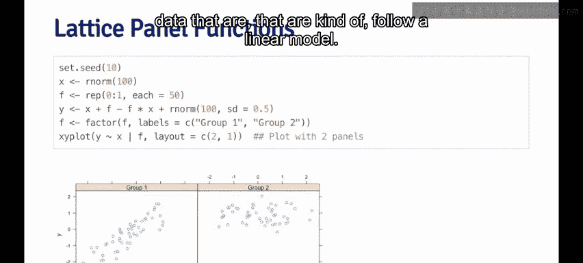

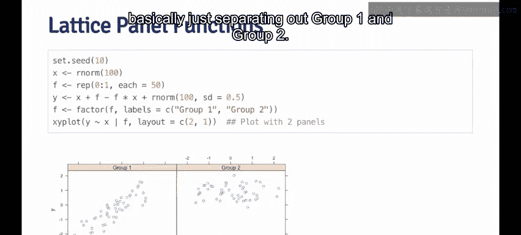

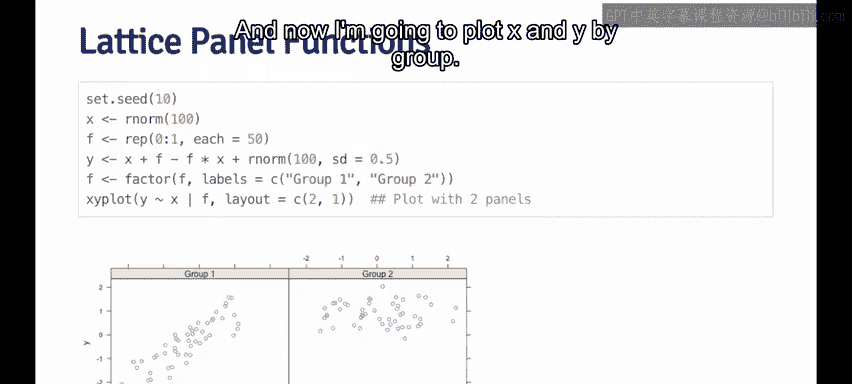

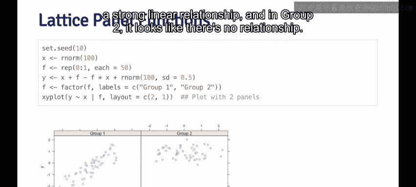

So you can here you can see I'm calling a custom panel function via the panel argument and I give it a function。

 so the first two arguments are x and y and then they followed by dot dot dot。

 which means any other arguments that may get passed And so in my custom panel function the first thing I do is I call the default Xy plot panel function just to make the points appear and then my customization is I add a little horizontal line in each panel。

 which is the median of the y values in that panel。

 So now I can see there's a dashed line in each panel right at where the median of the Y coordinates。

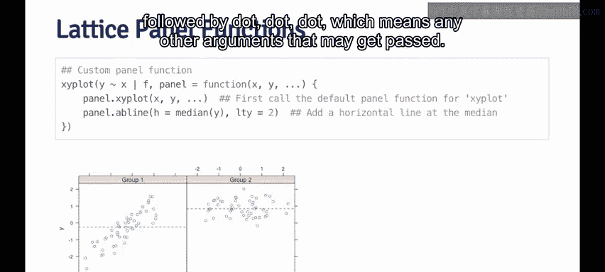

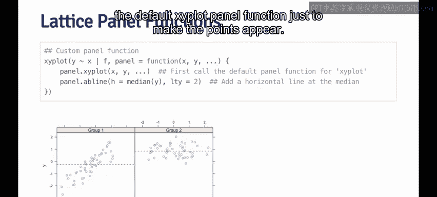

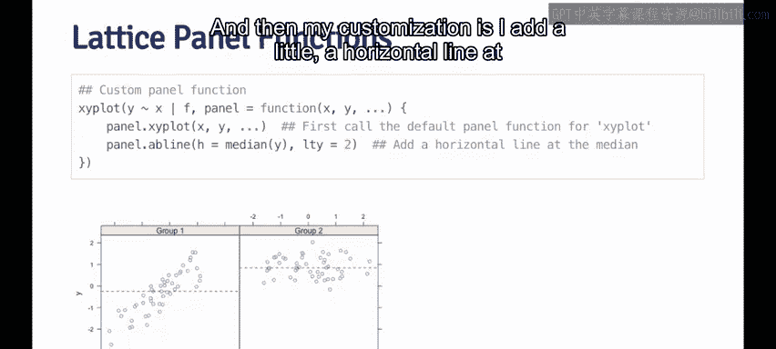

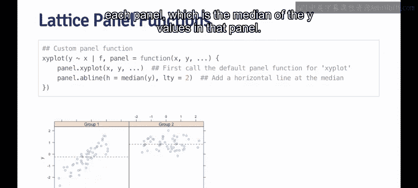

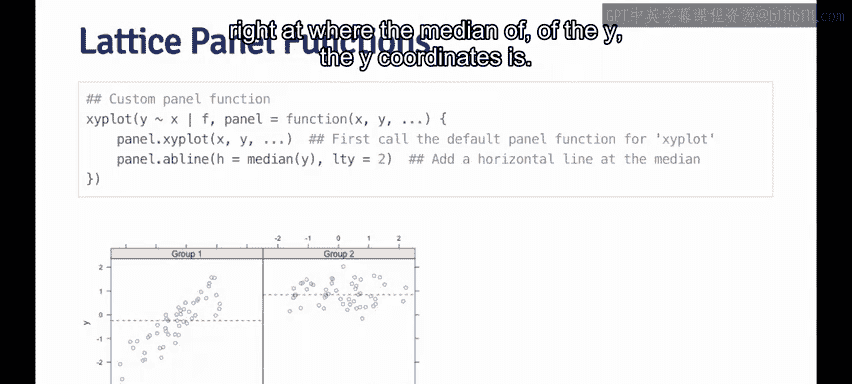

Another fancier thing I can do is rather than add the median。

 it might be useful to add a regression line so you can look at the linear relationship between x and Y within each of the panels so here again I pass a custom function and I call first thing I do is I call the panel that X by plot function just to kind of make the points appear and make all the aes labels and everything appear and then I call panel that LM line。

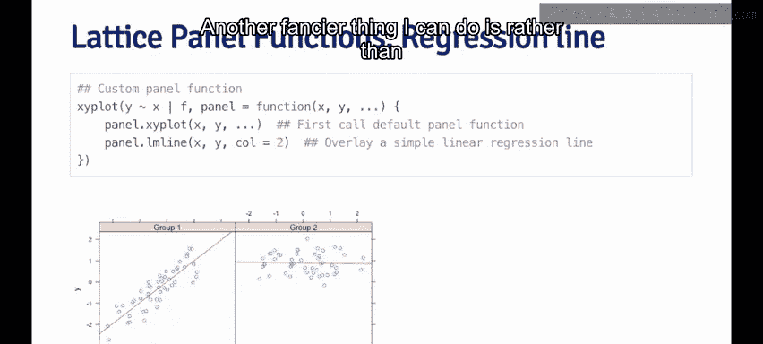

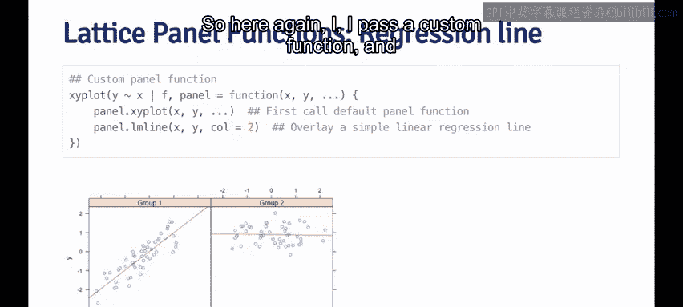

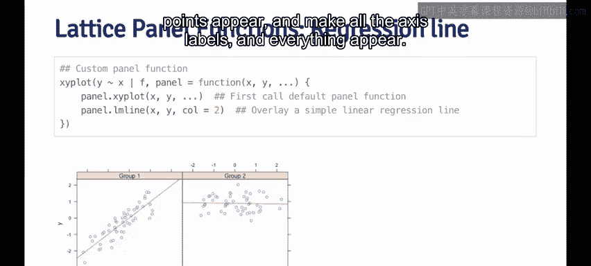

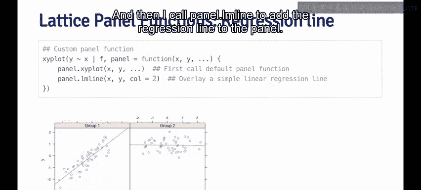

To add the regression line to the panel， one thing that's worth noting is that you can't use any of the annotation functions from the base plotting system in the lattice system。

 So any of the functions that are in the base plotting system can't be used here。

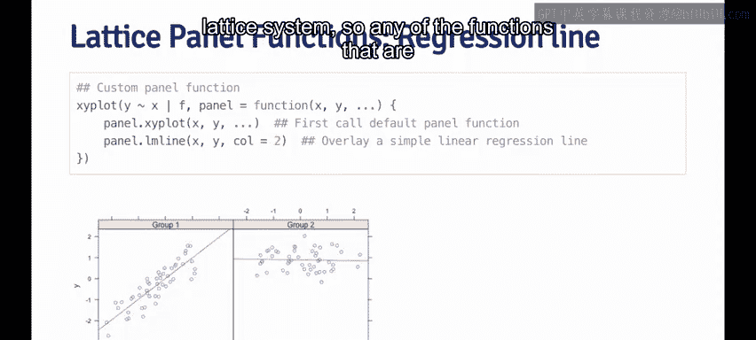

As a general rule， you can't mix functions between different plotting systems。

 and so you have to use all of the functions that are relevant to the given plotting system。

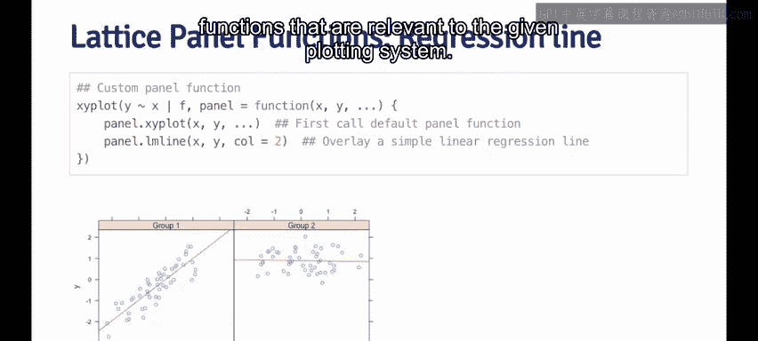

So as one one more quick example of showing a larger data set。

 this comes from the mouse allergen and Asma cohort study。

 which is conducted here in Baltimore City to look at the indoor environment of children with asthma living in Baltimore and many of these children are allergic to mouse allergen so this is an observational study in which there was a baseline home visit and then there was a visit every three months for a year。

 so a total of five visits。

And so one thing one question you might want to ask is how does the indoor airborne mouse allergen vary over time and across the subject。

 So what I want to do is I basically want to make a plot of the airborne indoor mouse allergen for every subject for every visit so there are 150。

Subjects in this data set and they each have five visits can so there you're gonna to be 750 data points here that we want to look at。

 And so what's a compact way to do that Well actually a very easy way to do that is to use Xy plot and use a multipan lattice plot and so that's what we've done here you can take a look at the data and these are all the subjects in the study and this is all their airborne mouse allergen levels well it's the log of their airborne mouse allergen levels and so you can see the variation within a person so within each panel you can see that they' allergen levels can go up or down or can vary from visit to visit you can see the variation across subjects you can see that some people have just very high levels and some people just have generally lower levels So there's kind of that cross-seal variation in addition to the within personson variation you can see that a number of people have missing values so not everyone has five values some people only have two values or one value and sort of maybe be useful to kind follow up on those subjects to see okay well Y。

This subject only have four values or three values。 You can see that some subjects。

Have a lot of variations so they go up and down a lot between visits and some have almost no variation at all at every visit is the same level of mouse allergen And so you may or may not want to follow up in some of some of these patterns。

 depending on what exactly you want you're interested in。

 And so you can see that with essentially one or two function called you can make a massive plot like this。

 Look at a lot of data without having to go through a lot of code And so that's that's part of the power of the lattice system which lets you look at a lot of data as long as they're kind of kind of formatted in a certain way。

 so again， this is the relationship between the visit number and the log airborne mouse allergen levels by subject And so this is covered quick way to kind of summarize all the data in this study。

So just to summarize in lattice plots are constructed with a single function call to one of the core lattice functions like Xy plot like one of the nice things about lattice plots with that things like margins and spacings and labels are automatically handled and so you don't have to set them all the time using like you did in the base plotting system where you had the margin option and and the of spacings and the Mtex and the outer margin and so you don't have to worry about that very much in lattice plots the lattice system is really ideal when you have data sets that you can look at by conditioning on certain variables So basically you typically look you want to look at a relationship but you want to look at within levels of another variable。

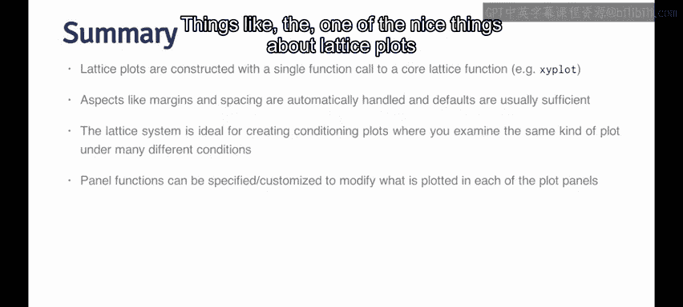

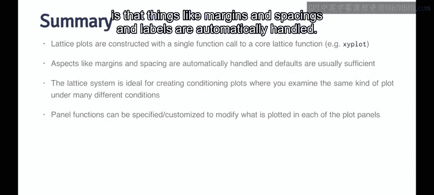

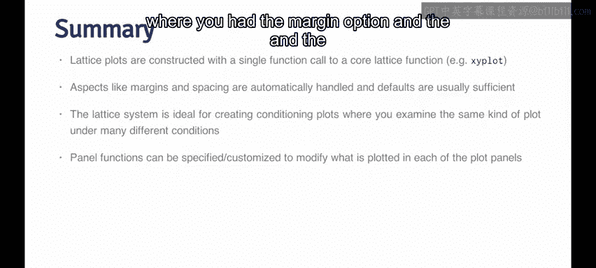

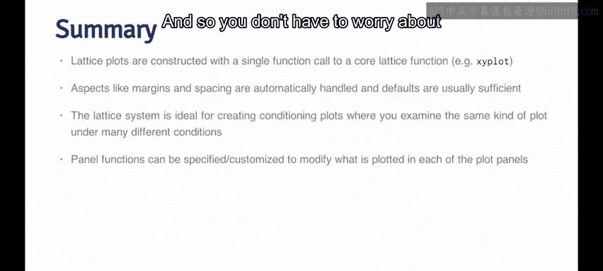

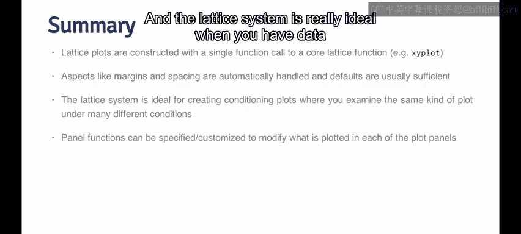

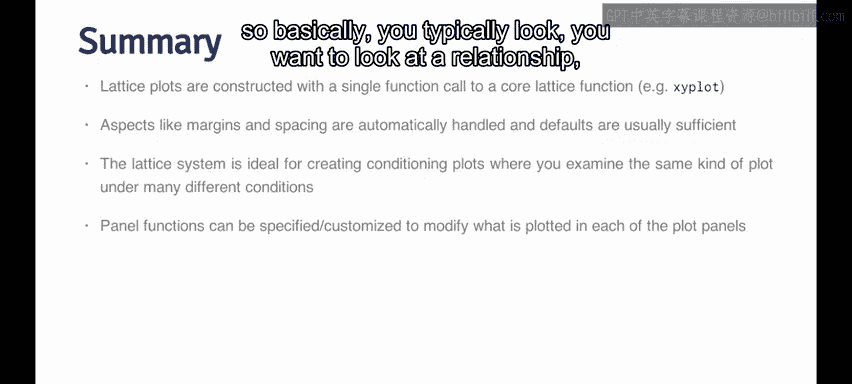

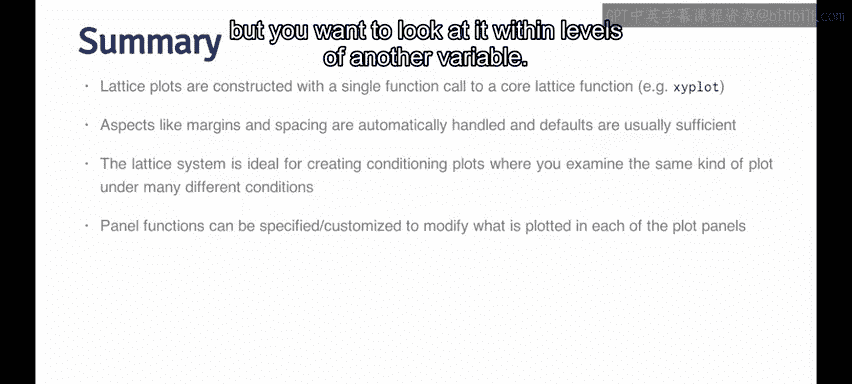

So you want to look at kind of the same kind of cloudd， but under many different conditions。

 and you can use the customized panel functions to modify exactly what goes on in each。

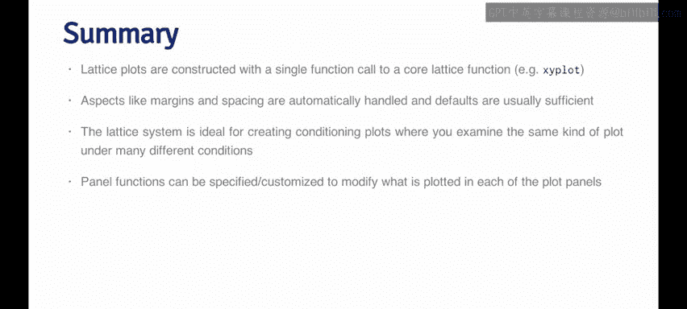

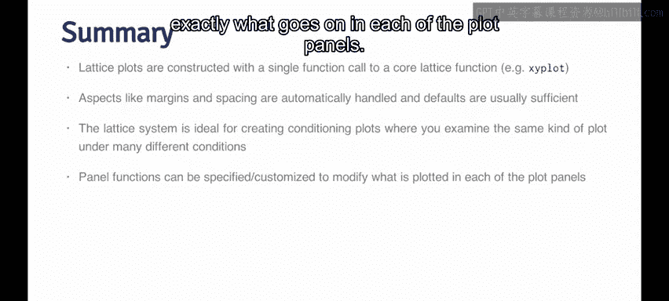

Of the plot panels and so that gives you a lot of power to kind of customize the look of these panel plots and so I find the lattice system very useful for looking at kind of a lot of data in a very quick way and so I encourage you to try to look at it and look at some of the other functions like BW box plots and scatter plot matrices to see how they work for you。

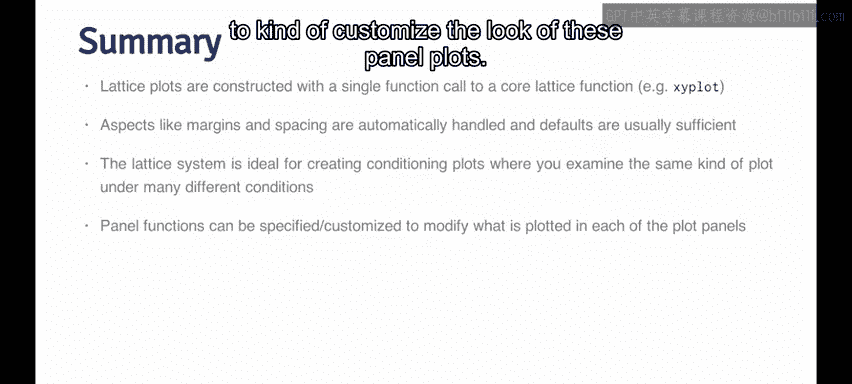

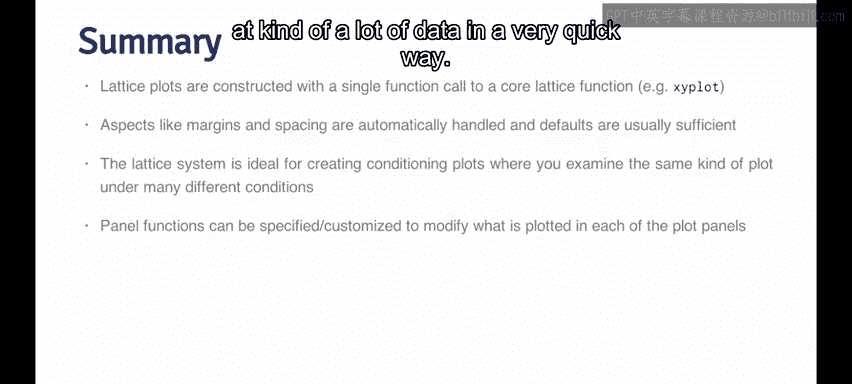

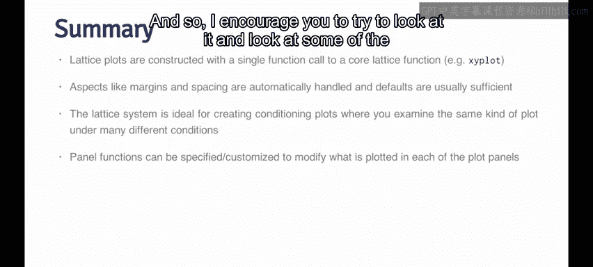

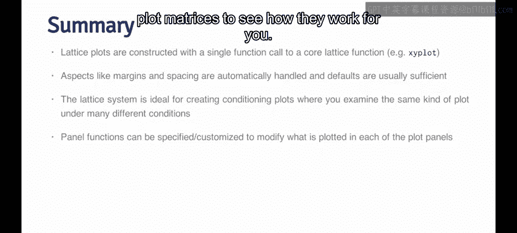