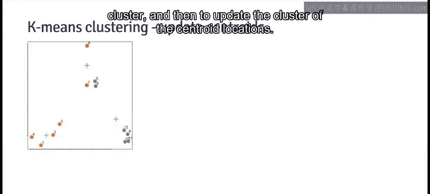

# 约翰霍普金斯大学数据科学课程4：《探索性数据分析》｜exploratory-data-analysis｜ - P26：25_k均值聚类部分1.zh_en - GPT中英字幕课程资源 - BV1U94y1s7th

This lecture is going to be about K means clustering and K means is actually a relatively old technique that was developed quite a while ago。

 but it remains very useful we're kind of summarizing high dimensional data and forget getting a sense of what patterns your data show and what kind of what observations are similar to each other and what observations are very different from each other so I'm going to talk a little bit about how K means works and show what it can do for you so the basic principle behind K means clustering is that you have to first define what does it mean for things to be similar to each other and what does it mean for things to be different from each other so in some sense you want to define what does it mean to be close how do we group things together and how do we visualize this grouping and then once we visualize the grouping and how do we interpret what we see。

So I think the basic the most important thing is define you know what do we mean by close so we need a distance metric to define you know what it means for two things to be close together because depending on the context two things could seem close but not but not be very close and then in a different context you could have a totally different meaning of distance and so this is a very important step and if you don't do it well you end up with nonsense of the ends so you get kind of the classic garbage and garbage out So a couple of。

Traditional distance metrics in statistics are having a notion of continuous distance which is like a Euclidean distance so this is like the straight line between two points another continuous measure is basically like a correlation similarity between let's say two variables and so you can see how correlated they are or how similar they are so highly correlated points would be very similar and then another distance is called the Manhattan distance and this is kind of we'll talk a little bit more about this a little bit later on。

So you need to pick up a distance or similarity metric that makes sense for your problem。

So K means clustering is a way of partitioning a group of observations into a fixed number of clusters and so the idea is that you have to say beforehand how many clusters of points are there。

 so for example if you have about 100 observations in your data。

 you might think that they could be neatly divided into say four different groups so you have to have a sense of well how many clusters there are first and then each of these groups is going to have a centroid so it's going to be like a center of gravity around which each group kind of gathers。

And then once you have these centroids we kind of define we kind of assign each of the observations to each of these centroids and that's how we do the group a kind of assignment and so the basic approach is to kind of pick some the algorithm for running k meanss is to kind of pick a centroid you know assign all the points to the centroids and then maybe recalculate the centroids and reassign all the points you kind of iterate back and forth until you reach a solution and so the things that you need you need a distance metric you need a number of clusters so a fixed number of clusters that have to specified beforehand and you need an initial guess as to where the centroids are and often you might just pick some random points just to start the algorithm in terms of where the centroids are the k means clustering algorithm will produce a final kind of estimate of where the cluster centroids are and it will tell you which centroid each observation is assigned to。

So here's a quick example of how you might use the K means clustering algorithm and I've generated just some random data here that are in two dimensions so it's easy to visualize and so the x coordinates and the Y coordinates all come from a normal distribution with different means so I've specifically created three different kind of clusters for these 12 observations so each cluster has four observations in it so when I plot the data it's very obvious that this is where the clusters that there are three clusters and I put labels on each of the points。

So here we see that the algorithm started。 And I just chosen some three random points to be the centroids。

 So you see there's a kind of a red plus and a purple plus and an orange plus down at the bottom。

 So those are the random starting points for the centroids。

 I' gonna see is the first thing we're gonna do。 as we're gonna to take each of our data points and assigned to it。

 the closest centroid So you can see， for example， point number 8 at the very top。

 the closest centroid is the red plus over on the upper left。 So that gets assigned to that cluster。

 and then point number4 down the lower left here that gets assigned to the red cluster also。

 and then the three points 1，2 and3， they gets assigned to the orange plus they're in the orange cluster。

 And then the rest of the points are closest to the purple little plus there。

 So they get assigned to the purple cluster。 And so that's the first of initial grouping of the。

Of the points to the three different clusters。And then the next thing we're going to do is recalculate the centroids。

 so now we have the cluster definition at every point is assigned to a cluster。

 we can recalculate the centroid so for example， by taking the mean of that cluster。

 you can now see that the purple plus has moved slightly to be in the middle of that cluster。

 the red plus is moved a little bit to be in the middle of that cluster and the orange one is now in the middle of the three orange dots and so the cluster centroids get recalculated。

And then you kind of repeat the process again so you take each data point and you say okay well what cluster centroid is it closest to now and you can see that point number four。

 for example， used to be in the red cluster but now it's closer to the orange cluster so it gets reassigned and then you see for example。

 point number seven is now closer to the red plus so it's in the red cluster and then when you recalculate the centroids from this you can see now the centroids are kind of moving towards each of the points so you can see that the clusters are kind of forming as we go step by step so the two processes are to assign the points to each cluster and then to update the cluster the centroid locations。

