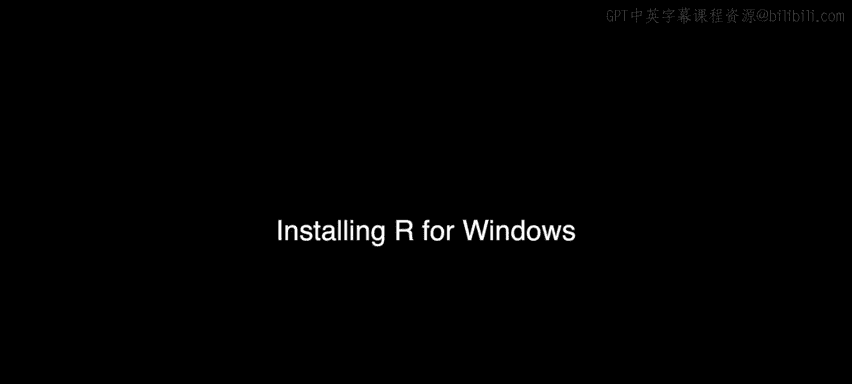
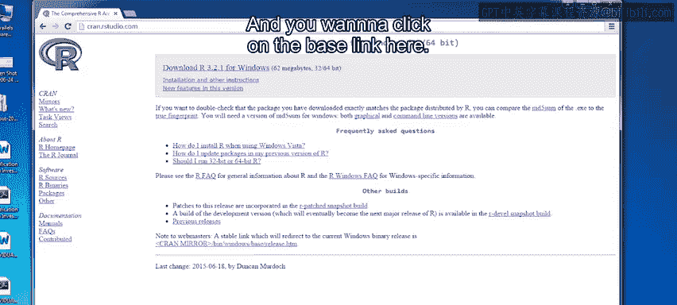
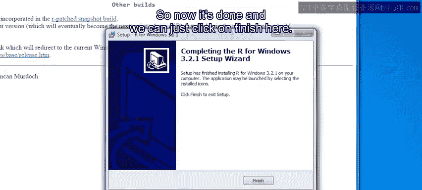
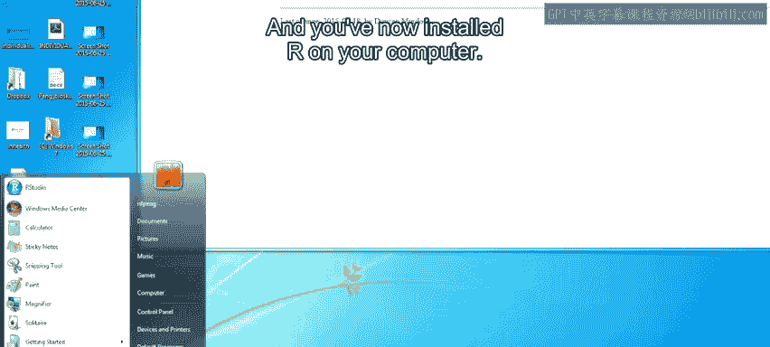
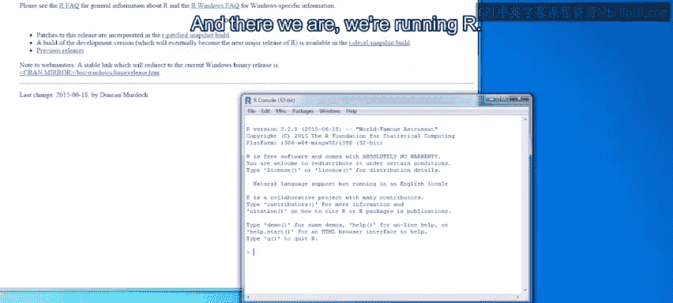

# 约翰霍普金斯大学数据科学课程4：《探索性数据分析》｜exploratory-data-analysis｜ - P2：1_在windows 3 2 1上安装r.zh_en - GPT中英字幕课程资源 - BV1U94y1s7th

I just wanted to briefly describe how to install R for a Windows machine so the first thing you need to do is launch your web browser。

 so I'll do that here I'm using Chrome， but it doesn't really matter and you need to go to the comprehensive R archive network or Crran。

 so let's type that in here。And you'll see that there's at the top there's three options。

 there's Linux， a Mac and Windows， so you can go to the Windows version here and you want to go click on the base link here so you can just click on this link and the download will start and so depending on how fast internet connection is。

 this might take a few minutes。

Okay， so the download's finished， I'm going to click on this。

And so you can choose your language here there are a number of choices in terms of the translations that you can choose from so I'm going to choose English because that's my language then you can just click through the installer it I walk you through the various steps and so we'll do that right now just to see what the options are so you click on next you have to agree to the license which is the Ganew general public license so feel free to read it and then click on next。

The user the default installation directory is fine so I'm going to go through this the default user installation is fine there are other kind of installation setups that you can choose from if you know you only you have a 32 bit machine and maybe an older machine you could click on that by default it will install both version so you don't have to really worry about that so just click through next on this one。

And you can choose to kind of take all the defaults or you can try to customize your startup。

 I'm going to customize the startup just so you can see kind of what the options are here。

So this option here shows you whether ask you whether you want an MDI or SDI interface so what that means is basically do you want R to kind of run in one big window with kind of different subwinds within inside of a big window or do you want it to run in kind of like separate windows I prefer to use the SDI mode where so the console will be in one window and the kind of the graphics window will be a separate window I just kind I feel like I like that little bit better it's easier to work with so I'm going to click on the SDI option。

And then you can choose how you want to look at your help files so the HTML help is a little bit niceier it's pretier to read and the plain text help is while it's just plain text so maybe I'll just click on plain text just to be different and then you can choose whether you want standard or internet to internet access this generally speaking you should not mess with so you just click on next。

嗯。You can create a shortcut in the start menu， so it's usually a good idea。

And you can usually quick choose the defaults here in terms of creating a desktop icon unless your desktop is very cluttered and you want to avoid that so are these defaults are fine so I'll click on next and then itll start installing the files on your computer。

So now it's done， and we can just click on finish here。 and you've now installed R on your computer。

 And actually you've got I got a desktop icon here。 So I'll just double click on that。

 And there we are。 We're running R。

