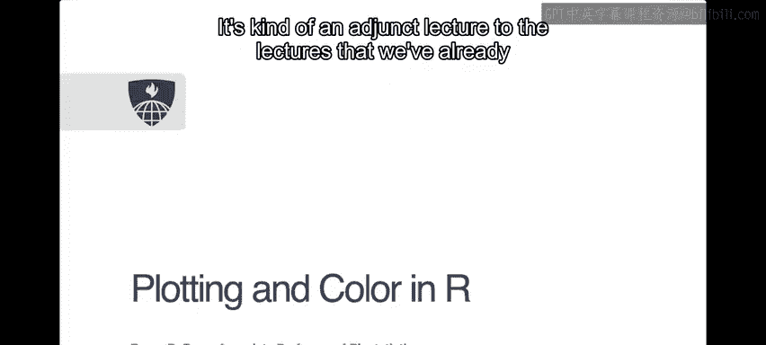
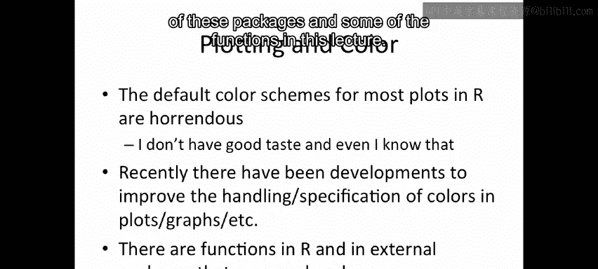
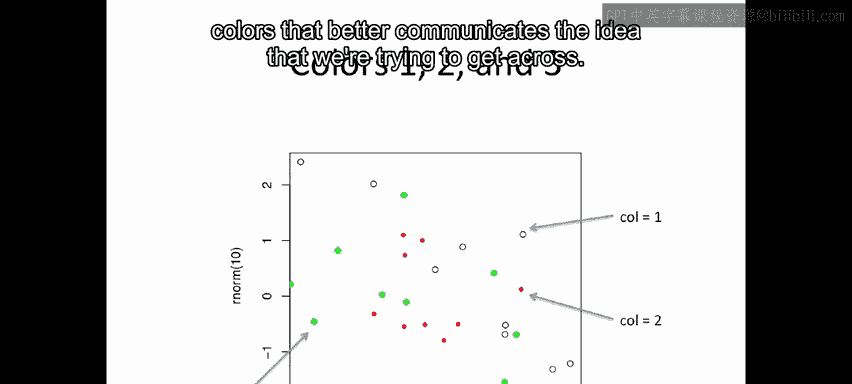

# 约翰霍普金斯大学数据科学课程4：《探索性数据分析》｜exploratory-data-analysis｜ - P31：30_在r绘图中使用颜色部分1.zh_en - GPT中英字幕课程资源 - BV1U94y1s7th

This lecture is going to be about plotting and color in R It's kind of an adjunct lecture to the lectures that we've already had about plotting in both the base graphics and the lattice graphic system I just want to talk a little bit about how you can specify different types of colors using different palettes in R you might think that the specification of color in a plot is maybe kind of a secondary decision and in some sense it is it's definitely secondary to something like the data。

 but of course， but the judicious and appropriate use of colors I think in plots can help to describe the relationship that you're trying to demonstrate and can help various dimensions of the data come out more effectively than if you just choose an arbitrary set of colors。

So there are a couple of think functions and things I'm going to cover in this lecture。

 but the basic。😊，Point is that the default color schemes for most of the plots in R are pretty bad and you don't have to be an expert in design or anything to really kind of see this。

 but kind of the natural color schemes that you kind of gravitate towards when you use the plotting functions are not particularly well suited for different kinds of data。

 but there have been a number of developments via packages and also in the core R system that can help with the handling and specification of colors in various types of plots and so I'm going to talk about one of these packages in some of the functions in this lecture。

So the basic problem that typically comes out in most plots is this is a pretty standard plot in R that you might see in a presentation or in a paper。

 there's some points on the plot and I'm just plotting random points here and you see that the points are in three different colors the first is black。

 the open circles are in black then there's a couple of points that are in red and then there are a couple of points that are in green so why does this happen well because when in most plotting functions there'll be a call argument COL and when you say call equals1 you get black when you say call equals 2。

 you get red and when you say call equals 3 you get green and so if you have a plot and you want three different colors in it。

 it's very easy to say okay well'll just give me call equals 1，2，3。And so you get black。

 red and green call equals4 would have been something like can and then call equals 5 is magenta so those are the kind of standard colors that you just get stuck with when you set call equal to be one。

2，3，4 or5 and so if you go to this route the red in the green are not particularly meaningful in this case。

 of course you don't know what the data are about so it's possible that they are but in most cases they're not the most suitable colors for the type of data that you're going to show and also just from a design point if you use this color scheme all the time then all of your plots will look like they belong in some Christmas show or Christmas presentation。

The question is whether or not we can choose a better set of colors that better communicate the ideas that we're trying to get across。

 Another standard set of colors is shown here。 This is the volcano dataset set that comes with R。

 and it's basically a data that shows different elevations of a volcano and the set of colors on the left comes from the heat colors palette And so this is a palette of colors that。

Goes from kind of a reddish to indicate low to a yellow or white to indicate high and then on the right side here we've got a palette of colors called the toppo colors or topographical colors and this goes from a kind of blue。

 which indicates low to a brown or a white which indicates high。

So for the heat colors if you kind of know what fire is。

 it may be reasonable to kind of see that picture and know that kind of what is kind of low and what is high。

 for the topographical colors， it's not maybe not immediately clear to some people。

 what is low and what is high， it's not so the fact that blue is low and green is higher than blue。

 it may not be particularly obvious， it's not particularly obvious to me。

