# 约翰霍普金斯大学数据科学课程4：《探索性数据分析》｜exploratory-data-analysis｜ - P33：32_在r绘图中使用颜色部分3.zh_en - GPT中英字幕课程资源 - BV1U94y1s7th

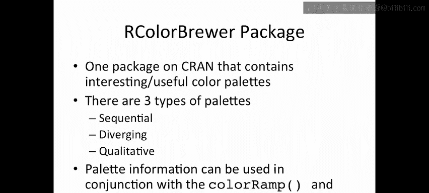

So you might be wondering well where do I come up with interesting palettes of colors where you can always create your own palette of colors just that I did in the previous slides by indicating colors like red。

 yellow or anything in the colors vector that you get when you call the colors function。

 but you might want to come up with some more interesting colors color palettes and that can be done using the color brewre。

 the R color brewreer package in R so the R coloror brewer packages available on Crran and all it does provides a set of interesting palettes that you can use for different types of data and this package was created from work that was done by Cynthia Brewer。

 who's at Penn State and she's done a lot of work researching appropriate colors for creating maps and for mapping data。

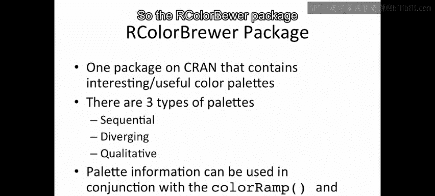

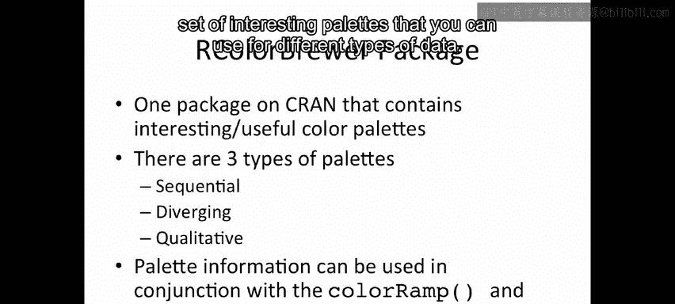

But these pallets are going to be quite useful for other types of data that don't really occur on maps。

 so the three types of pallets that and you can get from the our color brewreer package are the sequential pallets。

 the diverging pallets and the qualitative pallets。

So the sequential pallets are used for data that are ordered。

 you can think of this as being used for numerical data or continuous data。

 doesn't have to be continuous， but the idea is that the data are ordered from low to high diverging pallets can be used for data that kind of diveerge or they deviate from something for example。

 if you have a bunch of data and you want to show the deviations from their mean then you might so this way in this sense that there's data that can be positive and there's data that can be negative and as they go away from whatever that center point is maybe that center point is zero。

 they can get bigger in two different directions， maybe going negative and going positive so that's a diverging set of data and you want to use a diverging color palette to represent that。

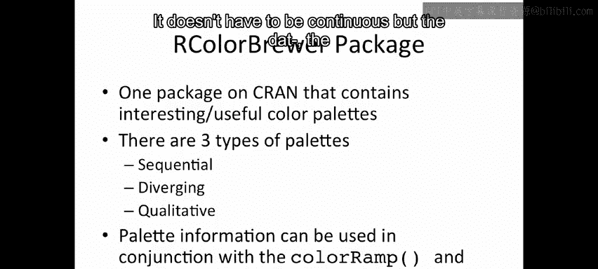

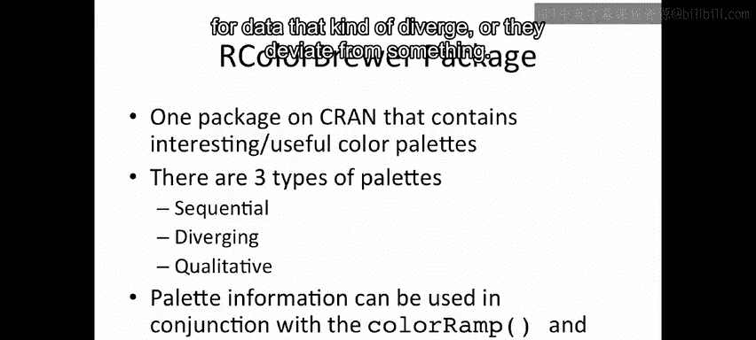

The last color palette is the qualitative palette which is just used to represent data that are not ordered。

 so these can be factors or categorical data that don't have any specific ordering they just have different values。

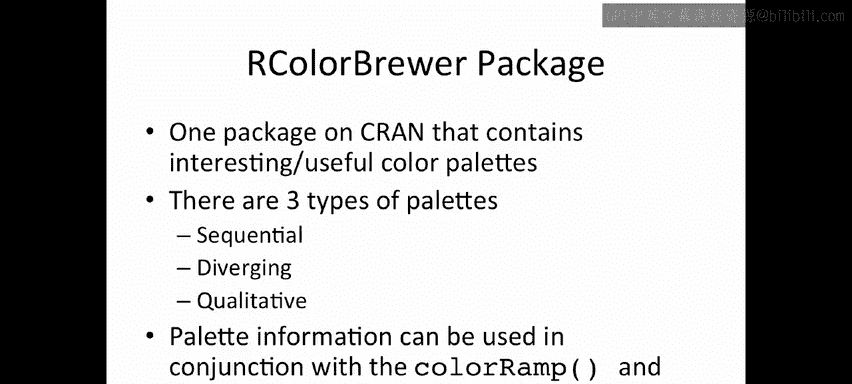

So。So the palette information that you get from the R color Breer package can be passed to functions like color ramp and color ramp palette to be used in the plotting functions in R。

So these are the various palettelets that are found in the R coloror brewer package。

 the top set here， these are the sequential palettes and you can see that they basically go from light to dark as you go from left to right。

 but they travel through a different set of colors on each palette so the top one here goes from yellow orange to red and then the bottom one here is called the blues palette it just goes from a light blue to a dark blue so these are used for ordered data for numerical data that have a low and a high。

The second set of pallets here is the qualitative pallets and these are used to represent categorical data and you can see that the colors in the palettes don't really have any specific ordering。

 they don't go from light to dark， they don't go from any specific order。

 but so they just have a certain set of colors associated with them and each palette has basically a theme some palettes are kind of bolder than others and some are more on the pastel side。

 the last set of colors you can see are the diverging pallets。And。

The colors in this palette you can see that they are kind of light in the middle and as you go for left to right they get darker in different color ranges and so you can think of that the left being negative and the right being positive and so and that's how they diverge and again they travel through different sets of colors here so the top one here goes from a red as from the left all the way to a kind of purple blue on the right and then the bottom one here goes from brown on the left to kind of blue or green on the right so you can choose your palette here depending on what kind of color scheme you prefer。

😊，So the color brewer package can be loaded into library after you install it using the install dot packages function。

 you can do library R color brewer and then the Ber pal function is really the only useful function in the package and it takes two arguments the first argument is the number of colors that you want for your palette and this is usually small it'll be two。

3 or four you don't need that many blotches on your palette for the primary colors and then the second argument is the name of the palette and the name of the palette really is not easy to remember you just have to look in the help page for brewer dot pal and which will list all of the names of the pallets that are available so here I'm using a bluegreen type of palette and I want three different colors in that palette so now you can see that the character vector that it returns has three colors and they each have a mix of red green and blue and if you're fluent in hexadeimbel you'll know what these values are but it's not really important to know exactly what the colors are you'll be able to see them on the screen。

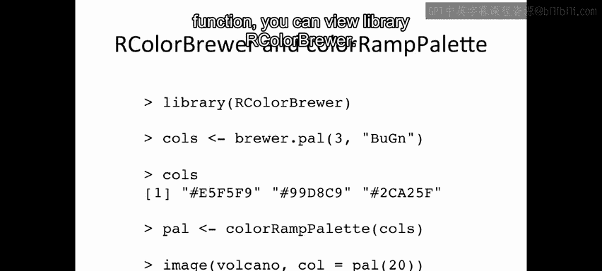

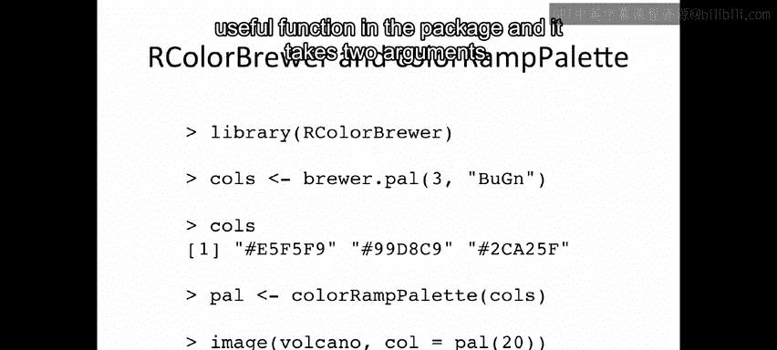

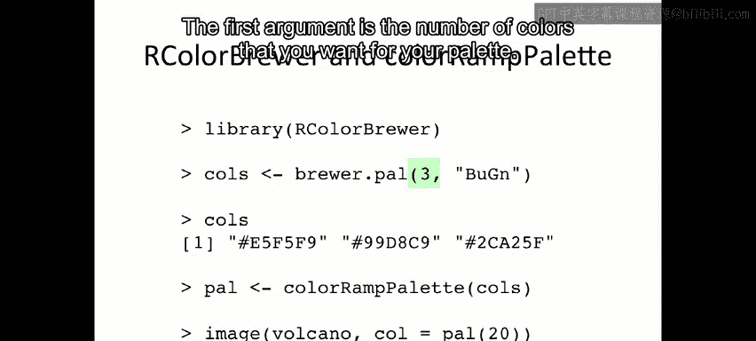

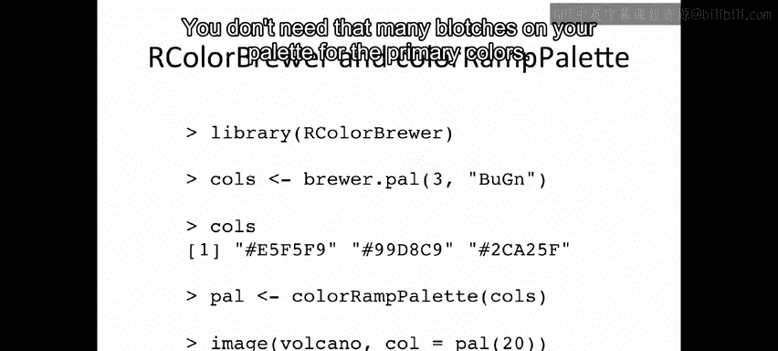

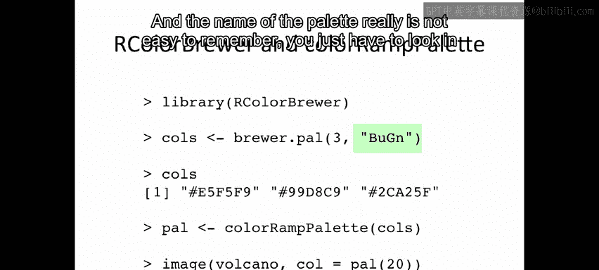

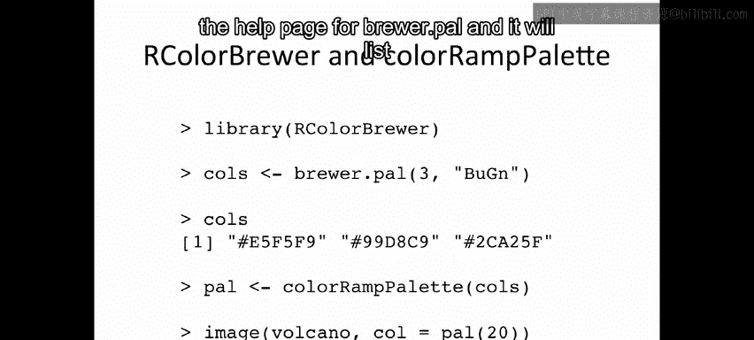

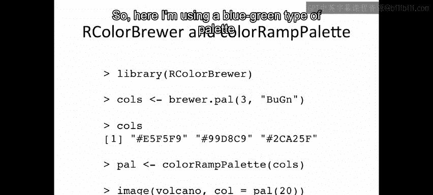

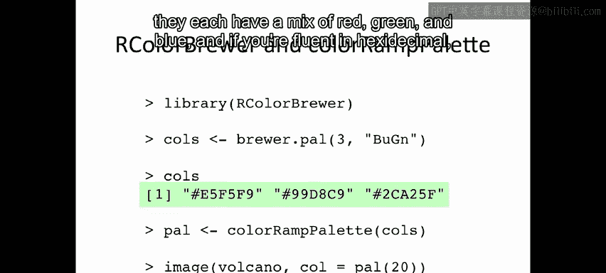

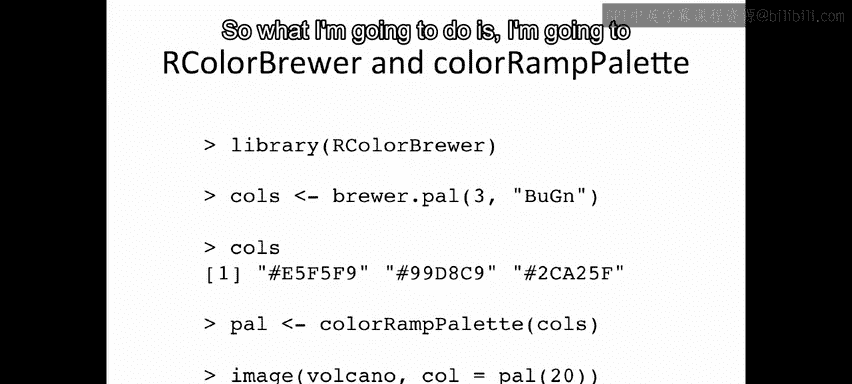

So what I'm going to do is I' going to pass this palette of colors into the color ramp palette function and it's going to return a function that I'm going to call pallet so now I'm going to create the image of this volcano using the image function。

 but I'm instead of using the heat colors of the topo colors palette I'm going to use this palette that I've got from the color brewer package and so I'm going to specify that I want 20 different colors to be represented in this image so that the 20 colors are going to come they're going to be interpolated from this bluegreen palette。

😊。

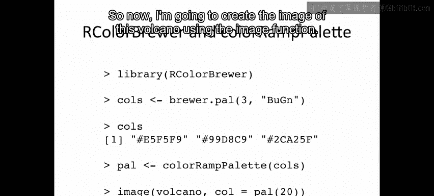

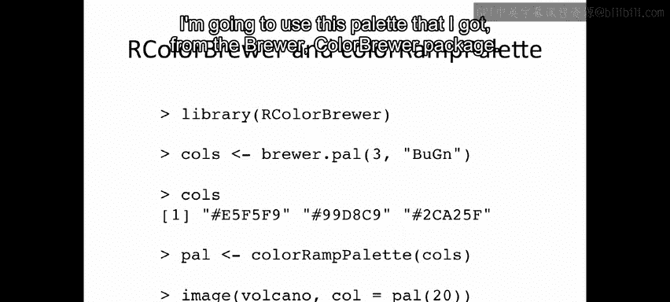

So the resulting image looks something like this， and you can see that as it gets higher。

 the colors get darker and more green。

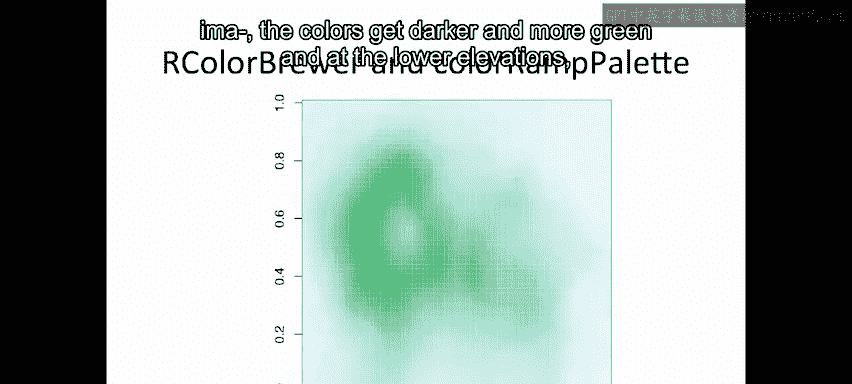

And at the lower elevations， the colors are lighter and more blue。😊。

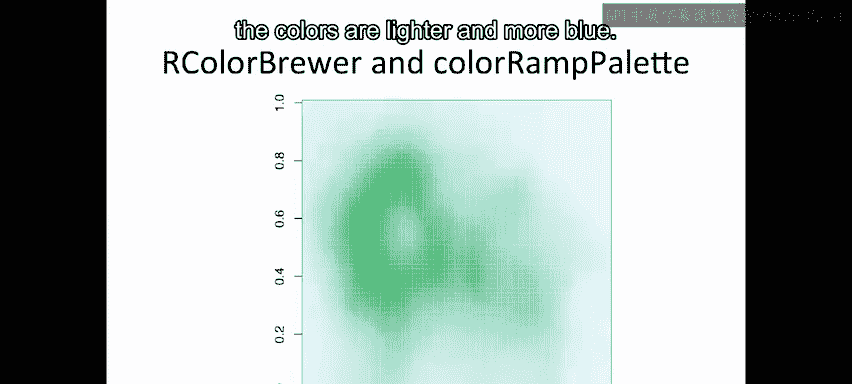

Another function that uses the color brewer palettes is the smooth scatter function which comes with R and this function is particularly useful if you have to plot make a scatter plot of a lot of different points and you don't want to just have a bunch of dots on the screen that are overlapping each other So here I'm plotting 10。

000 points and if I were of just plot this on the screen using the plot function I would get a mess of points that are kind of overlapping each other it's kind of hard to see the details so the smooth scatter function what it does is it creates a histogram。

 a 2D histogram of the points in your plot and it just plots the histogram using a certain set of colors。

 the default set of colors that it uses is the blues colors。😊。

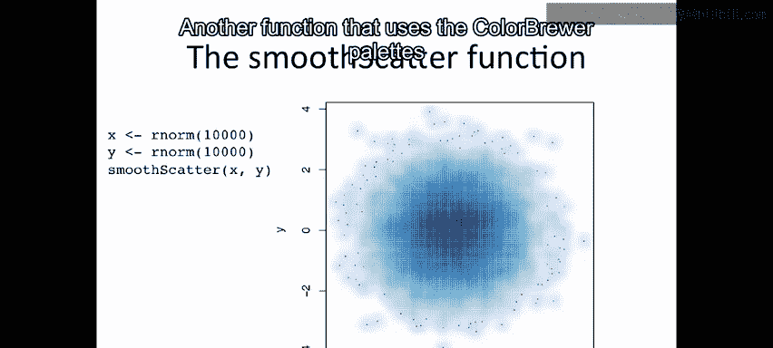

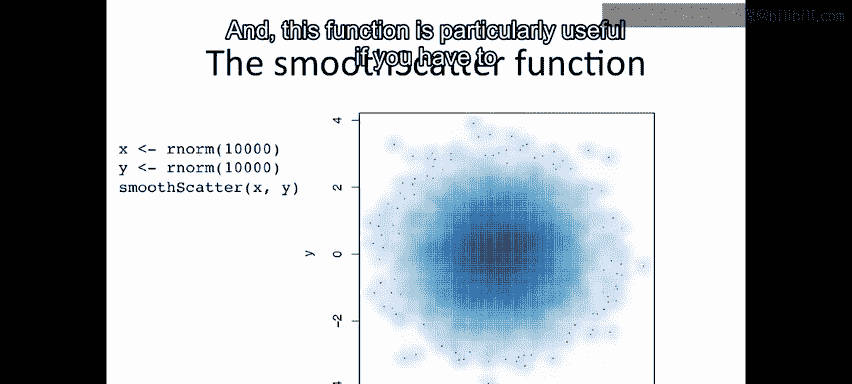

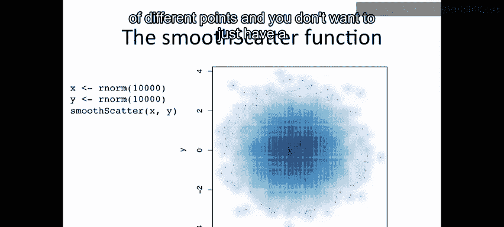

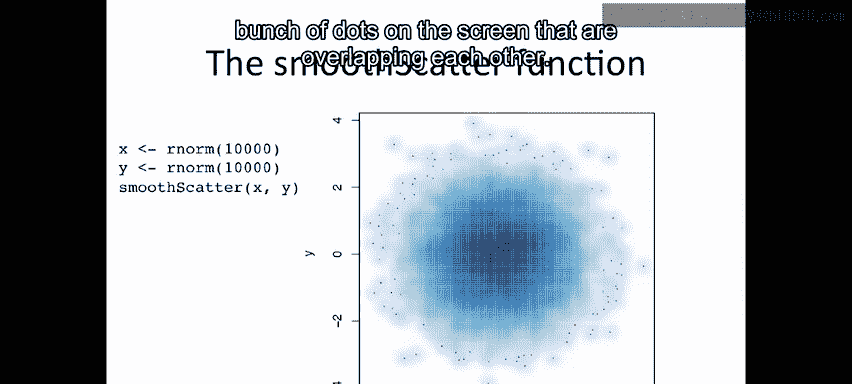

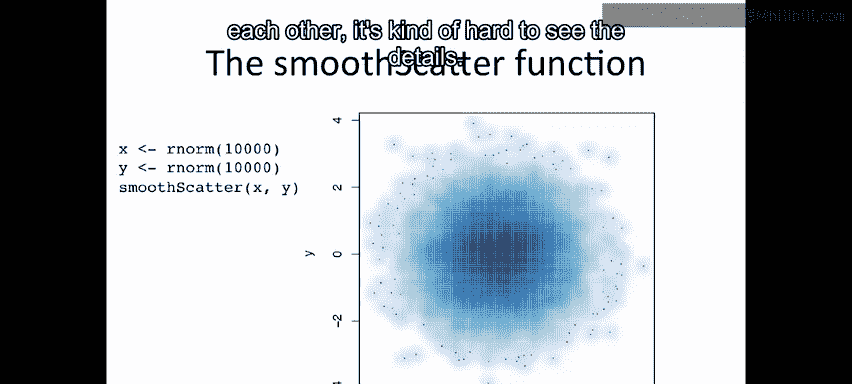

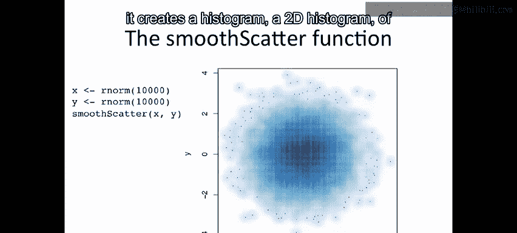

Sorry， the blues palette in the R color blueer package。

 which is a sequential palette and it gets kind of darker blue as you get higher and lighter blue as you get lower。

 so the darker blue areas of this plot are the high density。

 so that's where all most of the points are in the high density region and the lighter blue parts of the plot are the lower density regions of the plot。

😊。

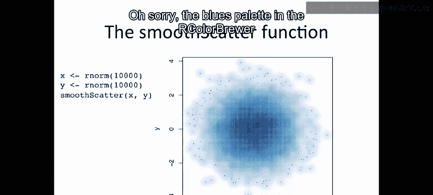

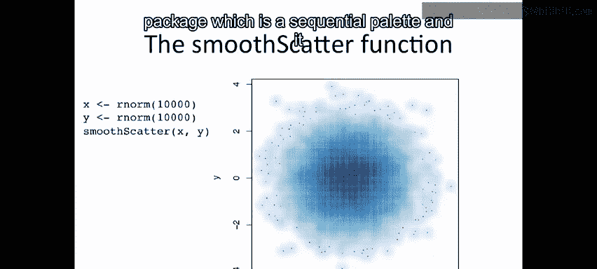

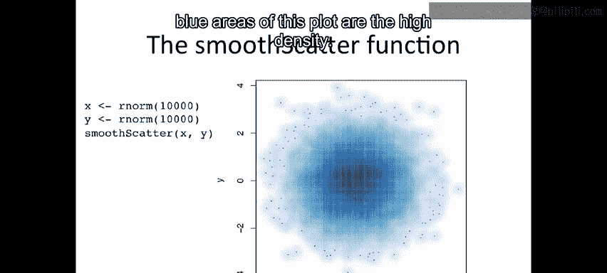

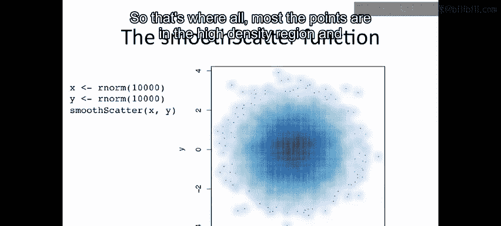

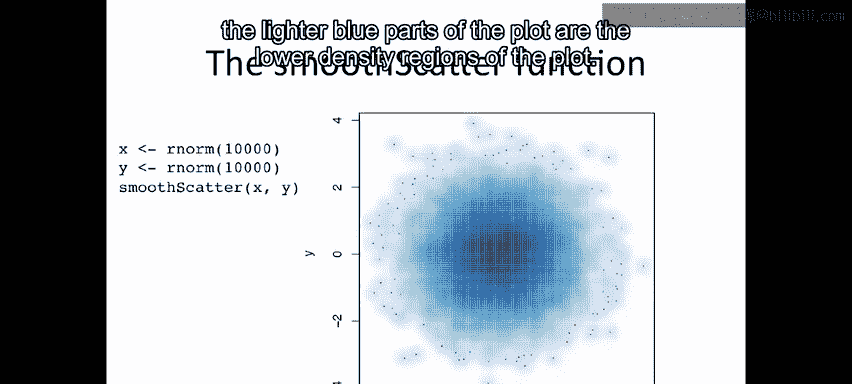