# 约翰霍普金斯大学数据科学课程4：《探索性数据分析》｜exploratory-data-analysis｜ - P34：33_在r绘图中使用颜色部分4.zh_en - GPT中英字幕课程资源 - BV1U94y1s7th

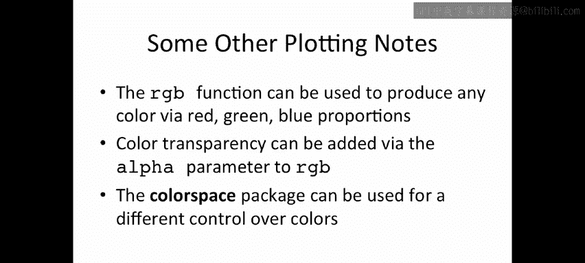

So there are a couple other functions that may be of use to you one is the RGB function and the RGB function takes arguments for red green and blue and what it returns。

 so these are numbers between0 and1 for red green and blue。

 and it will return a hexadecimal string that can be passed to functions like image or plot and so if you want to convert between decimal red green blue representation to this hexadecimal string。

 you can use the RGB function for that Another thing that you can use RGB for is to add transparency to your colors and so there's a fourth argument to RGB which is a number between0 and1。

 the alpha parameter which can be used to specify transparent in your colors。

0 being the most transparent or basically completely transparent and one being not transparent at all Lastly I'll mention the color space package which can be used to have a different exert a different type of control over colors you may want to。

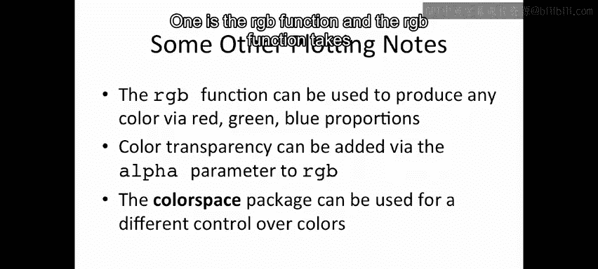

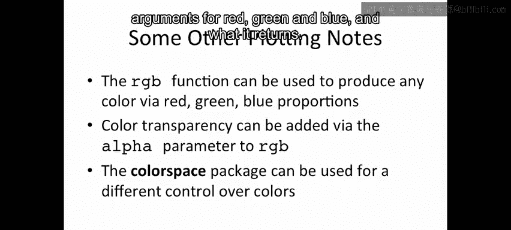

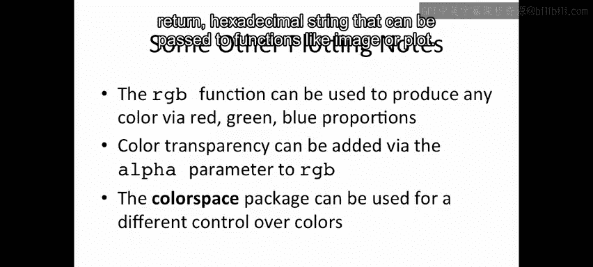

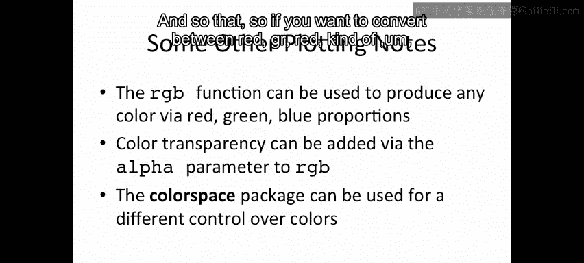

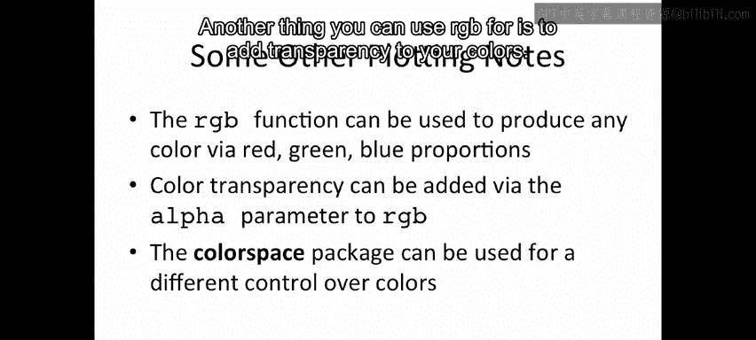

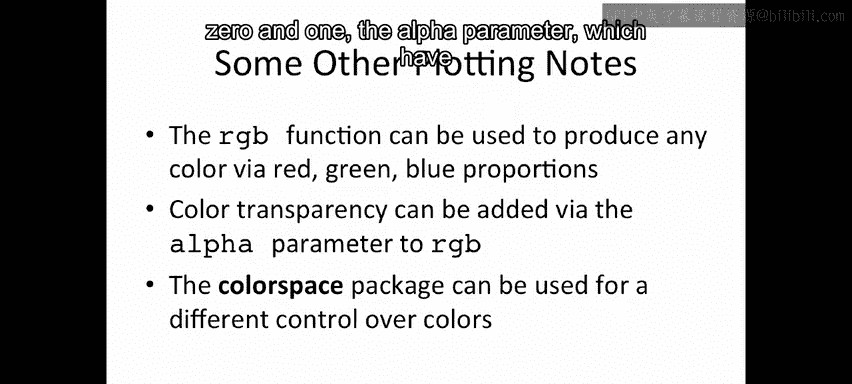

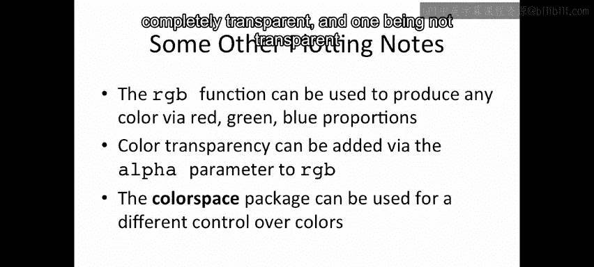

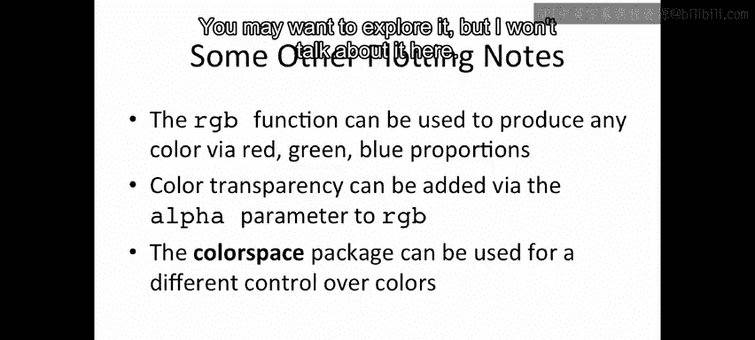

Explore it， but I won't talk about it here。So just a quick example of the transparency in R so here's a plot of about 1000 points and you can see that in the high density region here。

 I'm using the PCH19 which is a solid circle in the high density region。

 all of the plot all the points just kind of overlap each other so you just see a black blob there in the middle and it's kind of hard to see what the resolution is for the different points because there's no definition of points there because they're all overlapping。

😊。

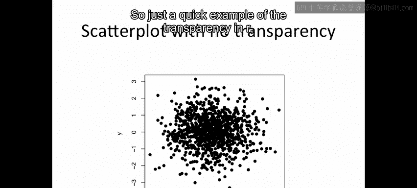

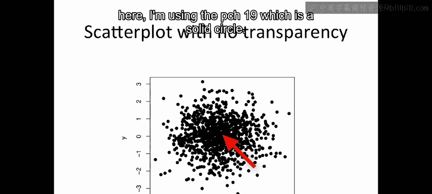

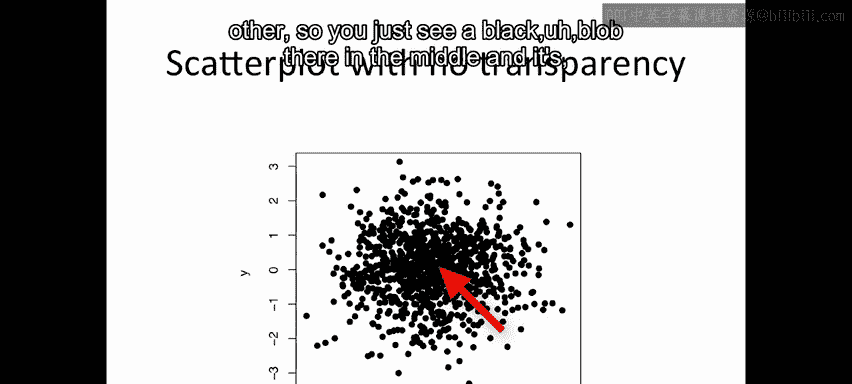

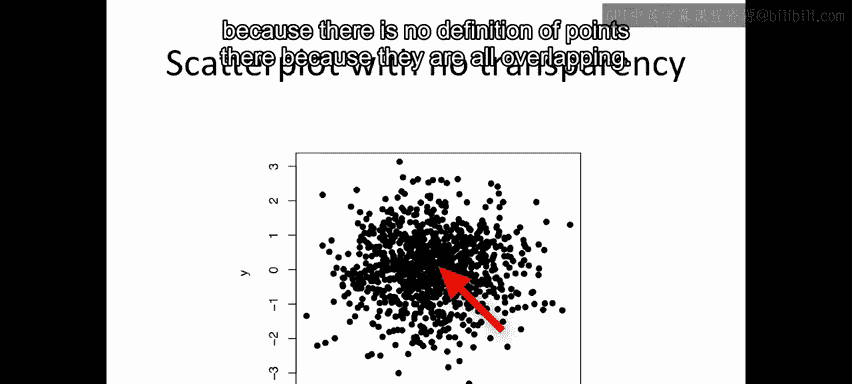

So if I add a little transparency to the plot you'll see that the circles become transparent so when they overlap each other you can kind of see through them and so the areas where there are lots of points overlapping they get darker and where there are areas where there are no points overlapping you just see kind of a transparency circle so here've got below I've got the code that I've used to create this plot and you can see that I've specified in alpha parameter of 0。

2 the red green and blue are all 0 so I can get black and so  point2 is a pretty close to 0 there's a lot of transparency but you can see that when I use the transparency like this it's kind of a cheap and easy way to get essentially a histogram estimator because the darker areas will represent higher density areas of the plot and the lighter areas will represent kind of lower density areas so you can see a little bit more information when you have a plot with a lot of different points in it when you use a little bit of transparency。

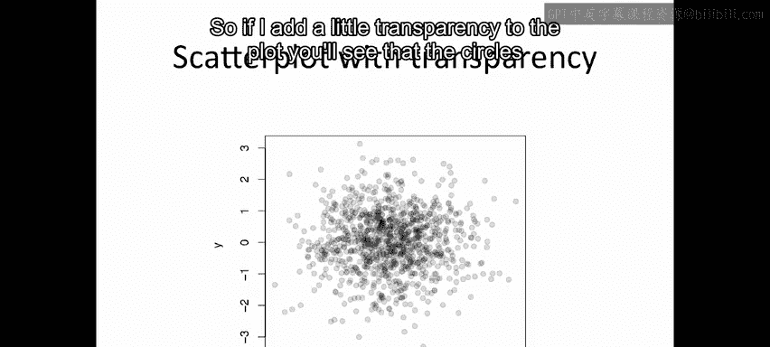

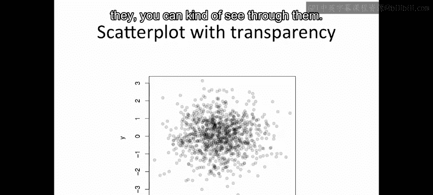

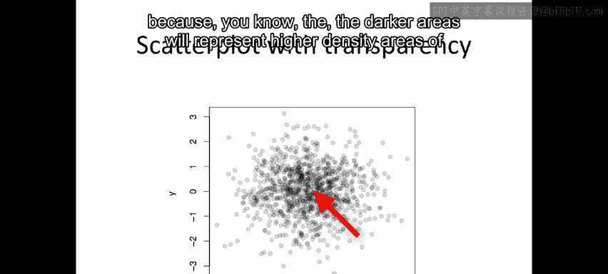

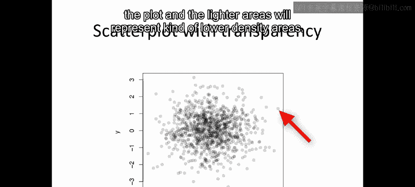

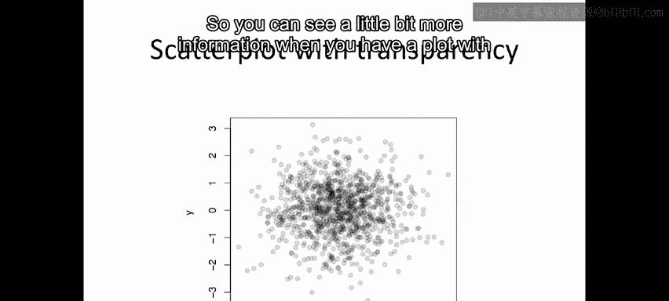

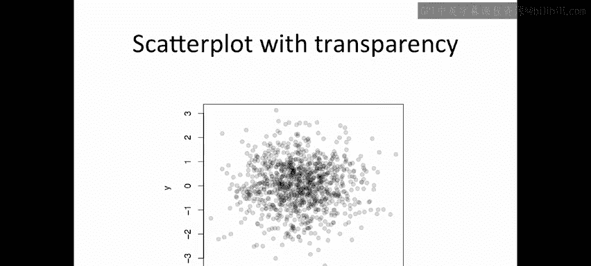

So thats that's the basic intro into the use of colors and transparency into R I think that the careful use of colors in plots and maps and whatever just can make it easier for the reader to get the point that you're trying to make or to see the comparisons that you're trying to make and I think it's useful to have a good set of colors especially to match kind of sequential colors of sequential data and diverging colors with diverging data。

 the color the R color brewer package is a very useful package that's available on Cran and it provides these color palettes for the different types of data that you might be app plotting the color ramp and color ramp palette functions are essential when you're trying to interpolate between colors especially if you're using the R color brewer package and you want to interpolate between the colors on a given palette。

And then finally， transparency is very useful because you can be used to clarify plots that have many。

 many points on them by allowing the colors to be transparent and to kind of overlap each other。😊。

