# 约翰霍普金斯大学数据科学课程4：《探索性数据分析》｜exploratory-data-analysis｜ - P35：34_聚类案例研究.zh_en - GPT中英字幕课程资源 - BV1U94y1s7th

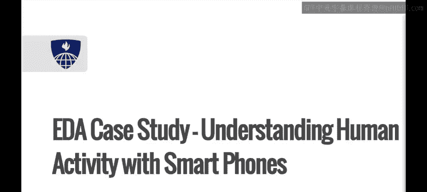

In this case study， I'm going to talk more about exploratory data analysis techniques and how to use them on a data set that involves using smartphones to kind of predict human activities so remember just any exploratory data analysis。

 you have to have a sense of kind of like what you're looking for。

 what and what might be the kind of the key priorities that you want to get out of your data。

And so that will help you guide kind of what you look at and how you approach it remember the basic idea with exploratory data analysis is you want to kind of produce a rough cut of the kind of analysis that you ultimately maybe want to do so maybe this isn't going to be perfect it's not going to have all the right bells and whistles to it but it's going to give you a rough idea of kind of what kind of information you're going to be able to extract out of your data and what kinds of questions you're going be able to feasibly answer and what questions might not really be possible to answer with the given data set。

So Exploratory analysis is really important because it rules out certain questions and it kind of pushes you along other directions and it really allows you to give you that rough cut analysis that can take you to the next step so let's take a look at the Samsung dataset in this example and see what we can find。

So the data here comes from the University of California Irvine or the UCI machine learning archive。

 and it's based on predicting people's movements from their galaxy Samsung Galaxy phones so here's a picture of the Sasung Galaxy S3 the actual data was producing the Galaxy S2 but the idea is kind of basically the same so in each of these phones。

 there's an accelerometer and the gyroscope and so it helps you kind of to understand the kind of three dimensionmenal position and acceleration of a person assuming that they're holding their phone。

So this is where the data comes from is the UCI machinech learninging repository。

 you can go to the link to learn a little bit more about the data how it was collected and kind of what is available on the website and so I've downloaded a subset of the data which is just the training data for the purposes of this lecture。

So the data have been processed a little bit to make it a little bit easier to use。

 but basically you get a matrix that has kind of has the observations on the rows and the various features on the columns and you can see that at the bottom here I've got the activity label which is the kind of the for each row it tells you what the person was doing at that time。

 and so for example， there's six possible activities that you can be doing there's laying， sitting。

 standing， walking walking down and walking up。And the idea is that you want to be able to kind of separate out these six activities based on the many features that are collected by the accelerometer in the gyroscope。

 and so I listed the first 12 features here， you see that they have there body acceleration is the mean。

 the standard deviation， the mean absolute deviation and the maximum of each of these features。

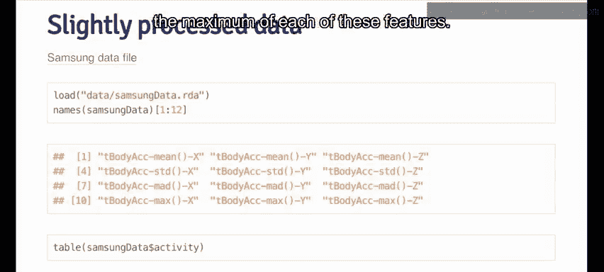

So one thing we can do really quickly is just look at the average acceleration for the first subject so the first thing I'm going to do is just convert the activity variable into a factor variable and then using the transform function and then I'm going to just subset out the first subject so subject equals one and for the rest of this presentation I'm just going to ignore the rest of the subjects for the moment and so。

If I plot the first subject， I can look the first column and that's the the first column is the body kind of the body accelerator。

 the mean body acceleration in the x direction， so acceleration is kind of divided into three dimensions x Y and z。

 and then the second plot here is going to be the body accelator the mean body acceleration in the Y direction and and I've color coded each of the。

Activities by each I'm sorry I've color coded each of the activities and so you can see， for example。

 on the left hand plot that there's green， there's red， black， blue and all for different activities。

 So part of the problem with the left hand plot is you can't tell which activity is which so on the right hand plot I added a legend using the legend function just so you can figure out kind of which activities correspond to which color And so you can see that the green is standing the red is sitting and the black is laying etc。

 And so you can see that for example。The mean body acceleration is relatively kind of uninteresting for things like standing and sitting and laying。

 but for things like walking and walking down and walking up there' much more variability in the mean body acceleration for the X direction。

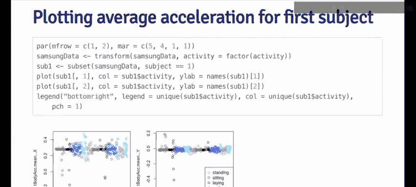

We can try to cluster the data just on the average acceleration so I've taken just the first three columns of this matrix and I calculated a distance matrix using the distance function and I'm using a Euclidean distance just as the default and I can call the H cluster function to do a hierarchical clustering of these data and I've called this myPL cluster function just to visualize it and can see that the clustering is a little bit messy and there isn't any kind of clear pattern going on all the colors to kind of jumble together at the bottom and so we might need to look a little bit further to try to kind of extract more information out of here。

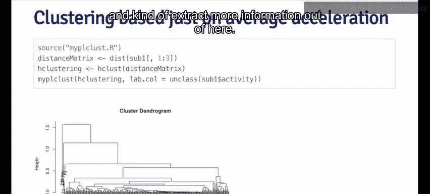

So another thing we can look at is the maximum acceleration for the first subject here。

 and so I I'm plotting here columns 10 and 11， and so you can see that column 10 is body the maximum body acceleration in the x direction and column 11 is the maximum body acceleration in the Y direction。

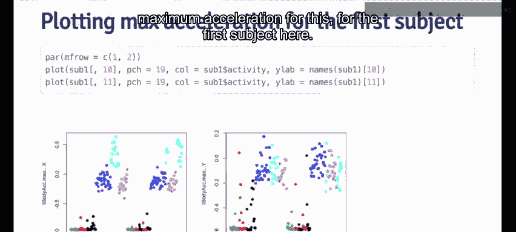

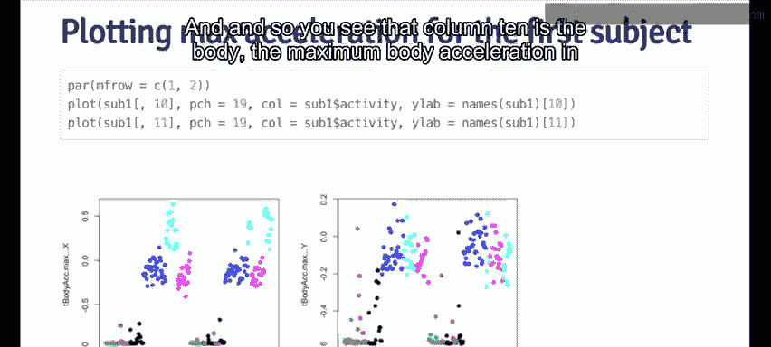

And so you can see that， again， for things like laying and standing and sitting。

 there's not a lot of interesting things going on， but for walking and walking up and walking down。

The maximum acceleration shows a lot of variability。

 so that may be a predictor of those kinds of activities。

But maybe or at least separating kind of not moving from moving。

 which might be kind of obvious in retrospect。

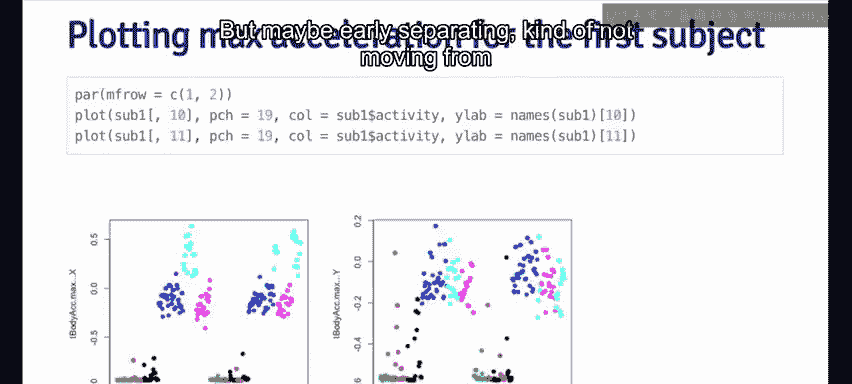

So if you cluster the data on maximum acceleration。

 you can see that there's of two very clear clusters on the left hand side。

 you've got the kind of the various walking activities and on the right hand side you've got the various non-moving activities laying standing and sitting and so but beyond that things are a little bit jumbled together。

 you can see that there's lot of turquoise on the left and so that's clearly one activity。

 but then the blue and the kind of magenta kind of mixed together。

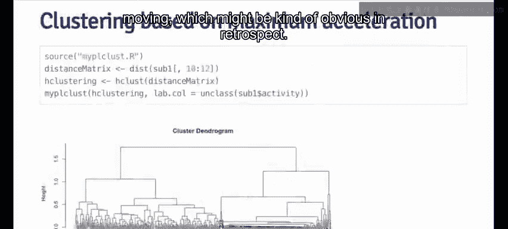

And so clustering based on maximum acceleration seems to separate out kind of moving from non moving。

 but then once you get within those clusters， like for example。

 within the moving cluster or within the non moving cluster。

 then it's a little bit hard to tell kind of what is what based just on maximum acceleration。

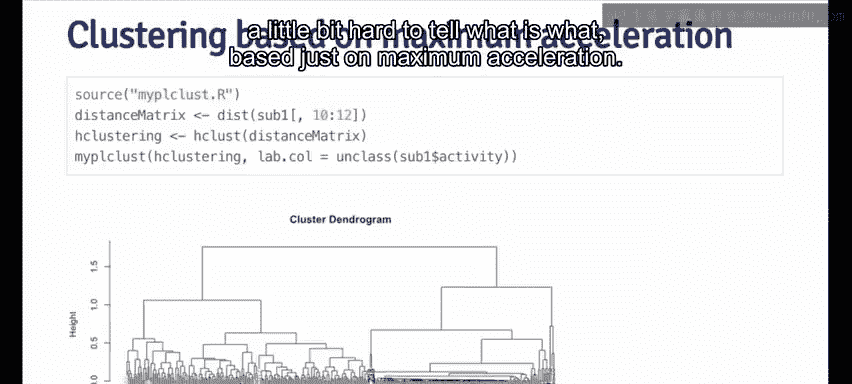

We can try a little singular value to compositionposition on this data just to explore what's going on now before I do the SVD I'm going to do it on the entire matrix which is 560 some columns but I'm going to remove the last two because the last two columns are just the activity identifier and the subject identifier which are not really interesting data so I get rid of the columns 562 and 63 and then I run the SVD on the data。

And you can see I'll take a look the first and the second left singular vectors and color code them by activity and again you can kind of see there's a similar type of pattern。

 the first singular vector really seems to separate out the moving from the non-m so you can see that there's the kind of the green red。

 black on the bottom and the blue turquoise magenta on the top and then the second singular vector is a little bit somewhat a little bit more vague what it's looking at。

 it seems to be separating out the magenta color from all the other clusters and so I think this is the walking down。

We're walkingking up one of those two， and so it's not clear what is different about that that kind of highlights that gets highlighted on the second singular vector here。

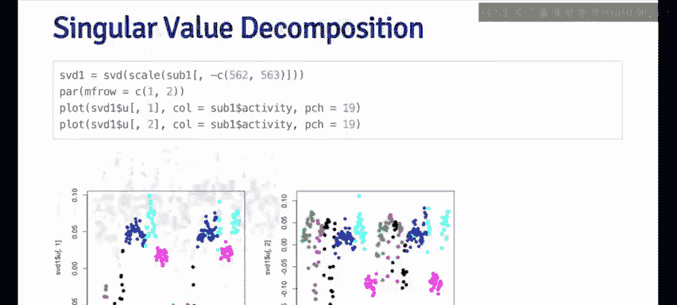

So one of the things we can try to do is try to find the maximum contributors。

 the contributor so in the second singular vector sorry in the second right singular vector we can try to figure out well。

 which of these features is kind of producing the most variation or is contributing to the most to the variation between the various the different observations and so。

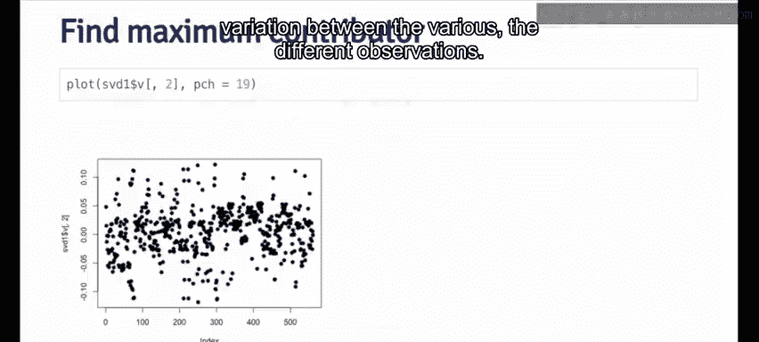

We can use the witch dot max function to figure out okay which of the 500 or so features corresponds to the kind of the largest or contributes most of the variation across observations and I'll save that to an object called max contribe and then I'll cluster based on the maximum acceleration plus this extra feature and I'llll calculate the distance matrix around the H cluster function and you can see now kind of the various activities seem to be separated out a little bit more。

 at least the three movement activities have clearly been separated。

 we've got the magenta the dark blue and the turquoise all separated out the various non-moving activities seem to be all kind of mixed together too so whatever this maximum contributor happened to be。

 it didn't really help to separate out the non-moving activities but it seemed to help a lot in terms of separating out the movement activities。

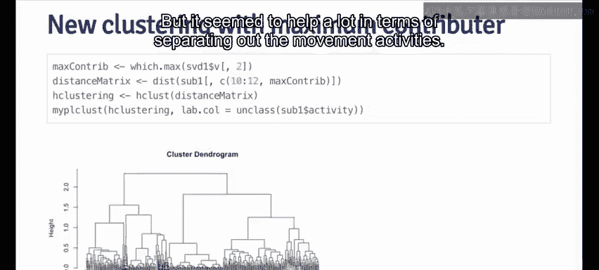

So this max contributor was the body acceleration， the mean body acceleration in the frequency domain for the Z direction。

 and so this is kind of the body acceleration for the Z direction where they apply a fast Fourier transform and they give you the kind of frequency components from that so that's kind of interesting。

We can try another clustering technique here， which is k means clustering。

 And one of the things about K means clustering that you have to be a little bit careful about is that you can get kind of different answers depending on you know how many times。

 how many starting values you've tried and and how often you run it。

 So whenever you start when you start K means， it has to choose a starting point for where the cluster centers are。

 and often it' will just most algorithms will just choose a random starting point。

 So if you choose a random starting point， you may get to a solution that's suboptimal。

 So if you choose a different starting point， you may get to even better solution。

 And so it's usually good to set the end starting argument to be more than one。

 So you can try many different starting points just you can get the optimals or a more optimal solution。

 So here is one clustering that we've done with K means and you can see that the。

I specified six centers so I know that there are six clusters so I'll just specify them right away and you can see that some of the clusters kind of jumbled together so exceed cluster 3 is a combination of laying sitting and standing whereas cluster1 is walking clearly walking cluster2 is walking down cluster4 is walking up cluster5 is just walking and again。

 and cluster 6 is a mixture of laying sitting and standing and so you can see the K means here had a little had trouble separating out also the laying sitting and standing from the three in the clusters。

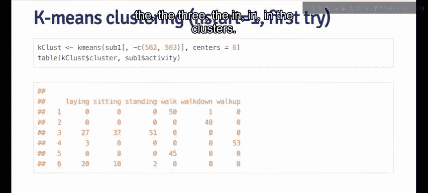

If we tried again， you can see the arrangement's a little bit different， but again。

 cluster2 for example， is a mixture of laying， sitting and standing， cluster5。

 similarly a mixture of sitting and standing， but the other the other activities seem to cluster out very easily。

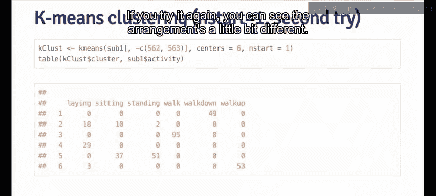

So now if we tried 100 different starting values and take the optimal solution from these hundred0。

You see that things seem to separate out a little bit better and not much better than last time you can see cluster 1 is a mixture again of laying sitting and standing。

 cluster 2 is clearly laying， cluster 3 is clearly walking and cluster 4 is walking down etca so you can see how these things kind of cluster together and we'll do a second try with 100 starting values and you can see this is going probably going to be our best effort and cluster 6 still is a mixture of three activities and cluster 5 is a mixture of two。

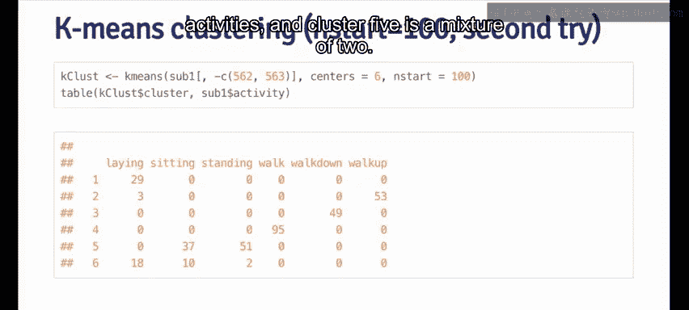

So you can see kind we can see where the kind of cluster centers are and the idea is that each of the clusters has a mean value or a center in this 500 dimensional space。

 and so we can see kind of which features of these 500 features seem to drive the location of the center for that given cluster and that will help us help give us some idea but know well what features。

Seem to be important for classifying people in that cluster or classing observations in that cluster。

So for in the first cluster here， which seems to correspond to laying。

 you can see that the center has a relatively high value for or positive values for。

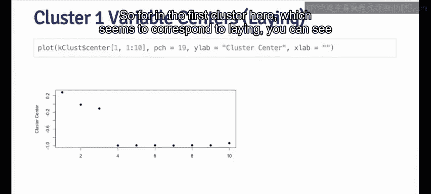

The first three features was kind of the mean body acceleration and then low values for some of the other features features4 through 10。

 I'm only plotting the first 10 here of the 500 or so。

And then you can see the second cluster here corresponds a little bit more has some more interesting values for other features so there's mean by this kind of mean acceleration there's also the kind of max acceleration which seems to have kind of some interesting values and so one of the things you can do by looking at the cluster centers is to see well what features seem to have interesting values that kind of drive the location of that center and which could give you a hint in terms of what features will be most useful for predicting that activity So this is just a short demonstration to show how you can take a large data set with lots of features and lots of observations and start to explore a little bit with various clustering techniques we use hierarchical clustering we use k means clustering and we use the singular value composition to look at various features of this data set So given what we've learned here。

 we maybe want to be interesting in following up on what separates out the various non movement activity so in terms of laying sitting and standing it seemed to have some difficult。

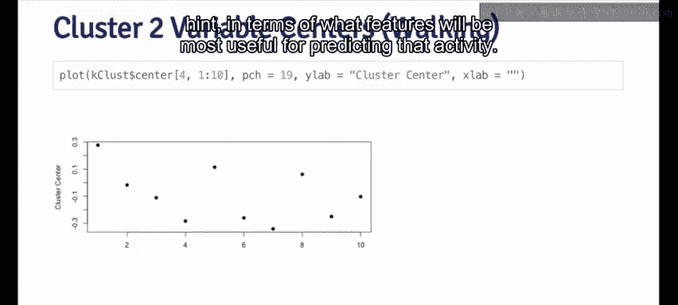

At least on the first glance， separating those three activities out。

 the movement activities in terms of walking， walking up and walking down。

 we seem to be able to kind of separate those out into separate clusters using just a few variables。

 mostly the max acceleration variables。 But the non-movement kind of activity seem to be harder to separate out。

 So the nice thing about the exploratory data analysis is that it gives you this rough cut that tells you kind of where to spend your energy。

 So we probably don't may not have to spend too much energy on the movement activities。

 but maybe you need to spend dig a little bit deeper looking at the kind of nonmovement activities。

 So I hope this you find this useful in terms of how to get started using clustering your techniques and how to take a look at the data to kind of further your analysis in。

😊，So to kind of get you going for a more formal analysis。

