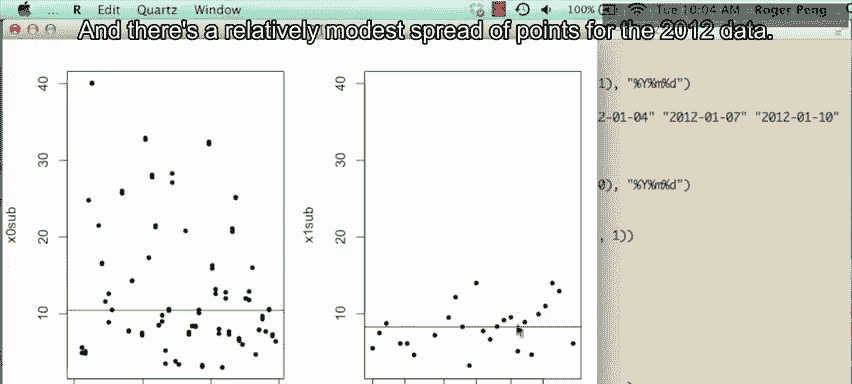
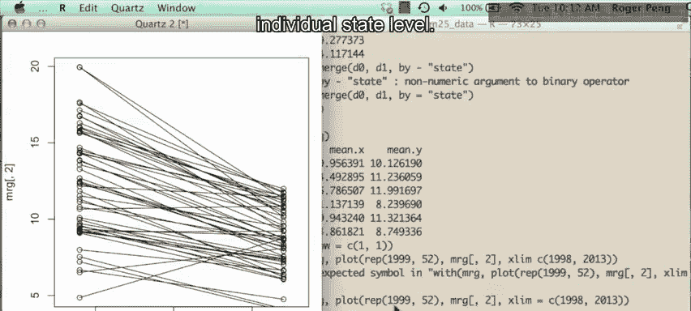

# 约翰霍普金斯大学数据科学课程4：《探索性数据分析》｜exploratory-data-analysis｜ - P36：35_空气污染案例研究.zh_en - GPT中英字幕课程资源 - BV1U94y1s7th

In this video I just want to talk about an example exploratory analysis just to show kind of the tools that you might want to use when you're just starting out looking at data so a lot of these things are basic know things that we've covered like know one dimensional plots。

 two dimensional plots， basic summaries， exploratory plots just to get a sense of what the data look like and what you might be able to do with them。

Now the first thing of course， anytime you start to look at data is as you have to have a kind of a basic idea in mind of what you're looking for this can come in the form of a hypothesis or even more generally just has a basic question what are you trying to answer with this data So the data that I'm going to use right now for this example comes from the US environmental Pro Agency and it involves air pollution monitoring data from the United States in particular we're looking at fine particulate matter air pollution that's in the air so particulate matter is's just a fancy word for dust so this is just dust that's in the air and it's of concern because we inhale air all the time and along with the air we inhale the dust and it may have certain health effects on populations So one of the important pieces of legislation in the last four decades in the United States has been the clean Air Act and the Clean Air Act has been designed to reduce the levels of air。

PoIn the United States and so one of the questions that you might want to ask when it comes to these kinds of data is are air pollution levels lower now than they were before right so it's a very basic question it's fairly general can we can look at it in a variety of different ways and so we're going to look at it in a very specific way we're going to look at。

A fine particle air pollution and so this fine particle air pollution that was started being measured in 1999 and iss currently being measured today so what we're going to do is we're going to look at data from 1999 and look at the fairly recent data from 2012 I we want to answer the very basic question are the levels on average lower in 2012 than they were in 1999 and so。

The nice thing about air pollution data in the United States is that the EPA collects all this data and makes it essentially all available on their website so it's freely available。

 I'll put the URL up on the website and you can download as much or as little as you want So what I've done is I've gone to the EPA website and I've just literally downloaded the zip files for 1999 and 2012 for fine particulate matter data is sometimes called PM2。

5 right so let'lls take a look at just the basic data files that you get。

So in this directory here， I've got。The the two files for 1999 and 2012。 Now。

 I should say that the original files are zip files and each of the zip files come with two things。

 One is a text file with this dot TXD extension and another is a Pf file。

 which contains some documentation。 So this is just La raw file that I download it from the EPA website。

 I haven't done anything to it。 So let's just take a look at a couple lines。

 So they'll say the 1999 file。 All so I'm gonna take a look at this。

And so one thing you can see is there's a little bit messy here。

 but one thing that's you can see if I just pull this out a little bit。

Is that there's basically one record per line in this file The first record here is kind of a header and it tells you the names basically gives you the names of the different columns。

 each column is separated by a kind of vertical line here so that's nice to see you can see that every record here begins with RD All right so these are called that indicates kind of the type of record and that corresponds to the heading in the Rd here heading over here There's another type of headings here that corresponds to RC records which are these guys over here。

 and if there were any RC records in this file， then they would have those that heading I don't believe that there are any R records in this file。

 but we can just double check that by using a quick rep so let's take a look at if any records but start with RC。

And nope offer for that one， and take a look at 2012。

None for that so these are all RD records and so we can we can use the RD headers to indicate when one of the various columns okay and so a lot of these columns are not going to be particularly important to us。

 but one of some of the things we're going to want to know are for example。

 to what state and the monitor the record comes from the county。

 the site ID indicates the kind of monitor within that county。

And then most importantly is a sample value。 So that tells us you know what the level。

 that's the actual kind of mass of PMm2。5 in micrograms per meter cubed。

 So that's going to be very important And because we want to see if those levels have gone down over the between 1999 and 2012 and the date of collection may also be important too。

'll see we'll take a look a little bit at that later。

 Now there are a number of other things here there indicate certain records may have problems。

 but we're going to not worry about those at the moment。

Those kinds of things may come in may be important later on in a more in depth analysis。

 So let's start up R here。OkayAnd the first thing I'm going to do is I'm going to read in the data for 1999 and so I' was going to call it PM0。

 a zero meaning kind of like the first one and you know I'll name the second one you PM1 or something。

 So I've just used a straight read table here。I'll give it the 1999 file and what first thing I'm going to do is I' I'm going to ignore the lines that start with the hash symbol and I'll figure I'll kind of pick those up later。

 I'll say header equals false and then a S equals remember it's the solid line here and then the missing values are indicated in this file which is the blank string All right so I'm going to read those in and can see。

That happens relatively quickly。 Let's take a look。

 it's always good to check to see know how many dimensions you got in the So I've got about 117000 rows。

28 columns。 Let's take a look at the first few rows here。

And you can see that I don't have the headers for the columns。 So I'll get those in a second。

 but you can see that all these are different columns。

 And remember the first column as this RD record indicator。

 And there are a lot of missing values here which are not that important right now。

 So one thing we're going want to do is kind of get the column names for each of these column so that we can we don't refer to them by V1 V2。

 So if you recall the column names come from the very first line in the file。

 So I'm going to read one line。The first line， so we can you use read lines for that。

And I'm going to give it the file name。And it's going to tell it to read one line。 Okay。

 so if I print out C names here， you can see， first of all。

 it's just a string and it hasn't been split across， you know。

 using the separator because I didn't use read dot table。 I just read the line directly。

 So the first thing I'm gonna have to do is split all the column all the names out。

So I'll can you stir split for that。I's split on the solid line and it's a fixed pattern。

 not a regular expression。 so now if I print out C names。

 you can see I get a character vector containing for each element it has the column name now St split actually returns a list back and so you're just going to want the first element of this list。

And so now I'm going to assign the column names to this table to be this this first value of this list here。

 So if I take now if I take a look at this data frame。

 you can see that there are all these all the column names are basically there。 Now。

 one of the things that you'll notice is that。These come these column names are kind of not valid because they have spaces in them for example。

 and so one thing you can do to fix that is to use the make dot names function。

And the make dot names basically takes an arbitrary string and makes and turns it into a valid name column name for a data frame so now if I take a look at the first few lines here。

 you can see that it's replaced the spaces with dots so now all of these are kind of valid column names for a data frame so they'll be easier to reference in future kind of modeling or analysis functions。

So the first thing I'm going to want to do is take out the PM2。

5 variable so that's remember that's the sample value column right here and you can see the first three values here are missing。

 but then we've got 8。841， 14。9 etcter， and those are in units of micrograms per meter cubed。

So let's take a look at that columns， pull it out，ll call it x0 here。

 and I'll just pull out the sample value column。And let's see what it is first as a numeric column that's good。

 should be numeric， let's run a stir on it Okay， so we got 117421 values， it a numeric vector。

 let's do a little summary。You get a five number summary of this data。

 so you can see the median is a 11。5 micrograms per meter cubed， the maximum goes up to 157。

 which is quite a high level for a daily value。And there are also some missing values here。

 So let's see in so 13，000 missing values， let's see kind of roughly what that means in terms of the proportion。

 So we can see is that NA on this。I can see that about 11% are missing。

So we come across one interesting feature about this data set is that there are a number of missing values and so one thing you have to ask yourself is okay are missing values something that I need to worry about for the question that I'm interested in answering remember we want we want to get a sense of in general is the whole country does the whole country have lower air pollution levels in 2012 than it did in 1999 so the question is you there's an occasional missing value on a given day in a given county or monitor is that going to make a big difference in particular is having 11% of your values missing。

 going make a big difference in your analysis So that's something to think about because missing values can play a very different role depending on what kind of question you're trying to answer and so you have to you don't always although missing values can be very inconvenient a lot of the times they don't always cause a problem depending on what trying to question depending on what type of question you're trying to answer。

All right， so now we've got the 1999 data， let's read in the 2012 data here。

 so I'll take I'll call it PM1， I'll readt table it。And。And we'll do the same kind of op。Approach。

 I'll comment out this these rows， header equals false。Sap equals the solid bar。

 and then any strings。Like that， okay。So one thing you'll notice is that this is taking quite a bit longer than reading in the 1999 file。

 one of the issues is that PM2。5 monitoring only just began in 1999 so there were very few monitors at that time。

 of course over the years the monitoring has increased。And so now in 2012。

 there's a much bigger monitoring network available。

 and so there are more going to be more observations。

 So let's take a look at how many observations exactly we have here。嗯。

You see it's quite a bit more about 1。3 million records here as opposed to the 117。

000 records that we had before， so that may be a bit of a problem in and of itself。

 but we'll kind of put that to the side for now so one thing I know is that the two files have the same column names so you can see they both have 28 columns and I know that the column names are going to be the same they're both RD records so I can just give the names for this data frame to be the same as the other one soll make that names here。

Again。And you can see if I take a look at the first few rows。

All of the columns here so you can see that the dates are now 2012 and the sample values here are the PM2。

5 values so I'm going to grab the PM2。5 values from here。And take a quick check on what we have here。

That's a numeric vector， numeric vector，1。3 million elements。 So that looks good。 So now let's take。

 let's do a quick comparison of the 2012 and and the 1999 data。 So I'll do a summary on X1。

And do a summary on x0。So that's interesting， so you can see that in the 2012 data the median is about 7。

3 and in the 1999 data， the median is about 11。5， so there does appear on average to be a decrease in the levels for the whole country in PM2。

5。He does that there are quite a few missing values in the。

2012 days we can take a look at what proportion that is。嗯。And oh it only see it's only about 5%。

 So that actually as a percentage of the total there's actually fewer missing values in 2012 than there were in 1999。

 So that's interesting to know 5% missing is probably not that big of a deal。

And so let's take a look at So it's so on first glance， it appears that。

TheThe PM2 and5 levels have gone down over the years。

 And so that's good that's good news for public health。 Let's take a look。

 let' see if we can take a look at a visual representation of this data。

 So let's take a look at a box plot。 let's see box plot X 0 x1。And let me bring this up。

So it's a little hard to look at there's a lot of skew in the PM2。

5 data and so these are data are both they're right skewed and so you can see that it's kind of all smooushed down near zero。

 but then there's some very large values， one thing you'll notice is that the maximum value here is a 909 which is extremely high level。

 in fact it's so high for the United States that we might think that perhaps it's an error or maybe there's something wrong with it 909 micrograms of meter cube。

 although it's not impossible we do observe it in other parts of the world。

 we generally don't observe it in the United States unless for example。

 there's some special or strange occurrence。So maybe we we'll think about that value a little bit later because since we're not really focused on extremes right now。

 we're looking at kind of the medians。 So one way to kind of fix this box plot is to take a log of these guys。

 So let's take the log of X0。 do the base 10 log。And that will hopefully kind of evenen out the boxp a little bit。

So here you can see that the 1999 data is right here。

 so you can see the mean is about a log of equal to 1。

 which is roughly 10 micrograms per meter cube and then you can see that the black line which the median of this black spot does go down quite a bit remember this is on a log scale so even a small change is it can be a big change in the absolute scale。

 but one thing you'll notice is that the spread of the data has also increased too。

 so even though the average levels have gone down， there are more kind of extreme values in the later data。

And so that's interesting， we're not exactly sure what to make of it。

So the next thing we want to take a look at as you noticed in the summary for the 2012 data。

 there suchs negative values here， so that's a little bit strange。

One of the things about measuring PM2。5 is that we measure the mass of it kind of per unit of airflow。

 So basically the idea is that there's a filter and there's air being sucked through the filter。

 and then the particles collect on the filter and we weigh those filters to see how how many particles landed on the filter。

 And so because of the way that it's measured。 you really can't have a negative measure。

 you can't have negative mass。 And so if there's a negative value for the PM2。5 variable。

 that's a little strange。 It's a little unusual。 So let's take a look， we can take a look at that。

And see， maybe get a sense of what's going on。 So let's let's pluck out the values。

 let's take a look one more time at the summary。 let's let's pluck out the values that happen to be negative。

 So I'll create a logical vector that is true or false。

 depending on you know whether the the 2012 PMm2。5 value is below0。 So we take a stir on this。

You'll see that is its true false specter。So if I take the sum of this。Any R equals true。

You'll see that there are about 26000 values that are below  zero or negative。

 So that's a little bit strange。 let's see what the proportion this is。

 So it's about 2% of the values。 This is not a really large number of values。

 And so it maybe it's something that we don't even care about。 but it may be worth taking a look at。

 So in particular， it may be interesting to see whether there are negative values at certain times of the year。

 or maybe only the negative values occur at certain locations or times。

So let's take a look at the dates of the measurement。 So it'll pull us the dates。Column。

And if you take a look at this， first of all， you'll notice that it is an integer vector。

 so these are coded as integers by default。Which is not going to be as useful for us。

 So we want to be able to convert them into dates。 And so one thing you'll notice is that they're in the year。

 so the first four digits of the year， second is the month and the second is the day right。

 So here we've got 2012 in then January and then 28th right， so let's take a look。

 let's convert those guys to date variable。 So the as dot date and。

And it's going to be in the year month， day format。Now it's a reasonably long vector。

 so it's going to take probably a few seconds on our reasonable computer。

Now take a look at the dates vector。So you can see now it's in the date format。

 So let's take a look at just a histogram of the dates to see kind of where the collection occurs。

 we can do it by month and you see that。The most of the most of the the measurements are occurring in kind of the。

In the winter months here， So winter and spring months here。

 So let's see where the negative values tend to be。 So we'll a has on dates and negative。

So this only makes a histogram of the dates where the negative values occur。And' say month。

And you can see that the the negative values tend to occur seem to occur more often in the。

In the late and in the December， January， February types of months。

 there's a little bit of a spike here in April kind of May June type period。

 so it's interesting to see that there aren't many negative values here in the summer months here and so it's not entirely clear you know what this tells us but it may be worth investigating one issue with PMT。

5 is that in many areas of the country， it tends to be very low in the winter。

And high in the summer and so typically when pollution values are high。

 they're easier to measure and when they're low， they're harder to measure。

 so maybe that some of the negative values are just kind of a measurement error when the values tend to be very low。

 but given that it's only 2% of the data， I'm not going to spend too much time worrying about at the moment。

 it may be something that we worry about later。So one of the things that I think would be interesting to do is rather than look at the air pollution levels for the entire country and say。

 okay， well， the median for the entire country has gone down between 1999 and 2012。

 why don't we pick out one monitor and see whether we can see kind of a change or decrease in the levels just at that one location and。

And that way we can kind of control for the fact that know there's different monitors at different times Now one thing we have to do is we to find a monitor that was kind of out there in 1999 and then was also out there in 2012s because then know the network's changed quite a bit and so we're going to pick a state and then try to find a monitor in that state to see whether or not the pollution levels have gone down so I'm just going to pick New York state because that's where I'm from and let's try to take a little let's try to find a monitor there that we can where we can look at the change in the levels so。

TheFirst thing I'm going to do is I'm going to subset the PM data to look at the all of the kind of monitors in in New York State。

 So I'm going to take。So I' going take the PM0。Data frame。

 and I'm going to subset on state code equals 36， which I just happen to know is New York State because I do this a lot。

 and I'm going to pluck out the county code and the site ID columns。

And then I'm going to do the same thing for the 2012 data set here。Okay。

So and then what I'm going to do is I'm going to so if you take a look at site zero。

 you can see it's a two column data frame and it just has the county code and the site ID。

What I'm going to do is create a special kind of variable that's basically。

 that's just the county code and the site I pasteed together， right。

 and so we can literally use the paste function to do that。

 So I'm going to kind of replace this guy with paste。😊，And I'll take the first home。

And the second column。And separate it with a period。

And then I'm going to do the same thing for the 2012 data。So now if you take a look at site zero。

 it's a character vector， you can see either that it's the kind of county dot and then the site ID。

 if you look at this， it's kind of the same thing， right？

So one thing you'll notice is that the 2012 vector it only has 18 elements so there are only 18 counties and site ID combinations whereas the 1999 data had 33 of those combinations so the only thing so basically what we want to do is we want to see well where what is the intersection between these two guys so which county slash monitor ID numbers exist in both sets we can just use the interect functions for that。

And I'll assign it to an object called both。 So these are the monitors that are in both the 1999 and 2012 data sets。

 So if we print this out， you can see that there are。There are 10 monitors。

 a 10 county slash monitors that are in both data sets， so that's good。

 at least that there are a few that we can look at across the time period。嗯。Now。

 one of one of the things that would be useful is if we chose the monitor that is first of all。

 in both time periods， but also had a lot of observations that we could look at。

 So let's take a look at how many observations are in each of these monitors and in each of these time periods Okay so so the first thing we want to do is we want to count we want to figure out how many observations are available at each monitor。

 So I'm going create a new variable called county site。Which is just。TheWhat we just created。

 so it's the county code。Pasted with the site I。But I'm putting this in the original data frame here。

 and I'm going to do it for the 2012 also。And then what I want to do is I want to subset this data frame。

To be just New York State， right， So I'm going to subset PM 0 to be state code。36。

And county site is also is one of these special monitors， which is in both。In both data sets。

 all right， do that for this guy here。And now what I'm going to say if you take a look at this。

It's the same data frame， but it's only the rows that are in New York City so you can see that the state code here now is 36 right。

So what I want to do is I want to split this data frame by the kind of monitor。

 So I want to split it into separate data frames by each monitor and then count how many observations there are in each of them。

 So I'm going to do a split。This data frame by the this county site variable。

Right and now actually that was not particularly useful because just spit out a whole list of data frames that I don't really know what happened there。

 So what I want to do is I an s apply over all these data frames and count the number of rows that there are Okay。

 so that gives me the number of observations that are in each of these data frames so you can see that。

 for example， county1 site 12 had 61 observations and county1， site 5 had 122。

So now I want to do the same thing for the later period。Excuse me。To change this to。

And you can see now that for there are County  one。

 site 12 only had 31 observations in 2012 rather than  61 in the 1999 data set。

So I think that the county that I'm going to the county slash monitor that I'm going to pick here is going to be county 63 and monitor 22008。

 So let's take a look at those guys and see what we can look at in terms of PM trends。

 So I'm going to call a new data frame called PM1 sub。I'll subset it， PM1。County code is 63。

And the site ID is 2008。And they're going to do the same thing for the 1999 data。

I know that they're both there， I look at PM1。I know there's 30 observations。And for PM0 sub。

There should be 122， there you go。So the thing we're going to do now is we're going to take each of these data frames。

 we're going to plot the data， the PM2。5 data as a function of time。

 so it's going to be like a little time series here and on the X axis is going to be the date and on the Y axis is going to be the level PM2。

5 and we just want to get to visualize whether or not we can see that the levels of PM 2。

5 have gone down over this kind of 13 year period at this particular monitor so we're going to make some plots to do that。

So the first thing we need to do is to get the dates out so we can plot the data as a function of date。

 so dates I'll create a dates vector here from this PM sub data frame。And。Get the PM2。5 data out。

And so if I make a plot of the dates， you can see。Well。

 first thing you'll notice is that the dates are not coded properly， they're integers here。

 and so we need to convert them into dates， so I'm going to do that right now。

And they're in year month day format。So now if I make this plot again。Well， first of all。

 you can take a look at the new variable。if I make this plot， so it's in date four that now。

And you can see now the plot makes more sense。 The X axis is coded appropriately。

 And you can see that the the data are kind of bouncing around all over the place somewhere between 4 and 14 microgram per meter cube。

 So this is the 2012 data。 So let's do the same thing for 2000 for 1999。

We'll convert these guys to date format since we know we have to do that。

And let's make a little plot here。Oops， I didn't get the PM。5 data。Alright。

 so let's make a plot of the 1999 data。So you can see that again。

 first of all you'll notice that the data are only actually recorded starting in July through the end of the year。

 so only about a half of the year of the data is collected there and you can see that they range from roughly say5 micrograms per meter cube to about 40 so of course it's a little hard to look at the plot separately so why don't we make a plot that kind of puts both 1999 and 2012 in the same panel。

So， so we need to use par for that。 and we'll say MF row is 1，2。 So this says one row， two columns。

And I'm going to adjust the margins a little bit to create more space。So first。

 I'll plot the 1999 data on the left hand side here。I'll change the plotting character for fun。

Alright， and then I'll plot the I'm going to put a little line here at the median。For that year。Okay。

 so that gives me the median about maybe a 10。 so micrograms of meter cubed。

 Now let's plot the 2012 data。And we'll pop the median。right so that's well。

 it's a little bit unusual。 Looks like the values are going up between the two years。 But actually。

 so it's a little bit misleading because you'll notice that the y axis for the 2012 data is totally different from the y axis for the 1999 data。

 And so even though it looks like it's going up between the two time periods it probably actually is going you look at the median here。

 It's a little over 10。 and the median here is a little bit is quite a bit under 10 actually。

 And so this picture is by itself is a little bit misleading。

 So we need what we need to do is we need to put the two plots on the same range。

 So let's do that by calculating the range of the data set。With the with the range function， right。

 so let's take a look at the range of x0 sub。And next one sub together。

And we'll remove the missing values。 and can see that。It's between 3 and 40 microgram me cube。

 So let's assign that to this to a variable called R N G。

 And now we need to remake the plots to be to kind of fix the range here。 So I'll set par。

Just in case I don't need to do this actually， well as to plot the dates。And PC equals 20。

 But now I'm going to set y n to be equal to this range， okay。And the A B line， H equals median。

All right， and then I'm going to do the same thing， but for the 2012 data。And remember， I'm gonna。

 I'm gonna keep the range here to be the same。And I'll set the。Little horizontal line here。

And now you can see it makes more sense， right， so you can see that the horizontal line。

 the median is going down between the two years at this monitor and more interestingly， actually。

 for me， is the fact that you can see there's a huge spread。

Of points here in the 1999 data and as a relatively modest spread。

Of points for the 2012 data。 So so what this means actually is quite interesting is that not only are the average levels going down。

 but these extreme values are also coming down across the years， too。

 So not so so on average we're kind of breathing in lower levels of pollution。

 but we don't get these huge spikes on a daily basis like we used to get in 1999。

 So those two kind of facts are quite interesting because they kind of address two different types of problems。

 One is more of a chronic problem of having kind of just on average， very higher pollution levels。

 and one is more of an acute problem where you get these really big spikes that can cause different types of health problems。

 And so we've reduced the average levels and the spikes at this monitor。 So that's quite interesting。

So one thing I think so the last thing I think I want to look at is say。

 okay well let's not look at the whole country but also it's not that useful perhaps look at just one monitor and so why don't we look at individual states in the country so we'll look at the different states to see how the individual states have improved or not across the years and one of the reasons why this is important is because the states are actually where a lot of the implementation of the regulations occur so when the EPA sets the national guidelines for air pollution levels it's up to the state to figure out how it's going to kind of come into compliance with those guidelines and so it' be useful to kind develop a summary at the state level to kind of see what's going on at this kind of very important level and furthermore the state is is somewhere in between the whole country and individual monitor so what I want to do is I want to create a plot that has kind of the value the state averages for 1999 and then the state averages for 2012 and I just want to connect the dots to see connect。

Each state to see whether it's going up or it's going down or maybe staying the same。

 so that's the kind of plot I want to make。So。Let's figure this out。I'll change my plot window here。

He back。So foristic rub， let's take a look， Remember the the。The data has a。

Has a column here which is the state code And so every state will have a code there。

 And so what I want to do is I want to take the sample value here。 So this is the PMm2。

5 value and then I want to basically I just want to take the average value by state so this is the kind of thing that's going to require the T apply function where the T apply member it takes the mean of a vector within subgroups determined by another vector right and so this is the perfect job for T apply。

 So what I'm going to do is I'm going to take I'm going to create a vector I'll call mean zero so this is the mean of the 1999 data。

And I'm going to base it on the PM2。 PMm0 data frame， and I'm going to T apply the sample value。

Based on state within subsets of the state code。And I want to use the mean function。

And I'm going to get rid of missing values here， okay？So if I take a look at this guy now。

 you can see that there are 53 elements here and these are the means of the individual states， okay。

If I take a summary。You can see that they range from 4。8 microgram per meter Q to 19。96。 Okay。

 so now we need to do the same thing for the 2012 data。

 So I'll just let me just go up here and I'll just change this to a one。Same operation。

We can take a summary of this data。You can see that it ranges from about 4 to 11 so and the median is definitely lower。

 the median in 1999 it was 12 and this is the state average。

 this is kind of the median of all the states and the median of all the states in 2012 was 8。7。

So now I want to create a data frame for each of these guys that has the kind of the name of the state or the ID of the state and their kind of average PM2。

5 so I'm going to create a data frame called D0。With a variable called state。

 it's going to be equal to the names of this guy。And then mean is the value。

 And then I'm to do the same thing for the later data。So you can look at D0。

 you can see that there's the state and then the mean， there's the D1。

 it's also the state and the mean now I just want to merge these guys together so I can use the merge function on D0 D1 and I'm going to merge it on the state name。

Its typo there。So if you look at the merged values。There are either are 52 rows。

And if you look at the merge now you can see that the mean mean x so this corresponds to the 1999 value and this corresponds to the 2012 value。

 So now I've got a data frame which is which has the state code has one row per state and then each row there's the kind of the state average for 1999 and the state average for 2012 So just basically what I want to do is create a plot that plots those state averages and then connects them with a line so that's the last thing I're going to do here。

So I'm going to reset my par to be to just one plot here instead of a panel plot。

And then with this merged data frame， I'm going to plot， I know that there are 52 values。

 so I'm just going to plot the 1999。Values。嗯。In one column。That's， that's end And the。Right。

And I want to set the X limb here because I want to make room because I know I'm going to plot the 2012 values later。

 So I want to set the X limb to say let's be。And then。Like that。And。All right。

 so you can see I've got my 1999 values right here。And then I'm going to do the same thing。

 but instead of plotting， I'm going to use points。To add the points for 2012。

And this is the third column of the data frame。And I don't need this excellent in here because I'm using points。

嗯。And if I bring the plot over here， you can see that I've got my plot so you can see that the data has kind of gone down quite a bit。

 we saw this already in the individual monitor data。

 so all we need to do now is kind of connect the dots here and so we can use the segments function for that。

And so we give the X coordinates， the Y coordinates， and then the second set of x coordinates。

 which will be 2012。And Eric， now we can see， okay， so this is quite interesting。

Now we can see that most of the states have gone down can see this line here has gone down these lines here some states have gone up and but the vast majority of these states appear to be going down the one thing you'll notice is that there appear to be some lines kind of going off the chart here that's because I didn't set the Y limb to be equal to the full range of the data so we could have fixed that but I won't bother with it right now we can fix it later but now we can see that each of the states kind how they progressed over the many years here。

 so some states kind of have barely really moved at also this state right here has barely really moved at all and the lines kind of connecting the dots help us see what the trends are at the individual state level。

right so that' basically that's kind of a first exploratory analysis of some air pollution data in the United States if you were just to summarize the basic question we were trying to answer was you know have particulate matter levels decrease between 1999 and 2012 and we looked at it for the whole country between 1999 and 2012 we looked at it for an individual monitor between those two time periods and we looked at it for individual states and so through a combination of kind of summaries。

 five number summaries， box plots， a scatter plots。

 things like that we can get a very nice look at the data and get a sense of kind of what kinds of questions we can continue to ask and what kinds of things we should follow up on and so that's just that's a kind of a simple case study of how to do exploratory analysis and I hope you find it helpful。

