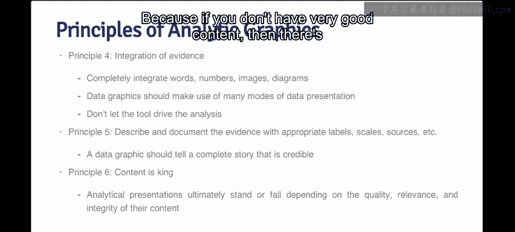
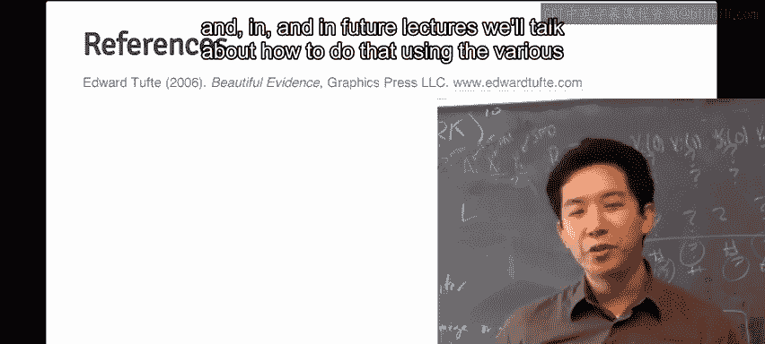

# 约翰霍普金斯大学数据科学课程4：《探索性数据分析》｜exploratory-data-analysis｜ - P7：6_分析图形原理.zh_en - GPT中英字幕课程资源 - BV1U94y1s7th

This lecture is going to be about some basic principles for building analytic graphics。

 The basic goal is to provide some general rules that one can follow when we're building analytic graphics from data and we're trying to tell a story about what's happening in the data I find these rules to be quite useful when thinking through building data graphics and they apply in many different situations So I've kind of cribbed these rules from a book by Edward Tufty and I'll give the reference at the end of the lecture this is from his book beautiful evidence where he kind of goes through a number of principles and so I'm going to talk through some of these ideas and kind of show them in context so the first principle that Tuy talks about is to show comparisons and this is a very basic idea in all of science and the basic idea is that evidence for a hypothesis or an idea about the world is always going to be relative to another hypothesis so evidence is always relative and so if you're comparing hypothesis A there has to be some。

Alternative hypothesis that you're going to compare it to and so whenever you hear a statement or hear a summary of evidence based on data you should always be asking the question compared to what right so here's a quick example。

 the basic idea is that we have a box plot which looks at the effect of an air cleaner on the asthma symptoms of children who certain in a set of homes so the idea is that an air cleaner was introduced into a child's home to reduce kind of indoor air pollution levels and we want to see if their asthma symptoms are improving so the outcome is it's what's called symptomfr day so a higher number is better and here we can see that the group of children that got the air cleaner in their home had an increase in their symptom three days about on the median increase was about one symptomfr day over two weeks。

So that's a positive outcome and we might be inclined to think that of course that the air cleaner works。

 but of course the real question is compared to what right so what do we compare the air cleaner to and so what we compare them to in this case is nothing or a control setting where the control set of houses are have no air cleaner and just kind of live their daily lives so this is a randomized controlled trial that looked at installing an air cleaner in a child's home and installing nothing in the child's home and you can see now that in the control homes the average change in the symptom free days was about zero so there's really no change and then the average change in the air cleaner homes is about one symptom free day per two weeks and so now you can say okay well relative to doing nothing the air cleaner is actually a little bit better showing an improvement in the child's symptoms So it's always important to show a comparison in a plot so that you can so you can have a basis to compare what you're showing so you can compare the evidence between。

two different hypotheses the second basic principle is to show causality or mechanism or to make an explanation and to kind of show what's going on。

 show some systematic structure so I mean the use of the word causality here is not supposed to be formal but rather it's just to show kind of what you believe how you believe the world works right so you need to be able to show how you believe the system is kind of operating so to speak and so so what's the causal framework。

For thinking about the question that you're kind of interested in。

 and so if I might extend the example from the previous slide。

 previously we saw that if you install an air cleaner in a child's home that on average。

 they're going to experience a one symptom three day increase。

 so a better outcome in their asthma symptoms。Now we might ask。

 okay well why does that occur why is it that installing an air cleaner in a child's home improves their symptoms Well of course we hypothesize that the air cleaner is cleaning the air。

 it's removing particulate matter from the air and so this particulate matter that's not it's being removed is no longer going in the child's lungs and no longer triggering their asthma symptoms so that's kind of how we believe things work and so we can show a plot that might corroborate that evidence and so we can show another plot which has the symptom three days on the left-hand side and then the particulate matter on the right- hand side righthand side so now we can see what was the effect of the air cleaner on the particulate matter levels inside the child's home and you can see that for the control group there was basically no change in the particulate matter levels。

 maybe even the slight increase in the levels but there was a pretty substantial decrease in particulate matter levels for the group of homes that got the air cleaner so now we can see that not only did a child's symptomfr days increase when they got the air cleaner。

That their but their indoor particulate matter levels decreased also when they got the air cleaner on average。

 so we can think about you know what is the explanation for you know why the air cleaner seems to improve symptoms in children can and we can show using the data that we observe that it does seem to decrease their particulate matter levels now of course to really confirm that this hypothesis that the air cleaner operates through by reducing PM we'd have to do a lot a little bit more investigation and perhaps more experimentation。

 but this graphic kind of suggest a possible explanation。

The third principle that that Tuftty talks about is to show multivariate data and the basic this rule can be boiled down to show as much data on a single plot as you can and the reason is because data are the world is inherently multivariate。

 there's lots of things going on all the time and and if you just plot two variables or maybe even three variables。

 it's not going to show the real picture of what's happening in the world。

 so if you can if you can integrate， if you can put a lot of data on a plot。

 then you'll be able to tell a much richer story So here's an example of。

A plot which is another air pollution example。 but now this is this data comes from outdoor air pollution。

 So on the X axis we have particulate matter less than 10 microns in aerodynamic diameter。

 the concentrations of those from day to day。 So every circle on this plot represents a daily concentration and on the Y axis we have the daily mortality in New York City this is for the time period in 1987 to 2000。

 and you can see that overall when there seems to be a slightly negative association between PMm10 levels and mortality because you can see that the regression line that I put through there is slightly downward sloping。

 So that seems interesting because one might hypothesize that higher air pollution levels and might be associated with higher mortality。

 not lower mortality So but you can look at other variables So there's not just air pollution and mortality that is kind kind that is of interest here。

 there are other variables that may be of interest and may kind of be part of the system。

We canfound this relationship。 So one of the things that we can look at is see well。

 how does this relationship change across different seasons。

 So if we look at particulate matter and and mortality in winter， spring， summer and fall。

 what does that look like So we can make a different plot to show that relationship and this is the plot that we can make。

 And so this plot shows the relationship between PM 10 and mortality。

 So it's the same plot as as we showed on the previous slide。

 but it's split across the different season So we see it separately for winter spring。

 summer and fall。 and we can see that in each plot。

 the relationship is actually now slightly positive So within each season。

 the relationship between PM and mortality is positive。

 But if you look overall the relationship appears to be negative。

 So this is an example of Ss paradox。 if you may have heard it。

 but the basic idea is that the season in which we look at the relationship is confounding the relationship between PM10 and mortality。

 And so when we look across when we look at the relationship with。In each season， it changes。

 so it's important to show as many variables as is' reasonable at a given time so that you can get a clear picture of the relationships in your data。

So the fourth principle is to integrate the evidence that you have and the basic idea here is that you want to use as many different modes of evidence or displaying evidence as you can and so there's no reason to say if you have a tool that makes a plot to only show a plot or if you only have the ability to make a table to only show a table you should be able to combine different modes of evidence into a single presentation to to make your graphic or whatever display that you're making as information rich as possible and so the idea is not to let the tools that you use drive the kinds of plot that you make you should make a plot that you want to make and not just let the tools do the thinking and so that's one of the nice advantages of a system like R because the tools are very flexible in R and you can make all kinds of customized plots to show the data and to kind of integrate different modes of evidence so this is just one very quick example from a published paper in the journal of the American medical Association looking at the。

between coursearse particulate matter and hospitalizations in the elderly and the basic idea is the details of this plot are not particularly important。

 but I just want to show that there are kind of point estimates here which are the solid circles and then there's confidence intervals indicated by the lines going to the confidence through the solid circles but then on the right hand side here you see this label called posterior probability that the relative risk is greater than zero and so this is a measure of the strength of the evidence that the kind of the association between coursear particulate matter and and hospitalizations is in fact different from zero and so here we integrate kind of the point estimates as dots and lines then we also have text on the right which also which shows another piece of evidence which is kind of the strength of that evidence as encoded by the posterior probability so you can use these kinds of tools to put lots of information on your plots and not have to resort to putting information in different places where they。

Maybe difficult to track down。The fifth principle is to describe and document the evidence that you present with using labels and sources and whatever in particular。

 if you're going be making a plot with a system like R。

 it's important to preserve the computer code that made the plot So the idea is that you want to lend some credibility to the evidence that you present So sources of where the data came from that's very important and how you made the plot is also important So that's a very basic principle and it's important for your credibility。

 the very last principle， of course is that content is king。

 So if you don't have an interesting story to tell then there's no amount of presentation that will make it interesting。

 So when you're making plots when you're making figures and you're making graphs。

 first think about what's the content that you're trying to present what's the story you're trying to tell what's the data that you have and then think about well what's the best way to present that how am I going to present it and what is it going to look like because if you don't have very good content then there's really not much you're going to be able to do beyond that。

So just to quickly summarize the six basic principles are first show comparisons always show something relative to something else。

 show causality or mechanism or explain at least try to explain how the system is working how the world is working at least according to your ideas The third is to show multivariate data so always try to show more than two variables because the world is complex and involves many variables Princci number four is integrate multiple modes of evidence so you can use things like tables and plots and text all together you don't have to keep them separate if you don't want to describe and document your evidence。

 always have sources and source code and to lend credibility to your plots and finally always remember that the story that you tell the data that you use are the most important elements of any graphic。

So just the P reference that I would use for this presentation is Edward Tuppty's book Beautiful Evidence and you can read about it at his website which I point you here。

 it's an excellent book I highly recommend it so these are some basic principles about building analytic graphics and then and in future lectures we'll talk about how to do that using the various plotting systems at are。

