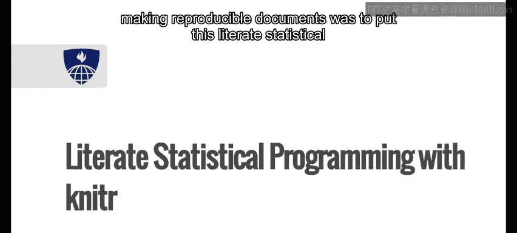
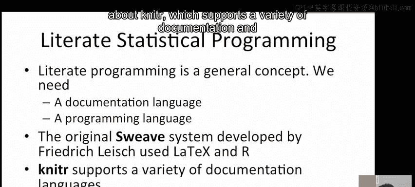
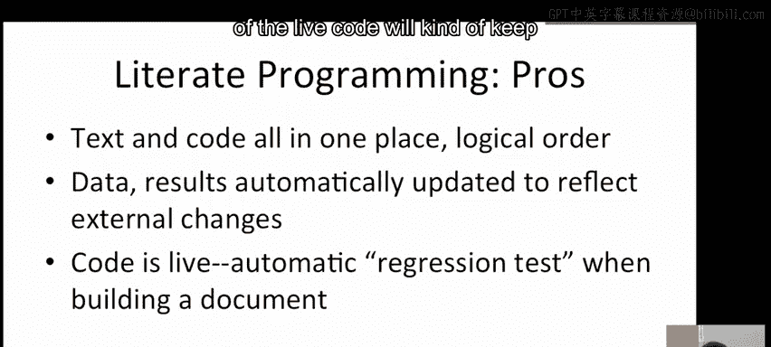
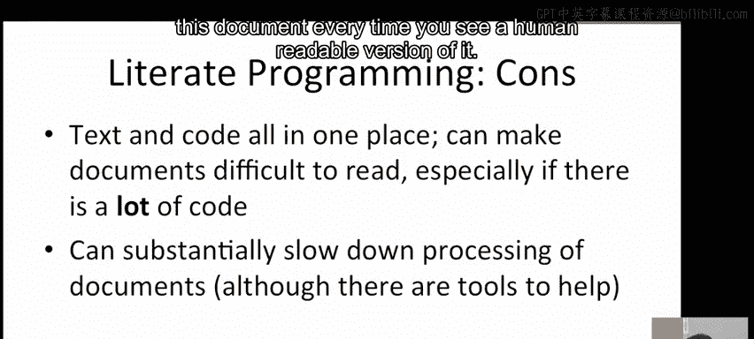

# 约翰霍普金斯大学数据科学课程5：《可重复研究》｜reproducible-research｜ - P14：13_knitr第1部分.zh_en - GPT中英字幕课程资源 - BV1E14y1k7nm

This lecture is going to be about literate statistical programming in the lecture about reproducible research I talk about the basic ideas of what it means for an analysis to be reproducible。

 but now I'm going to talk about one of the tools that you can use to actually make your analysis reproducible by others or at least to help other peoples to kind of reproduce your analysis and one of the ways that we talked about making reproducible documents with this literate statistical programming literate statistical programming concept or just literate programming and so the basic idea is that authors have to undertake a lot of effort to put data and results on the web and even when they put that stuff on the web。

they're all kind of separate， the data is over here。

 the code is over here and you kind of have to figure out well which code goes with with which data and how do you execute this code and get load this first and you do this first so there can be a lot of confusion even when everything is just available and so one of the ways that you can simplify that process is to put the data and the code together in the same document so to speak so that people can execute the code in the right order and the data are read at the right times so you can have a single document that integrates the data analysis with all the textual representations so the words that you use thatscribe was's going on and so you don't have everything kind of in separate pieces but everything is kind of linked together。

So the original idea behind a literate program comes from Don Canth。

 who was a computer scientist at Stanford。And his original system was for writing just regular computer programs and documenting the computer code at the same time as writing the code。

 so the basic idea translates over to a literate statistical program where you want to document your analysis and similarly have the code for your analysis in the same document。

 and so the idea is an article is a stream of text and code and analysis code is divided into text and code chunks。

And so the presentation code， formats of tables and formats of figures， things like that。

 there's article text that talks about what's going on and in these lit programs。

 there's two concepts you can weave them into human readable documents and you can tangangle them to Bruce machine readable documents or just code files。

So。😊，Liter programming as I said before is a general concept you need a documentation language and a programming language so the original Sweve system that I talked about before written by Fritz Lyicch used lateek as the documentation language and are as the programming language so on this lecture I'm going to talk about knitter which supports a variety of documentation and programming languages and so the first thing you want to start with so the basic question is how do I make my work reproducible and the basic answer to that is that you have to decide to do it and you can decide to do this at any point in your analysis。

 but it's usually easiest to do it at the very beginning if you decide the very end that you want to make your analysis reproducible then it's often is much harder to do and maybe even impossible and so we want to keep track of things as you go along you could use a version control system like Gi or SVN I won't talk about that here but if you heard of that then it's a good thing to learn。

It's important to use software statistical software whose operation can be coded so the idea is that you can write down the instructions that were used to manipulate or analyze the data and so this generally rules out graphical user interfaces unless those programs will code or keep track of all the clicks that you make on the graphical user interface but systems like R and other types of packages because you have to program them explicitly the code as long as you save the code kind will have everything that you will store everything that you did to the data another key lesson is to not save any output and by output I mean mostly kind of temporary data transformation types of objects if you pre-process the data and have a kind of clean dataset set rather than store the clean data it might be better just to have the kind of raw data with the pre-processing code because then not only do can you make the final product but you can see how you got there if you just keep the clean dataset and maybe you accidentally。

Lose the preprocessing code that you don't really have a good record of how you got from A to B and so try to keep rather than keeping temporary products or even final products。

 try to keep the original products and the code that got you there and that will make it easier to understand what you did and how you got to the data that you ended up analyzing so not saving output is I think a key element of reproducibility and try not to save data in non-proprietary formats so these are data formats that are not worthy where the layout of the data that is not publicly known there are not too many proprietary formats out there anymore that are I think are commonly used as like there were before but a lot of them for example。

 products will store data because it's much more efficient in a proprietary format but then that makes it difficult to transfer to another person if that person doesn't have the same exact program than they will't be able to read the data and so using nonproprietary even textual formats maybe be compressed can be much better much。

Can make your research a little bit more analysis more reproducible than proprietary formats。

So the couple of pros and cons when it comes to the literate programming style。

 this is not the only tool that you can use to make your work reproducible。

 but literate programs is one of the tools， and so some of the pros are that it forces you to put all the text and the code of your analysis in one place so it occurs in a logical order。

 all the data and the results they are automatically updated to reflect external changes so you have this live document and if you make some changes when you reprocess the document。

 it will automatically update itself to reflect any changes so you don't have a situation where numbers will be out of date or things will be mismatched。

 mismatched because the code will kind of automatically recalculate everything。

Because the code is live in the document in the sense that you have to run the code in order to produce the final document。

 that's the weaving process， you get this kind of regression test so to speak not like linear regression。

 but regression tests see so if there are any mistakes that you introduce into the analysis。

 if the code doesn't run， then you know youve made you've made an error you've introduced the problem so the running of the live code will kind of keep you from introducing new errors into the analysis。

Some of the cons when it comes to literaryerate programming are that of course the text and the code are all in one place。

 and so in particular， if you have a lot of code or if you're very complex or lengthy analysis。

 then you're kind of like a human readable text is going be mixed in with all this code and it can make it difficult to edit the document because you have to somehow search through all this whole document to figure out where the text is amongst all the code。

 so that can be a problem for the author， also if your analysis is very complicated and you have to reprocess this document every time you want to see a human readable version of it。

 it can substantially slow down the process by which you build the document。

