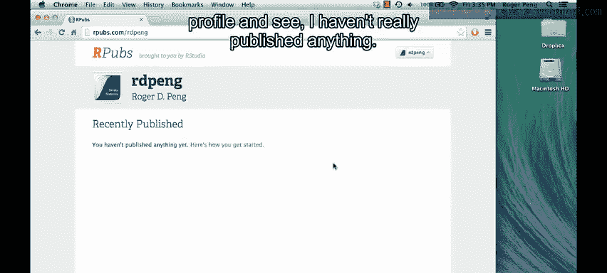
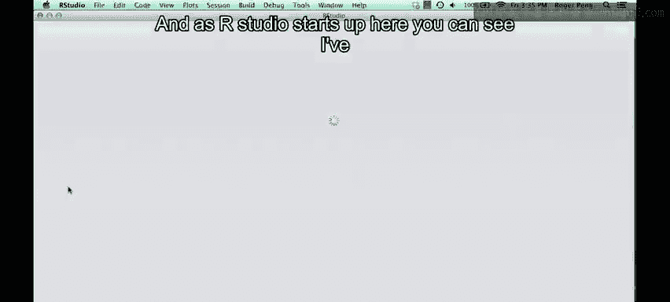
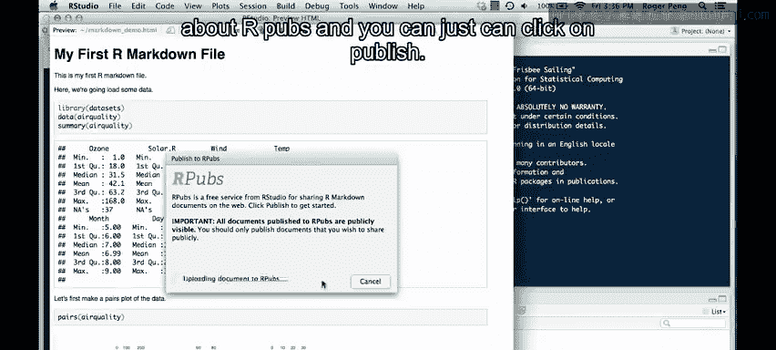
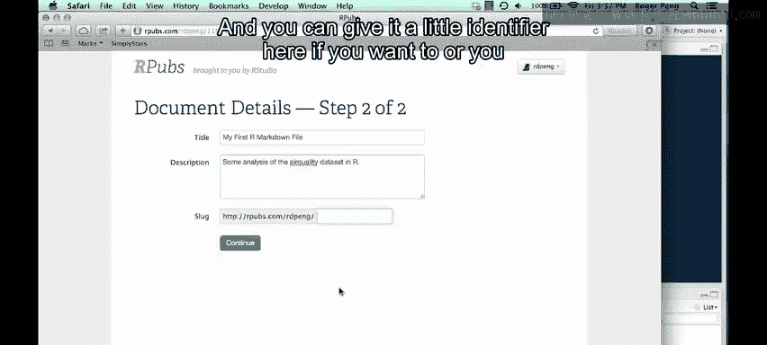
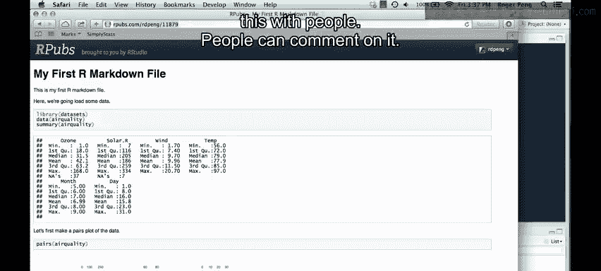
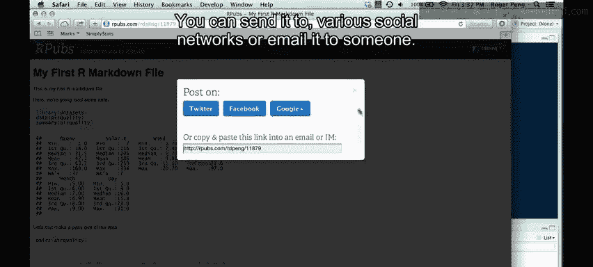
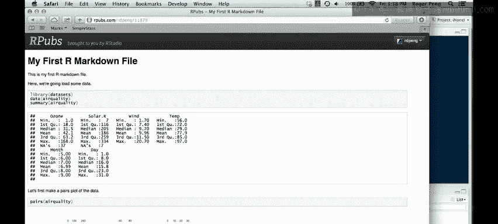

# 约翰霍普金斯大学数据科学课程5：《可重复研究》｜reproducible-research｜ - P20：19_rpubs.zh_en - GPT中英字幕课程资源 - BV1E14y1k7nm

One of the nice things about using our Markdown knitter and our studio together is a little service that our studio provides called R pubs。

 so I thought I'd bring that up just to show you kind of how it works here so we go to ourpubbs。com。

You can see that there's a website that's brought to you by our studio and you need to create an account on here so the basic idea is that once you've created an account。

 you can publish markdown or knitter documents to the website that can be used to share with other people and share with the public so the first thing you need to do is register for an accounts you can just enter your name and your email and a username and a password once you've got your account then you can start publishing things to our pubs。

I'm going to sign in here I we an account。And so and then you can go to my I can go to my account page。

 look at my profilefil and see I haven't really published anything。

 and so why don't we try to publish something here， so put this away， I'll start up our studio。

嗯。

And as I see it starts up here， you can see I've already got a markdown document here on the left as part of the demo and so maybe the first thing I'll do is I'll just I'll knit it and see what the HTML looks like and you can see here it says basically I'm loading the air quality data here making a pairs plot of the variables in the air quality dataset。

And then if you go down a little bit， I'm fitting a linear model of ozone and on wind。

 solar radiation and temperature， and then I have the results of a linear model here so nothing too special。

 but I want to be able to share this with the world so you'll notice at the top of the preview window here I can there's a publish button so I can I just click on the publish button。

You'll get a little notice about R pubs and you can just click on publishublish and if you're already signed into your account at R pubs。

 it will put it itll bring it right there if you're not here， I'll bring it Safari though and so。

You can give it a little title， I can give a description here。

So's some analysis of the air quality data set。给R。And you can give it a little identifier here if you want to or you can let you can just not do anything and just click continue you can see up here at the top that it gave it a little identifier here 11879 so this is the kind of permanent URL for this analysis and you can see it looks just like the HTML output that was shown in our studio in the preview window。

 but now it's on a website。

And can you can share this with people， people can comment on it there's a comment button here。

 you can click on the share button here， you can send it to various social networks or email it to someone So it's a really useful service。

 it's totally free the one thing that's just important to remember is that everything that you put on here is public immediately so's there's no time period in which it's private and so you need to be careful just to make sure that you don't publish anything that you didn't mean to publish Of course if you did publish something by accident you could always delete it down here at the bottom So that's our pubs。

 it's a really useful service for publishing and sharing kind of statistical analyses that are written in R markeddown and using knitter and I think it's worth a try。

