# 约翰霍普金斯大学数据科学课程5：《可重复研究》｜reproducible-research｜ - P25：24_基于证据的数据分析第2部分.zh_en - GPT中英字幕课程资源 - BV1E14y1k7nm

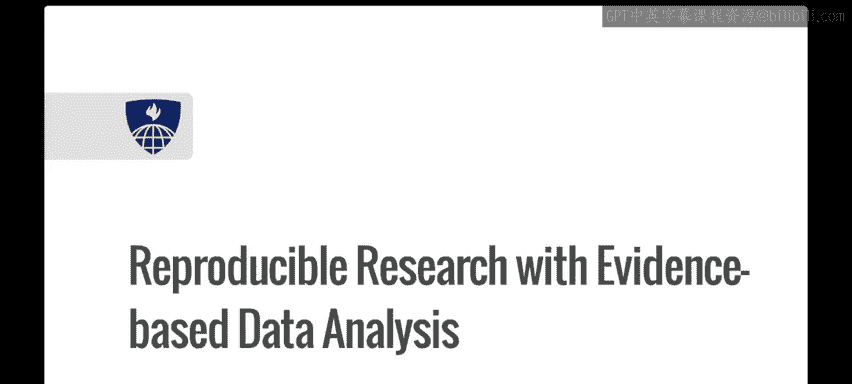

So。😊，Just to diagram out kind of the framework reproduce reasons I think about。

 typically you have some published article that you view in the journal and that's all you get。

 you get everything that's in the article， you probably have some exposure to what their scientific question was and these people went into nature and and then there's nothing right and so you have the author kind of started from here and went that way and then the reader has starts from over there and wants to go this way。

 but for the most part and most cases the reader can start with the article and then they're welcome to go back to nature。

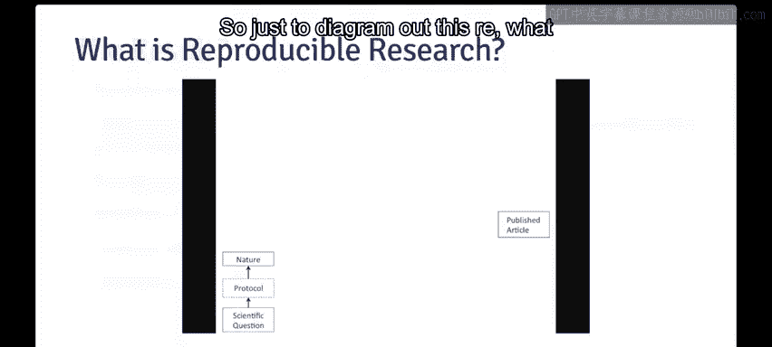

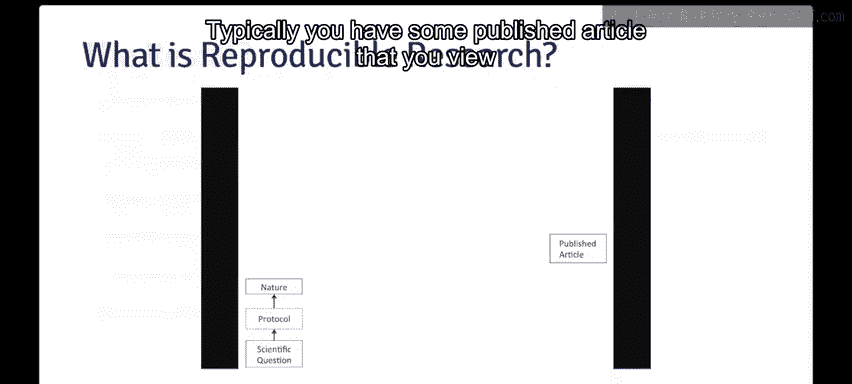

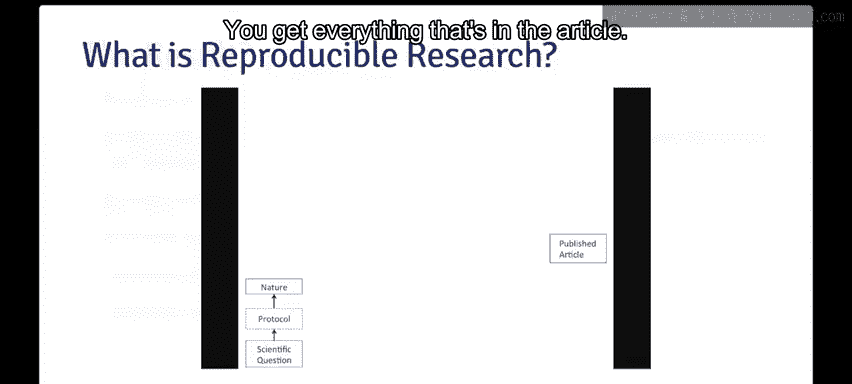

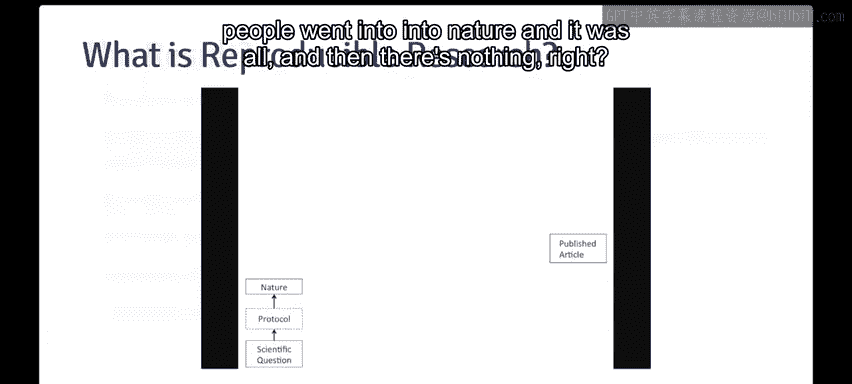

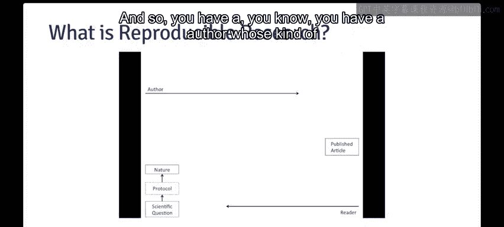

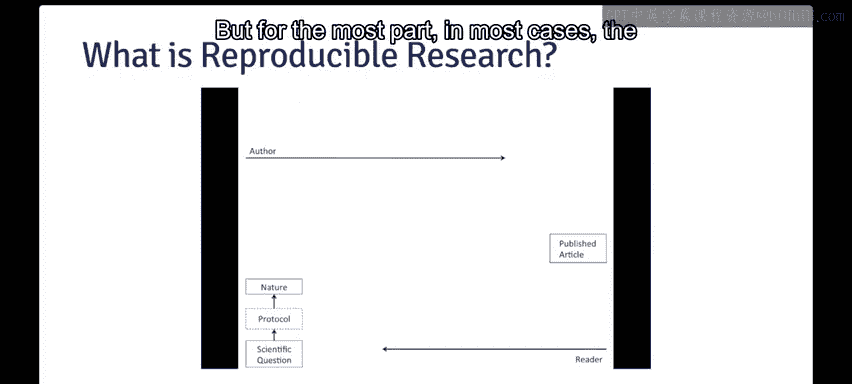

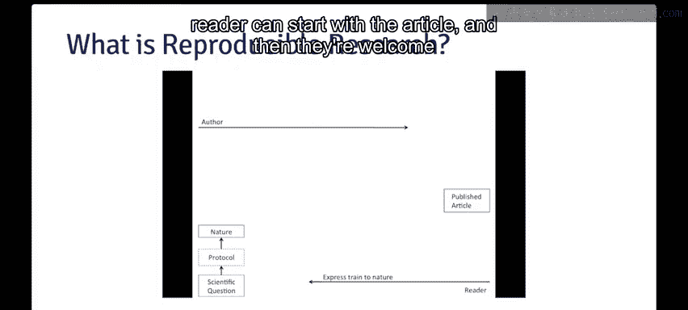

And just do it again or replicate the study if they want。

 there's really not anything else that they can do besides read the article and be impressed。

So。

That's the express trend in nature so but really of course there's all this other stuff here is you know there's this data that kind of might call the raw data and measured data there's stuff that happens that data so a specific analysis can be done there's all this code that is involved to do that there's results there's figures and tables and things like that so that all exists but it's typically not available and so the basic idea of reproducible research is to say okay well let' let's just meet in the middle over here and say well's make this stuff available is make the analytic data available maybe make some code available some of the preprocessing of it's important things like that so。

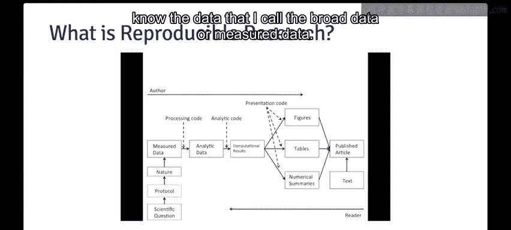

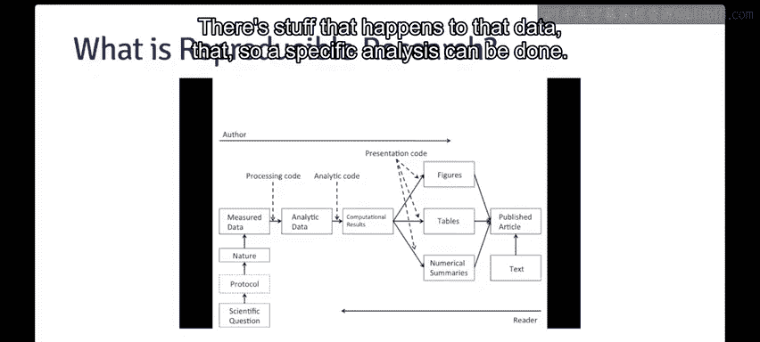

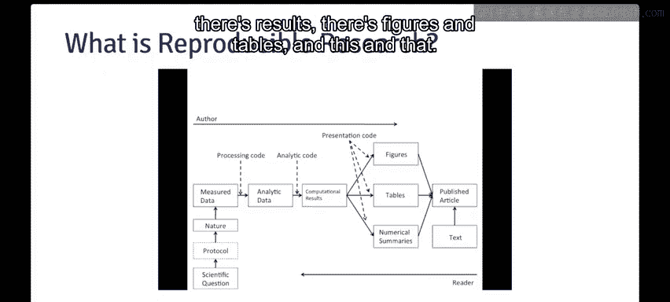

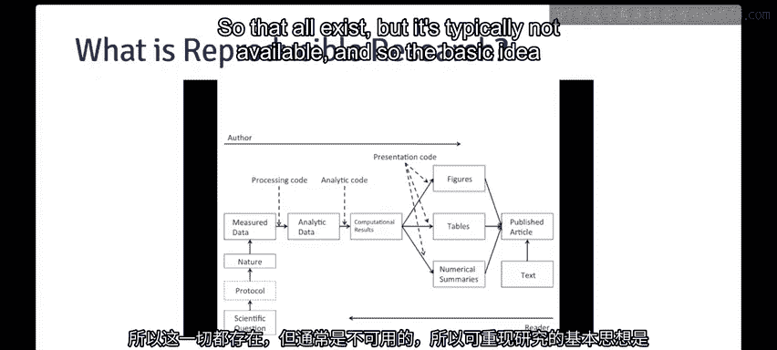

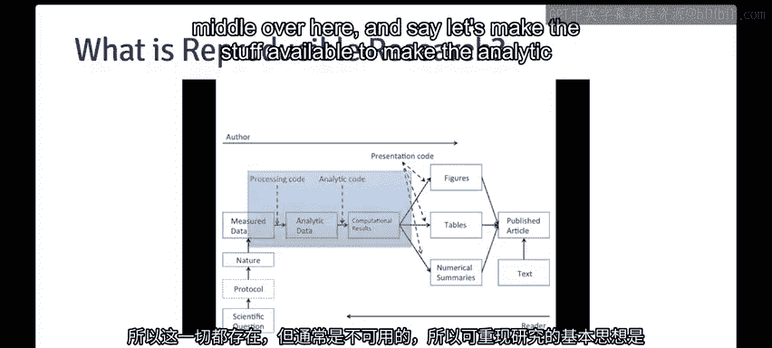

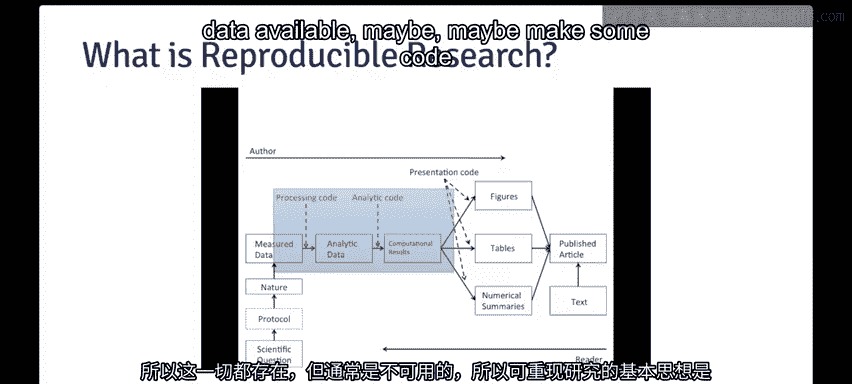

That's the kind of reproducibility compromise。Short of replicating the whole study。

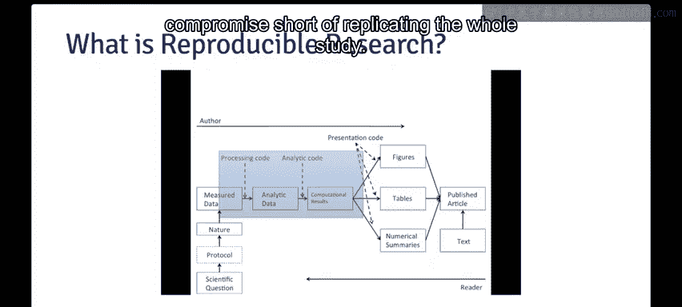

So。So I want to get a little bit to what of what problem does reproducibility solve and I think one of the things that we get from a reproducible study is we get transparency of course we have a better sense of what they've done。

 we get the data that they use so that's available if there's methods involved that are new we get their methods and we have more kind of an increased transfer of knowledge because now we know exactly what they did not what they meant to do I might we don't get any sort of sense of whether the analysis was correctly done and I think the main reasons because analysis can be reproducible and still be wrong and there are many examples of this in the literature where something was totally wrong but yet fully reproducible so just because the people use the wrong methods or they kind of treated the data the wrong way or not so I think the fundamental question of can we trust this analysis is not really addressed by reproducibility these things are all very important so I think that's fine but we still have I think a little bit of a problem over here so and one question you might legit。

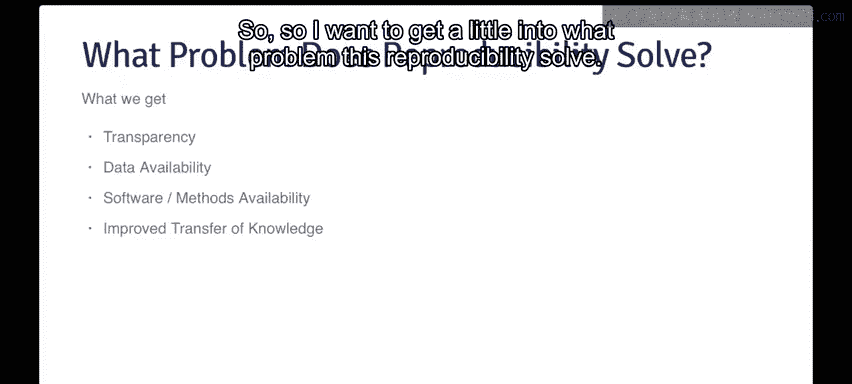

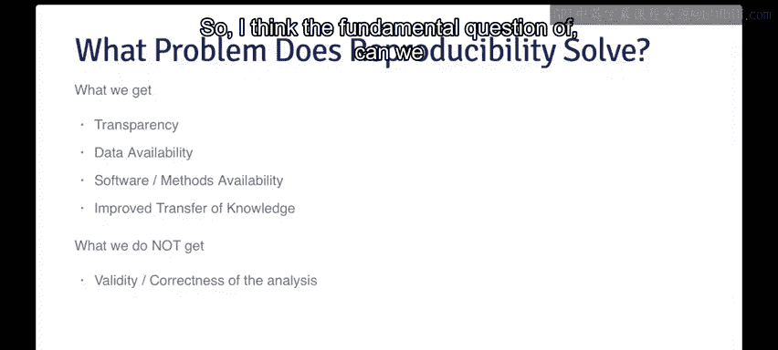

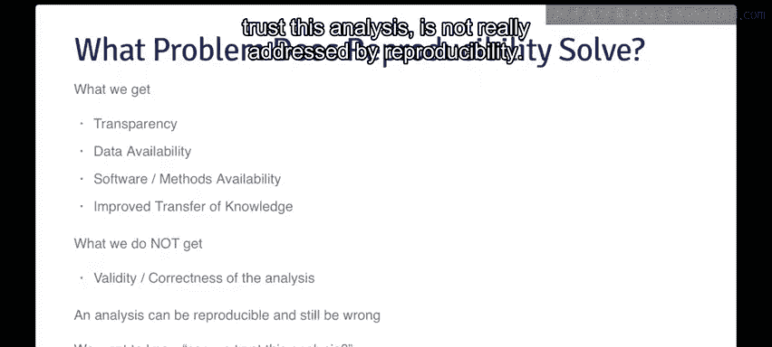

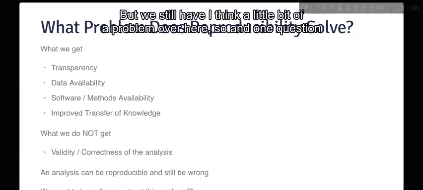

does it require you require every study， every analysis to be reproducible。

 would that somehow deter people from doing that analysis。

 and I fundamentally think the answer is no。

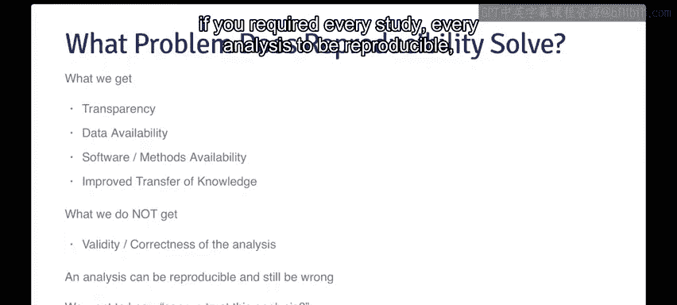

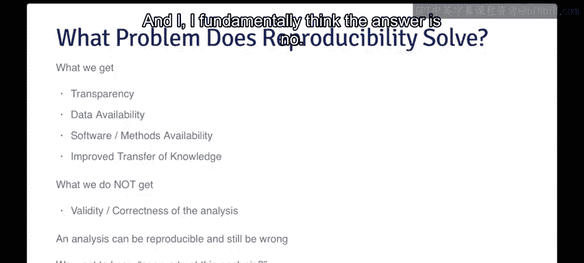

So some of the problems I have with reproducibility are so the premise of reproducible research is that with all the data and all the code available to free people can check each other。

 you can kind of validate someone else's analysis and the whole system can kind of be self-correcting in the long run So one problem which I don't say here is that the long run sometimes is too long and then in terms of the context of the problems that you're dealing with where I think reproducibility addresses what I call most the kind of downstream aspects of scientific dissemination be more specific about what I mean by that meaning that it kind of only happens post publication the most part and another key thing which is important in my error particularly in my error is that。

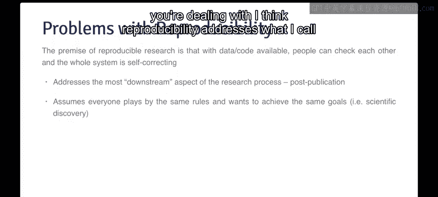

The ideas of reproducibility kind of assume that everyone plays by the same rules and everyone wants to achieve the same goals。

 which is definitely not true。

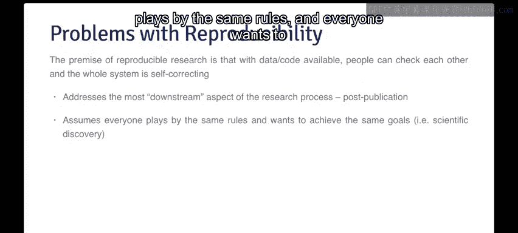