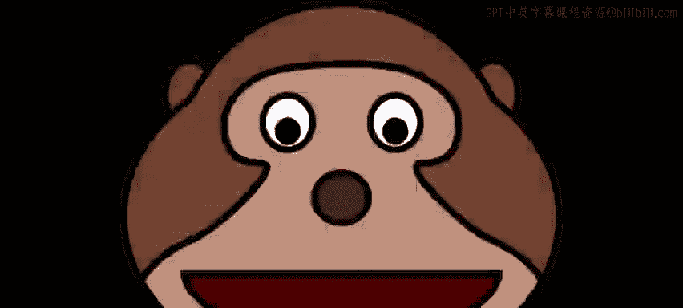

# 约翰霍普金斯大学数据科学课程5：《可重复研究》｜reproducible-research｜ - P2：1_可重复研究是关于什么的.zh_en - GPT中英字幕课程资源 - BV1E14y1k7nm

Hi everybody， welcomel to Reproducible research The purpose of this lecture is to introduce you to the idea of reproducibility and to kind of explain why I think it's really important。

 even if you don't think of yourself as a researcher or as conducting research if you analyze data at all it's critically important that you understand the ideas of reproducibility and the problems that it introduces so I want to get that across to everybody right off the bat so you can kind of understand it and see why it's so important Now in case you're not familiar with the idea already。

 I thought I'd introduce some of the issues that are raised by reproducibility by drawing an analogy from another area and that's music so before we go on any further。

 just take a quick listen to this excerpt that I'll play for you。🎼Code monkey， get up， Get coffee。

 Code monkey， go to job。 Code monkey have boring meeting with boring manager Rob Rob say cold monkey。

 very diligent， foot is out st。

His code not functional or elegant， What do code monkey think Code Mon think maybe manager wantan to write godd damnam log in page。

🎼不 notなて。I quote on not crazy。🎼want你来。🎼我等你来。🎼たぶな。🎼你 very幸福美。😊，The big born fuzzy secret art。🎼まけ。🎼ま来。

Okay， so that was a song called Codemonkey。 It was written and performed by Jonathan Colton and I just played you the first minute or so of the song that got you through the first verse in the course。

 And so you might want to just rewind and kind maybe listen to that excerpt one more time just kind of get it in your head it may get stuck in your head so I apologize in advance think about that song and what you already know about it。

 right so you know kind of what it sounds like， you have a sense of who wrote it。

 who performed it you know that so it starts with a guitar in the beginning。

 if you have a pretty good ear， you know that it's an F major and then later on another guitar joins as a drum kit that plays along and of course you know he's singing along he's singing the words and if you can listen carefully and you understand the language。

 you could even tell what words he's saying And so and that's pretty much the whole song and of course I didn't play the whole thing for you。

 but if I had you could decocodeed a lot of this information just from the recording so most。

songs like this are not very complicated。 They don't have a lot of instruments or a lot of voices。

 and they typically range you know， from two to4 minutes。

 So and if you're a good musician and you can listen very carefully， it's very actually。

 it's not that hard to kind of play the song。 maybe on your own guitar or whatever after you've heard it。

 Okay now okay， now let's take a listen to this piece now。Okay so in case you didn't recognize it。

 that was the very beginning of the symphony number8 by Gustav Mahler。

 it was performed by the Chicago Symphony Orchestra under the baton of Sir George Schultte and so this might be the polar opposite of the Code monkeykey song that I just played for you this symphony is sometimes called the symphony of a thousand because just the sheer number of people that have to be on stage to perform this piece。

 you need an entire symphony orchestra you need an entire full chorus to sing and so there's a lot of complex moving parts needed to perform this piece and yet it gets performed all the time and everyone kind of recognized the piece when they hear it because it's more or less the same thing now how does that happen so how is it that orchestras and chorus is all over the world can play this enormously complex piece and it always seems to come off more or less as the same thing and similarly how is it that？

You can listen to Jonathan Colton's song and you can hear the music and then somehow if if you're a trained musician。

 you can pick it up and maybe play it for yourself。

 so this is where this is really about reproducibility right So in music。

 one of the nice things about music in general is that when you hear the performance。

 regardless of whether it's a simple popular song or an enormous symphony。

 you get all the information that you need。 and now depending on the complexity of the music。

 you may get more or less information because the brain is only able to process so much information at a time。

 but for something that's very complicated like a symphony。

 we actually have a way to write down the instructions to give to the performance to tell them how to play each thing And so and actually Mahler is a great example of this because he himself was a conductor and he knew that as a conductor。

 it's often difficult to look at a composer's music and understand what is that exactly。

YouThe composer wanted here and so when he wrote his music。

 he put instructions in every single inch of that piece of music because that way the conductor who was interpreting and the performers who are interpreting the music can understand oh that's what the composer wanted here so for the symphony from Moleryphony number8 what we have is the score so the score is basically a book that lists every single part of every instrument and what they need to play and what instructions they have and so the conductor can look at the score and say。

 okay I know what the violin is playing at this time and I know what the flute is playing and I know what the chorus of singing at this time and that way the music can be coordinated and all performed and' kind of synchronized you can have a score for a popular song too so the Code monkeykey could have a score there there'd be guitar lines or be drum lines it's typically not written in the same way that you would write a symphony but's also but there is a notation that is used sometimes to communicate how a piece of music should be performed。

What we're talking about in this course reproducible research is basically how do you develop the score for a data analysis so that you can communicate to someone what was done and if they want to reproduce the work how to do it okay now the fundamental problem in data analysis is that we don't really have an agreed upon notation system for communicating data analysis and so everyone kind of does it a different way and and in aggregate。

 it's kind of a mess so some people will just describe in words what was done。

And in some cases this is sufficient， this is sufficient。

 but in many cases it's not some people will provide the computer code and the data and everything that that you need and sometimes that's good。

 but sometimes it's enormously complex and difficult to sort through and so there are a variety of ways that you can communicate data analysis。

 but we just haven't agreed upon what is a way that we can that is sufficient for everybody or more or less sufficient for everybody so。

What we're going to focus on in this course is how to communicate a data analysis using code by writing documents that are dynamic and by sharing data so that other people can reproduce the work that you're doing so this is important for all data analysis。

 it's not just about doing research per se， and because if you want to communicate what you've done to other people。

 you need to be able to give them the material so that they can perform。

 so to speak the analysis themselves。