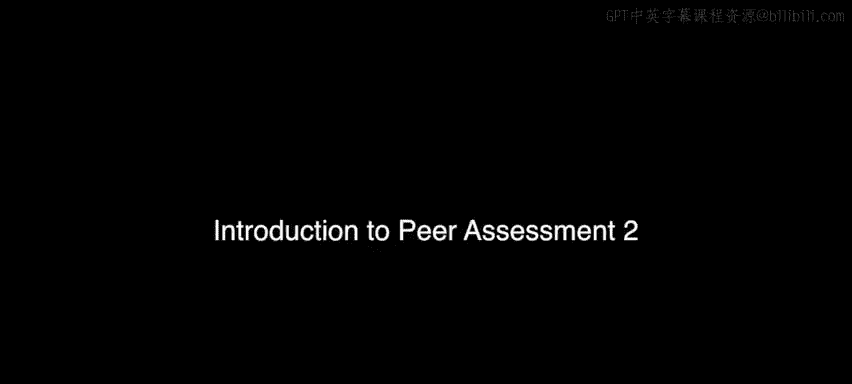

# 约翰霍普金斯大学数据科学课程5：《可重复研究》｜reproducible-research｜ - P33：32_同行评估2介绍.zh_en - GPT中英字幕课程资源 - BV1E14y1k7nm

Hi everyone， this week's peer assessment ask you to do a data analysis based on the National Oceanic Atmospheric Administration's Storm event database。

 so just to give you a little sense of kind of what I'm thinking about what I'm expecting。

've I've written up a sample data analysis and put a link to it next to this lecture so you can either go to this link or check out the link on the website that's associated with this lecture so good luck on the assessment this week I'm looking forward to seeing what you guys can do。

