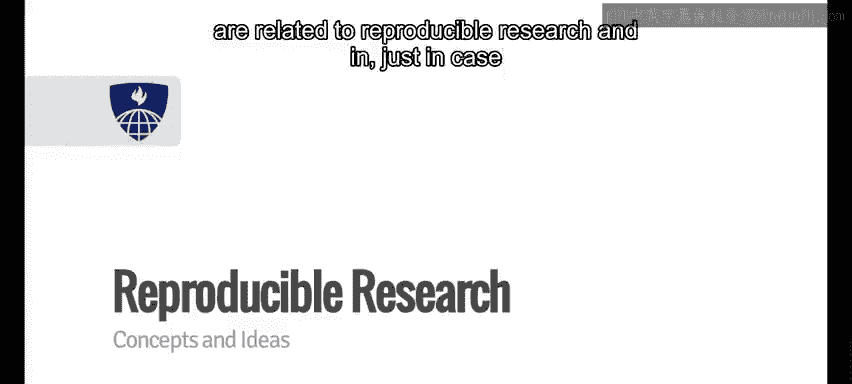
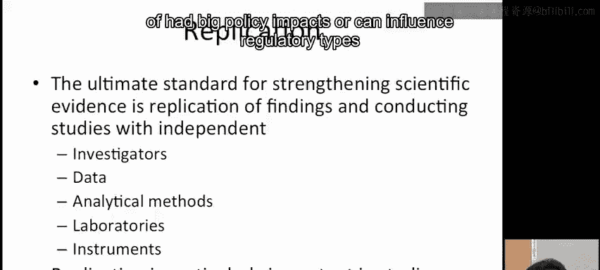
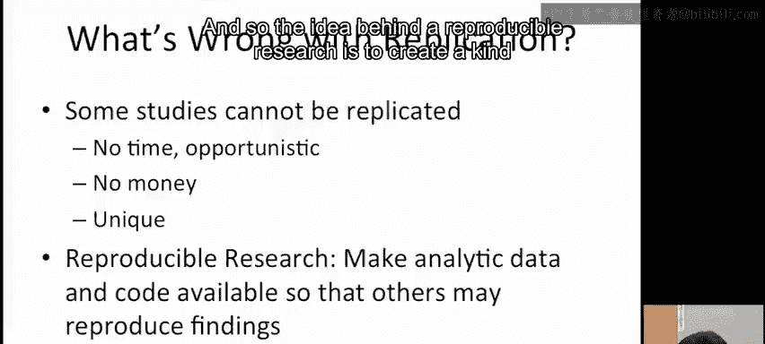
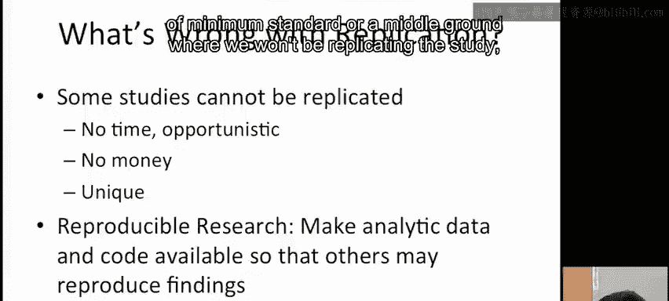
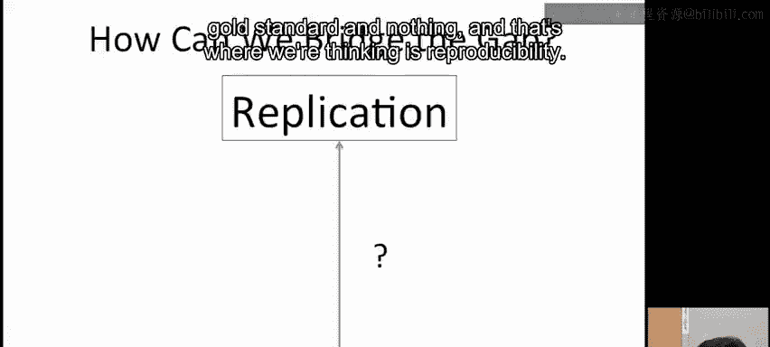
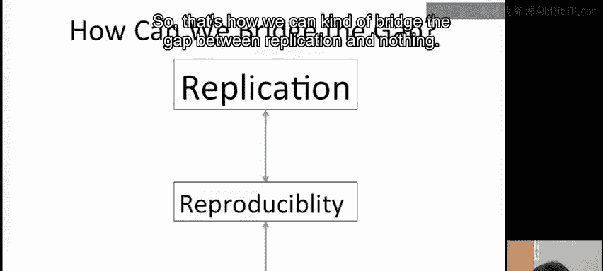
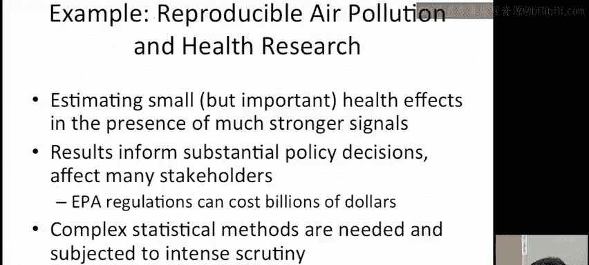
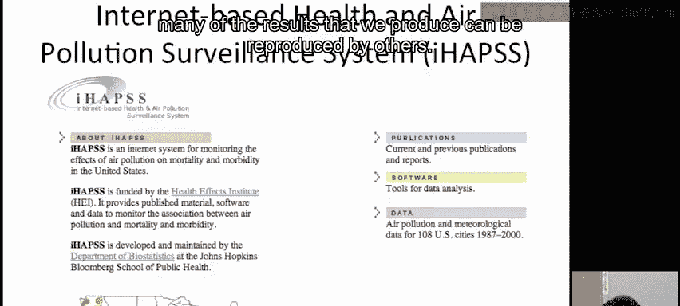

# 约翰霍普金斯大学数据科学课程5：《可重复研究》｜reproducible-research｜ - P3：2_可重复研究概念和想法第1部分.zh_en - GPT中英字幕课程资源 - BV1E14y1k7nm

Hi， everyone， this lecture will be about reproducible research and I want to just to talk about some concepts and ideas that are related to reproducible research and in just in case you haven't heard about it or I don't know what it is So the basic idea is that in science。

 replication is the most important element of kind of verifying and validating findings that scientists discover So if you claim that X causes Y or that vitamin C improves disease or that this causes a problem what happens is that you know other scientists and that are independent of the original will try to investigate that same question and see if they come up with the same result and lots of different people come up with the same result and replicate the original finding。

 then we can tend to think that well the original was probably true and that this is a real relationship or real finding so。

The ultimate standard in strengthening scientific evidence is replication and the goal is to have independent people do independent things with different data。

 different methods and different laboratories and see if you get the same result。

 because if a findings is robust to all these different things that it's more likely to be true the evidence is stronger in its favor replication is particularly important in studies that kind have big policy impacts or influence regulatory types of decisions。

What's wrong with replication， So there's really nothing wrong with it。

 This is what science has been doing for a long time through hundreds of years and there's nothing wrong with it today。

 But the problem is that it's very it's becoming more and more challenging to do replication or to replicate other studies and and part of the reasons because studies are getting bigger and bigger and order to do big studies you need a lot of money and so there's a lot of money involved and you want to do 10 versions of the same study。

 you need 10 times as much money and there's not as much money around as there're used to be sometimes it's it's difficult to replicate a study because you know if the original study took 20 years to do。

 it's difficult to wait around another 20 years for replication so that can be a challenge some studies are just plain unique So if you're looking at a unique situation in time or a unique population you can't readily replicate that situation So there are a lot of good reasons why you can't replicate a study and so the idea is that well if you can't replicate it is the alternative just。

Do nothing just let that study stand by itself。 and so the idea behind reproducible research。

Is to create a kind of minimum standard or a middle ground where we won't be replicating。

The study， but maybe we can do something in between So the basic problem is。

 you know you have the gold standard which is replication and then you have the kind of the the worst standard。

 which is nothing。 And so what can we do that's in between the gold standard and nothing and that's what we're thinking is reproducibility so that's how we can kind of bridge the gap between replication and nothing。

So why do we need this kind of middle ground which I haven't clearly defined yet。

 but the basic idea is that you make the data available for the original study and you make the computational methods available so that other people can look at your data can run the kind of analysis that you've run and to kind of come to the same findings that you've found and so a lot of this what reproducible research is about is a validation of the data analysis because you're not collecting independent data using independent methods it's a little bit more difficult to validate the question itself that you're asking。

 but if you can take someone's data and and reproduce their findings and you can some sense validate the data analysis and so this involves having the data and the code because most more likely than not the analysis will have been done on the computer using some sort of programming language like R and so if you can take their code and their data and reproduce。

findings that they come up with then you can at least have confidence that the analysis was done appropriately and that the correct methods were done were used excuse me so what is driving this need for kind of a middle ground there reproducibility middle ground between replication and doing nothing Well there's a lot of new technologies on the scene in many different fields。

 including biology and chemistry and environmental science， all kinds of areas。

 these technology allows us allow us to collect data at a much higher throughput and so we get these very complex and very high dimensional data sets almost instantaneously compared to even just 10 years ago and so the technology has allowed us to create huge data sets at essentially the touch of a button Furthermore。

 we have computing power that allows us to take kind of existing databases and merge them into just even bigger and bigger databases so we can take data that were previously maybe inaccessible and to create new datas out of them and so these new datas are huge now。

And in addition to allowing us to create new data sets。

 computing power allows us to do more sophisticated analyses。 So the analyses themselves。

 the models that we fit and the algorithms that we wrote are much。

 much more complicated than they used to be and so having a basic understanding of these algorithms is difficult even for a sophisticated person。

 So understanding what someone did in an analysis of data will require looking at code looking at the computer programs that people used and so the bottom line all these different trends is that for every field X there is now computational X。

 there's computational biology， is computational astronomy， computational， whatever it is you want。

 there is a computational version of it。So one example from research that I've conducted is in the area of air pollution and health now air pollution and health is a big field and it involves kind of is a confluence of features that make reproducibility。

 very important in this area the first that we're estimating very small but very important public health effects in the presence of much stronger signals so you can think about air pollution as something that's perhaps harmful but even if it were harmful there are many other things that are going to be more harmful that you have to worry about and so pollution is going to be not at the very top of the list that's going to harm you the results of a lot of air pollution research and kind of substantial policy decisions。

 regulations will be based on scientific research in this area and so these regulations can affect a lot of stakeholders and furthermore can cost billions of dollars to implement。

Finally， we use a lot of complex statistical methods to do a lot of these studies and these statistical methods are subjected to intense scrutiny so the combinations of an inherently small signal large impacts and complex statistical methods almost require that the research that we do be reproducible and so one of the things that we've done here at Johns Hopkins is to create what's called the Internet based health and air pollution surveillance system we make a lot of our data available。

 we make a lot of our statistical methods in the form of our code available so that they can be examined and the data and many of the results that we produce can be reproduced by others。

