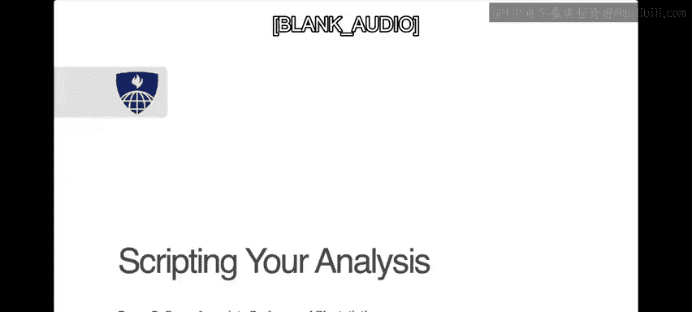
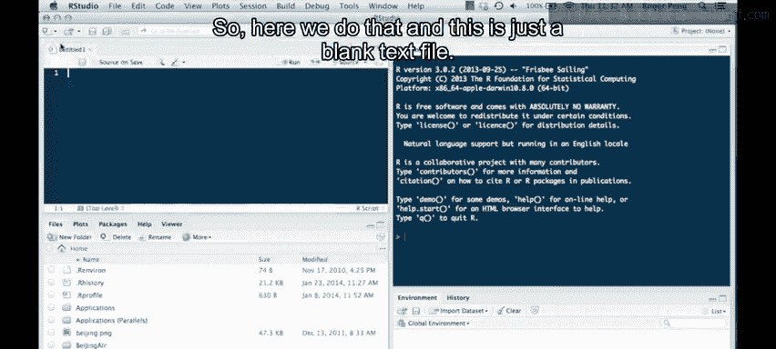
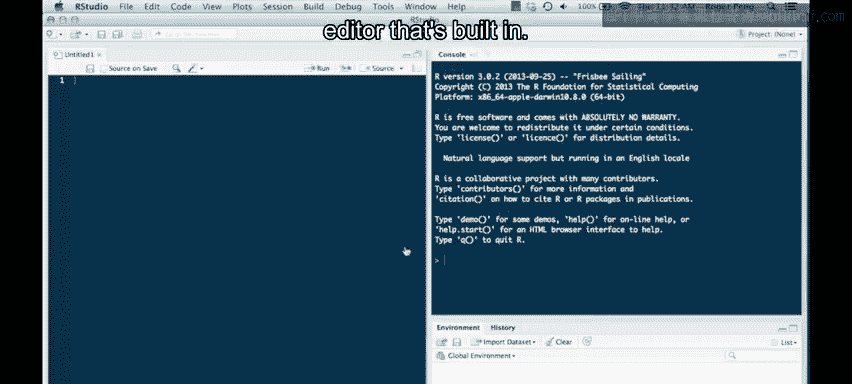

# 约翰霍普金斯大学数据科学课程5：《可重复研究》｜reproducible-research｜ - P6：5_对你的分析进行脚本编写.zh_en - GPT中英字幕课程资源 - BV1E14y1k7nm

In this course we're going to talk a lot about different tools and techniques to help you make your work reproducible now before we get into all of that though。

 I just want to kind of boil down the basic principle that we want to deal with throughout this whole course。

 I mean if there's one rule that I think you would want to adhere to to make your work as reproducible as possible is that you should script everything。

Scriping is really important and it's the basic idea of writing everything down back in the old days you might have written down things down on paper or in lab notebooks。

 but now that we have more sophisticated computers and we can program them。

 you write things down as scripts or programs so I mean just by way of analogy。

 if you think about if you think about a great symphony or a great piece of music you can think of if you imagine just hearing the melody of a piece of music that's very interesting it's also can be very beautiful but often if you look at a symphony。

 there's a whole orchestra， there's a whole set of musicians that are kind of backing up the melody and doing a lot of work and all that work is really important it contributes to the texture it contributes to the kind of the feel of the whole piece of music right so。

if you were just hear a symphony， it would be probably difficult for you to reproduce that sound。

 even if you could hire your own orchestra because you wouldn't know where all the notes were what all the different instruments were playing at any given time。

 even if you heard it a few times you probably still wouldn't be able to do it and particularly you definitely would not be able to reproduce that sound if you were to only hear the melody right so if you think about the presentation of an analysis or of your research the presentation is really kind of like hearing the melody alone the melody is really nice it's really important but all the supporting material that's going on behind the scenes。

 all the analysis that you did， all the exploratory work。

 all the kind of dead ends that you went down， all the decisions that you made in your analysis which are not presented in your kind of final presentation whether it's a paper or oral presentation but they're all very important So those are the supporting players right。

So just like in music in research we need a way to kind of write down everything that we did everything that's going on right so in music this is typically called the score right so the score is a way to kind of write down in musical notation。

 all the different things that are being played， all the different things that are going on。

 all the notes， all the rhythms， all the timings， all the instruments。

 everything and so someone can look at the score and say， okay well。

 I need to put together all these things and people need to play at different times at different locations and so it's a way you're you to reproduce a piece of music as accurately as possible and musicians have of have have agreed upon a standard way to write down music and a standard notation for doing that and so this course is essentially about you know defining and developing the notation of specifying a research project or a data analysis right so what is how do we write down what what are the things that we did。

 how do we talk about exactly。What was analyzed， what was done and so the way that we do that essentially is through scripting。

 right we write down computer programs， we give instructions to the computer and tell it what to do at any given time with what type of data。

And so the main rule for anything you do in data analysis is to write a script and the more you can do that and the less you can kind of do things on your own by hand without writing it down。

 the better and the more reproducible your work will be so these computer programs。

 these scripts that we write these are like the score for your data analysis。

 they tell someone else is trying to reproduce your work， exactly what happened and what to do。

So if you want to get a sense of what it means to script something， you can just load up our studio。

And when you load it up， you'll see。That the first thing you can do is you can open an R script So here we do that and this is just a blank text file and then you can start writing our code in here and then you you'll be programming。

 you'll be telling know R what to do in terms of a coding language right so this is this is the easiest way to kind of get started scripting to load up something like R studio and use the text editor that's built in So in this course we'll talk about a bunch of other tools。

 things like NATO， things like markdown that will help you kind of organize your analyses but the bottom line is to write it down。

 write a script， write a program and make your work reproducible。

