# 约翰霍普金斯大学数据科学课程5：《可重复研究》｜reproducible-research｜ - P7：6_数据分析结构第1部分.zh_en - GPT中英字幕课程资源 - BV1E14y1k7nm

This lecture will talk about the basic process by which data analysis will unfold and of course。

 not every data analysis is the same and not every data analysis will require the same components。

 I think this will serve as a useful template for kind of understanding what are the pieces of a data analysis and how they typically flow together。

So if one were to write down the steps in a data analysis。

 you might come up with something along these lines， a list just like this one。

 there may be things little things you might want to add or delete tip most data analyses have some subset of these steps and so what we're going to talk about in this lecture which is part one is defining the question that you're interested in defining the ideal data set determining what data you actually can access obtaining the data and cleaning the data。

 and then in part two of this lecture we'll talk about the remaining topics here。

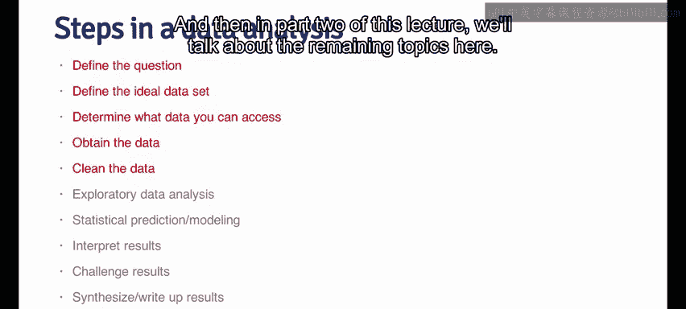

I think the key challenge in pretty much any data analysis was well characterized by Dan Meyer。

 who is a mathematics educator and taught high school mathematics and in his TED talk。

 he said ask yourselves what problem have you solved ever that was worth solving where you knew all the given information in advance where you didn't have a surplus of information and have to filter it out or you had insufficient information and had to go find some and so I think that's a key element of data analysis which is that typically you don't have all the facts or you have too much information and you kind of have to go through it and the process of data a lot of the process of data analysis is sorting through kind of all all this stuff。

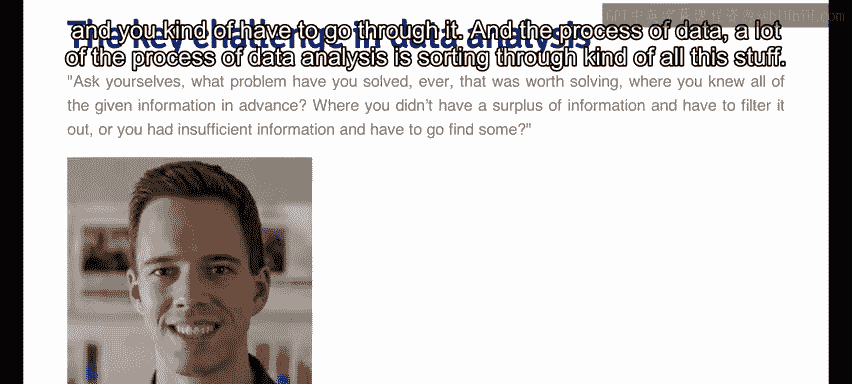

And so。The first kind of important part of data analysis that you want to start with is a define question and not every data analysis starts with a very specific or coherent question。

 but the more effort you can put into coming up with a reasonable question the less effort you'll spend having to filter through a lot of stuff and the reason why is that defining a question is the kind of the most powerful dimension reduction tool you can ever employ because if you're interested in a specific variable like height or weight。

 then you can kind of remove a lot of other variables that don't really pertain to that at all。

 but if you're interested in a different type of variable then you can remove another subset and so the idea is if you can narrow down your question as specifically as possible。

 then that will serve to reduce the kind of noise that you'll have to deal with when you're going through a potentially very large data set。

Now sometimes you just want to look at a data and see kind of what's inside this data and then you'll have to explore all kinds of things in a large data。

 but if you can narrow down interest your interest to a specific type of question。

 and that can be extremely useful for simplifying your problem So I encourage you to kind of think about what type of question you're interested in answering before you go into delving into all the details of your data So the science generally speaking will determine what type of question you're interested in asking and that will lead you to the data which may lead you to applied statistics which is you use to analyze the data and then if you get really ambitious you might want to think of some theoretical statistics that will kind of generalize the methods that you apply to different types of data of course there are relatively few people who can even who can do that and so that would not be expected of everyone So the part that's in the red bracket that's number one that's typically referred to as statistical methods development the part that's in the purple bracket here。

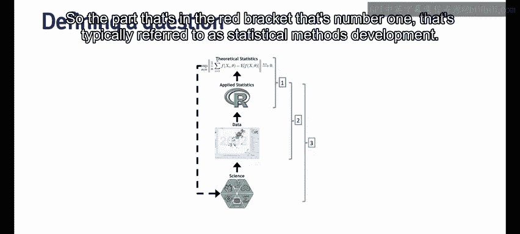

two， which is just to kind of the application of statistics just to raw data without any sense of science is what I would refer to as the danger zone。

 which kind of derive here from a kind of Venn diagram of data science that was written by Drew Conway The idea is that if you just kind of randomly apply statistical methods to data sets to find an interesting answer first of all。

 you will find something interesting almost certainly but it may not be reproducible and it may not be a really meaningful and so I think a truly proper data analysis has a scientific context it hopefully has at least some general question that we're trying to investigate which will narrow down the kind of dimensionality of the problem and then we' apply the appropriate statistical methods to the appropriate data。

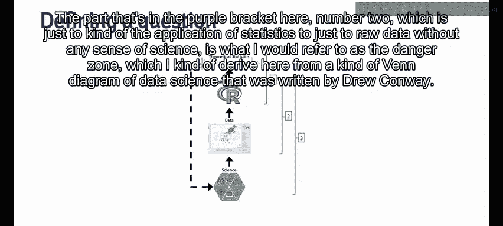

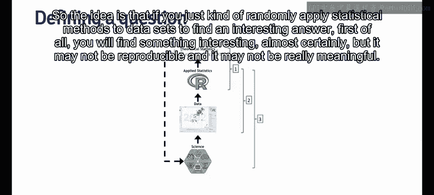

So let's start with a very basic example of a question。

 so a general question might be you know can I automatically detect emails that are spam and those that are not Of course this is an important question if you use email you want to know what are the emails that you should read that are important and what are the emails that are just spam。

And so you might want to so if you want to turn that into a data analysis problem。

 there are many ways that you could answer this question， for example。

 you could just hire someone to just go through your email and figure out what's spam or not。

 but that's not really that's probably not very sustainable it's not particularly efficient。

 So if you want to turn this into a data analysis question。

 you have to make the question a little bit more concrete and translate it into by using terms that are specific to data analysis tools And so a more concrete version of this question might be can I use quantitative characteristics of the emails themselves to classify them as spam or ham okay so now we can start looking at emails and try to think。

 well what are these quantitative characteristics that I want to develop so that I can kind of classify them as spam。

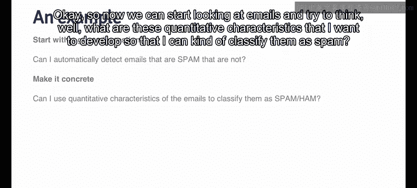

So once you've got a question here， we want to know。

 okay well how do I separate out my email so that I know what's spam and what's not spam。

 so that way presumably you can kind of get rid of all the spam and just read usual the real email。

So the first thing you might want to think about is， you know。

 what's the ideal data set for this problem And so if I had， you know all the resources in the world。

 what would I go out to look for？ And so there are different types of data sets that you could potentially collect and depending on the goal and the type of question you're asking a descriptive data set So if you're looking interested in a descriptive problem。

 you might think of a whole population So get just kind of so you don't need to。

Sample anything you might want to just get the entire census or population that you're looking for so all the emails in the universe。

 for example， if you just want to explore your question。

 you might just take a random sample with a bunch of variables measured if you want to make inference about a problem then you you have to be very careful about the sampling mechanism and the definition of the population that you're sampling from because because typically when you make an inferenceferential statement。

 you take you're drawing from a sample to make a conclusion about a larger population so there are the sampling mechanism is very important。

If you want to make a prediction， then you're going to need something like a training set and a test data set from this from a population that you're interested in so that you can build a model in a classifier if you want to make a causal statement so you want to say okay if I modify this component。

 then something else happens so this is basically you're going to need experimental data and one type of experimental data is from something like a randomized trial or a randomized study and then if you want to make mechanistic types of statements。

 you need data about all the different components of the system that you're trying to describe。

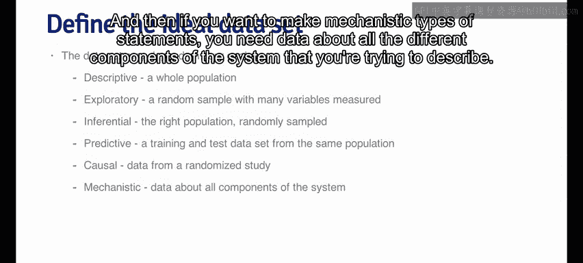

So for our problem here with spam， one ideal dataset perhaps would be if you use Gmail。

 you know that all the emails in the Gmail system are going to be stored on Google's data centers right so why don't we just get all the data in Google' data centers that all the emails in Google data centers right because that would be a whole population of emails and then we could just kind of build our classifier based on all this data and then we have we would have to worry about sampling because we'd have all the data and then and so that would be a kind of ideal data。

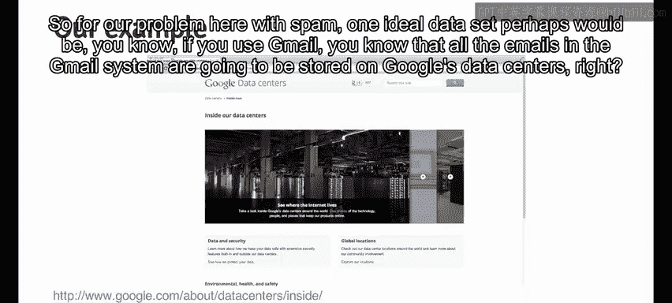

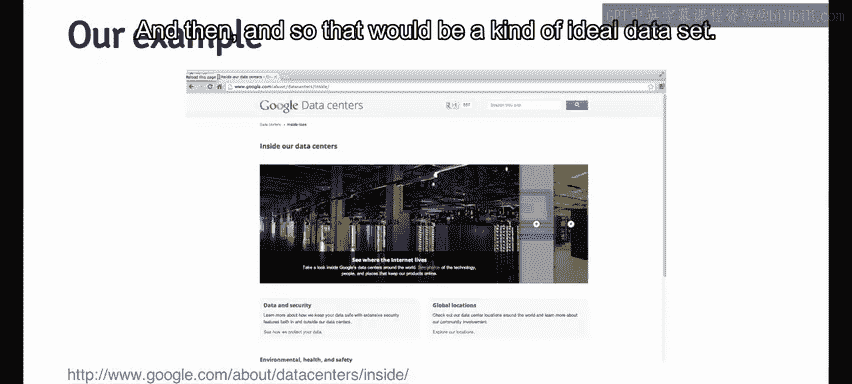

So of course， in the real world， you have to think about well what are the data that you can actually access right so maybe someone at Google can actually can access all the emails that go through Gmail but even in that extreme case it may be difficult and furthermore most people are not going to be able to access that so sometimes you have to go for something that's not quite the ideal data and so you might be able to find free data on the web you might need to buy some data from a provider and in these kinds of cases you should be sure to respect the terms of use for the data so any agreement or contract that you agree that you kind of agree to about the data has to be adhered to and if the data simply just do not exist out there you may need to generate the data yourself in some way。

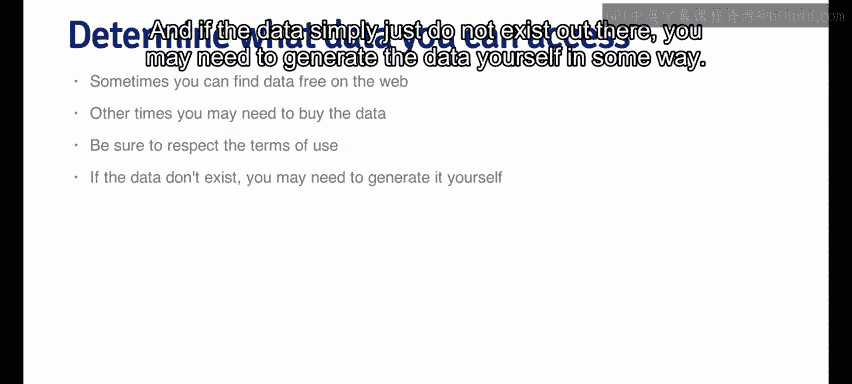

So getting all the data from Google will probably not be possible。

 but because most I'm guessing their data centers have some very high security。

 and so we're going to have to go with something else。

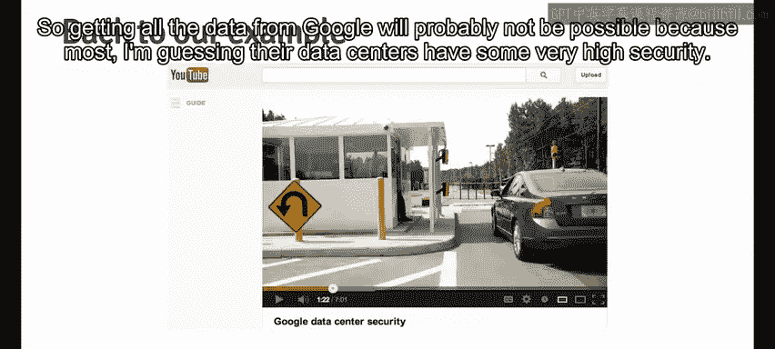

And so one possible solution comes from the UCI machineine Learner repository。

 which is the spam based dataset， and this is a collection of spam that was and this data was created by people at Hewlett Packard who collected a couple thousand spam messages spam and regular messages and classifiedify them appropriately so you can use this database to explore your problem of how to classify emails into spam or hamAM。

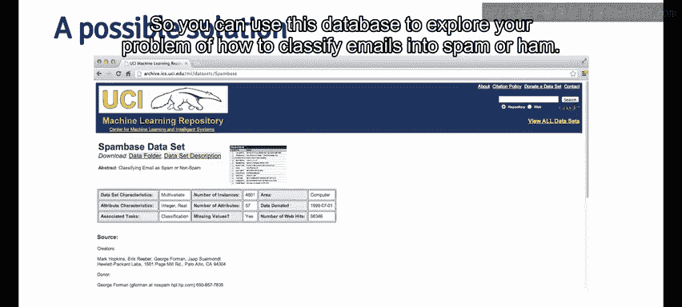

So when you obtain the data， the first goal is to try to obtain the raw data， for example。

 from the UCI machine learning repository， you have to be careful to reference the source so wherever you get the data from。

 you should always reference the source and keep track of where it came from if you're asking if if you need to get data from a person or an investigator that you're not familiar with often a very polite email will go a long way they may be willing to share that data with you and if you get data from an internet source you should always make sure at a very minimum to record the URL which is the website indicator of where you got the data and the time and date that you access that so people have a reference of when that data was available in the future the website might go down or the URL may change or may not be available。

 but at least at that time that you got the data you documented how you got it。

So the data that we're going to talk about in this example since we don't have access to Google's data centers is this spam email data set which you can get from the current La package in R。

 so it comes with the current lab package and so if you install the current lab package。

 you can load the data right away。So the first thing that you typically need to do with any dataset is to clean it a little bit。

 so raw data you typically need to be processed in some way to get it into a form where you could model it or kind of feed it into a modeling program if it's already pre-processed it's important that you understand how it was preprocessed so try to get some documentation about what the pre-processing was and how it was done if you have to understand kind of where the data come from so for example it came from a survey。

 you need to know how the sampling was done it was it a convenient sample did the data come from an observational study did it come from an experiment so there a source of the data is very important。

 you may need to reformat the data in a certain way to get it to work in a certain type of analysis if the data is extremely large you may want to subsample the data to make it more manageable and so anything that you do to clean the data it's very important that you record these steps and write them down in a script or whatever is most convenient because someone you or someone。

This is going to have reproduce these steps in if they want to reproduce your findings。

 and if you don't document all these preprocessing steps。

 then no one will ever be able to do it again。So once you've cleaned the data and you've gotten a basic look at it。

 it's important to determine if the data are good enough to solve your problem because in some cases they may not be good enough。

 you may not have enough data。 you may not have enough variables or enough characteristics。

 the sampling of the data may be inappropriate for your question。

 So there may be all kinds of problems that occur that you realize as you clean the data and so if you determine that the data are not good enough for your question。

 then you've got to quit and try again or change the data or try different question it's important to not to just simply push on with the data that you have just because it's all that you've got because that can lead to inappropriate inferences or conclusions。

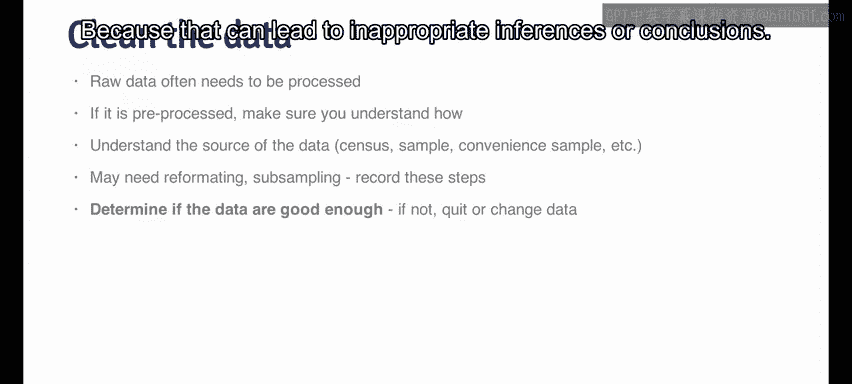

So here is our clean dataset that we're going to use for this example。

 it's already been clean for us in the current lab package。

 and I've just showing you the first five variables here。

 there are many other variables in the data but you can see that there's 4601 observations of the five variables and I put the link here you can see the help page that shows you where the dataset came from and how it was processed。

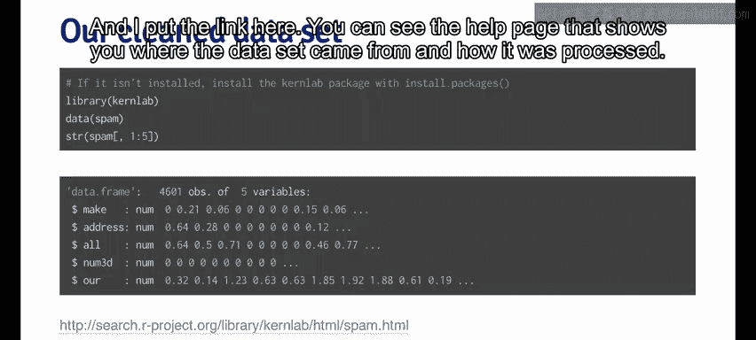