# 约翰霍普金斯大学数据科学课程6：《统计推断课程（约翰霍普金斯大学）》｜statistical-inference｜ - P12：11_05 02 方差模拟例子.zh_en - GPT中英字幕课程资源 - BV1oG41197es

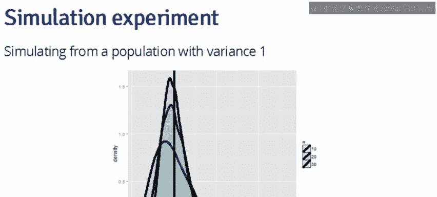

Imagine if I were to do the following。Simulate 10 standard normals and take their sample variance and do that over and over and over again。

 then I get a distribution of sample variances。

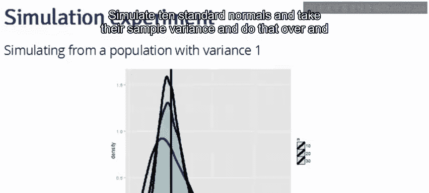

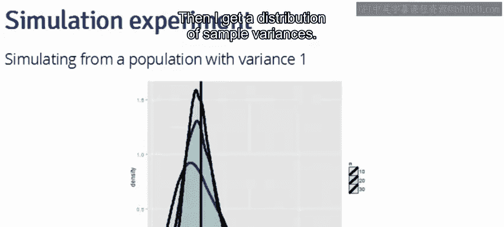

And that's exactly the salmon colored density right here is if I were to repeat that process thousands and thousands of times。

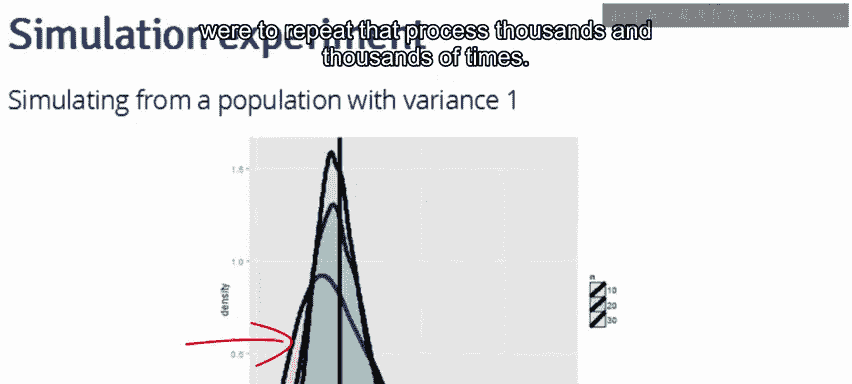

What I was talking about， the result I was talking about on the previous slide is merely that this distribution。

 if I were to sample enough of them。

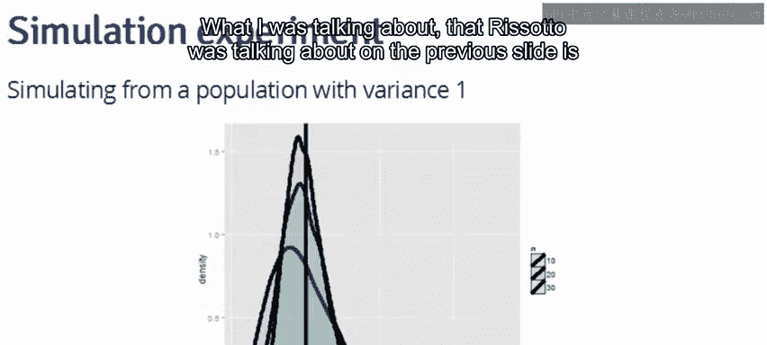

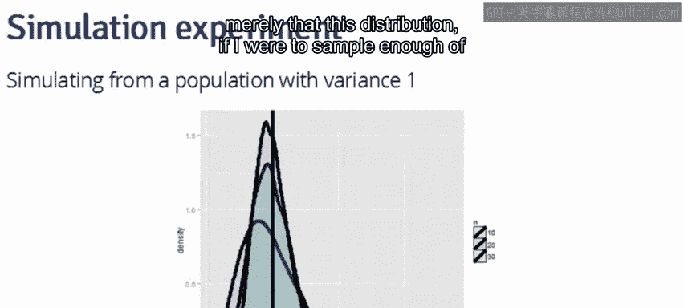

Its center of mass will exactly be one， the variance from the original population that I was sampling from the standard normal。

 which has variance  one。

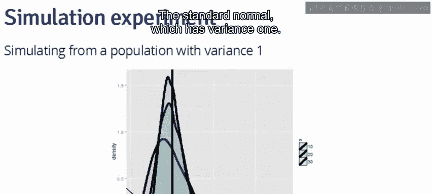

The same will also be true sample variances of 20 observations from this distribution so I sample 20 standard normals。

 take their sample variants and then repeat that process over and over and over again to get an idea about the distribution of sample variances of 20 standard normals and then I get this more aquacolor distribution that's the second one and it is also centered at one。

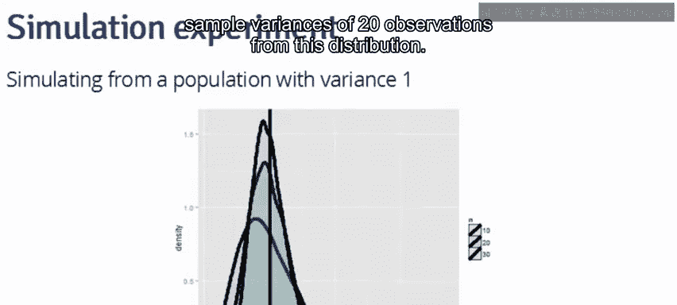

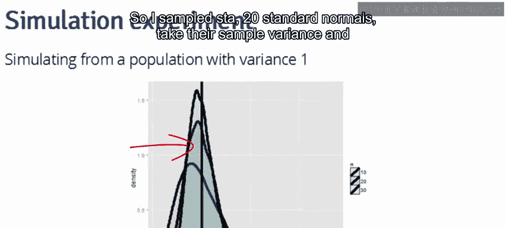

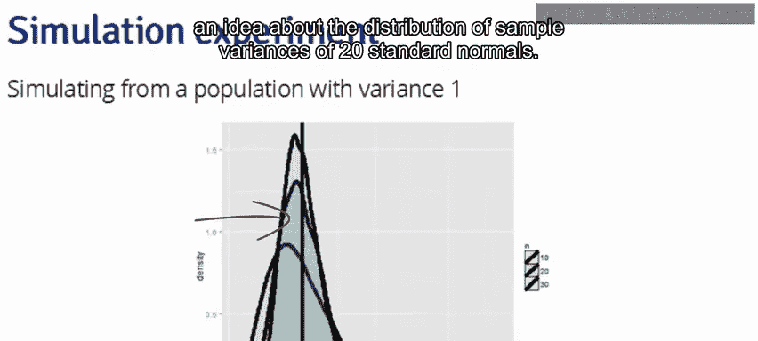

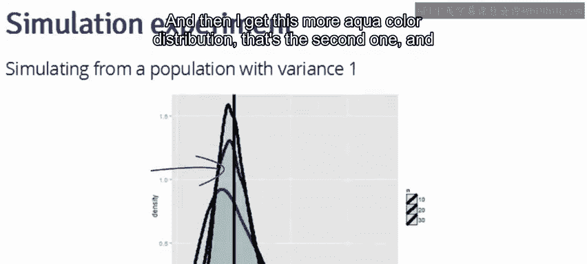

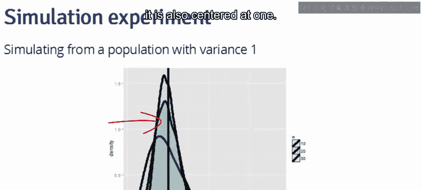

The same thing when I do it for 30， but notice what happens， the variance。

 the population variance in the distribution of the sample variance gets more concentrated as I have more data。

 so in other words saying that more data is going to yield a better。

 more concentrated estimate around what the sample variance is trying to estimate in this case they're all trying to estimate one because they're samples from a population with variance one。

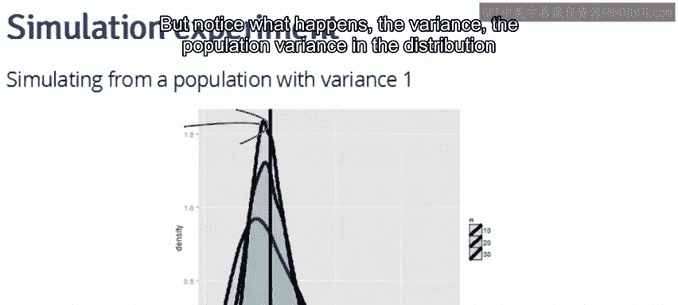

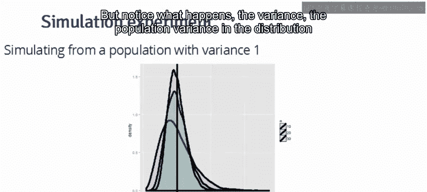

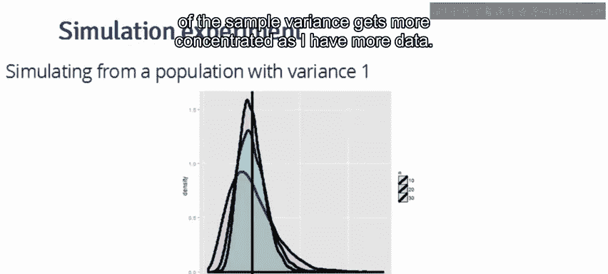

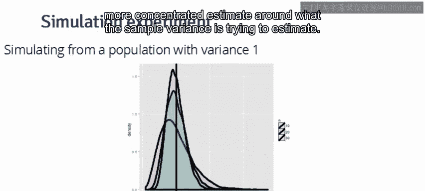

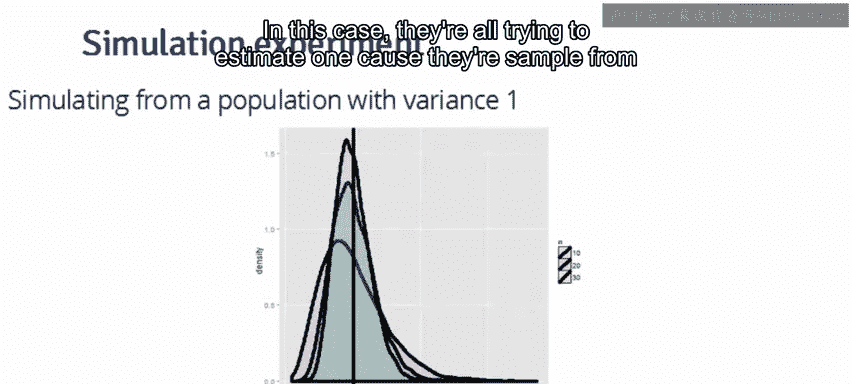

Recall that earlier on in the lecture， we found that the variance of a di roll was 2。92。

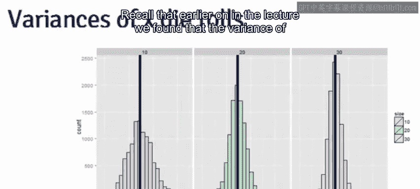

So imagine if I were to roll 10 dice and take the sample variance of the numbers that were on sides facing up。

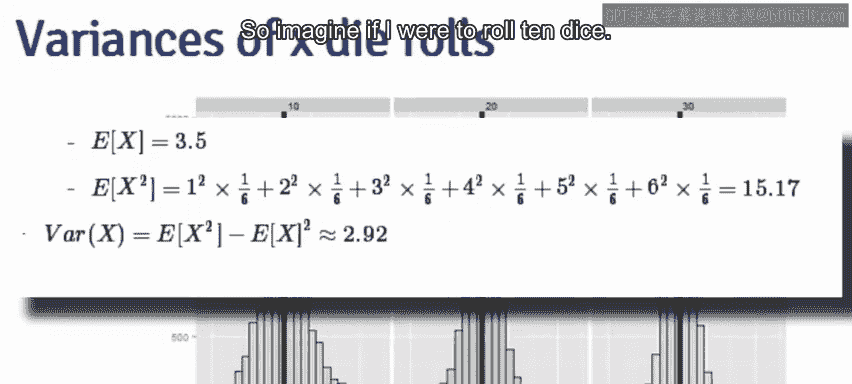

Then if I were to take those 1 dies and repeat that process over and over and over again。

 then I would get a very good idea about the population distribution of the variance of 10 die rolls。

 I would have to do it a lot， but fortunately on the computer I can do it thousands of times。

 which is what I did right here and notice that the distribution of the variance of 10 die rolls is exactly centered around 2。

92， the variance of the population of a single dieole。

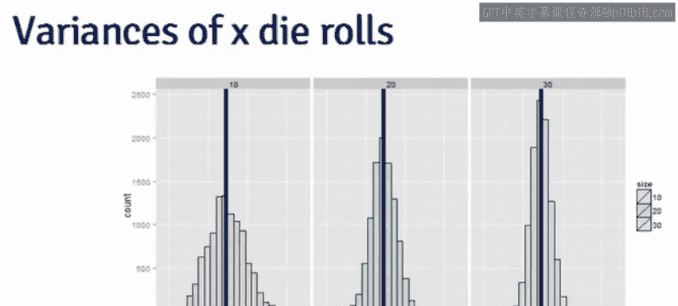

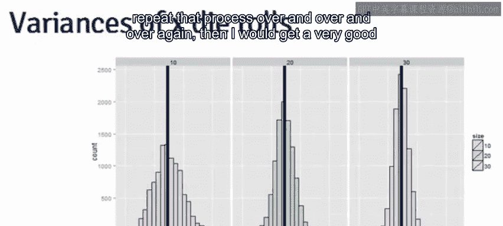

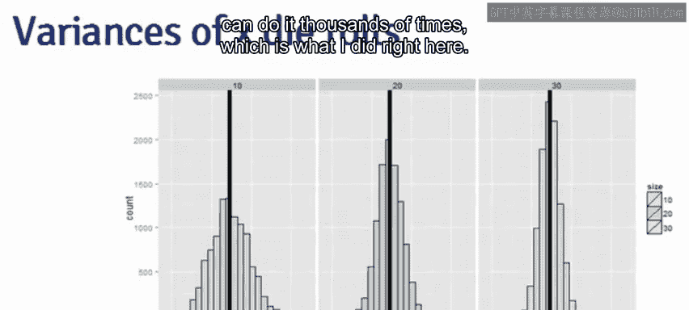

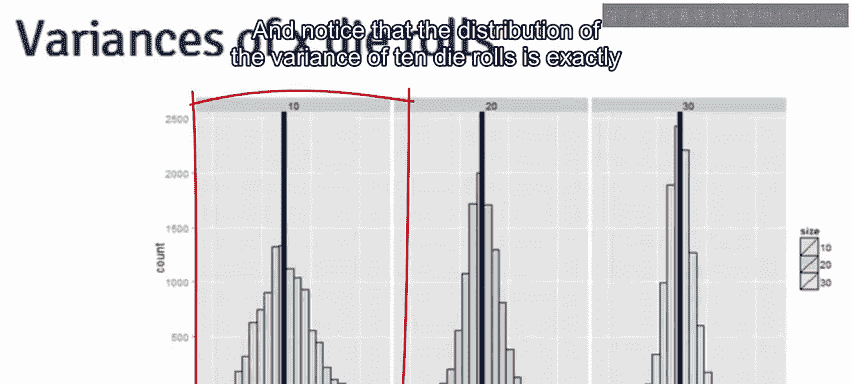

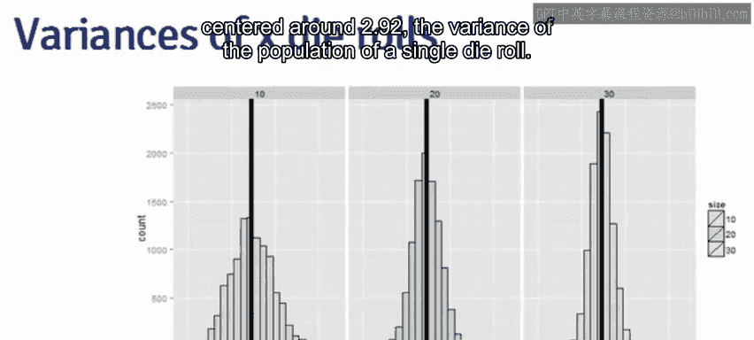

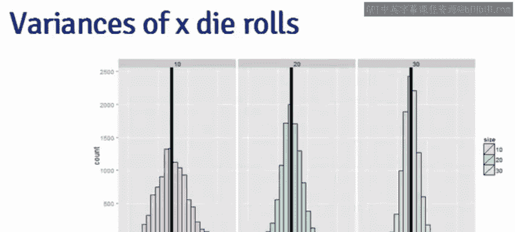

And as I go to 20 and 30， it's still centered in the same place。

But it becomes more concentrated about what it's trying to estimate what this is basically saying is that the variance is a good estimate of the population variance。

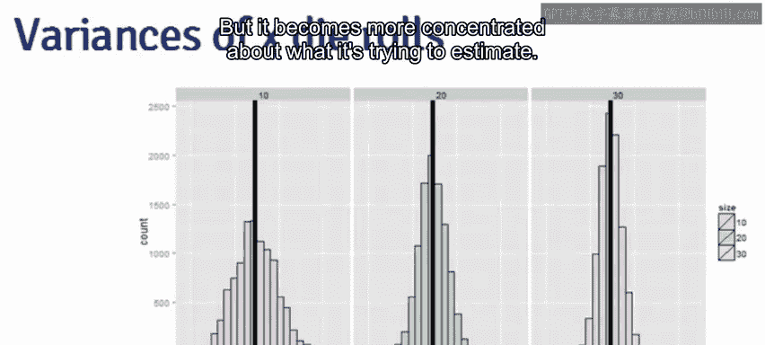

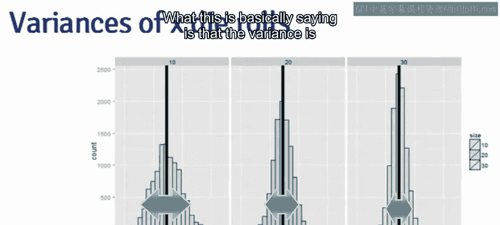

That as we collect more data， the distribution of the sample variance gets more concentrated about what it's trying to estimate and that it's centered in the right place。

 in other words that it's unbiased。This unbiasedness is why we divide by n minus1 instead of n that makes it unbiased。

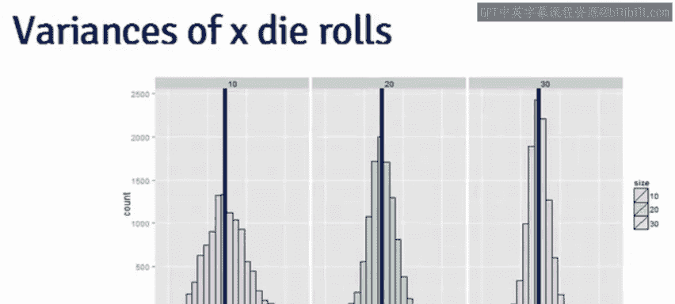