# 约翰霍普金斯大学数据科学课程6：《统计推断课程（约翰霍普金斯大学）》｜statistical-inference｜ - P28：27_09 04 两组检验.zh_en - GPT中英字幕课程资源 - BV1oG41197es

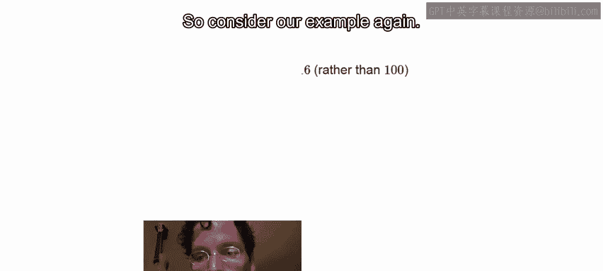

So consider our example again， suppose that n was 16 rather than 100。

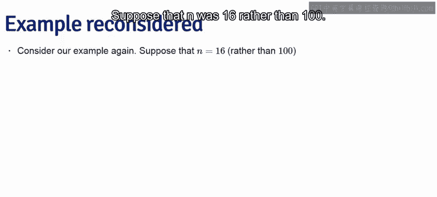

Then our test statistic remains the same， it's the sample mean。

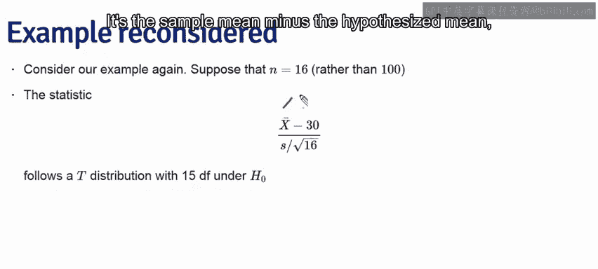

Minus the hypothesize mean where remember we're testing H n mu equal to 30。

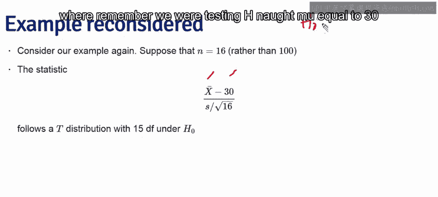

Versus H u greater than 30。And then divided by the standard error of the mean where now we have square root 16 rather than square root 100 and recall s was 10。

This test statistic， how many estimated standard errors from the hypothesized mean the sample means follows a t distribution with 15 degrees of freedom in the specific case。

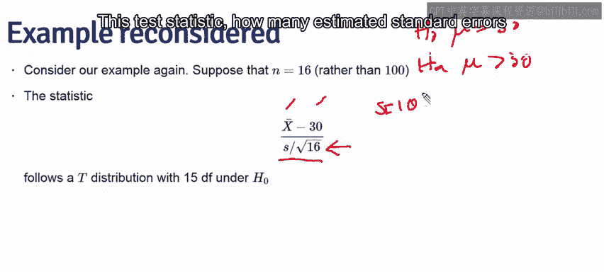

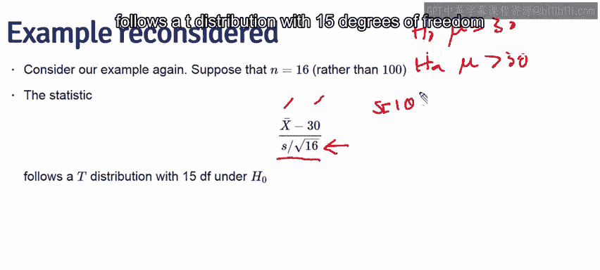

So under the null hypothesis， the probability that is larger than the 95th percentile of the distribution is 5%。

 so we need to calculate that fifth percentile of the T distribution， this can be done with QT。

95 and 15 degrees of freedom which works out to be 1。7531。

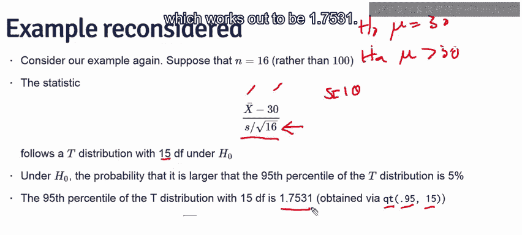

Our test statistic， if we actually plug in the 10 in our x bar of 32， works out to be 0。8。

And so we're failing to reject because 0。8 is smaller than 1。75。

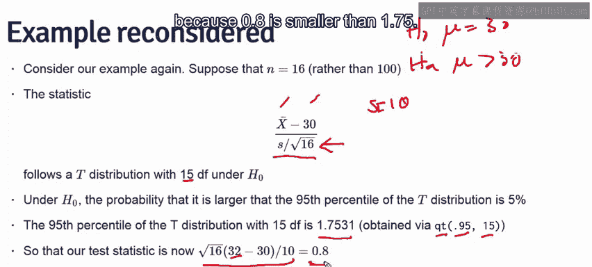

Let's also go through a two sided test。Suppose that we wanted to reject the null hypothesis if in fact the mean was too large or too small。

 this doesn't make a lot of sense in our specific scientific setting because we were specifically interested in whether or not this particular population of obese subjects had a respiratory disturbance index larger than 30 our reference value。

However， it's often the case that in scientific settings。

 a two cid test is demanded regardless of whether or not it makes scientific sense。

It's important to understand how to do two sided tests and the fact that there are some instances where you are mandated to do with two sided tests。

 even though it doesn't necessarily make that much sense to consider the other side。

So we want to reject， in this case， if we were to do a two sided test。

 we want to reject whether or not mu is different from 30。

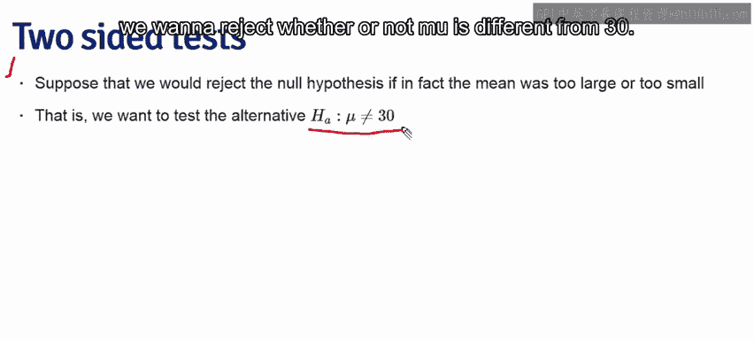

So in other words， we'll reject if our test statistic is either too large or too small。In this case。

 because our test statistic is positive， we only need to consider the large side。

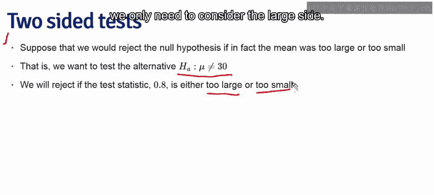

What does change， however， is in order to get that 5% in a way that allows our test statistic to be too large or too small。

 we need to split the probability is 2。5% in either tail of the distribution be it the T distribution for small sample sizes or the Z distribution for large sample sizes。

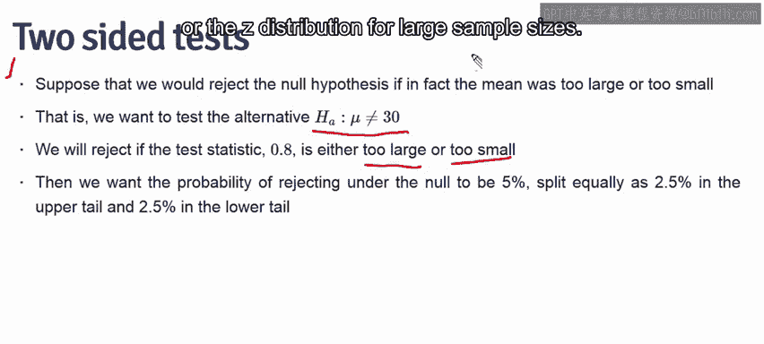

So now instead of QT at 0。95， we're going to do QT at 0。975 again with 15 degrees of freedom。

And so we want to reject if our test statistic is larger than this。

so let me draw an example of our t distribution， this will be the 0 Qt0975。

With 15 degrees of freedom， there would be 2。5% in that tail， and this is the point Q T。

025 with 15 degrees of freedom， and that's 2。5% in that tail。That point right there。

 so we're going to reject if our test statistic is larger than this guy or smaller than。This guy。

However， because the lower quantile is the negative of the positive quantile。

 we can always say that's the same thing as taking the absolute value of our test statistic and rejecting if it is too large。

That point is made right here。So in this case， we failed to reject the one sided test。

And now in this slide， we're showing that we fail to reject the two sided test。 However。

 I think youll probably already noticed that because we've moved further out into the tails of the T distribution with our rejection region。

That if you fail to reject the one sided test， then you will also have failed to reject the two sided test。

Usually we don't calculate the rejection region and perform the hypothesis test in the formal manner in which we've gone through in the slides by hand。

 instead we'll usually pass the data to a function like T dot test and it outputs all the relevant statistics for us for us to understand what's going on with the test。

What's interesting is we already know how to do this because we've used T dot tests in order to perform confidence intervals。

 we just haven't gone through the output to understand what it's doing for a test。

Let's look at in the using R package， the date of father dos son。

And we'd like to test whether the population of。Sunhes。

Was equivalent to the populate population mean of father's heights。Now。

 the observations here were paired was。

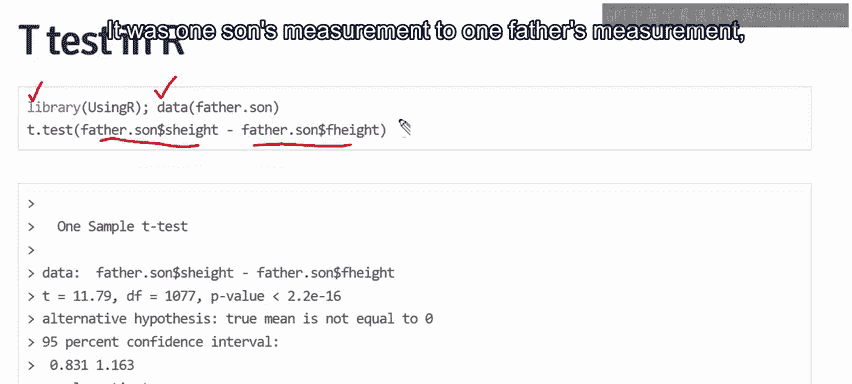

One son's measurement to one father's measurement and so on。 So it's in this case。

 we're going to take the difference and we want to test whether the difference in the heights is 0 or it's non0。

You do that with T dot test and you can either pass the difference directly to the function T dot test or you could pass it the two vectors。

And then add the argument paired equals true。It gives you your T statistic right here， 11。79。

 it gives you your degrees of freedom right here， 1077， so we had exactly 1。

078 pairs that we took the difference of。

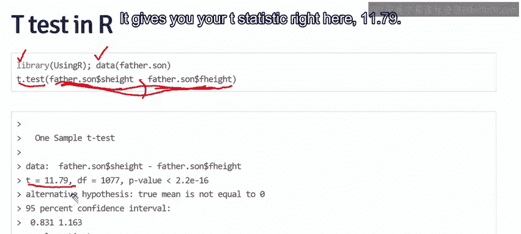

Now 11 is a quite large T statistic。So we reject the no hypothesis in this case。

Also notice that the degrees of freedom are quite large。

 so the distinction between a T test and a Z test in this case is irrelevant。

It very nicely gives us the T confidence interval automatically when we do T dot test。

It's useful almost always to look at the confidence interval in addition to the output of the test。

 simply because the confidence interval bridges this gap between statistical significance and practical significance quite nicely。

 you can see whether the range of values in the confidence interval are of practical significance or not。

 because it's expressed in the units of the data that you're interested in。

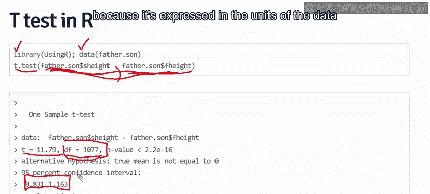

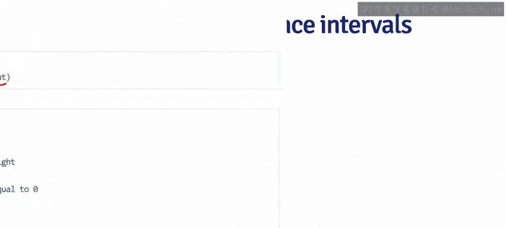

Speaking of confidence intervals。In the previous couple of lectures。

 when we covered confidence intervals。

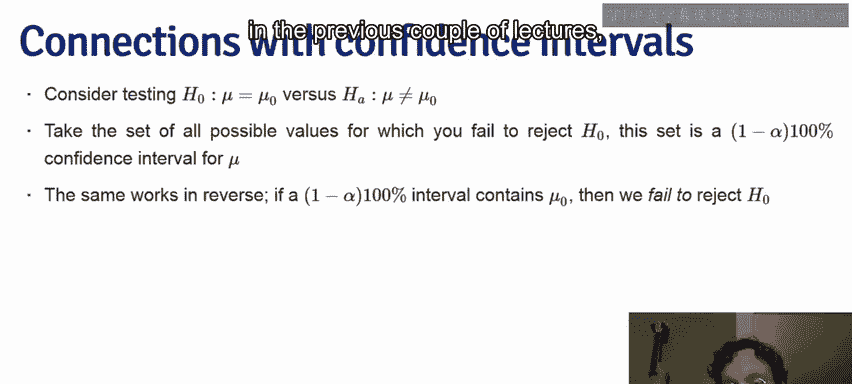

We investigated whether or not a hypothesized mean was supported by looking at whether or not it was in the conference interval or not。

 if it was in the conference interval， then it seemed to be a supported value of the mean and if it was outside。

 it was not。

You might wonder， how does that procedure？

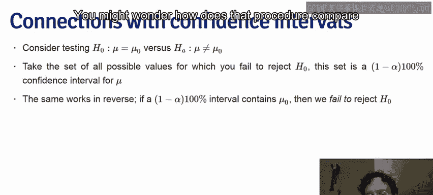

Compare to formally performing the hypothesis test， say， for example。

 the hypothesis test that the mean is equal to a specific value versus not equal to a specific value。

Consider the previous example， we were interested in whether or not fathers and son Heights were equal。

We got the answer that， no， they weren't as far as the hypothesis test was concerned。

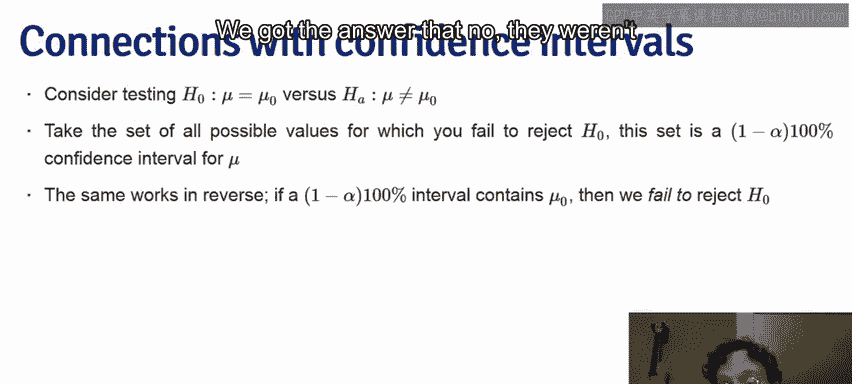

We also got the answer that the interval did not contain zero。

You might be wondering whether or not those two statements could ever disagree。

 And it turns out that， no， they can't。

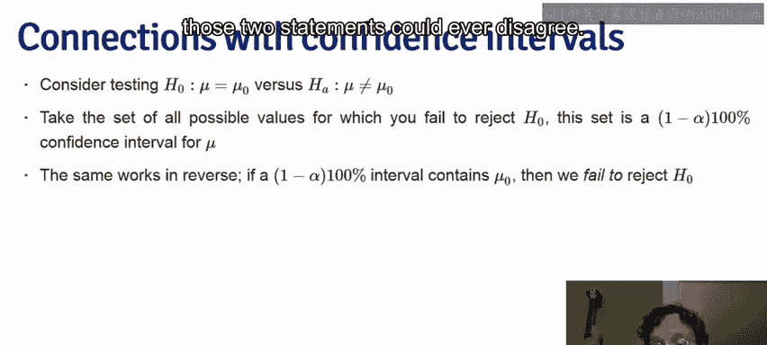

Checking whether or not mu not is in the interval。Is identical to performing the two sided hypothesis test with the caveat that the alpha that you used interval for the hypothesis test has to be equal to one minus alpha for the confidence interval。

 in other words。

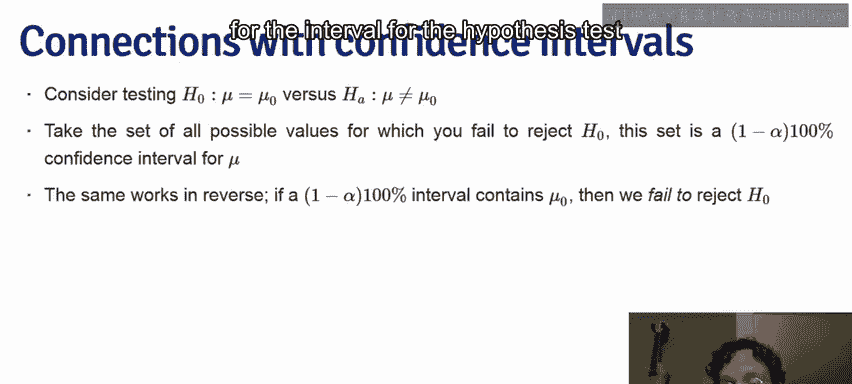

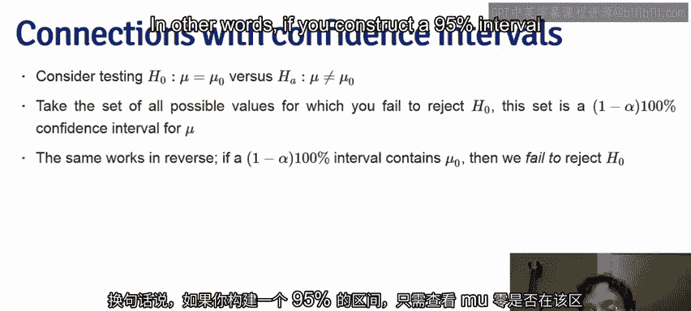

If you construct a 95% interval and just look for whether or not mu not is in that interval and fail to reject if it's in the interval and reject if it's outside the interval。

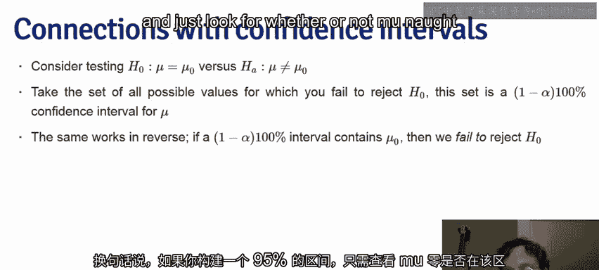

That is the same as performing that hypothesis test with an alpha lab with a type 1 error rate of exactly alpha。

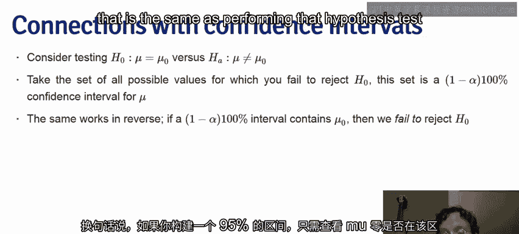

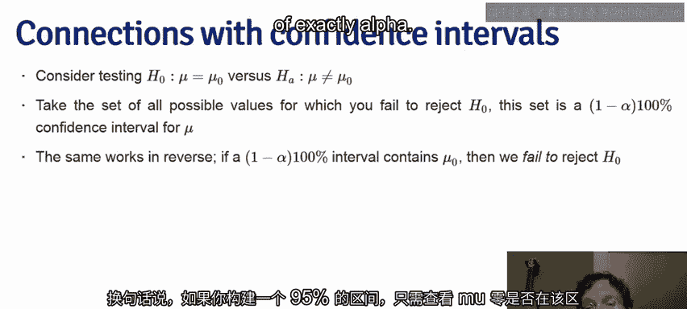

This is stated here in this slide， by saying。

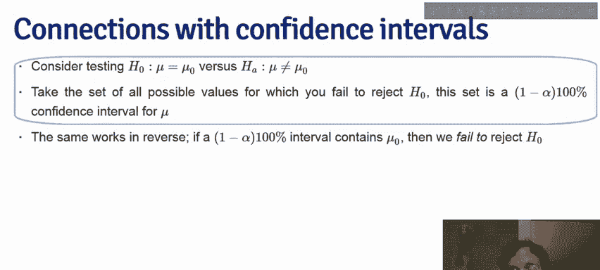

The confidence interval can be constructed as the set of all possible values for which you fail to reject the no hypothesis。

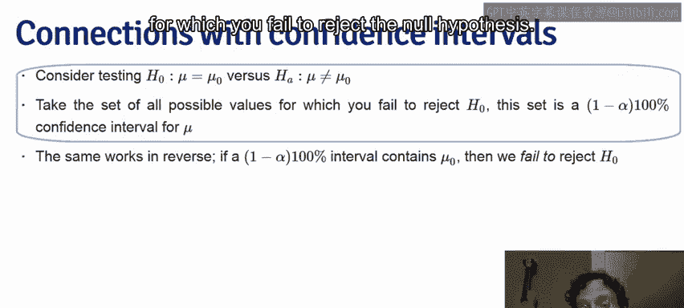

Now， with all the infrastructure that we have in place。

 both understanding confidence intervals and understanding hypothesis tests for one group。

 two group intervals should be a very minor extension of what we're doing。

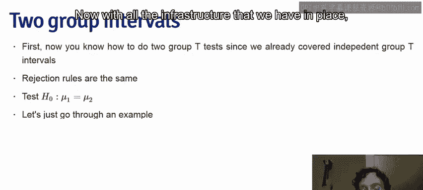

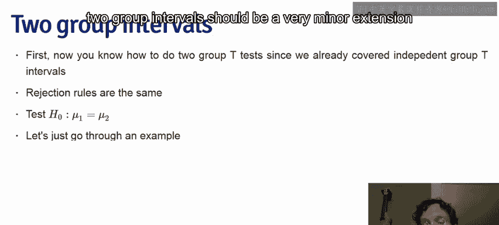

Basically， the rejection rules are the same。And we want to now test whether or not the mean for one group is equal to the mean for another group。

We have the same set of alternatives that mu 1 say is greater than mu2。

 that mu1 is less than mu2 versus mu 1 is not equal to mu 2。

 Our test statistics will always be the same。 It will be the estimate x bar 1 minus x bar 2 minus the hypothesized mean In this case。

 the hypothesized mean difference。 mu1 minus mu 2 is 0。

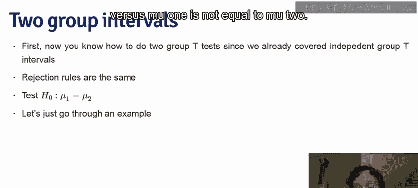

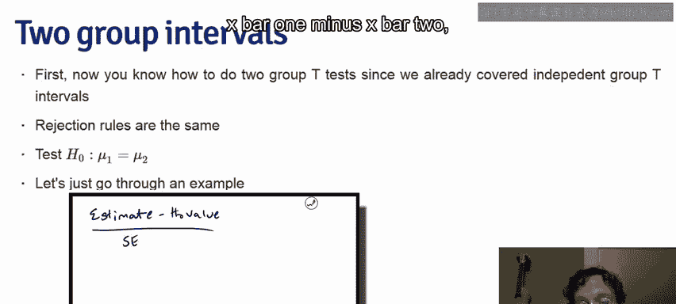

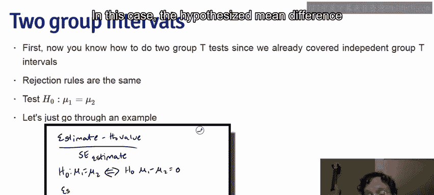

Divided by the standard error of the me。

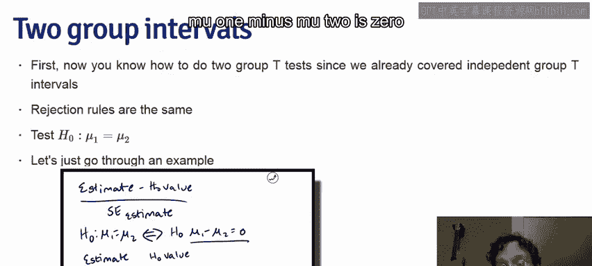

We'll go through an example to illustrate this。

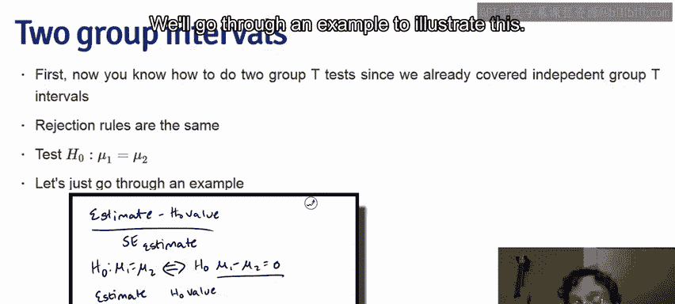

We'll call the checkw data。We called the Chick weight data that we looked at in the last lecture。

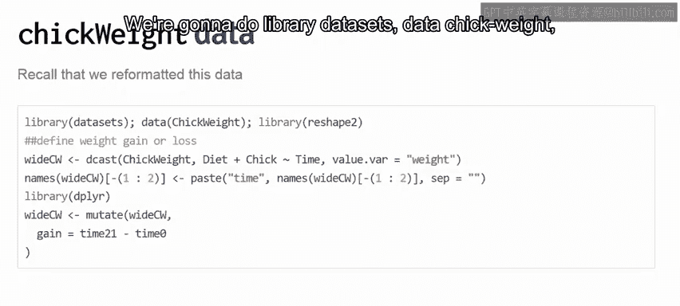

We're going to do library data sets， data check weight。

 and then remember that we needed to reshape two package to get it in the format that we wanted。

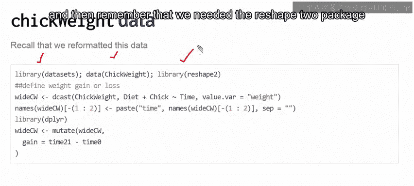

Specifically， the checkck weight data is such that it's like this chick。One，1，1， one， one。

 and it has a bunch of measurements。for that chi at several different times。

 so this is a so called long format， we want it in a wide format so we're going to use the deccast function and then I want to rename it。

And then I want to define a variable that is weight gain basically time 21 minus time0 in this case。

 almost all the chicks are about exactly the same way to time0 relative to their time21。

 so this doesn't make that big of a difference， but I also wanted to show people this mutate function which makes it very easy to add a variable to a data frame。

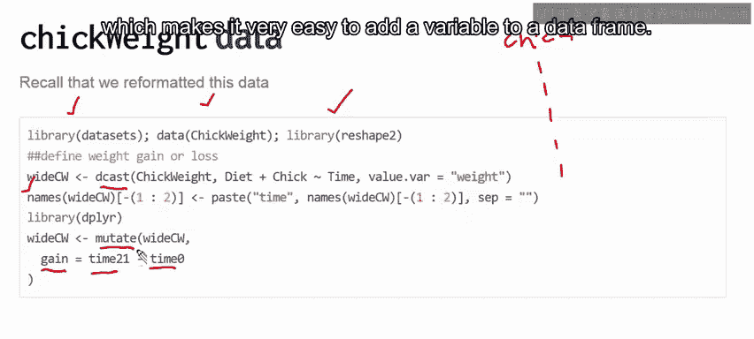

So I grabbed the subset of the diets in one in four in this specific case。

The reason being that this Tilde operator in the T dot test function requires that the predictor variable diet in this case only have exactly two levels。

 so it's because I want to compare one in four， I did it that way。

I'm going to say parroed equals false because in this case。

 the chicks that received diet one were totally separate set of chicks than those that received diet4。

 so it wouldn't make sense to treat them as if they were paired chick one from diet one has nothing to do with chick1 from diet4。

I' am assuming equal variances and in the last lecture we concluded that equal variances maybe isn't the best thing to do in this particular data。

 so I would suggest that you try on your own running this example with var equal as false to see how it changes。

In this case， RT statistic， which is the estimate the difference in the average weight gain between the two diets。

Minus the hypothesized value in this case，0。 whenever you're doing two groups。

 unless you specify a hypothesized difference in the means。

 it's going to assume that you're interested in testing whether the means are。

Equal under the nopost or different under the alternative。The degrees of freedom is 23。

 those are the same degrees of freedom N1 plus N2 minus2 that we covered in the conference interval lecture。

 or if you're doing the unequal variance degrees of freedom。

 you might get a fractional degrees of freedom so the same thing that we covered in the confidence interval lecture。

And it gives you your confidence interval here again。

 which is always good to look at whenever you're performing hypothesis test。In the next lecture。

 we'll talk about what a P value is and how it makes doing these kinds of tests fairly。

 a fairly easy thing to do。 So our teeth statistic， which calculates。

How many estimated standard errors？Our difference in means is from the hypothesized mean。

 that's negative 2。7。That's pretty far out in the tail of a T distribution or a normal distribution。

And so。It's well below our cutoff value， we don't actually explicitly get a cutoff value in this particular case because we know that it's pretty low and after we go through the P value lecture。

 we'll be able to tell immediately that we know that this would be rejected if that was a 5% level test we'll know without having to actually specifically calculate the T quant。

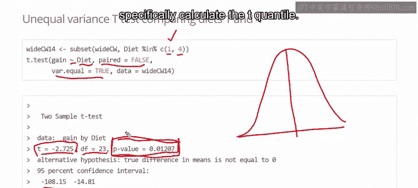

Let's go through a fairly simple example of hypothesis testing that's not a normal or a T。

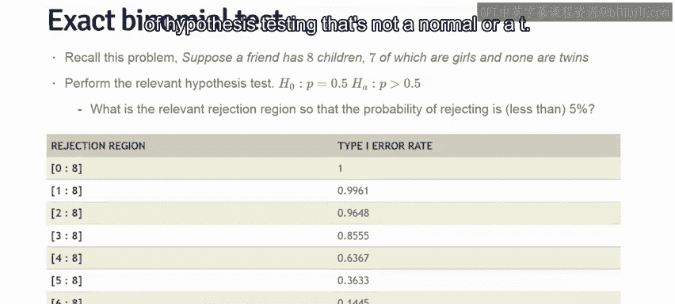

So remember this problem where your friend had eight children。

 seven of which were girls and you wanted to evaluate that。

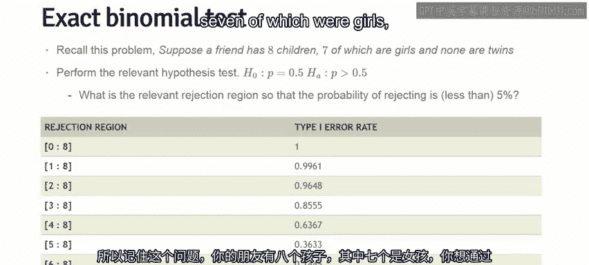

With respect to IodD coin flipping， thinking that maybe genders from a couple are like a coin flip。

 and you're interested in。

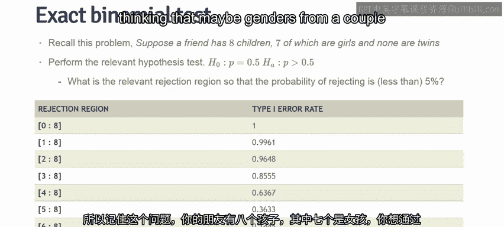

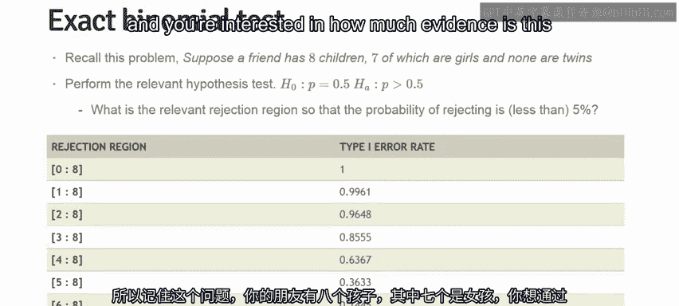

How。Much evidence is this that the genders or IID fair coin flips between boys and girls for this couple。

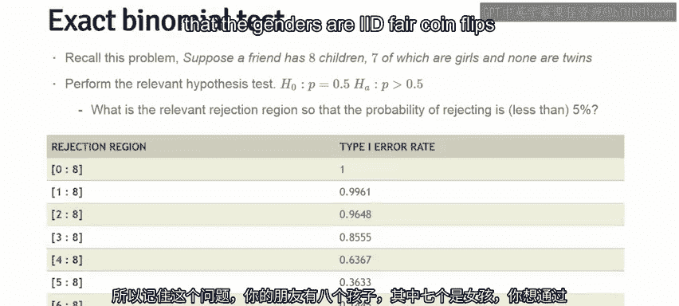

So you want to test the no hypothesis that P， the probability of a girl is 0。

5 versus the hypothesis that it's greater than 0。5 because you're a little skeptical your friend had eight。

7 girls out of8 children。So if you were to set up a hypothesis test。

 what would be the number of girls that the couple could have？

In order for the probability of having that many or more be 5% under the nu hypothesispo of a fair coin。

 Well， if we set up our rejection region， so in other words。

 we're going to reject the null hypothesispo if the couple had anywhere between zero and eight girls。

 well， of course， we would always reject。If we set up the rejection region so that we're going to reject if the couple have one to eight girls。

 well， it's still not 5%， its it's almost one okay if we keep following down what we see is let's say seven girls。

What we see is that if we set up our rejection region as being seven or eight girls。

 then the probability of rejecting under the non hypothesispo is just under 5%。

 notice we can't get it exactly equal to 5% because there's a jump if we set the rejection region to be 6 or higher。

 it's 14% if we set it to be 7 or  eight， it's 3% if we set it to be8 in other words you would only reject the hypothesis of a fair coin if in fact the coin came up heads all 8 times well。

 then you would have a type1 error rate of 0。004。

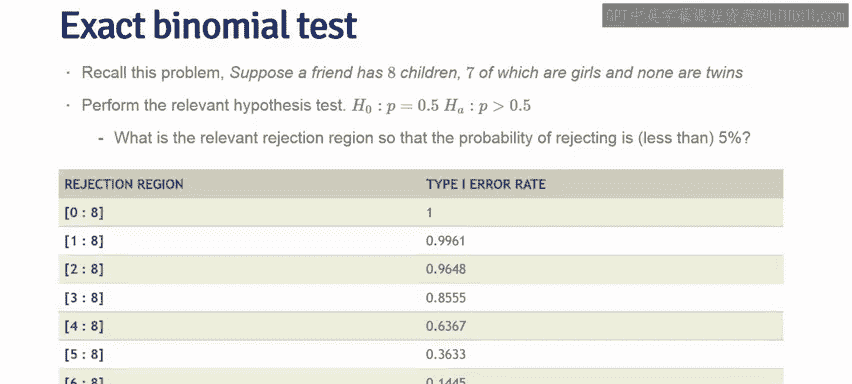

But's。Give a couple of notes about this specific test now what we see is that the closest projection region is 7 and8。

And。Li。Fact that your friend had seven girls means that we reject the no hypothesis。

But we know it's also impossible to get an exact 5% level test in this case。

 but that's just because of the discreteness of the binomial。For larger sample sizes。

 you could have just done a normal approximation， you could have counted the coin flip as an average treated as if it was Gaussian but you already know how to do this。

For the two sided tests， it's not obvious in this case， if you wanted to test whether P was 0。

5 versus different from 0。5。And。We'll talk about a way to do two sided tests in the next lecture。

And I would say I think this gets a little bit easier when we think about it in terms of P values。

 so if this example is a little confusing to you with you hear the P value lecture。

 I think itll make it a little clear the exact binomial Poson interval test will be a little bit easier。

 I would however say it is interesting that if you can do a twosided test for a binomial or a Poisson then you can invert those test。

 you can think of the values for which you would fail to reject the no hypothesispo and generate an exact confidence interval for the Poisson parameter。

 the binomial parameter and that is exactly how they get those exact intervals in R。

Where you don't do an asymptotic or central limit theorem type of approximation。

 but you get an exact binomial interval， they're inverting a two sided hypothesis test of this sort。

So I look forward to next time talking about P values where I think we'll solidify some of these concepts and also make the performance of our hypothesis test a little bit easier。

