# 约翰霍普金斯大学数据科学课程6：《统计推断课程（约翰霍普金斯大学）》｜statistical-inference｜ - P30：29_10 02 p值进一步示例.zh_en - GPT中英字幕课程资源 - BV1oG41197es

So we actually covered an instance of a P value previously in the class。

 and I wanted to go through it again now that we know what P values are。

So suppose we're going to think of gender assignment for kids that we're going to think of this for a specific couple as if it's a coin flip now there's a lot of complexity to this problem and we're going to reduce it。

 but let's just assume that it's a coin flip and what we're wondering because you have a friend that has out of eight kids had seven girls。

 whether or not the probability that that coin lands on girl right let's say P is the probability of having a girl is equal to 0。

5 versus greater than 0。5 so the null hypothesis is H not p equal to 0。

5 and the alternative is H8 P greater than 0。5。

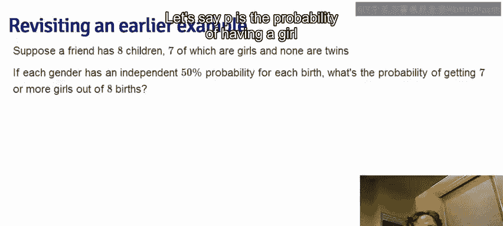

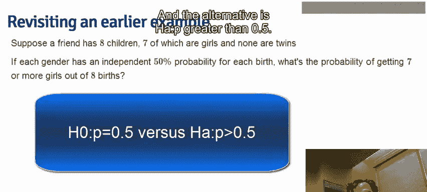

Well， under the null hypothesis。We want to calculate the probability of getting evidence as or more extreme。

 Now， we don't know what a test the test statistic is in this case。

 but the most logical one is just the count。 the number of girls out of the out of the8。

 So 7 or 8 would be as or more extreme than was actually observed。

 So the P value calculation is the binomial calculation for 7 plus the binomial calculation for 8 under the null hypothesis where P is 0。

5。

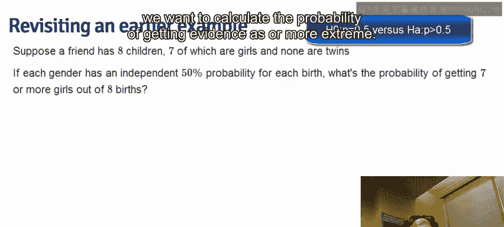

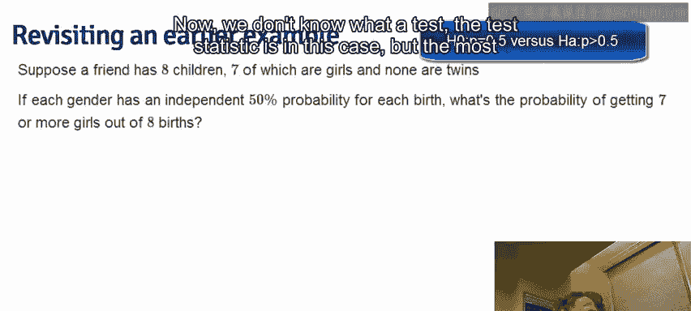

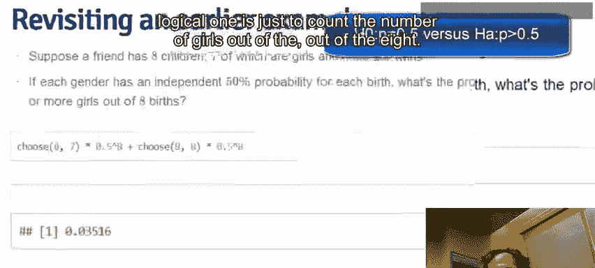

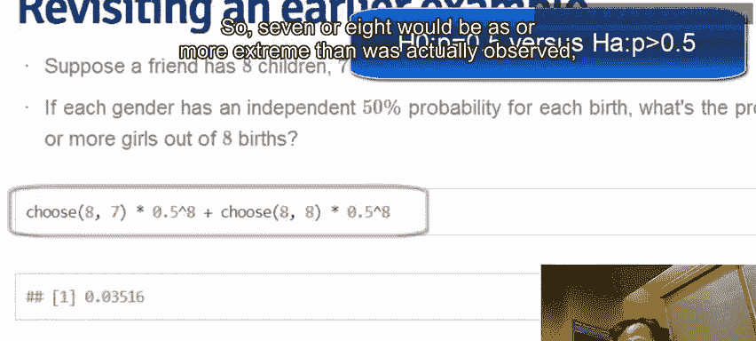

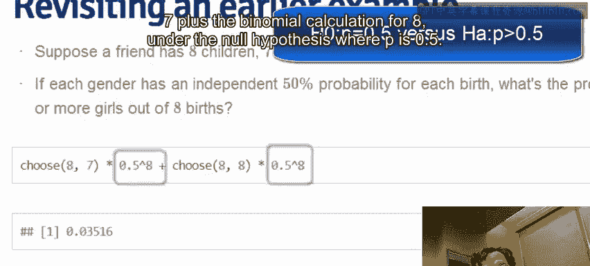

That works out to be about 3。5%。

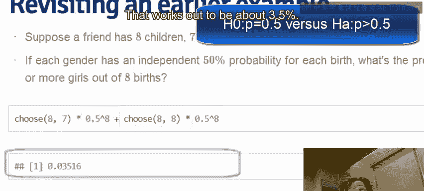

I also go through the calculation here where I do a P byome instead of directly plugging into the binomial formula and of course you get the same number。

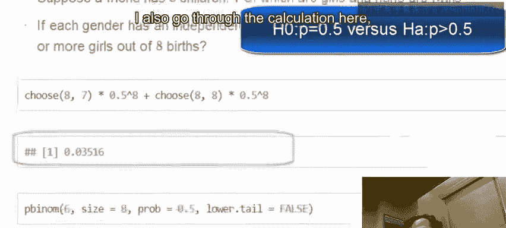

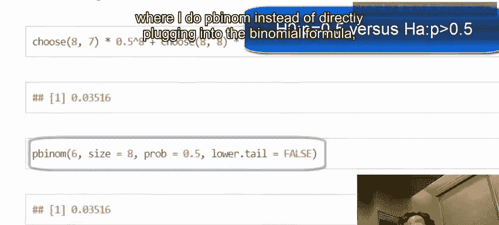

If we were testing that hypothesis， we would reject at a 5% level， we would reject at a 4% level。

 but we would not reject at a type 1 error rate of 3%。

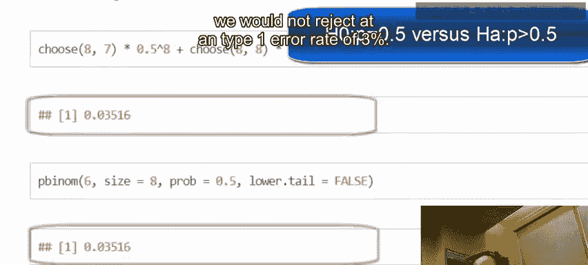

Now I would mention on this specific problem， it's not obvious what the two side of P value is。

 though I'll give you a simple trick， and the simple trick in this case is to simply if you wanted to test whether p is 0。

5 versus p different from 0。5。

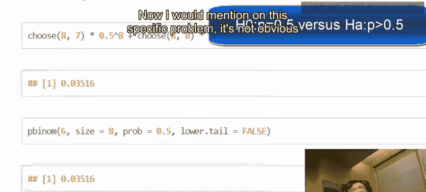

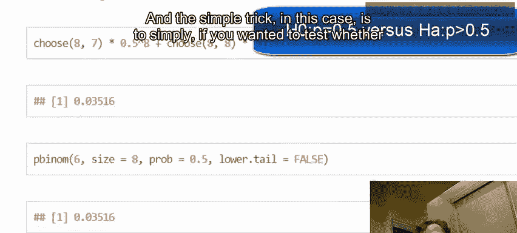

Then you just calculate the two one side of P values， in this case。

 the probability of being seven or larger would be one。

 one side of P value and the probability of being seven or smaller would be the other one side of P value。

 you take those two one side of P values， you take the smaller one and you double it。

And that's the procedure for getting a two side of P value in theseial exact binomial calculations。

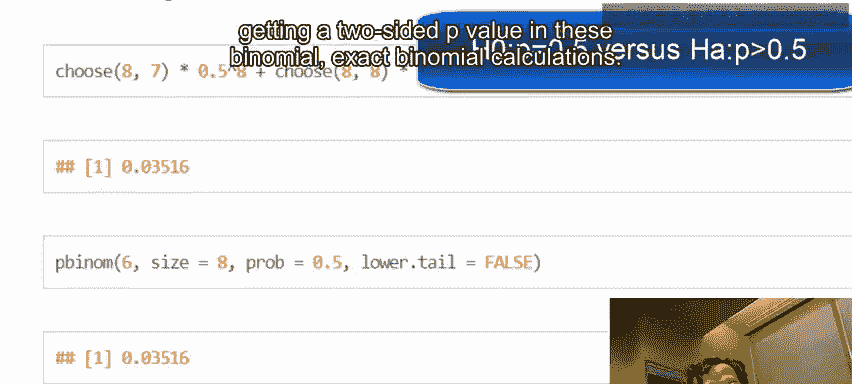

Let's go through a Poson example， so suppose the hospital has an infection rate of 10 infections per 100 person days at risk for a rate of 0。

1 infections per person day at risk。During their last monitoring period。

And we want to assume that a rate of 0。05 infections per person day at risk is an important benchmark if the rate goes above that。

 they would implement some quality control procedures， let's say。

But you don't want to just have this。These expensive quality control procedures go into place just because of random fluctuation。

 so you'd like to formally test this hypothesis accounting for the uncertainty in the data。

 and here we're going to assume that the count the number of infections is poson。Well。

 the nu hypothesis then is that lambda is 0。05 versus the alternative that lambda is 0。

 greater than 0。05。Or given that we're specifically talking about 100 person days at risk for this particular monitoring period。

 we could think of this as the null hypothesispo is that the rate times 100 is5 versus the rate times 100 is greater than5。

So what we want to know is if， in fact。The rate is 0。05。

 having been monitored for 100 person days at risk。

 what's the probability of obtaining 10 or more infections？

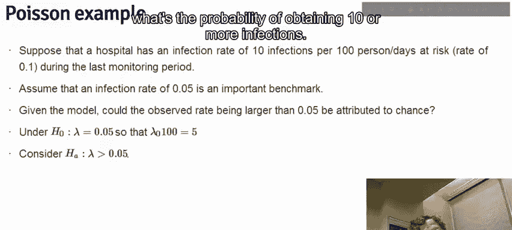

Okay， so this is a poson probability。 We want the upper tail。

 so remember this little quark ofar if you want the upper tail and you're doing a discrete distribution。

 you actually have to drop the number down by one so we want PpoIS so P poise for the poson probability。

 we want to put in nine because we want the upper tail and because of this issue that it does strictly greater than for the upper direction。

Then the poisonson rate is 0。05 times the00 person days at risk。 So 5。

 And then we want to specify lower do tail equals false to make sure that we don't get 9 in fewer。

 but we want strictly greater than 9， which is 10 or more。

 And that will give us our relevant P value。 So what is this probability。

 This is the probability of obtaining 10 or more infections。If in fact。

 the true rate of infections we should have seen on 100 person days at risk is5 okay and it turns out that that's a relatively low probability。

 it's unlikely for us to have seen as many as 10 infections for 100 person days at risk only 3% chance of that occurring if in fact the real infection rate was five for 100 person days at risk。

 so this hospital perhaps should execute those quality control procedures。

So hopefully what you've gotten out of this lecture is that the way that you calculate a P value is you calculate the probability of obtaining data as or more extreme than you actually obtained in favor of the alternative where the probability calculation is done under the null and all the P values are done this way and I think what we saw was we saw the kind of formal rules that you could execute in the Z and the T test which are kind of easy。

 but then we logic our way through some of these other examples like the binomial example and the Poisson example。

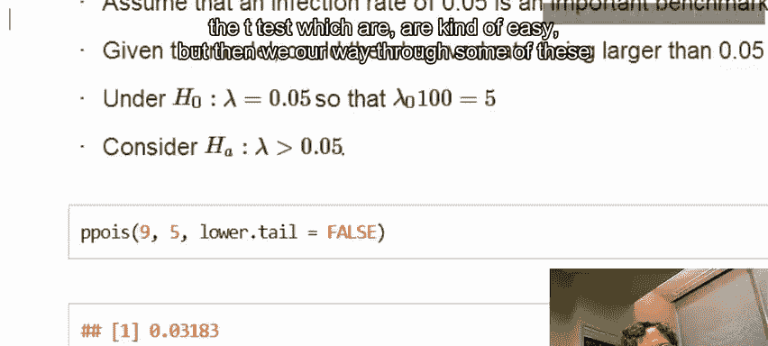