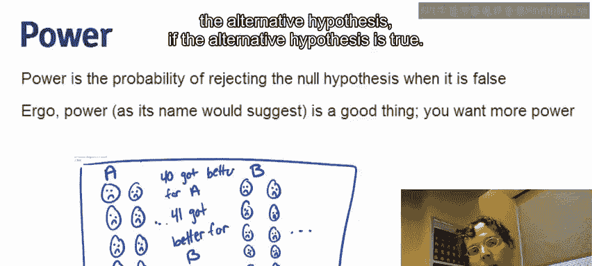
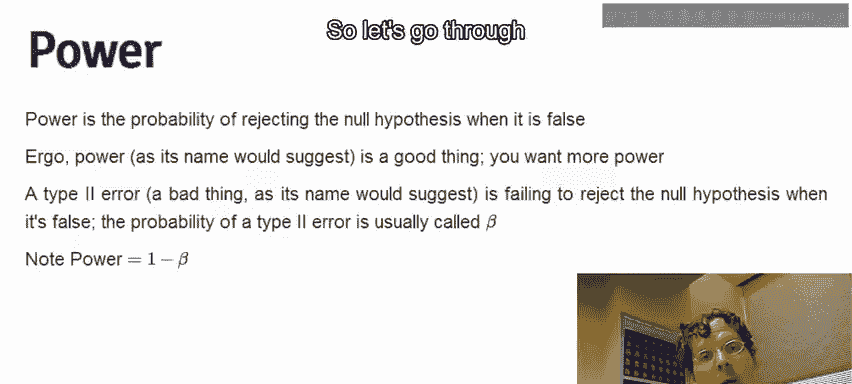
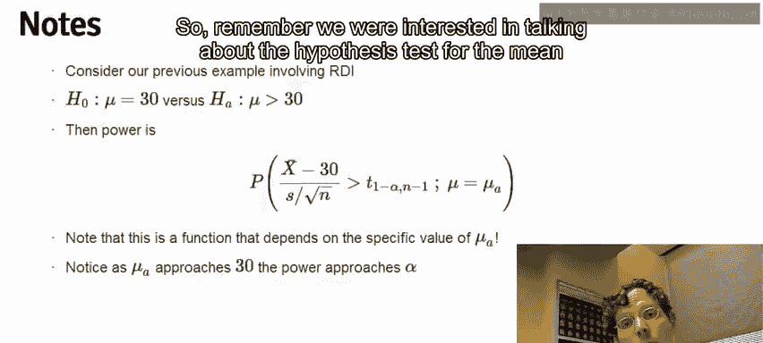
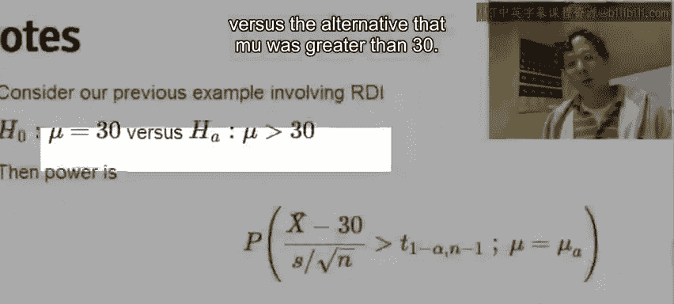
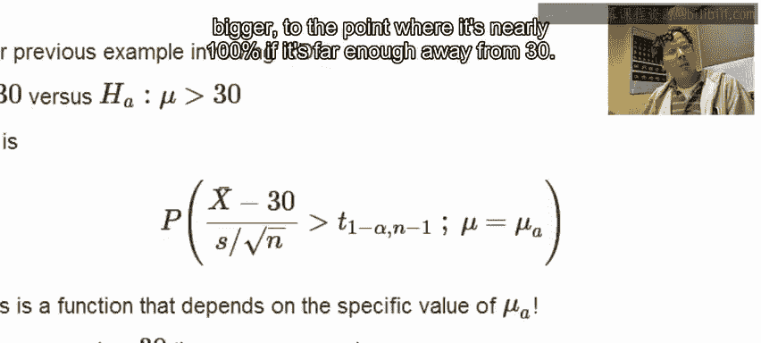

# 约翰霍普金斯大学数据科学课程6：《统计推断课程（约翰霍普金斯大学）》｜statistical-inference｜ - P32：31_11 01 功率.zh_en - GPT中英字幕课程资源 - BV1oG41197es

Hi， my name is Brian Caho， and this is the lecture on power。

Power is the probability of rejecting the null hypothesis when， in fact。

 the null hypothesis is false。So like its name would suggest， power is a good thing。

 you want more power。And interestingly。Power comes more into play when you fail to reject the hypothesis than when you reject。

 and let me try to explain。So imagine if you were to conduct a study that has low power， for example。

 you want to compare treatment A versus treatment B。

 and you've only randomized three people to receive treatment A and only three people to receive treatment B。

 Then when you make the comparison to see if treatment A results in a better outcome than treatment B。

 you would not be surprised to get a null result， because there were only three people in each group。

 you had very little power to detect a meaningful difference between the groups。

 So your null result was kind of expected or kind of what you would think might happen just due to chance alone。

 On the other hand， if you had 300 people in treatment A and 300 people in treatment B。

 and you failed to reject， then that would be meaningful because you would expect to see a difference since you collected so much data。

And that's why。Power actually tends to come more into play for null results than it does for non null results。

 and the way the power gets used most often is at the time of designing a study。

You want to design the study so that you have a reasonable chance of detecting the alternative hypothesis if the alternative hypothesis is true。

So let's also cover a couple more details， so a type 2 error。Is a bad thing。

 as its name would suggest， an error is failing to reject the null hypothesis when。

 in fact the null hypothesis is false。So the probability of a type 2 error is usually called beta and power is just one minus beta。

 so the two most meaningful quantities for hypothesis testing in terms of the two error rates for hypothesis testing are alpha。

 the type 1 error rate and beta the type 2 error rate。

 but we tend not to talk so much about beta instead we tend to talk about one minus beta this concept of power。

So let's go through a conceptual example and then we'll go through some specific numerical examples。

So remember we were interested in talking about the hypothesis test for the mean respiratory disturbance index。

 RDI in a particular population of obese subjects， so we wanted to test whether muu was 30 versus the alternative that muu was greater than 30。

We did a T statistic， which is， in this case， our sample mean minus the hypothesized value 30 divided by the standard error of the mean。

That statistic we're assuming follows a T distribution under the null hypothesis。

So if we calculate the probability that that statistic is bigger than the upper 1 minus alpha quantile of a T distribution。

That probability will be alpha if we calculate it under the nu hypothesispo when muu is 30。

 so in this case then I would write that mu A in this case equals 30。

Now power is simply the same calculation， but instead of plugging in muA equal to 30 for the probability that we're calculating。

 we plug in muA for some value greater than 30。That winds up being our power。

 Now imagine if I were to plug in a muA of say， 60。😡，Then this will be a large number。

 and that makes sense， right？If we want to detect whether or not the mean for this population is 30 or not。

 and it's really 60。Then we should have a lot of power to detect that because when we collect our data。

 there will be values around 60 instead of values around 30。Okay， now imagine instead。

 if our true alternative mean was 30。00001。Then we wouldn't have a lot of power to detect that because it's quite close to the null value。

 we're going to have lower power， So power， this power is a function that depends on the mean under the null hypothesis。

 if we plug in values close to 30， it's going to look a lot like our type 1 error rate and if we plug in values way away from 30。

 it should get bigger and bigger to the point where it's nearly 100% if it's far enough away from 30。

