# 约翰霍普金斯大学数据科学课程6：《统计推断课程（约翰霍普金斯大学）》｜statistical-inference｜ - P36：35_12 01 多重比较.zh_en - GPT中英字幕课程资源 - BV1oG41197es

Hi， my name is Brian Kaho and this is the multiple testing lecture in the statistical inference class in the Coursera data science series。

 this class is co taught by my collaborators Jeff Lee and Roger Pang。

 we're all in the Department of Biostatistics at the Johns Hopkins Bloomberg School of Public Health。

In fact， today we have a very special guest lecturer， Jeff Leak， I don't have a picture of Jeff。

 so let's just assume he kind of looks like this。

And he says things like internet's rule。And so I'll just let him take over from there。

This video is about multiple testing。We talked about hypothesis testing earlier in the course。

 and I mentioned that when you perform more than one hypothesis test。

 you have to do some sort of correction to make sure that you're not fooling yourself This lecture is a little bit about how to do those corrections。

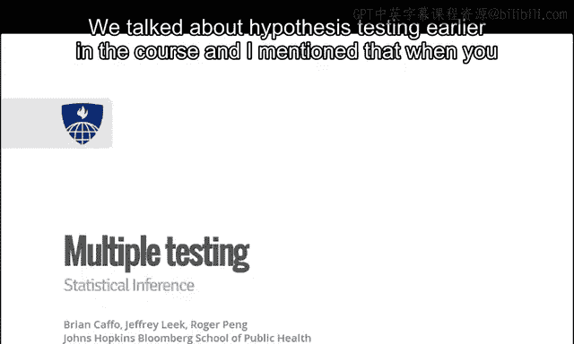

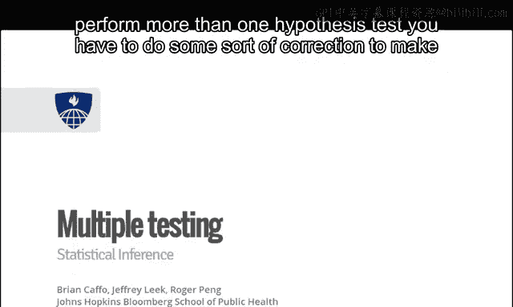

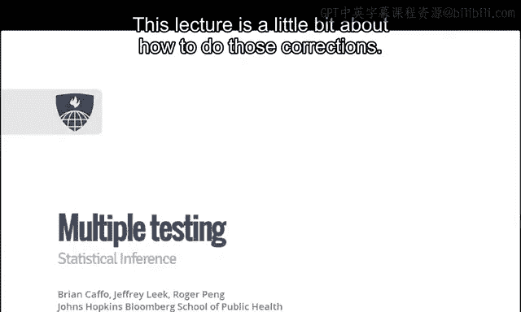

The key ideas here are that hypothesis testing and significant analysis are commonly overused techniques。

 in particular， what people will often do is calculate multiple P values when analyzing the same data。

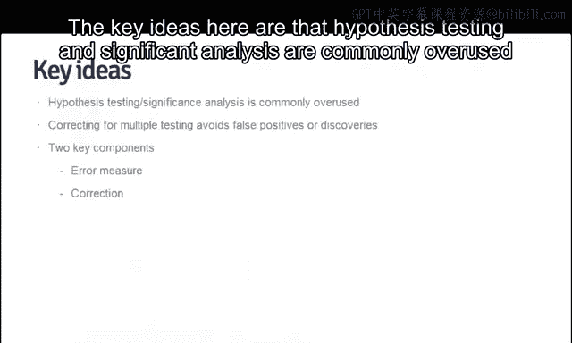

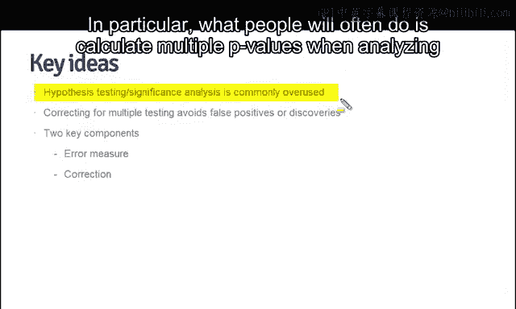

And then report only the smallest P value。

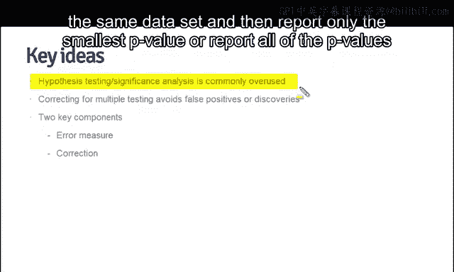

Or report all of the P values， but claim all P values less than 0。05 are significant。

 which leads to some problems that I'll demonstrate in a minute。

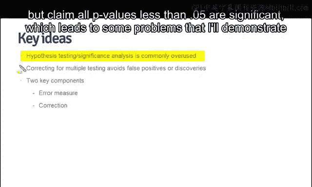

So what we would like to do is correct from multiple testing to avoid false positives or false discoveries when performing analyses with many variables。

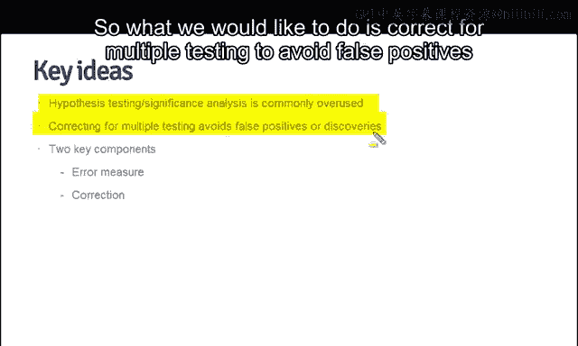

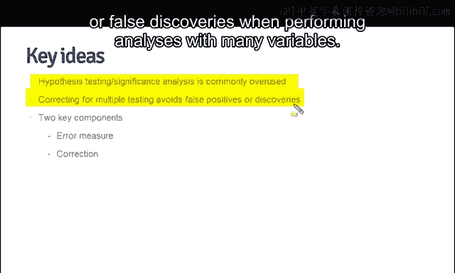

There are two key components to multiple testing corrections First it's a definition of an error measure that you would like to control。

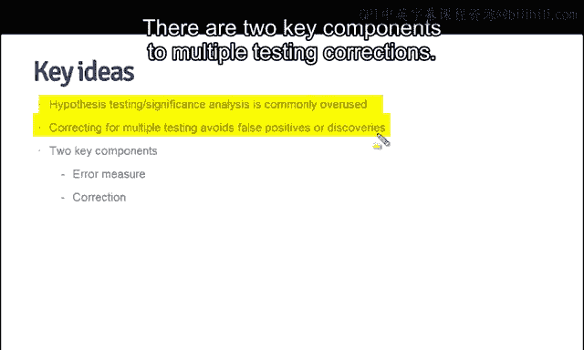

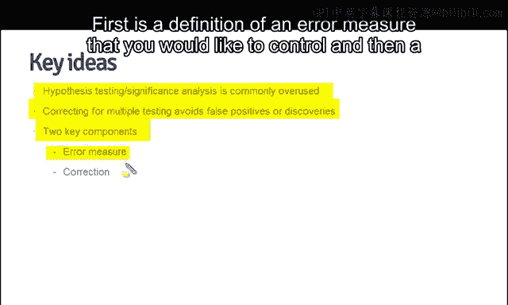

And then a definition of a correction or a statistical method that's used to control that error measure。

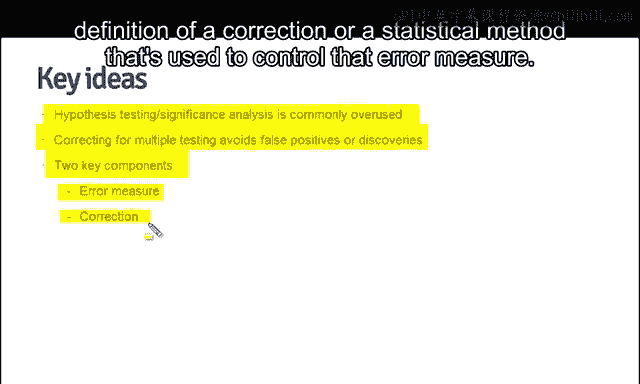

So this is related to the three eras of statistics， which appears in this book by Brad Ephron。

 of professorss of statistics at Stanford， so he talked about the three eras as the first era being when huge census level data sets were brought to bear on simple but important questions where they just collected a lot of data to try to describe a population。

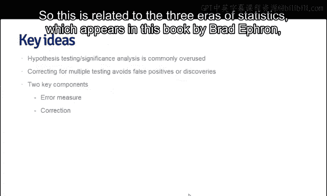

Then the classical period of statistics developed a theory of optimal inference for ringing as much information as possible out of small sample sizes。

 This is back what data was very expensive or difficult to collect。The third era。

 the era that we're in now， is the era of scientific mass production when data is cheap and easy to collect。

 but this also means that we're performing more and more analyses and if we don't correct for the fact that all these analyses are performed and we're allowing for a small amount of error in each analysis。

 those errors can pile up。So the reasons for performing multiple testing corrections are because of these new technologies that are leading to this increase in data。

 these technologies range from next generation sequencing machines and molecular biology to imaging of patients and clinical studies or electronic medical records。

Or personalized or individualized quantitative self measurements that you might take with something like the Nike fuel band or the Fitbit。

So why should we correct for multiple tests， this is actually a cartoon to describe the key problem that you run into。

 so suppose that you were looking at a particular analysis where you wanted to see if jelly beans cause acne。

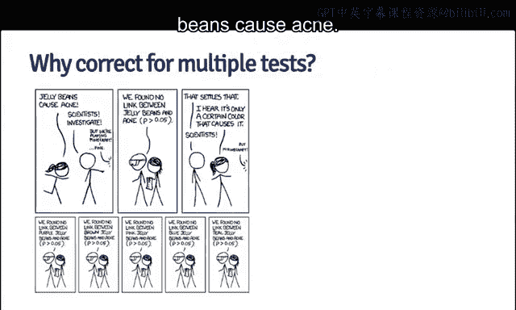

So what you do is you send off a bunch of scientists to investigate and they first look at just all jelly beans and they look and see if people eat any kind of jelly beans。

 whether they get acne or not and their P value comes back greater than 0。05。

And so the next thing that they might do is go and run and test all the different colors of jelly beans individually。

 say， well， is there a relationship between purple jelly beans， and acne， brown jelly beans。

 and acne， and so forth？

And in each case， they get a P greater than 0。05 so they don't report a significant result。

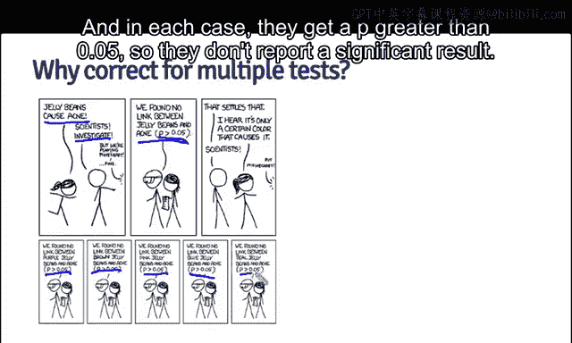

Until finally， after they test over 20 different kinds of jelly beans。

 they come up with one that is significantly associated with acne， green jelly beans。

 and they say there's only a 5% chance of this coincidence occurring by chance。

 but it turns out that they tested 20 different hypotheses。

 so it was almost it became very likely that at least one of them would result in a coincidence。

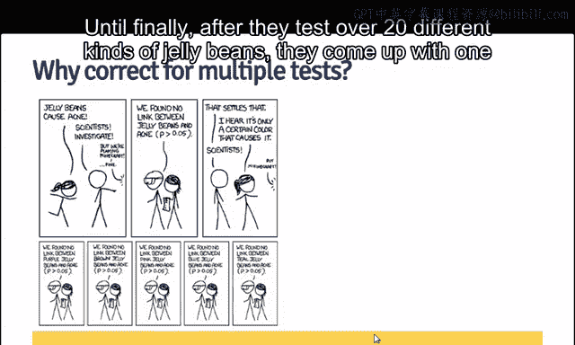

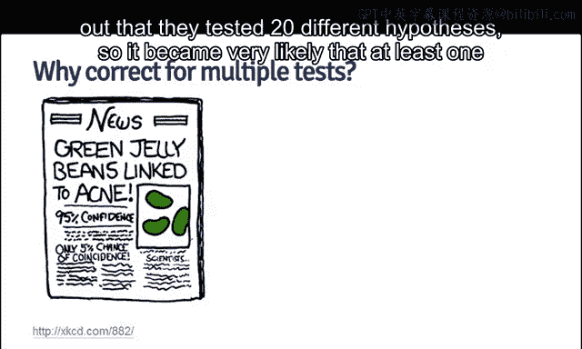

So in other words， if we allow for 5% chance of error in every hypothesis test that we perform and we perform at least 20 hypothesis tests。

 then we expect to find at least one error because 20 times 5% is about 100% so I've been referring to P values and hypothesis testing is sort of interchangeable ideas but they're not really interchangeable so you can imagine where you're performing a hypothesis test for parameter beta and you're trying to determine whether it equals zero versus the alternative that it does not equal to zero。

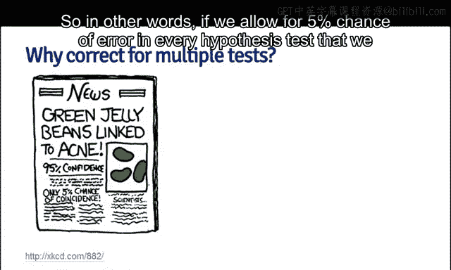

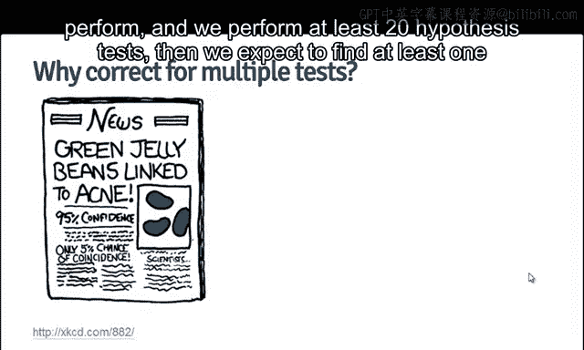

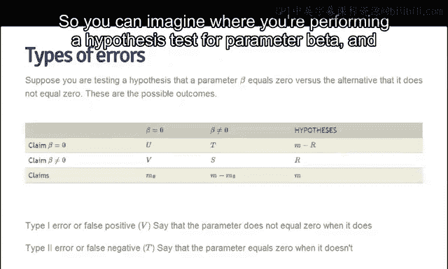

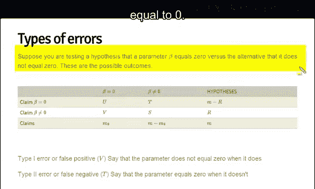

And so this is an example of when that might happen is say you're fitting a linear regression model relating one variable to another。

 if the coefficient for the variable that's the covariate is equal to zero。

 then there's no estimated association between the two variables， and if it's not equal to zero。

 then there is some association。

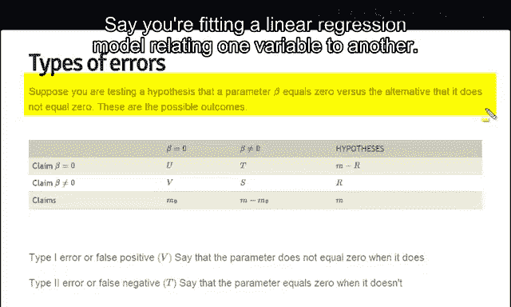

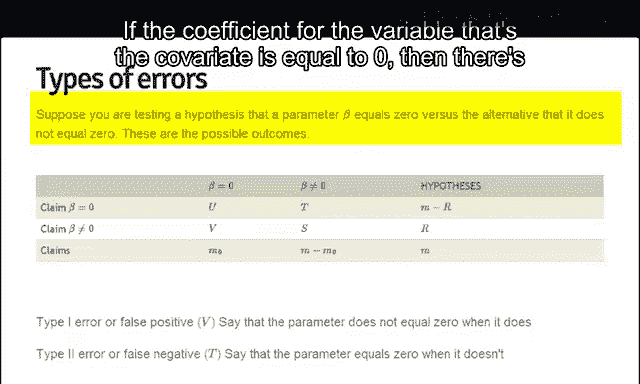

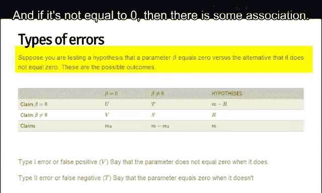

So you might fit that linear regression model and calculate a P value as we've discussed previously。

And then to perform a hypothesis test， you might look at that P value and calculate whether it's less than some particular threshold。

 and if it is less than the threshold， then you would say that beta does not equal to zero and if it's above the threshold you might say beta equal to zero。

 this is called the hypothesis test。

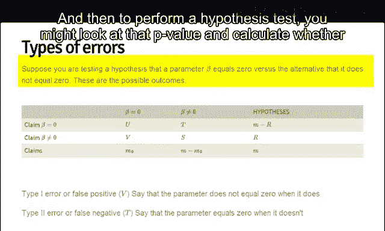

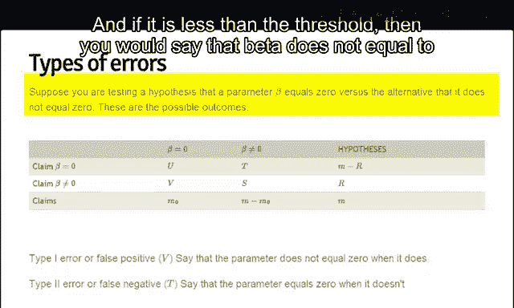

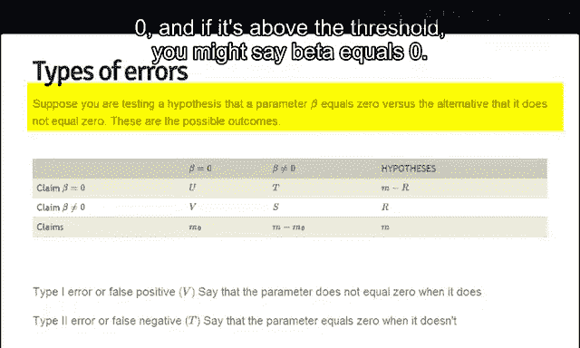

When you're performing a hypothesis test， this is the table of the possible outcomes that could happen。

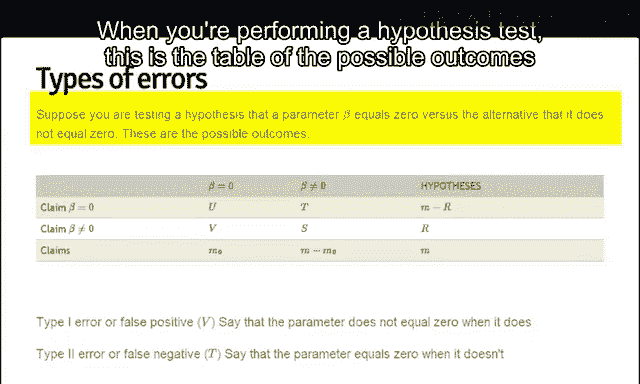

So in each row， you have a particular claim that you might make。

 whether the beta is equal to zero or beta is not equal to zero。

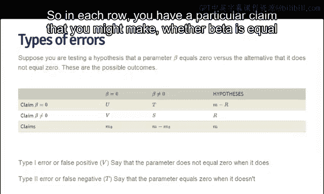

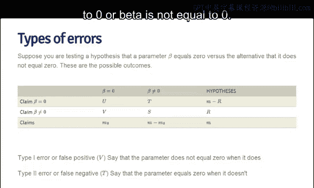

And then in each column you might have the true state of the world where beta is equal to zero or beta is not equal to zero。

 so if you perform lots of hypothesis tests， all the times when you say beta is equal to zero and beta actually is equal to zero。

 fall into this cell and all the times when you say beta is not equal to zero and is not equal to zero and it really is not equal to zero。

 they fall into this cell。

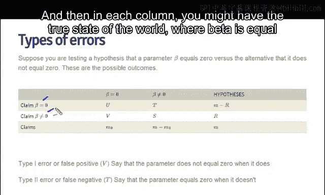

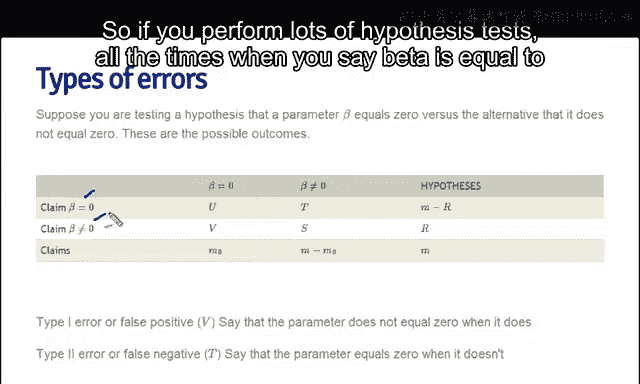

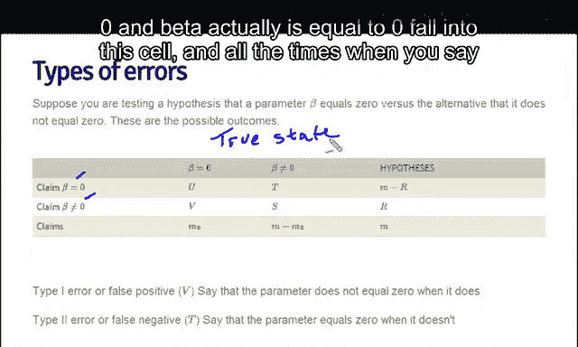

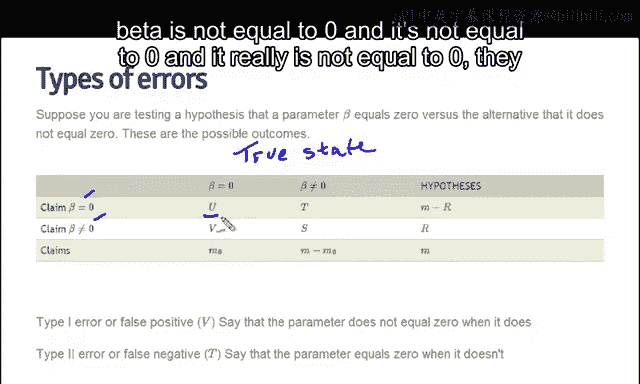

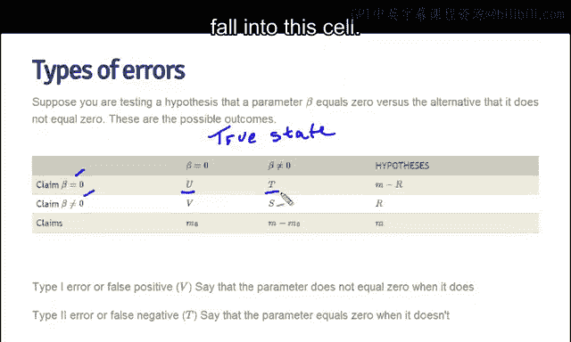

So then there are two types of errors that you might make， so the first one。

 type1 errors or false positives are the case where you say beta is not equal to zero。

 in other words you say there is some relationship between the variables。

 but there actually is not a relationship so we're going to denote by V the number of times that happens。

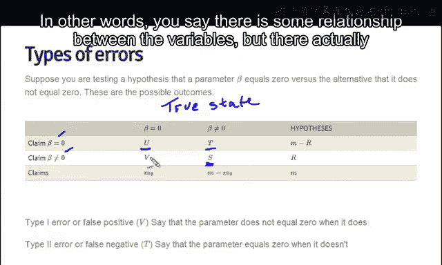

The other type of error， type 2 errors， or false negatives are the cases where you might claim that beta is equal to  zero。

 in other words there is no relationship between the variables。

 but it turns out that there actually is。

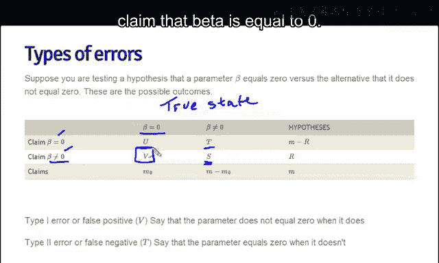

In general， people tend to focus a little bit more on type1 errors or false positives when performing scientific investigations as we want to limit the number of times that were led astray or we find false positives。

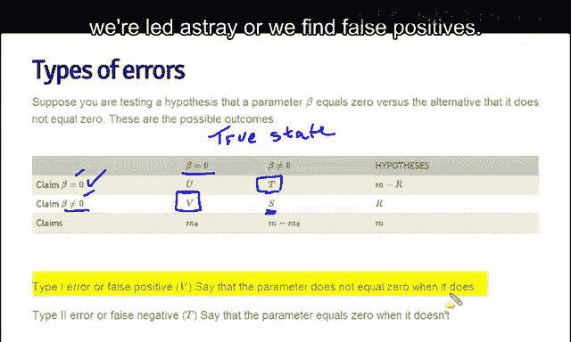

But in general， the two error rates might be compared a different amount depending on what type of problem that you're looking at and whether one type of error is more costly than the other。

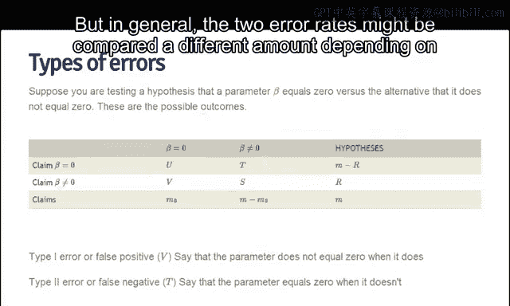

So in multiple testing， there are a couple of different error rates that we might consider that's the first component of a multiple testing procedure。

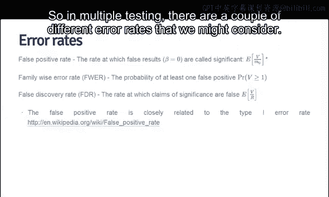

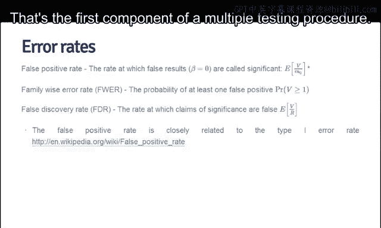

So the error rate in this case might be the false positive rate。

 so this is just the rate at which false results are called significant。

 so in other words these are the results beta equals 0 where there's no relationship between the variables。

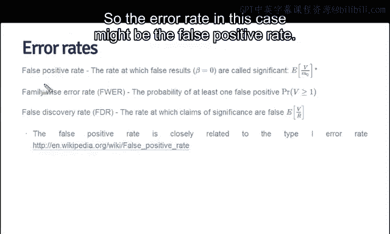

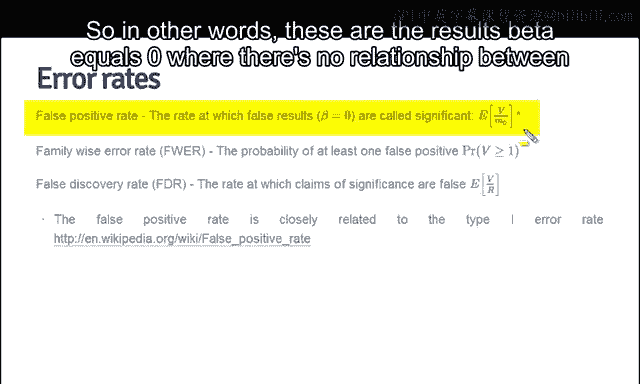

What rate do we call them significance， this is just the average fraction of the times that we call them significant when they're not divided by the total number of not significant variables。

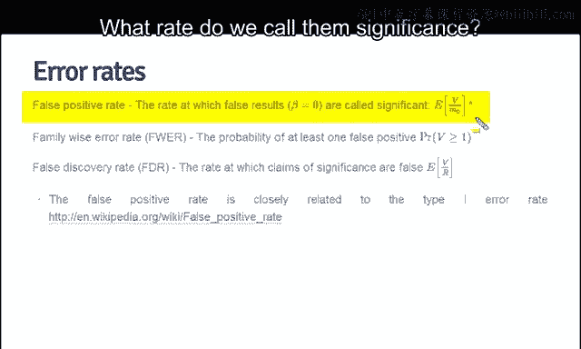

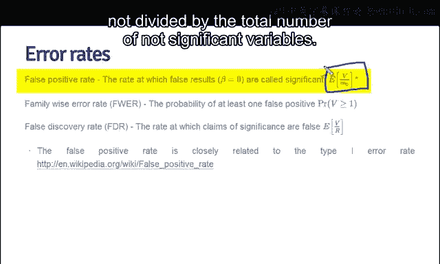

Then there's another error measure which is called the family wise error rate and so that is just the probability of at least one false positive so this V variable counts all the times where there is no relationship between the variables but we claim that there is one so if we do that v times the family wise error rate is controlling the probability that the number that we make that false claim greater than or equal to one。

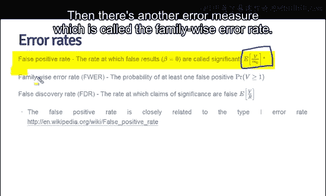

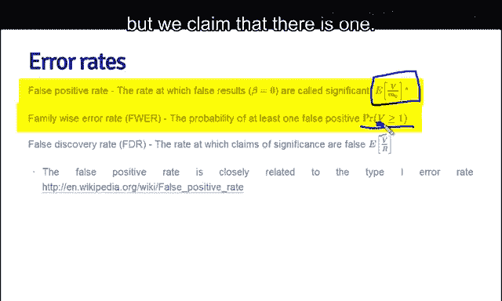

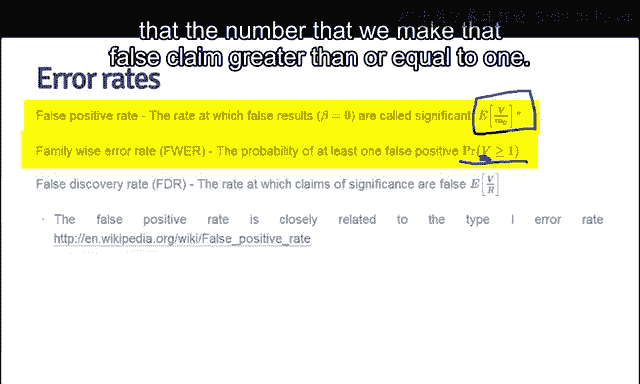

The false discovery rate is a little bit different than the false positive rate in that it's the rate at which claims of significance are false。

 in other words。

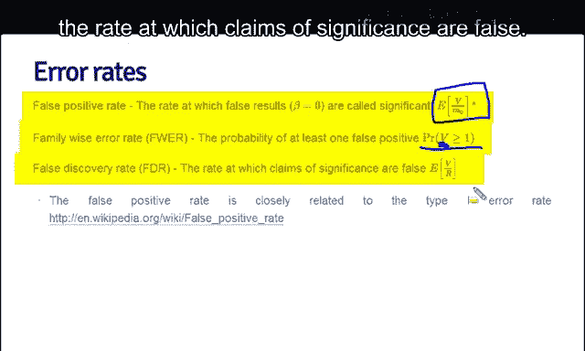

R of the times we're going to claim that beta is not equal to 0。

And V of the time we're going to be wrong about that decision so the expected value of v divided Ir is actually just the rate at which our claims that there's a relationship are false so this is the false discovery rate versus the false positive rate。

 which is the rate at which actually truly false results are called true。

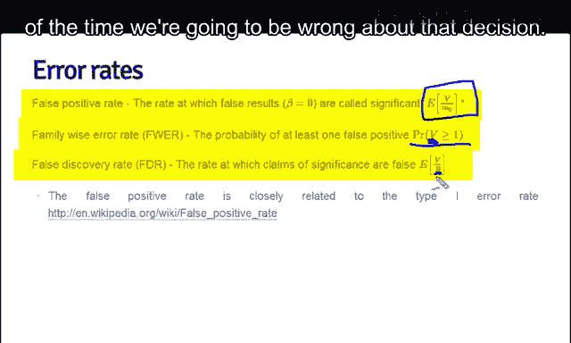

So the false positive rate is closely related to the type1 error rate and it's actually kind of a subtle distinction and if you want to learn a little bit more about that I've linked to the Wikipedia page here。

So the next part of multiple testing is now that we've defined the different error measures。

 how do we actually define a procedure that can be used to control that error measure。

 in other words， is there a way that we can perform a procedure such that the rate of errors defined by that error rate is held in check in a particular way？

So first we're going to talk about controlling the false positive rate and so if P values are correctly calculated。

 you can actually just use the P values that you've calculated directly and call all P values less than some threshold alpha where alpha is between zero and1 to be significant that will actually control the false positive rate at level alpha on average in other words the expected rate of false positives is less than alpha so here's the problem with that suppose that you perform say 10。

000 hypothesis tests this seems a little bit extreme a large number of tests maybe for people that are doing just one or two regressions。

 but in many high- dimensional settings or signal processing settings this is actually a reasonably small number of hypothesis tests that might be performed。

And if you call all P values less than 。05， say significant， so we set alpha equal to 005。

 then the expected number of false positives is just the total number of tests that you performed times the false positive rate that you're controlling the error rate at and so you get 500 false positives。

 so if you perform this many hypothesis tests and you get 500 significant results。

 it's pretty likely that there are mostly going to be made up of false positive results。

So a question that we immediately comes to mind is how do we control a different error rate so that we avoid so many false positives？

So the first choice is the familywise error rate and I talked about that just a minute ago。

 which is we want to be able to control the probability that we're going to make even one error so the Bon Feroni correction is actually the approach for doing this and I've linked to the Wikipedia page here it's actually the oldest multiple testing correction。

And the basic idea is that if you're doing M hypothesis tests and you want to control the family wise error rate at level alpha。

 in other words， we want to make sure try to ensure that the probability of making even one error is less than alpha。

 so that's actually quite a stringent control there， we can calculate all the P values normally。

And then take the alpha level that we originally had for a single hypothesis test and divide it by the number of hypothesis tests that we performed in other words。

 if alpha is 005 and the number of hypothesis tests is 10， then we get 0。

05 divided by 10 is equal to 0。005。

So then we get this new alpha level and we call all P values less than this new alpha level significant then that will on average control the familywise error rate the pros of this method are that it's easy to calculate and you don't make a lot of errors it's guaranteed to make very few errors in the sense that this error rate which is the probability of even one false positive is actually controlled to be quite low。

A con， though is also that it may be very， very conservative， in other words。

 if you're doing a large number of hypothesis tests controlling the probability of even one false positive might be pretty extreme。

 you might want to allow for a few false positives if that will allow you to discover a lot of more real signals。

So that's where the false discovery rate comes in， it's probably the most popular error rate or multiple testing correction when performing very many hypothesis tests。

 these examples like I said it came up in genomics， imaging。

 astronomy or other signal processing disciplines in particular。

 but it also comes up in a lot of other different places。

So the basic idea here is suppose you do M hypothesis tests and you want to control the false discovery rate at level alpha。

 so the expected number of false discoveries divided by the total number of discoveries is controlled。

You can think of this sort of as that level of noise in the results， so if you have an FDR of alpha。

 you expect about alpha percent of the things that you're claiming to be false。

So what you do is you just calculate the P values normally。

 and then you order the p values from smallest to largest and the way that we denote that is in parentheses we put the number that represents the order of the P value。

 so this is no longer the first P value we calculated。

 it's now the smallest P value that we calculate and then we order them all the way up to the em P value so there are M hypothesis tests。

So this is the maximum P value。Then you go through and for the Ith ordered P value。

 you look to see whether it's less than or equal to alpha times I divided by M and if it's true。

 then you call it significant and if not you don't。

 this then is procedure is designed to control this false discovery rate here。

The pros are that it's still pretty easy to calculate like the Boon Verroni correction。

 it's less conservative and maybe much less conservative if there's a lot of signal and you allow for just a few false positives。

 you might be able to find a lot more of the real signals。

The cons are that it does allow for more false positives， so if you let the error rate be very large。

 you might find a lot of false positives among the significant results and it might also behave strangely underdepend。

 in other words， if you perform hypothesis tests that are related to each other， say for example。

 including different sets of parameters in the same regression model and trying out a bunch of different regression models。

 you can get strange behavior of the false discovery rate。

So here I'm going to show you an example of how these significance calculations are performed and basically how the hypothesis tests are performed for the different corrections。

And so I'm going to do this example with 10 p values。

 and I'm going to control all of the error rates that we're going to be talking about at the level 0。

2。

So here are the 10 p values， they're ordered by how small they are。

 so this is the smallest P value up to the 10th P value which is the largest one and on the y axis is the P value itself。

And so the red line represents all the P values that we would call significant at alpha equals 0。

2 if we did no correction at all， so it's basically just all the P values less than 0。

2 and so this no correction approach actually controls the false positive rate。

 but remember that could lead to a large number of false positives if you're performing many hypothesis tests。

So the next thing to look at is the false discovery rate。

 so this is controlling the proportion of false positives at a level of 0。2。

 in other words we expect about 0。2% sorry about 20% of all the results we call significant to be false positives。

And so the way that this is calculated is actually following this gray line。

 so we're going to order the P values from smallest to largest and each time we're going to compare it to a linear line where the slope is determined by this alpha level here。

And so we actually would just call these first three Pvalue significance so we find three significant P values and we're controlling a slightly different error measure Finally the bonferroni correction down here is actually just taking 0。

2 and dividing by a 10 the number of hypothesisses that we' testing so in this case it's 0。

02 is this line straight across here and in this case we we'd only discover these two or call these two p values significant and all the rest we would call insignificant not significant but the boferroni correction here is controlling this much more stringent familywise error rate so this hopefully shows you a little bit about how the different procedures work sort of conceptually in terms of where the cutoffs are drawn for different sorts of sets of P values。

Another approach is to adjust the P values rather than to adjust the alpha level。

And so in this case， we're going to calculate what's called adjusted P values is the reason why I bring up this approach is because it's easy and sort of a direct calculation is available in R。

 something you keep in mind is that once you've adjusted P values。

 they're no longer classically defined P values， in other words。

 they don't have the same properties of classically defined P values and shouldn't be treated that way。

But they can be used to control error measures directly without adjusting the alpha parameter nowun。

So here's an example of how this might work for the boon Verroni correction。

 so suppose we have these MPP values， one thing that we could do is we could adjust them by calculating M times each p value and taking the max of that and1 so in other words the P values can the adjusted P values can't be larger than one just like the P value themselves can't be larger than one but we have multiplied every p value by M so remember for the boonferroni correction we were going to divide the alpha level by M so if instead we multiplied the p value by M we can just calculateal the number of times our new p values are less than alpha and it will give you the exact same set of results that are significant。

So in other words， we can use these familywise error rate or Bferoni adjusted P values to calculate significance by comparing it to the original alpha level that we might have been interested in in this case。

 say 0。05， so if we multiply the P values by the number of tests performed and look at how many or less than alpha。

 then we will control the familywise error rate at level alpha。

So here's an example with no true positives， so in this case I've simulated a bunch of data sets。

 so a thousand data sets。

In each case， I generate an normal y and a normal X that have no relationship to each other。

And then I fit a linear model relating those two variables y to X。

 and I get the coefficients of that I take the summary of that linear model and get the coefficient matrix。

In that coefficient matrix in the second row， the fourth column is the P value for the relationship between y and x。

 so I calculate the P value for all 1，000 different simulated examples。

And then I look at the number of P values less than 0。05。

 so remember in none of these cases was there actually a relationship between the two variables。

 but still we get 51 or about 5% of the tests being performed are called significant。

 even though there's no relationship。

So what happens if I adjust the P values and apply the false family wise error rate or the false discovery rate。

 so for example， what I can do is use the P dot adjust function in R。

 so I just say I apply P dot adjust to the P value vector that I calculated so this P value vector has all of the different P values from all 1000 different studies。

P dot adjust gets applied to that in the first case I say method equals B Feroni because I want to do the Bon Feri correction and again now that I've corrected the P values I can just compare them to a standard alpha level in this case 0。

05 and I look at how many or less than that and in this case there is zero so when there are no true positives we find very few significant results when we're controlling the family wise area which is good we shouldn't find any significant results because there's no relationship。

Similarly， we can do the same thing， but instead of controlling using the Bo forroni correction。

 we can use what's called the Benjamini Hoffburg correction。

 which is the correction I just talked about a minute ago for controlling the false discovery rate。

 so I can again adjust the P values and then look at the number that less than 0。

05 in this case again we don't discover anything which is good because there shouldn't be any discoveries in the case that there's no significant relationships。

So I'm going to show another simple simulated scenario。

 and so in this scenario I'm going to have 50% of the time there's going to be a relationship between the two variables。

 so I'm going to simulate again 1，000 different y and x variables for the first 500 sets of variables。

 I'm going to generate a y value that's independent of x。

For the last 500， I'm going to generate a y value that has a mean that's equal to2 times x。

 so there's a relationship between y and x， so the first 500 beta is equal to 0 and the last 500 beta is equal to 2 Again。

 I calculate a P value for each of the cases。

And then I can define the true status to be， beta is equal to 0 for the first 500 and beta is not equal to0 for the last 500 just so that I can make a table and show what the results are from this analysis。

So if we look at the number of P values less than 0。05 by the true status。

 this is with no correction。

I see that for the case where there is actually no relationship between the two variables。

 I again get about 5% of the time a false positive result。

 and then in this case the signals very strong， so I actually find that all of the P values for the cases where there is a relationship are less than 005 so actually discover all of the real signals that exist in this data。

So if I use the family wise error rate， I again adjust now the P values using P dot adjust applied to the P value vector。

 I set the method to be bo Veroni， calculate the number of times is's less than0。

05 in this case I actually discover slightly fewer。

Significant results， in other words， I missed 23 of the cases where there should be a signal。

 but now I actually have no false positives and that's because I'm again controlling the probability of even one false positive to be less than 0。

05 in this case。

In the case of the false discovery rate， I set the method to be equal to BH and what I discover is that here I do actually discover all of the significant results。

But I discover actually fewer false positive results than I would have discovered without out any kind of multiple testing correction and in its case。

 actually about 5% of the cases where I actually call there to be a true relationship only about 5% of the time are they is there not actually a true relationship so in this case I'm looking at the percentage of the times。

That they're actually equal to zero， but we claim that it's not equal to zero。

So the other thing that you can do although of this is not necessarily useful for performing the hypothesis test it's useful for kind of understanding what P adjustment does so I can plot the P values versus the adjusted P values corrected for both the boonferroni method in the Benjamin Hchberg in the case of Boon Ferroni what I'm doing is I'm just taking each P value and multiplying it by the number of tests that are performed so in this case multiplying it by 1000 so you can see the very smallest P values are still less than1 so then after I get to this point here。

 all of the P values multipplied by 1000 are equal to1 or greater and so since I don't allow the adjusted P values to be greater than one and you just get a flat line。

On the other hand with the Benjamini Hawkburger probe you actually sort of see this increasing function。

 so the P values on the x axis and the adjusted P values on the y axis。

 and you see that the adjusted P value is slightly larger across the entire range than the actual P value itself。

 but not dramatically larger actually for this particular case。

Because you actually have a lot of significant results。

So some notes and further resources， so first the notes。

 multiple testing is actually an entire subfield and there's a whole bunch of different corrections that you could possibly apply。

 depending on the different dependence structures and all the different sort of choices that you made in the statistical modeling。

So depending on your problem you might want to do a little further research on what's the right correction to apply The basic Boonferoni or Benjamin Hckburn correction is usually enough for most sort of standard problems but there's actually if there's strong dependence between tests。

 for example， you might want to consider method equals BY in the P dot adjust function or look into more direct adjustments for the dependence between the hypothesis tests。

 there' is actually an area in which I've done a little bit of research so hopefully you can take a look at some of my vapors on the area。

So for the resources are this is actually quite a nice paper。

 a gentle introduction to multiple testing procedures with applications in genomics which is an area I work in and where multiple testing has really flourished in terms of a statistical discipline。

 similarly the statistical significance for genomewide studies is a very nice gentle introduction introduction in terms of a paper to read again it's focused on molecular biology but it's pretty easy to read。

 I think even if you're not an expert in that area。

 and finally this is a very nice sort of introduction to multiple testing that goes over the basics。

 a lot of what I've covered now but maybe a little bit more depth in case you're interested。

