# 约翰霍普金斯大学数据科学课程6：《统计推断课程（约翰霍普金斯大学）》｜statistical-inference｜ - P9：8_04 02 期望值简单例子.zh_en - GPT中英字幕课程资源 - BV1oG41197es

Now let's talk about an example of obtaining a population expected value。

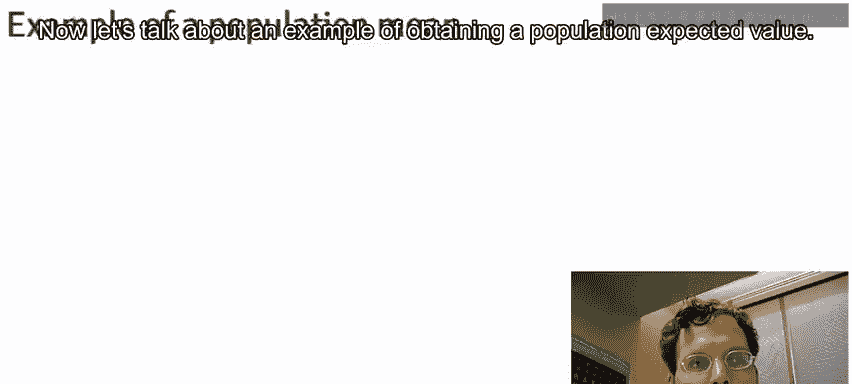

So suppose a coin is flipped and x has declared 0 or1 corresponding to a head or a tail。

 what is the expected value of x， so again the expected value is the property of the population。

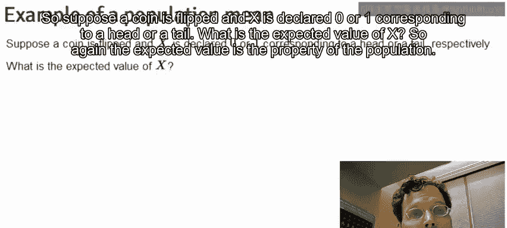

If we plug into our formula expect the value of x is the probability 0。

5 times the value 0 plus the probability 0。5 times the value 1。

 so all the values that the coin can take 0 or 1 times the probability that it can take them add it up。

 this one's up to be 0。5。

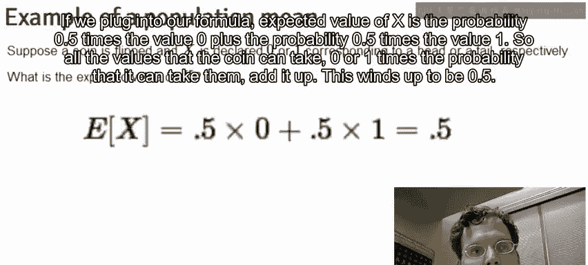

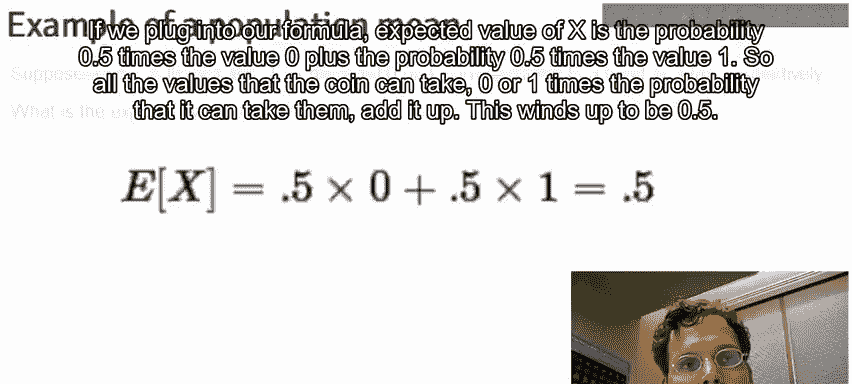

So notice the expected value is a value that the coin can't even take。

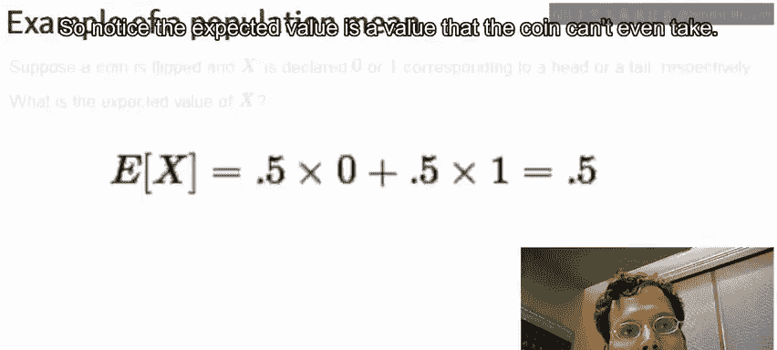

However， if we were to think about this geometrically。

 the answer is quite obvious if we have two bars， their equal height， one at zero， and one at one。

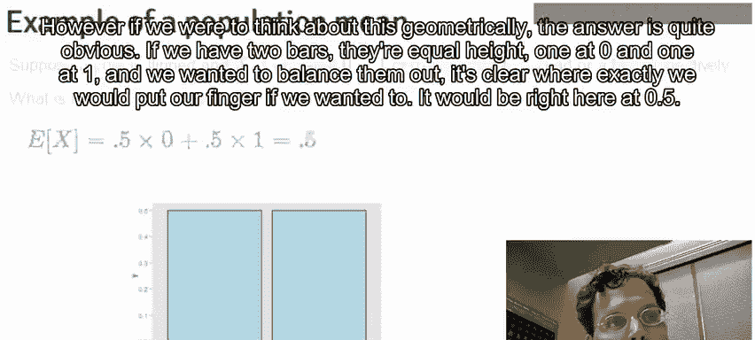

And we wanted to balance them out， it's clear where exactly we would put our finger if we wanted to。

 it would be right here 0。5。

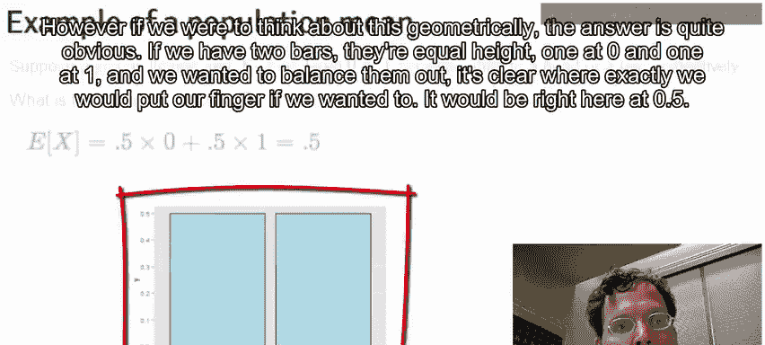

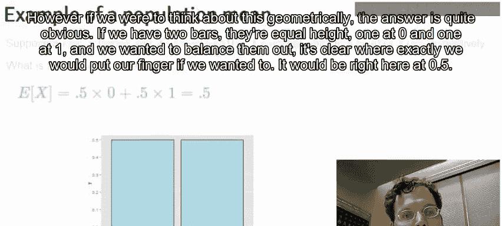

Suppose that a random variable x is such that the probability that it takes the value1 is p and the probability it takes the value 0 is 1 minus p。

 This is a biased coin where the probability of a head is not necessarily 0。5。

 The probability of a head now is P。

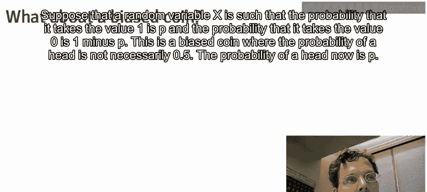

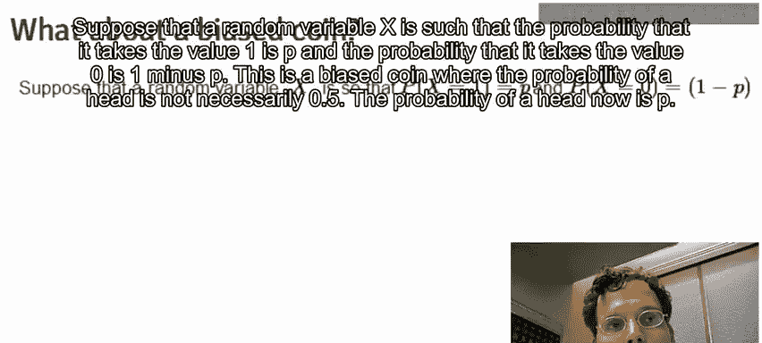

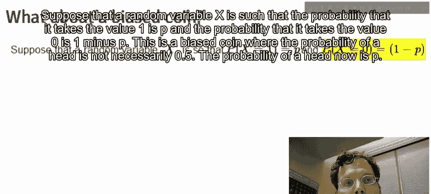

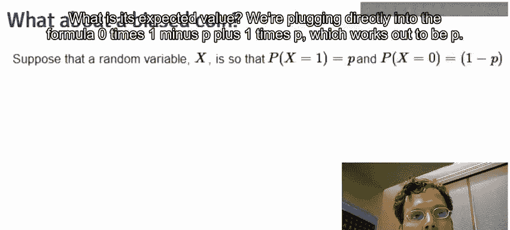

What is its expected value， with plugging directly into the formula 0 times 1 minus p plus 1 times p。

 which works out to be P。

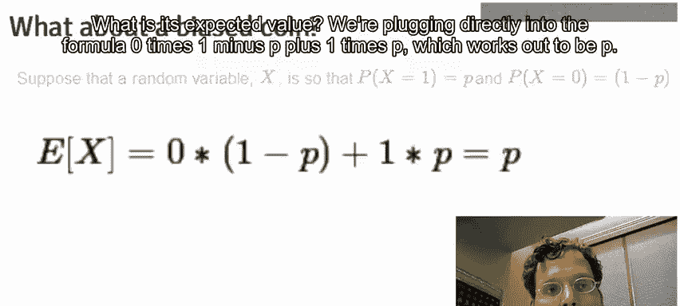

So the expected value of a coin flip。Even a potentially biased one is exactly the true long run proportions of heads you would obtain in infinitely many flips of the coin。

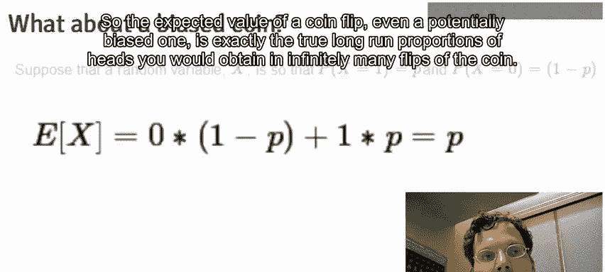

What about a die， supposeose that a die is rolled and x is the number that is face up。

 what is the expected value of x？

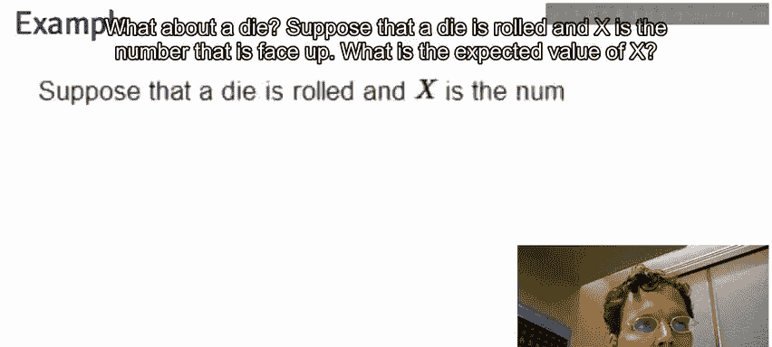

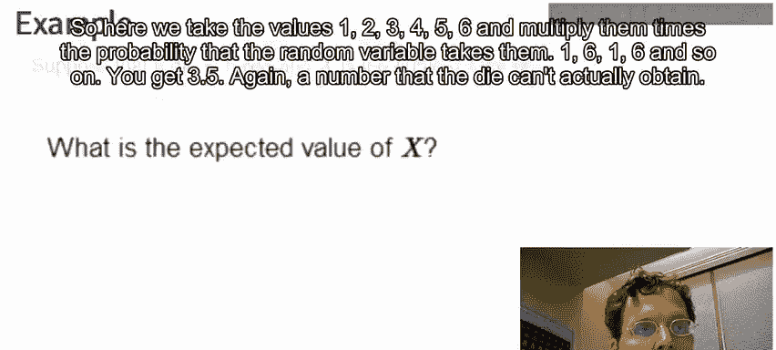

So here we take the values 1，2，3，4，5，6 and multiply them the times the probability that the random variable takes them。

 16，16 and so on you get 3。5 again a number that the die can't actually obtain。

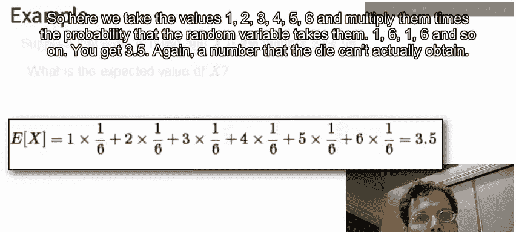

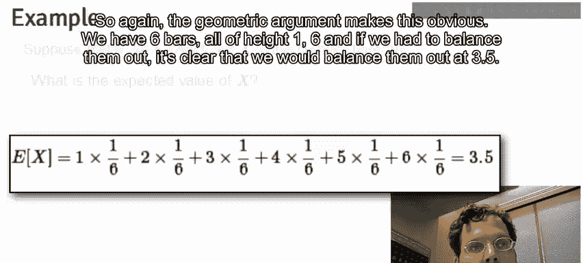

So again， the geometric argument makes this obvious， we have six bars， all of He 16。

 and if we had to balance them out， it's clear that we would balance them out at 3。5。

