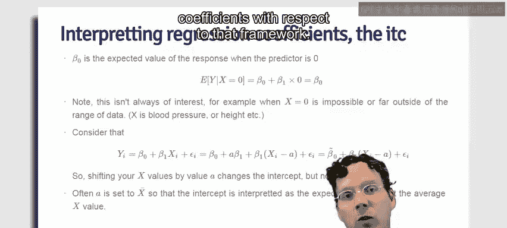
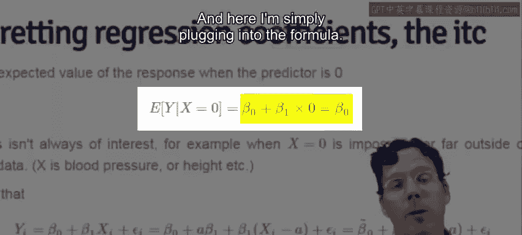
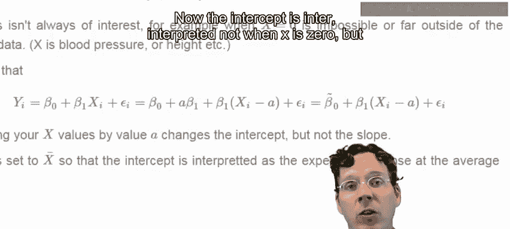

# 约翰霍普金斯大学数据科学课程7：《回归模型》｜regression-models｜ - P11：10_解释系数.zh_en - GPT中英字幕课程资源 - BV1Xw411m7We

Now that we have a formal statistical framework， we can interpret our regression coefficients with respect to that framework。

Take for example， the intercept， it's the expected value of y， given that the regressor is zero。

 and here I'm simply plugging into the formula。

Note that the regressor being equal to zero is often not of interest in the study， for example。

 if the regression variable is blood pressure， probably you're not interested in the response among people with blood pressure of zero。

However， there's an easy fix for this。Consider just shifting our regression variable by a constant A。

 and here in this equation， I've just subtracted off an A here。

Which means I have to add an a beta 1 over here to have done nothing to have simply added zero。

Well this is exactly rewriting the regression equation as beta not tilde plus beta 1 times x minus a。

 a new regression line with a new intercept， the same slope and my regressor now shift by a constant A。

 so this goes to show you that if you shift your regressiongressor by a constant。

 it doesn't change the slope。 however， it does change the intercept。

Now the intercept is interpreted not when x is0， but when x is this value that you shifted it by a。

A very common constant to do is the average set a equal to the average of the x variable。

 then your intercept would be interpreted。As the expected value of the response。

When the regressor is at the average value of the x's。

Let's see if we can figure out a model based interpretation of our regression coefficient。

Now it's a slope， so it must have an interpretation that is of the form the change in Y per unit change in X。

So let's see if we can work with that。Take the expected value of y。

 given that x takes the value x plus 1， a1 unit increase in x。

 and subtract off from it the expected value of y， given that x takes the value x。

Well that works out to be beta not plus beta 1 times x plus1。

Minus beta n plus beta 1 times x do the arithmetic and that works out to be beta 1。So。

Beta 1 is the expected change in the response per unit change in the regression variable。

 and that so it has a nice interpretation， it's not that different from the regular interpretation of a line just now with the expected value。

 the conditional expected value of the response。Now remember， if we shift the X variable。

 it doesn't change the slope， we discussed that on the previous slide。

What if we scale the regression variable and it usually we are usually scaling by a number， say。

 a that's positive。So what we can do is simply multiply and divide by a。

 and we can rewrite our regression equation as beta n plus beta 1 tilde times x times a plus epsilon。

So we've multiplied x by a， and our regression slope has now been divided by a。So in other words。

 multiplication of a regression variable by a factor A results in dividing the coefficient by a factor of A。

Let me give you a simple example so to hopefully solidify these points。

 imagine this if x is height measured in meters and y is weight measured in kilograms。

 a pretty simple regression problem。Then beta1 is interpreted in kilograms per meter。

Converting x to centimeters implies multiplying x by 100。Cimeterters per meter。

To get beta 1 in the right units， now we simply divide it by 100 centimeters per meter to get it back in the right scale。

 and here I just wrote a little equation to remind us。

