# 约翰霍普金斯大学数据科学课程7：《回归模型》｜regression-models｜ - P12：11_用于预测的线性回归.zh_en - GPT中英字幕课程资源 - BV1Xw411m7We

Also， I'd like to remind everyone that we can get a prediction for Y by taking beta not hat plus beta1 hat and multiplying it by the X that we want to predict at。

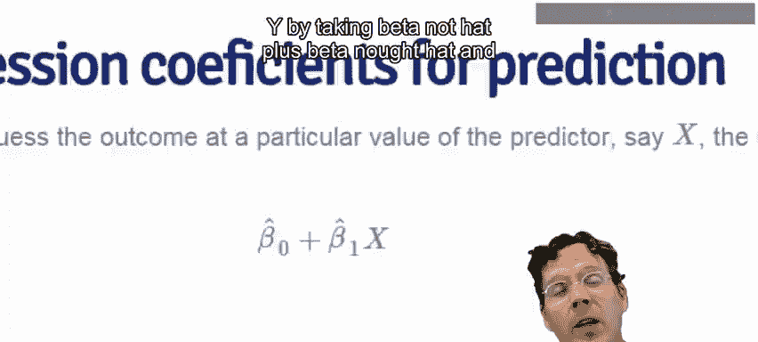

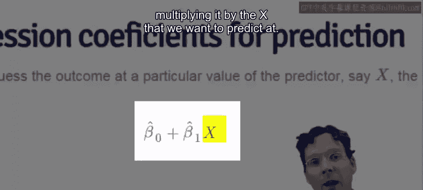

Now， if we plug in the observed x's， then we get the fitted values。

 the ones who we're trying to make as close as possible to the observed data。

 but that doesn't mean that we can only predict at the fitted values we can predict at any value of x we'd like to plug into the equation。

However， we're going to have more reasonable predictions if the value of X that we plug in is in the cloud of data that we use to build a model。

Later on we'll also talk about how to account for that kind of uncertainty with prediction intervals。

 but for the time being， let's just talk about how we get a prediction and in the next couple of slides we'll go through an example of interpreting the intercept。

 interpreting the slope and generating predictions from a specific regression modeling setting。

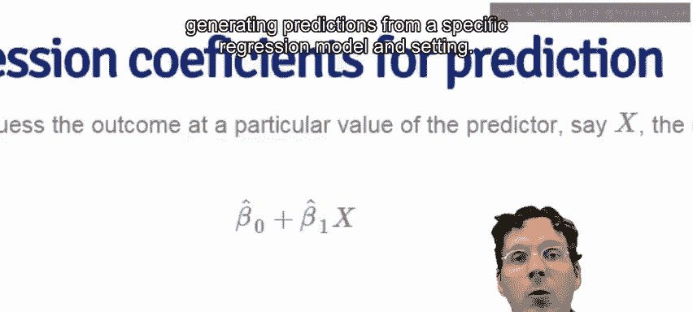

All right， let's go through some code now to interpret our regression coefficients and show you running of the regression coefficients sort of in real time the data set is the diamond data set from the using our package。

 the data is diamond prices in Singapore dollars and diamond weight in caratts。

 which is a standard measure of diamond mass。

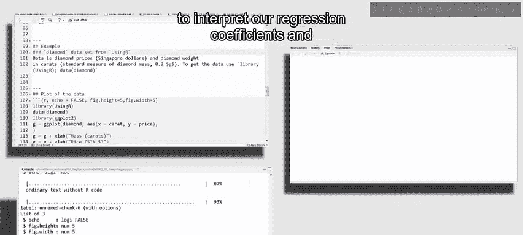

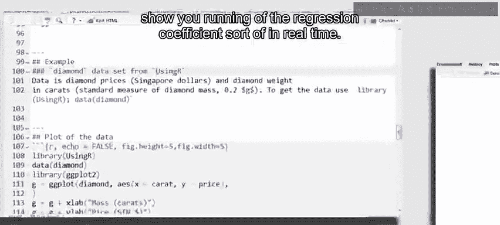

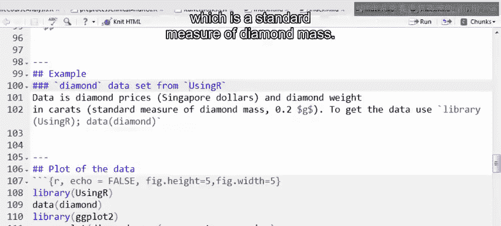

To get the data， you need to start out by using library using R to get the using our package and data diamond。

And then we want， I want to do G plot too because I'm going to do a G plot first。

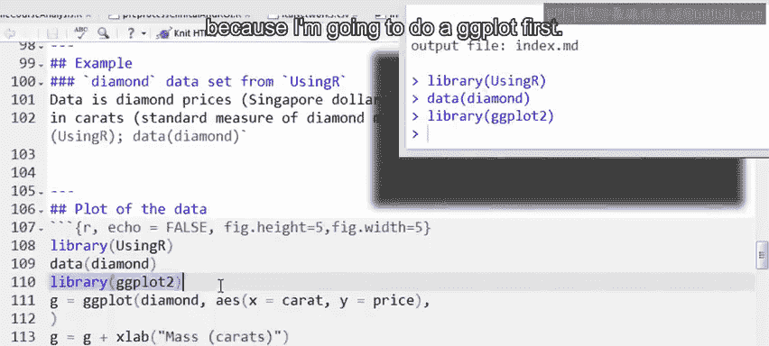

So here let me go through my G plot commands。So I would like to assign to the variable G， my G plot。

 the data set is diamond， My aesthetic has the horizontal access variable as carrot and the Y axis variable as price I'd like to label I'd like to get in the practice of labeling my axes。

 So my plot I add a layer where the X lab is mass in carroats and where the Y label Y lab is price。

In Singapore dollars。So let me run those。Let me run those lines。And then I'd like to add the points。

 I like to add the points with a black background and then a light alpha blended color on top。

And then it's quite easy to add the regression line。

 so I'm going to add a layer that is GO underscore smooth and method equals LM will add the regression line。

 and if you omit any arguments it's just going to assume the regression line withY is the outcome and X is the predictor and then I want my regression line color to be black。

So let me run that line and then。Call my plot。There's my plot， you can see on my X axis， I have mass。

 on my y axis， I have price， and now what I'm plotting is the fitted line。

 the line that minimizes the sum of the squared vertical distances between these points and the lines。

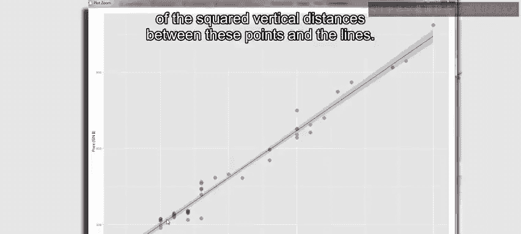

Now let's actually go through。And get our fitted line。Just to remind us。

 the function LM is R's linear model procedure， so it includes regression as a special case。

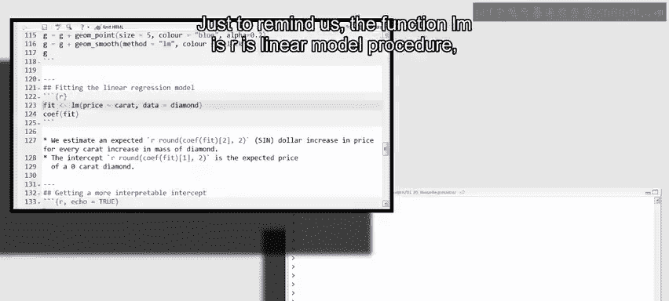

Why on the left hand side of our Tilde is the outcome price then Tilde。

Think of that as sort of the equal sign in the model， our x variable carrot。By default。

 LM includes an intercept， so if you don't want an intercept。

 you have to explicitly force it in the model。😡，Then the comma。

 we want the data set that we're looking at to be the diamond data set。

 so in other words we have to give it the data frame。

 otherwise it looks in the regular R environment for variables in the model and we're going to assign that to the variable name fit so let's see what that output looks like after we run it。

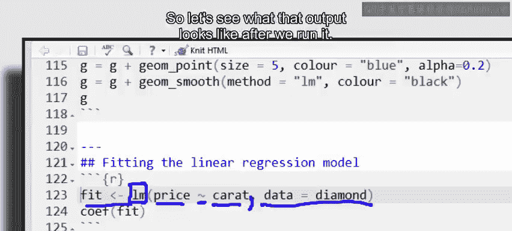

So there I've run the model， and now I'm going to type fit just to see what it prints out。

 It basically just prints out the coefficients beta n and beta 1。

 I would note that you can get a much more detailed。

Print out by doing summary of the outputted variable from the LM fit and you get this。

More elaborate printout and we're going to go through in detail all of the numbers on this printout you'll be able to interpret everything on this printout at some point after the class。

 but for the time being， let's just talk about the coefficients If you just want to grab the coefficients as a vector let's do coI fit and there we get the intercept it labels it is intercept and the regression variable for the carrot。

The slope for the carrot regression variable。So let's look at this 3。

721 variable and try to interpret it。

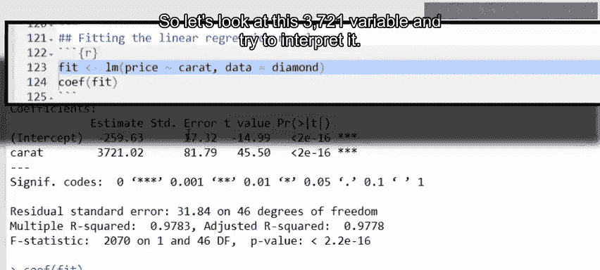

It's saying that we have an expected 3，721 Singapore dollar increase in price for every carrot increase in mass of the diamond。

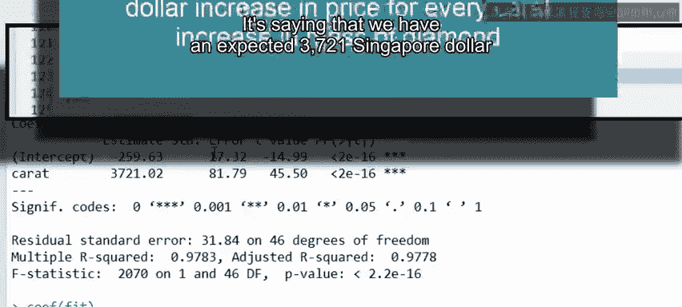

The intercept negative 259 is the expected price of a zero carrot diamond， so not very interested。

 interesting because we're not interested in zero cart diamonds。

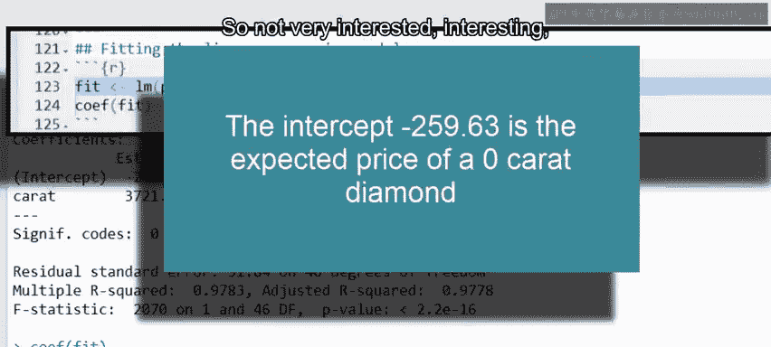

Now let's mean center our X variable so that the intercept is on a more interpretable scale。

The first thing I'd like to do。Is assigned it to a different variable fit to instead of fit because I don't want to overwrite the original fit。

LM is again my linear model procedure， My outcome stays the same。

 and now I want to mean center my predictor variable carrot， so carrot minus meanme carrot。

If you want to do arithmetic operations inside equation statements in LM。

 you actually have to surround them by this I function。

And then we still want our data set to be the diamondd data set。So let's run that code。

So I've run fit two。And there are my new coefficients noticeice， of course， the slope stays the same。

 3721， but my intercept has changed to 500。

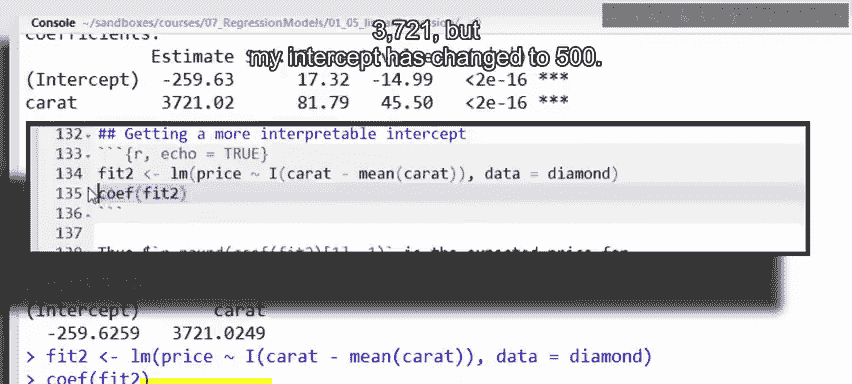

So $500， Singapore dollars is the expected price for the average size diamond。

 in this case the average diamond is about 0。2 carats。

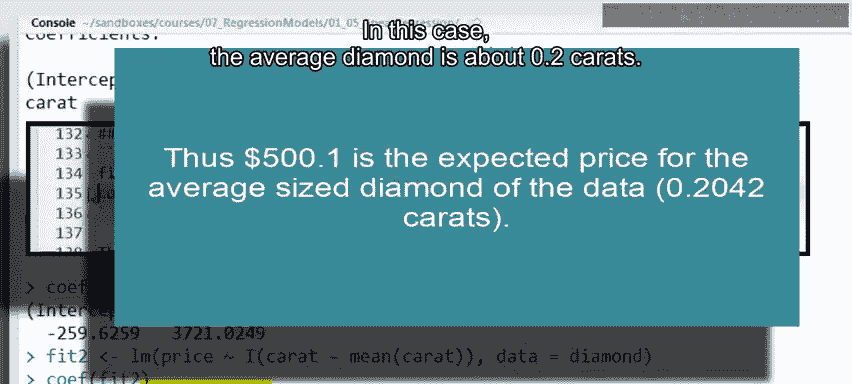

A one carroatt increase is actually kind of big， what about changing the units to1/10th of a carrot？

We can do this just by dividing the coefficient by 10。

 so we know that we would expect to see a $372 increase in price for every 11th of a car increase in the mass of the diamond。

 but let's actually show an R how this works as well。Here I am now assigning to the variable fit3。

The linear model fit。Where now instead of putting in carrot， I'm putting in carrot times 10。

 so the units of this new variable is 1/10th of a carrot。The data is， of course。

 still the diamond data set。So let me run that。And then let me find the coefficient。And you get。

 of course， that is now 372 rather than 3，721。

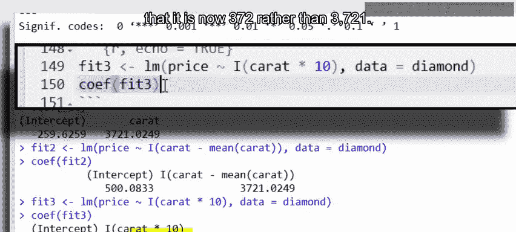

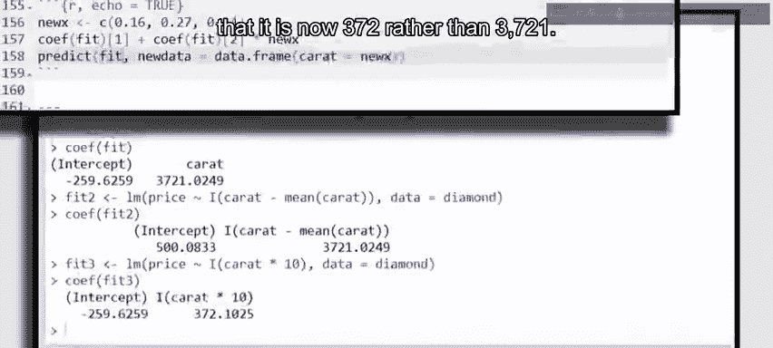

So imagine if someone came to you with three new diamonds that they had， 0。16 caratts， 0。

27 carats and 0。34 carroatts， so here they are right here。And let me assign those。

And they wanted to know what you would estimate the price would be。Well。

 you could do it manually by grabbing the two coefficients。

In multiplying the intercept or adding the intercept plus the slope times these new values。

 let's do that。 And so you would predict。336，745 and 1006 for these three diamonds。

 respectively based on your fitted linear regression model， which by the way。

 from the scatter plot seems to fit pretty well。Often you don't want to do even that much coding you want a more general method。

 especially when you get lots of regression variables。

 so there's this general method called predictict that will take the output from several different kinds of model fits。

 linear models or one example， but predict as a generic function in R and it applies to several different prediction models。

So we predict from the output of our LM fit。And then you need to give it some new data to predict that。

 So new data is a data frame that has the new values of x for the carrot variable。

 Then when we do that， what you'll see。Because of course it gives you the same answer。

 the now in a way that scales up when we have lots of regressors in much more complicated settings。

 so you generally want to predict using the predict function， if you omit this new data statement。

 if you just do predict fit， I'll show it to you。

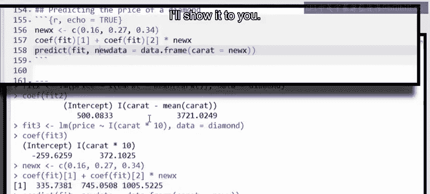

It predicts at the observed x values， so it gives you the Y hat values。

If you want it at new X values， you have to give it this new data argument。

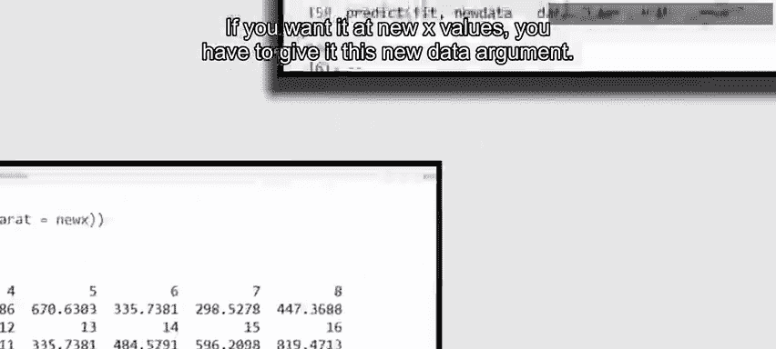

I just wanted to briefly illustrate what the prediction was accomplishing。Here's our。

Observe data points in blue。The fitted values， when we do the predict command。

 the fitted values in red， all of the observed。X values in their associated fitted points on the line。

 These are if we were to draw vertical lines from the observed data points onto the fitted line。

 they would occur at these red points。When we predicted a new value of x。

 what we're doing is we're finding a point along this horizontal axis here I'm giving the three values that we want。

 0。16， 。27 and 0。34， we're drawing a line up。To the fitted regression line。 and then over。

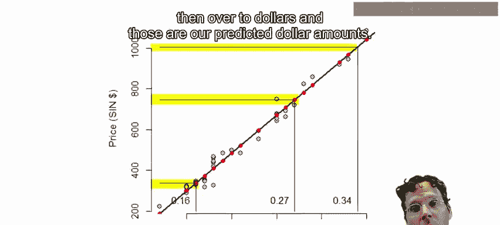

To dollars， and those are our predicted dollar amounts。

