# 约翰霍普金斯大学数据科学课程7：《回归模型》｜regression-models｜ - P14：13_残差编码示例.zh_en - GPT中英字幕课程资源 - BV1Xw411m7We

Let's go through calculating residuals。 we're going to use the diamond data set。 let's see。

 so our data is the diamond data set， so let's do that。I'm going to redefine prices y。

X is carrot and n is the length of the number of pairs， just so I don't have to type so much。

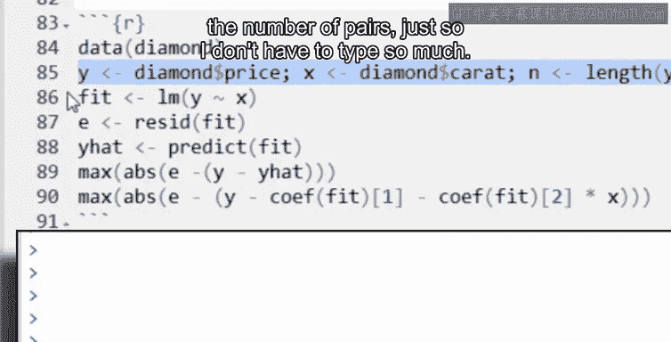

Now I'm going to assign to a variable named Fi， I'm going to assign my linear regression object that gets created from LM。

So let me do that。

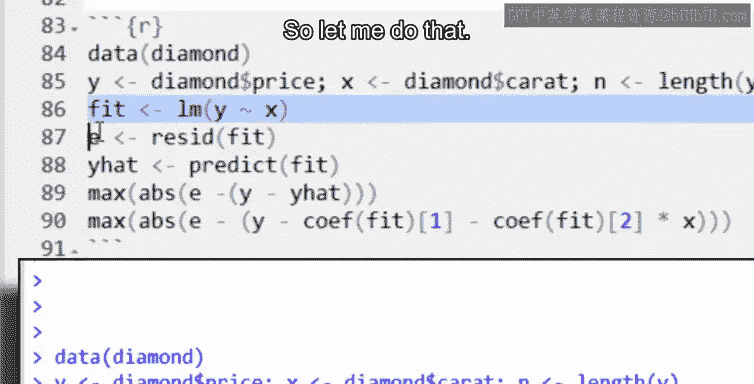

Now， the easiest way to get the residuals is just to resist a fit， so I'm going to define those as E。

Let me show you another way to get the residuals that of course。

 has to do the same thing if I were to get my predicted fitted values。

 and remember if I don't give the predict function new data， if I just give it the output from LM。

 the assignment from LM。Then it will just predict at the observed x value。

 So Y hat now is a vector of predictions at the observed。Carrot values。

Now I just want to show you that my residuals calculated via the residual function are the same as the residuals that I'm calculating manually。

 which is just subtracting Y and y hat so the way to do that is just take the difference。

 the absolute differences and find the largest one and I see that the largest one is on the scale of 10 to the minus 13 so up to numerical precision it's the same thing。

Then lastly， I just want to show that if I manually even calculate the fitted values， co if fit1。

 and then co if fit2 times x。That I of course， will get。Very， I get exactly the same number。

 So up to numeric precision exactly the same。 So the way you want to do it to get the residuals is reid。

 but hopefully showing you this other code will illustrate what's going on in the background with what the actual calculation that Rezid is doing。

Finally， let me show you that the sum of my residuals is zero。Well， it's 10 to the minus 14th。

 which is close enough to zero for me， and then also the sum of my residuals。

Times the price variable x， that also has to be zero， well 10 to the minus 15。

 so up to numerical precision is zero in both cases。

So the residuals are the s lengths of the red lines that I'm going to show in the following plot。

 and I'm going to do this using base R graphics just so I mix a little bit of base R with some GG plot graphics。

 so I'm going to create my plot here。There's my plot。I'm going to add the fitted line and in base R。

 if you want to add the fitted line and you fit a regression line。

 you can just do AB line and put the object that you assign to the LM fit。

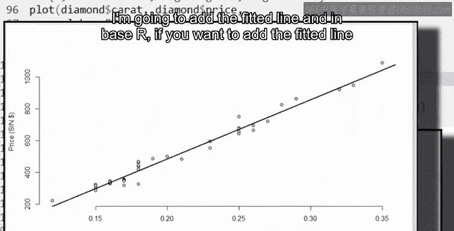

Just as an argument， and it'll add the regression line here， I want the line width to be2。

 So it shows up a little bit better。 And then I'm going to just for a loop over。

Over the data values to add in the red lines， let me zoom in and show you that plot。 There's my plot。

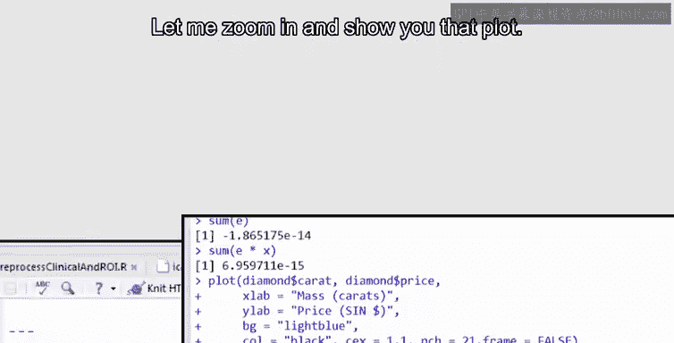

Now my residuals are these red lines。These distances where if the point is above the line。

 the residual will be positive and if the point is below the line， the residual will be negative。

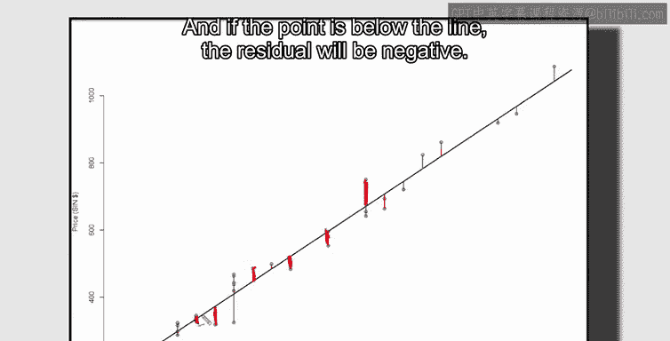

This scatter plot isn't particularly useful for assessing residual variation。

 Notice all of the blank space in this part in this part of the graph。

 making the plot kind of useless for that purpose。

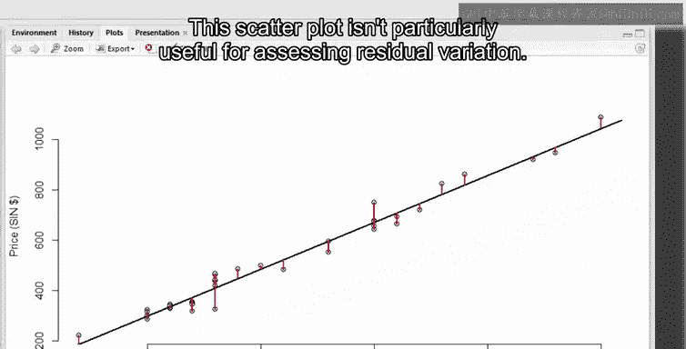

So instead， why don't we plot the residuals on the vertical axis versus mass on the horizontal axis？

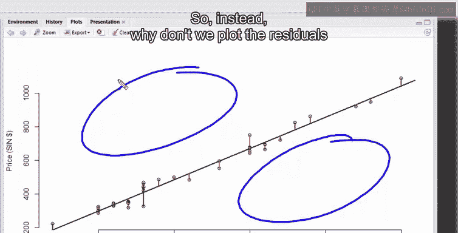

Let's go ahead and run the code。And here's the plot。

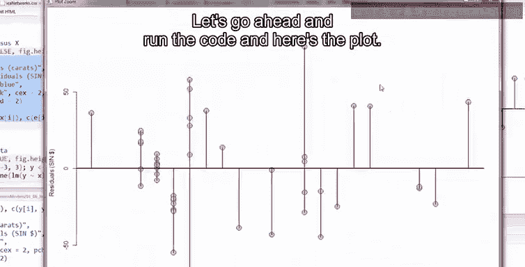

Now， we can see the residual variation much more clearly。When you look at a residual plot。

 you're looking at you're looking for any form of pattern。

 the residuals should be mostly patternless。Also， remember that if we've included an intercept。

 the residuals have to sum to 0， so they have to lie above and below this horizontal line at0。

 and you'd like them to be sort of nicely in a random looking fashion distributed both above and below  zero。

 We can see some interesting patterns by honing in on the residual plot here。 For example。

 we can see。

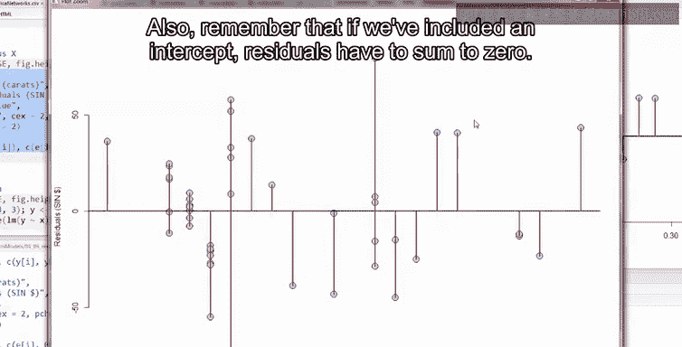

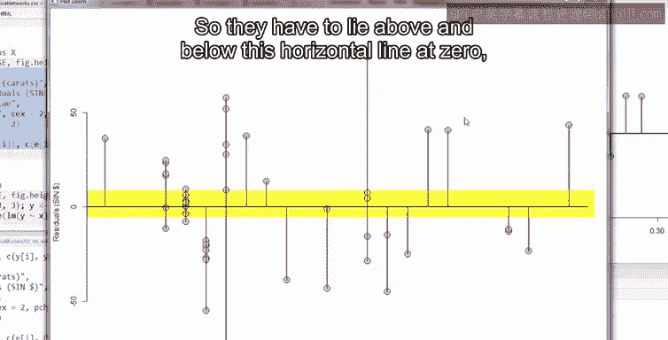

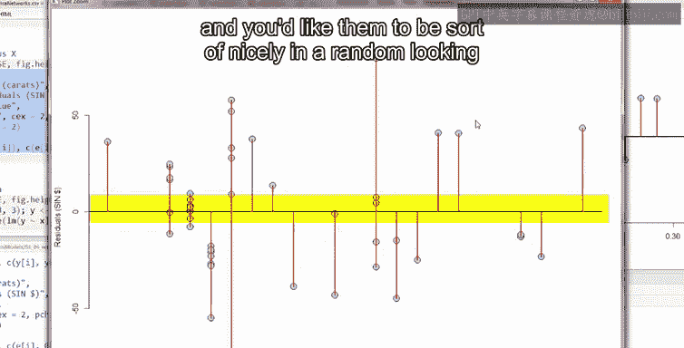

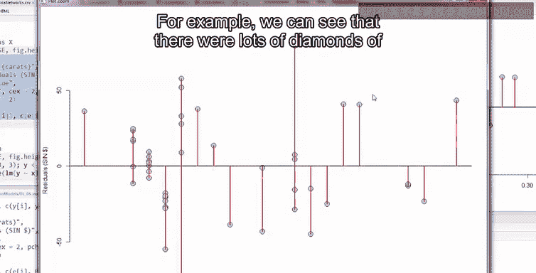

That there were lots of diamonds of exactly the same mass measured and this sort of gets lost in the scatter plot by zooming in this way。

 we noticed that particular feature。

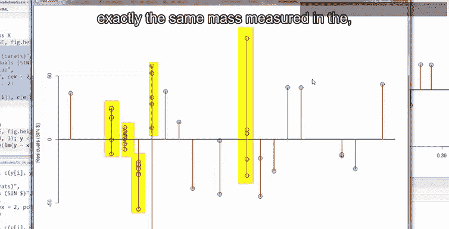

Next， what we're going to go through is some pathological residual plots just to highlight what residual plots can do for you。

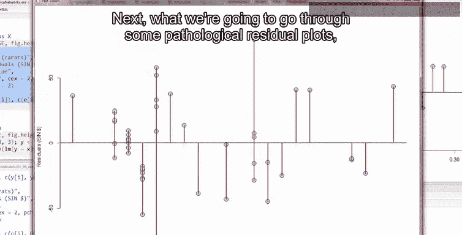

So I've concocted some examples that will help us to understand how residuals can highlight in on model fit。

So let's look in the R Markdown file and I'm going to show it again at the console rather than going through the slide so you can actually watch me doing this。

X here is just going to be uniform from minus3 to plus3。

 So I've created a X variable that's just a kind of random smattering of points between the values 3 and minus3。

My y is equal to x， so it's an identity line。But then I'm going to add another term that's cineex。

 so it should look like an identity line， but kind of oscillating around it a little bit。

 and then I'm adding some normal noise on top of it so let me。Add my Y。

 and I'm going to switch back to G G P because I like it better so。Then base graphics now。

So I've created my G plot。I'm going to go ahead and add the smooth first because I want it as the bottommost layer。

 and then I'm going to add my two sets of points and there's my scatter plot。And so let me zoom in。

 and it's a little difficult to see the non linearity that Sineex term is very。

It's a little apparent， but it's kind of very hard to see， I think if I was looking at this。

 I would immediately notice something paternesque in the poor fit here。But nonetheless。

 it's maybe a little bit hard to see。Before I move on to the residual plot， let me make a comment。

 this model is actually the NAR is actually not the correct model for this data and this might happen in practice。

 this doesn't mean that this model is unimportant right there is a linear trend and the model is accounting for it。

 it's just not accounting for the secondary variation in the sign term。

So I just want to emphasize this in regression modeling is just because you aren't fitting the actually correct model that doesn't mean the model is itself useless。

 you have about you know an average identity line here that represents the relationship between Y and X and it explains a lot of the variation。

 so I just want to remind you that in regression。Having the exact right model is not always the primary goal。

 you can get meaningful information about trends from incorrect models。

 so I just want to get that statement out of the way。

 but now let's hone in on the residuals so plot the residuals versus x and see if it makes this component of the fit。

 the sine X term more apparent。

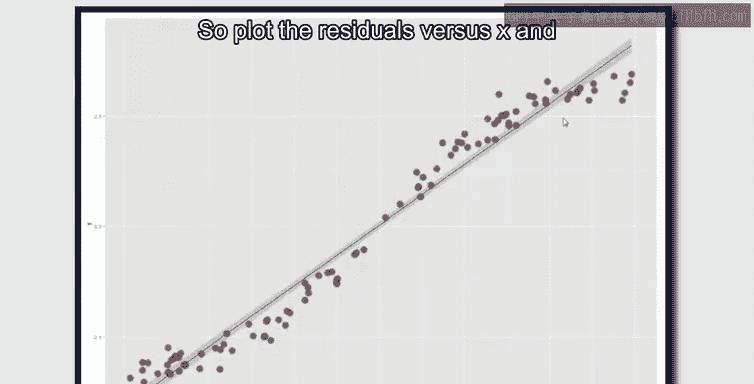

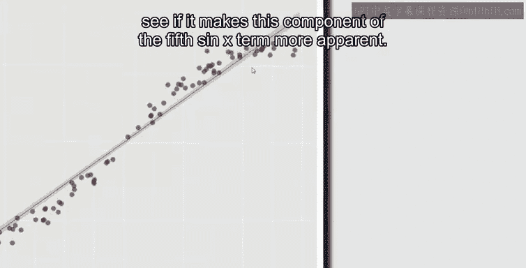

Okay， so let me plot the residual。The residuals versus the x variable。

 So just to describe what I have， I'm going to assign G as my G G plot， my x is。In this case， x。

 I've defined the x variable as the variable named X， but now my y is not the Y variable。

 but it's going to be the residual from the linear model fit in here I just grab it in that R command right there。

Then my aesthetic for my G G plot just has X and Y as the names of the variables for the horizontal and vertical axis variables。

 So let me run that command， and then I want to。Put a horizontal line， reference line at zero。

And then I want to add my points。And set the axes how I'd like， and then let's see the plot。

And there's the plot， let me zoom in。And here is the plot and I think what you can see is that this sign term is now extremely apparent that what the residual plot has done is it's zoomed in on this part of the model inadequacy and really highlighted it and that's one thing that residual plots are especially good at。

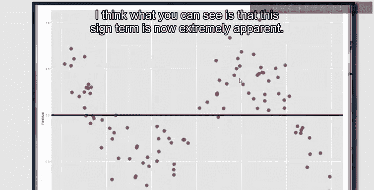

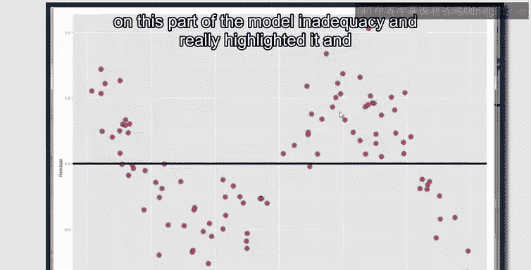

I'm going to show you another one where by all appearances the plot falls perfectly on a line。

 but when you highlight in at the residuals it looks quite different so let me。

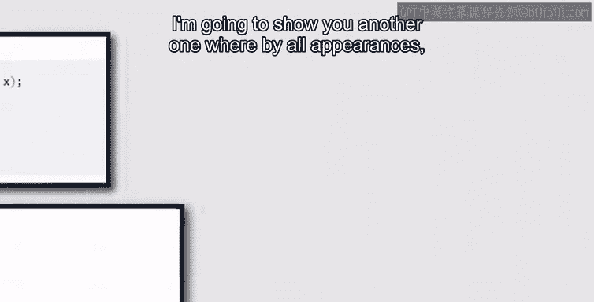

Run the commands。And then。I'll show you， so there's the plot。And then now。

 so look at that and it seems like the points fall exactly on an identity line Now let me highlight in on the residuals and you see this trend。

Toward greater variability as you head along the X vac variable。

 that property where the variability increases with the x variables called heterocaasticity。

Hetterchasticity is one of those things that residual plots are quite good at diagnosing and you couldn't see it if I go back to this earlier plot。

 you can't see it at all here， zoom in on the residuals。 and there you see it there。

 Let me just zoom back here to how I generated the data just to illustrate it for you my。

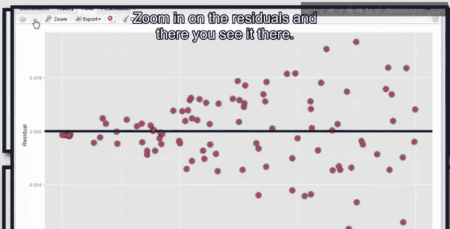

X variable is a bunch of uniform random variables。My Y variable is my x variable。

 so an identity line， but then when I added the errors。

The standard deviation of the errors is look right here。Has the X term involved in it。

 and that's how I generated data with hetero scacasticity。

So let's run the residual plot for the diamond data。

 so here I'm just going to add a column to the diamond data that is the residuals from a regression model fit where price is the outcome and carrot。

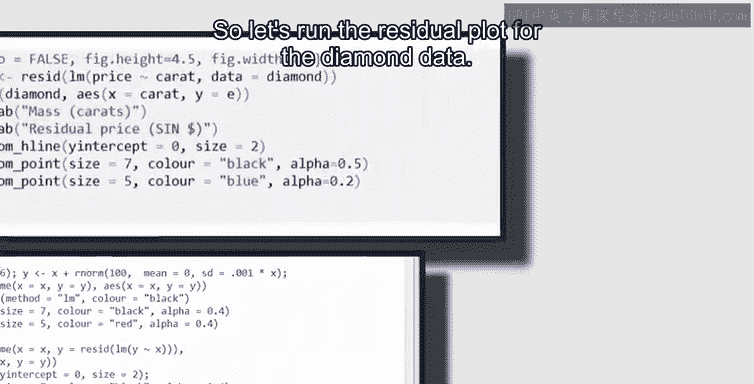

Is the predictor？So I run that and now my data frame。

My data frame has carrot price and now the residuals。So I'm going to create my G plot。

My X label is going to be mass in carrots， my Y label is going to be residual price。

 and I just want to emphasize that the residuals have the same units as the Ys。

 so the residual prices in Singapore dollars。I'm going to add my horizontal line。

I'm going to add my points。And then。There's the plot。

So there doesn't appear to be a lot of pattern in the plot， so this is good。

 it seems like it's a pretty good fit。

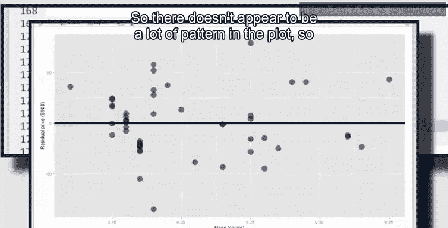

Let me。Iustrate something about variability in the diamond data set that'll help us set the stage for defining some new properties about our regression model fit。

So I'm going to create now。Two residual vectors。The first residual vector is the one where I just fit and intercept。

So the residuals are just the deviations around the average price。

Then I'm going to find the residuals where I add in carrot as a predictor variable。

 so now these residuals are variation around the regression line。

 so the first one is variation around the average price。

 the second is the variation around the regression line with carrots as the explanatory variable and price as the outcome。

So I'm going to run that。And then。I want to create a factor variable that labels the set of residuals。

 the first one is just going to be labeled as a bunch of intercept only model residuals and the second set are going to be labeled as a bunch of intercept and slope residuals。

Then I want to create a GG plot。My。With this data frame， my Y variable is going to be the residuals。

 my X variable is going to be the fit， which of the two fits it is linear model or a linear model with just an intercept or the linear model with carrot。

 the mass as the predictor， and I want to fill in my points based on with the color based on which fit it was。

So I'm going to do that and then the kind of plot I want is a dot plot。

And then I want to put my axes labels the way I'd like now let's see the plot。There it is。

So what we see on this。Left hand plot with just the intercept is the variation in diamond prices。

Around the average diamond price， so just basically the variation in diamond prices from the sample。

What we're seeing in the rightmost plot。This is displaying the variation around the regression line。

 So what we've done is we've explained a lot of this variation。With the relationship with mass。

And what we're going to talk about next is R squared。

 which basically says we can decompose this total variation。

 this variation in the wise by themselves， maybe with just the mean。

Into the variation explained by the regression model and the variation that's left over after accounting for the regression model。

 so this is the variation that's left over after accounting for the regression model。

 so the sort of subtraction of these two would be the variation that was explained by the regression model there's a formula for that。

And we're going to dive into that next。

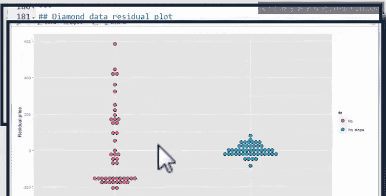