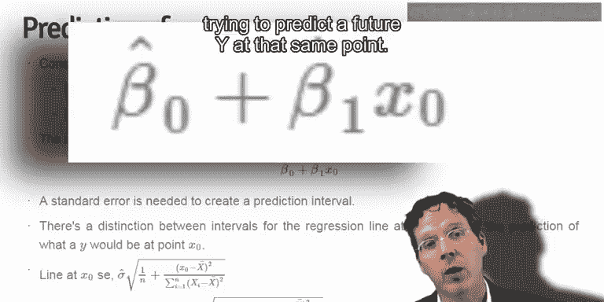
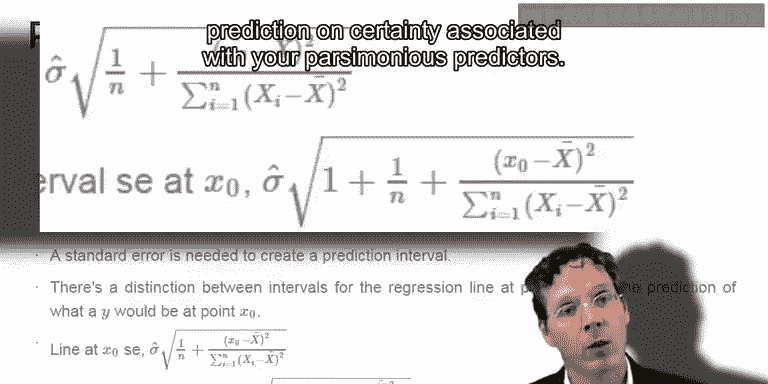
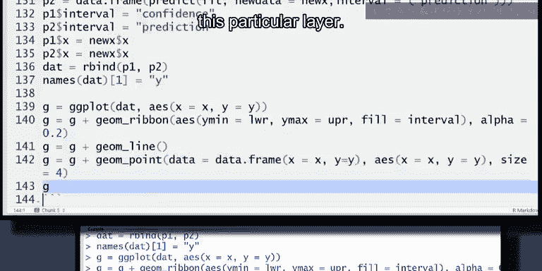
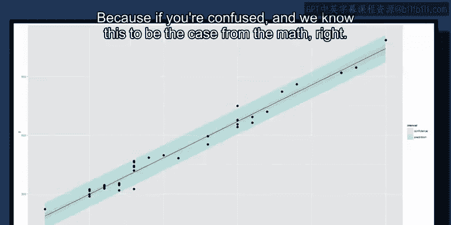
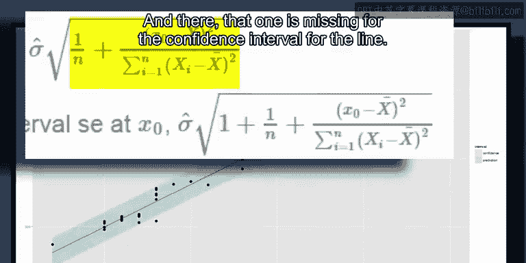
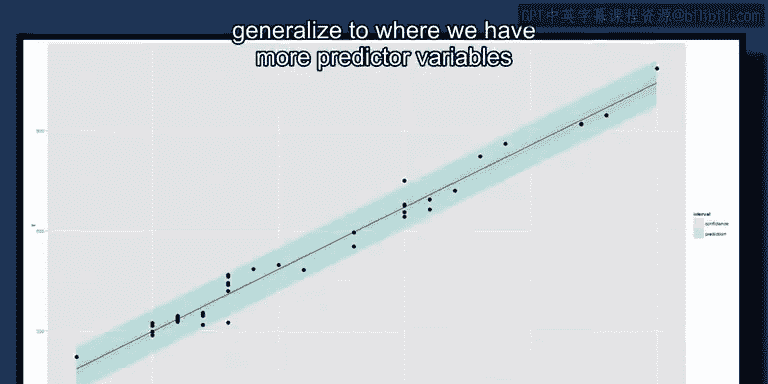

# 约翰霍普金斯大学数据科学课程7：《回归模型》｜regression-models｜ - P18：17_预测.zh_en - GPT中英字幕课程资源 - BV1Xw411m7We

Prediction is a central concept for the data scientist。

 in fact we have an entire course practical machine learning on advanced prediction techniques。

However， regression and generalized linear models， which we're going to cover later on in the class。

 are some of the most core techniques for performing prediction。

They often produce very good predictions， they're parsimonious and interpretable。And。

As an added bonus， you can get inference on top of your predictions without doing any sort of data resampling。

What I mean by inference is we can get predictions and then say， for example。

 confidence intervals around our predictions to evaluate the uncertainty in those predictions sos。

Very easy in regression and pretty easy in generalized linear models and quite difficult in some more advanced machine learning algorithms。

 you may have to do data resampling or something like that。So let's just talk about prediction。

 we might want to predict the response which might be the price of a diamond at a particular mass in carrots。

Or we might want to predict a child's height for a particular value of the parent's height。

The obvious estimate in both cases is just take our x0 our predictor value that we want to predict at either mass or parent height。

 multiply at times the relevant estimated slope beta 1 hat， and then add the intercept。

But if we want to be good statisticians， we need to evaluate some uncertainty in that prediction。

 so it would be nice to have us prediction interval。

There's a small intricacy in that there's a distinction between trying to predict at the line。

Pdt the regression line at a particular point and trying to predict a future y at that same point。

 those are two different ideas， I'll describe that in a picture in a slide。

 but let me describe the formula first， what we have here and it makes sense that our prediction variance first relates around how variable the points are around our regression line Sigma hat and it makes sense that that would be involved in our prediction error。

However， here we have this term1 over N， okay， that also kind of makes sense。

 typically our standard errors decrease at some rate one over square root n。

 so a one over n in a square root seems kind of reasonable。If we're predicting a new y。

 then we have this added one out front， so we get a wider interval if we want to predict a new value at a specific point versus trying to predict what the regression line is at that point。

So we'll talk more about that later， but let me also focus on this very end term that is in both equations。

 x minus x bar。Divided by sort the top of the variance of the axis。

Consider the numerator of this statistic。 Our prediction error is going to be the lowest when x is equal to x bar。

 so our prediction variance is going to be the smallest when we're predicting at the average price of a diamond or the I'm sorry。

 the average mass of a diamond or at the average height of the parents。So that's one thing to notice。

 the second is this summation Xi minus x bar squared in the denominator。

 that's basically how variable my x's are， the more variable my x's are。

 the smaller this term becomes and the lower my prediction error is， so again。

 not unlike our slope estimate where the more variable our regressors were the less variable our slope estimate is the same thing happens in our prediction error here。

Okay， so let's go through some pictures so we can try to solidify these concepts。

 but this is an essential part of using regression for prediction that you get easy and convenient prediction uncertainty associated with your parsimonious predictors。

So let's generate some prediction intervals for the diamondiad dataset set。

And I'm going to go through the code here and actually most of the code is just a little bit of data wrangling to get it in a format that's friendly for G G plotot。

 at least insofar as I know G G plotot， So I'm not going to go through this too carefully because after having had Rogers class。

 you're all better at this than I am。So let me go through just the most relevant part of this code。

 And that is the predict function right here。 So here's my predict function。

 And I'm going to give to my predict function the output of L M for a lot of。Prediction algorithms。

 especially linear models and generalized linear models， but other things。

 random forests and other things in R。The predict function is a generic method that applies to them。

 so I'm going to give it the output in this case of my LM。And then I want a nice。

 denser grid of x values to predict that for my plot than the observed data。

 So I'm going to give it some new x values。 And then here I tell you， I want a confidence interval。

 not a prediction interval。 That's ours。Code for saying I want the interval around the estimated line at that particular value of x。

 not for a potential new y at that particular value of x。

 If I want an interval for a potential new y at that particular value of x。

 I change the interval equals confidence to interval equals prediction。

 which I do in this line below。So here I'm going to run all of the sort of data wrangling code。

 and then let me go through my G G plot。 I like to do this just because。

I find GG plot a little bit confusing at first， but once I've gotten used to it。

 I like it quite a bit。And once I've done this data wrangling。

 then notice this some kind of complicated plot only takes a couple of lines。

So I'm going to start my G plot， I'm going to add a ribbon。

And the ribbon is going to have two parts because it's going to be filled by the interval type。

 so the blue one will be a prediction interval and the kind of salmon colored one will be a confidence interval。

And then I want my fitted line added。And then I want to add the observed data points now my observed data points aren't in the data frame that I use to create the GG plot。

 so I have to give it a new data frame and a new aesthetic command for this particular layer and then let me do my plot。

And then I'm going to switch windows to a large window with the plot。

So here's my plot and again the blue is the prediction interval。

 this is for predicting a new y and the salmon color is for a prediction of the line at those particular values of x。

 and so what you'll see is the prediction for a line。

 a so-called confidence interval for the R command predict。Is。

Much narrower than the prediction interval。 and here's how I like to think of this because if you're confused and we know this to be the case from the math。

 right， there's that one plus for the prediction interval and there that one is missing for the confidence interval for the line。

So here's the way I like to think about this， imagine if I collected an infinite amount of data at all different values of x along this line。

Well， then I would pretty much know the regression line exactly。And if that were the case。

 I would be extremely confident。About predictions on the line。

 where the line was at a particular x value， so as I collected more and more data。

 that salmon colored confidence interval would get narrower and narrower around the line to the point where it was just the line itself。

And that's good， that's what we would expect to happen。

 that's just the idea of statistical sampling working。On the other hand， the prediction interval。

 there's variability in the Y that has nothing to do with how well I estimate beta n or beta 1。

 and in fact， imagine if I were to just give you the correct beta n and beta1。

There would still be variability in the Ys because there， there's that error term。

 And so if I want to predict a new Y， there's some uncertainty that just doesn't go away with better estimation。

 It's sort of inherent in the in that I haven't。 there's left over residual variation。

From my regression line。So that variability will be ever present in the prediction interval and that's why it's 1 plus。

 that's why that one shows up in the equation， it doesn't go away with n。

 it doesn't go away as I collect more x's or anything like that。

 it's inherent and that's why the prediction interval has a certain amount of width that's never going to go away。

The last thing I'd say， you can see it probably I think a little bit more in the confidence interval here than in the prediction interval。

 but that both of these get narrower toward the center of the data cloud and then get wider as you head out into the tails and that's just simply saying that we're more confident in our predictions the closer we are to the mean of the x's now because of that one plus it means maybe less in for the blue color than it does for the salmon color and you can see it more clearly with the salmon color so that's why the pinches in a little bit and that makes sense if we were to go well beyond where we collected data than these intervals would really become a lot wider which is what we'd want because we would be extrapolating we want to predict where we did not collect data。

So on the next slide， I just summarize those points。

 but I think that's enough to get you started on inference from regression。

 and now we'll move on to some more complex topics in regression and generalize to where we have more predictor variables。

