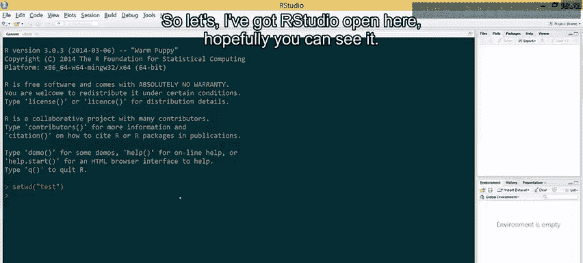
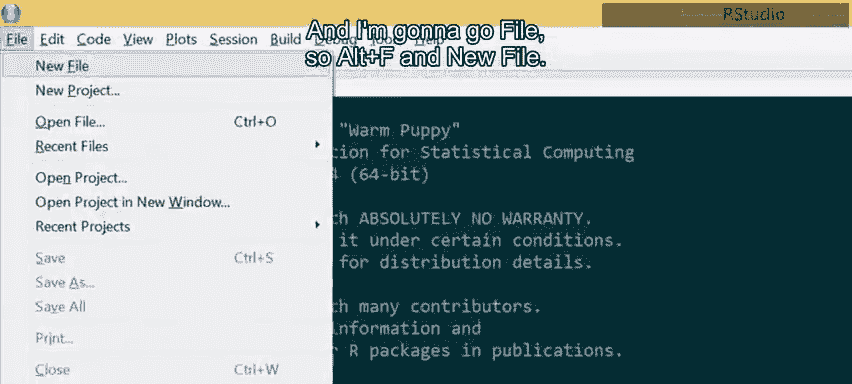
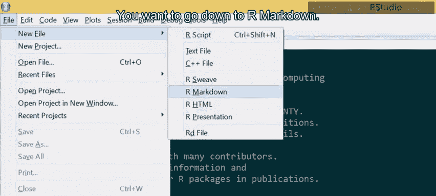
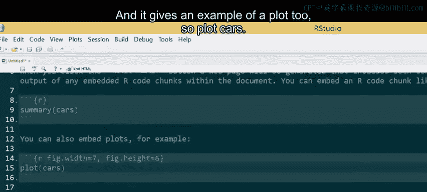
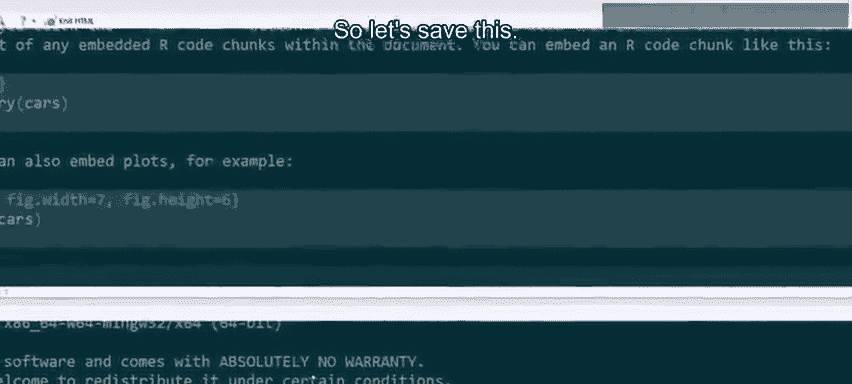
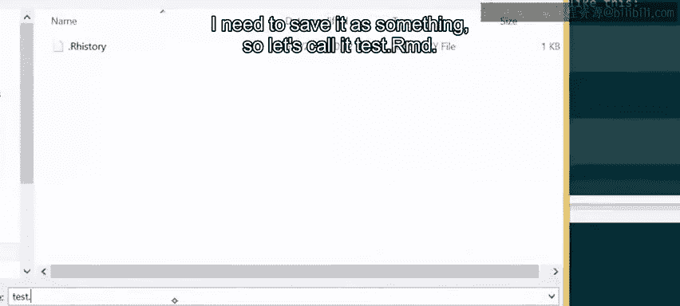
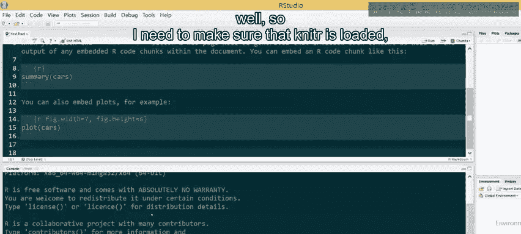
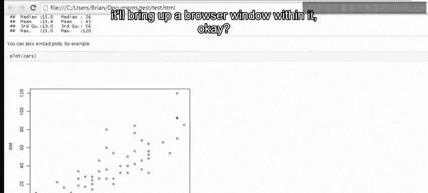

# 约翰霍普金斯大学数据科学课程7：《回归模型》｜regression-models｜ - P19：18_非常非常快速地介绍knitr.zh_en - GPT中英字幕课程资源 - BV1Xw411m7We

。Hi everyone。 This is a two minute tutorial on using knitter。

 You'll need a little bit of knitter to create your R project that you will hand in as part of the assignments。

 So let's I've got our studio open here。 Hopefully you can see it and I'm going to go file So Alt F。

And new file。 And then as you look， there's all these different options here and probably。

I'm in our studio， by the way and。There's all these different options here you want to go down to our markdown。

There we go and it actually populates a。Simple knitter document。Let me edit the title。

 I just want to say， this is a。Is a test knitter document。Okay。

 and then there's a bunch of text there。 and then it shows you the R。Command our commands here。

 So what you need is you need three little。Forward。Well。

 I don't know if these are right tick marks here， or right quotation marks。嗯。You know。

 one's slanted from the upper left to the low right， so the key。

 least on my keyboard that's right below escape。And then you need。If you put an R here。

In this little area， it will。It'll execute our code。

And the comma after the R will open up a bunch of options。So there's a ton of knitter options。

 but cash tells R whether or not to keep it。Probably the most useful ones for me。

Eval tells whether or not it should evaluate the code。

 Sometimes you might just want to show code in your document。These are all figure things。

Result sels so you can have results as marked up， which shows syntax highlighting as is。

Hide will hide the results。 And I find that most most useful。

 Probably the other one that's most useful for me is echocho。 So you have echo is true or false。

 echocho true shows the code and then also shows the results of the code。

 Echo false does not show the code。Okay， so any rate， so here's our。

Here's our examples here it gives an example of a plot too， so a plot cars。

Okay， so let's save this up it I need to save it as something， so let's call it test。 RMd。

Okay。And then I go。Control well， so I need to make sure that。That knitter is is loaded。

 but actually there's little button right here that you can just do， I'm on this tiny computer。

 so it's hard to see， but you can just actually click knit HTML right there and there and it'll knit it and there you can see how kind of what it looks like。

嗯。And it and it creates an HTML document。 So if I were， for example， to do D in R。

 you can see that it's created this。Test do H Tm L document。 that that's a。

 that's just a standard H L document。 You could do browse dot URL， B URL， browse URL。Test。 HTML。

 and it'll bring up。It'll bring up a browser window within within it Okay。

 so that's knitter in a nutshell。

