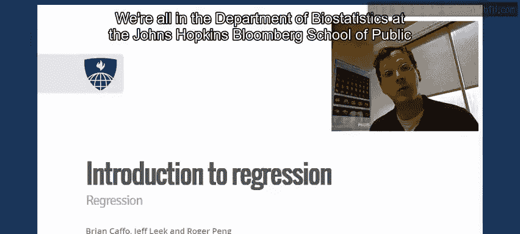
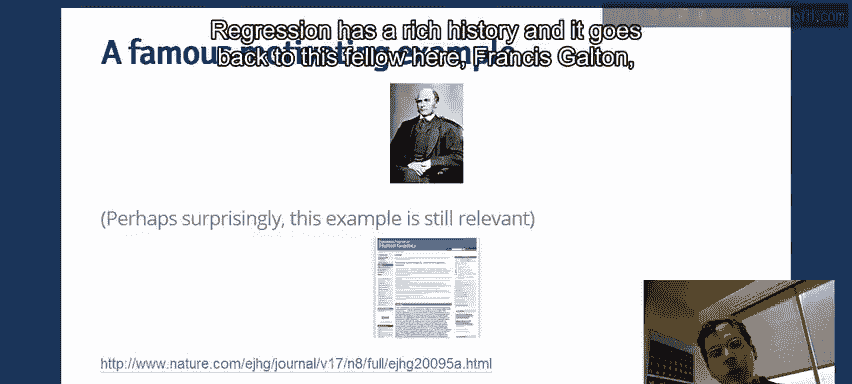
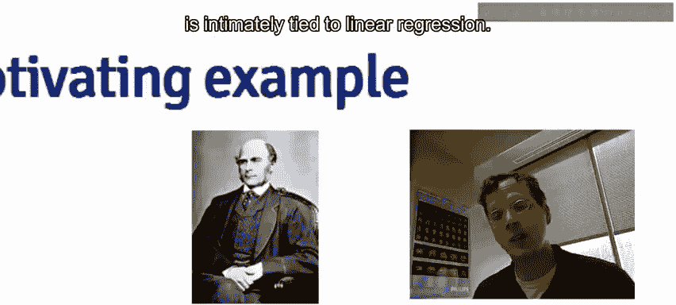
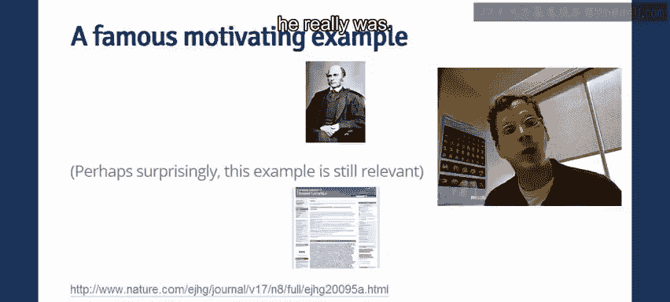
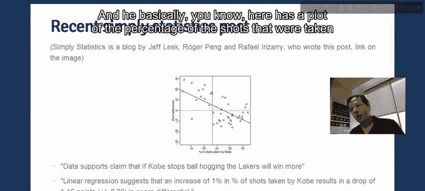
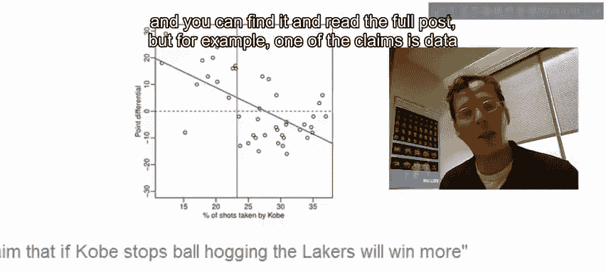
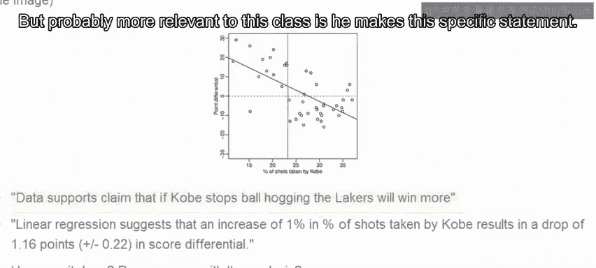
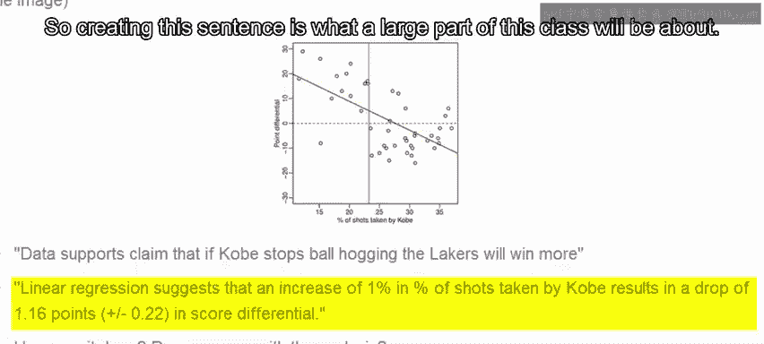
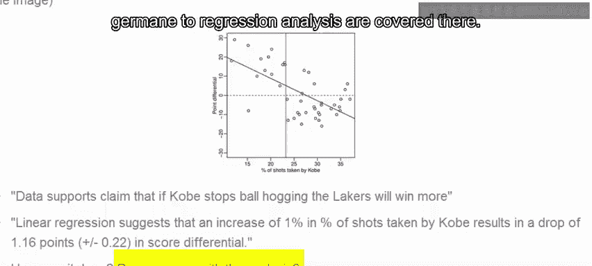

# 约翰霍普金斯大学数据科学课程7：《回归模型》｜regression-models｜ - P1：0_回归简介.zh_en - GPT中英字幕课程资源 - BV1Xw411m7We

Hi， my name is Brian Cathho and welcome to the Introduction to Reion。

Lecture as part of the regression Coursera class， this is part of our data science specialization。

 and this class is co taughted by my co instructorors， Jeff Lee and Roger Pang。

 we're all in the Department of Biosstatistics at the Johns Hopkins Bloomberg School of Public Health。

Regression is probably the most fundamental topic for the data scientist before you do any fancy machine learning or anything like that。

 your go to procedure is going to be linear regression or its generalization linear models。

Regression has a rich history， and it goes back to this fellow here， Francis Galton。

 who invented the term and the concept regression and the term and the concept correlation。

 which is intimately tied to linear regression。

And he did many things， one of which was predicting a child heights from a parent's height。

 a data set that we will investigate a lot just because of its historical significance and my friend and co instructor Jeff Lee noted that this。

Example is actually surprisingly still relevant。 And here's an article from the American Journal of Human Genetics。

 where they compare modern genetic data using high throughput bioinformatics2。

Old to the old Victorian era measurements created by Francis Galton and see that it doesn't do too much better。

 So near， I give you the links there。 You can read them over。

 It's a very interesting and kind of quirky take on modern genetics and genetic analysis。

 But it also goes back and reminds us about the importance of what Francis Galton did and how ahead of his time he really was。

Let's go through a more modern example that's a little bit more similar to what a data scientist would be doing in their day to day lives。

So if you don't read the blog simply statistics， you really should， it's written by Jeff Lee。

 Roger Pang， both of who are coinstructors in the data science specialization in Raphael Irazaari。

 who has a couple classes on edX that you should check out who's at Harvard biostatistics。

And RaFa wrote this post， was talking about ballhogging and players。And he basically， you know。

 here has a plot of the percentage of the shots that were taken by Kobe Bryant and the point differential。

 the game specific point differential。

And he fit a linear regression to it， and he made some of the claims in the blog post and you can find it and read the full post。

 but for example， one of the claims is data supports the claim that if Kobe stops ballhogging the Lakers will win more。

But probably more relevant to this class as he makes this specific statement。

 linear regressions suggest an increase of 1% in percent of shots taken by Kobe results in a drop of 1。

6 points。

And he gives a standard error in score differential。

 so creating this sentence is what a large part of this class will be about。

 how do you create this sentence， how do you interpret it， how do you。

 you know Ra's adhering to good statistical practice in giving a standard error。

And these are the sorts of things we're going to talk about in this class。

 but I' would also like just for this example to think about you know not only how it was done。

 but do you agree with the analysis， what are things that maybe Roa should have thought about or what is this a complete analysis and maybe read the blog post and some of the comments where some of the topics that are germane or regression allow regression analysis are covered there。

Let's go back to our example where Francis Galton is using the Par' height to predict the children's heights and talk about the kinds of questions we can answer。

So we might want to use a parent' height and try and predict their children's heights。

We might want to find a parsimonious and easily described mean relationship between the parents and child's height。

 so we don't want anything complicated。 We want the simplest possible relationship。

 and that is what regression is best at while machine learning and other techniques generate highly elaborate。

 in many cases， accurate prediction models， they tend to not be parsimonious。

 they tend not to explain the data and they tend not to generate new parsimonious knowledge whereas this is what regression is good at。

 this is what regression is in fact， best at。We can talk about variation that's unexplained by the regression model。

 the so called residual variation。We can quantify the impact。

Things like genotype information has beyond parental height and explaining child Hes。

 and that's related to this American Journal of European Journal of Human Genes paper that looked at what residual variation was left after using parental height or what residual variation was left after using genetics。

And then。Very importantly， we're going to connect this back to the subject of inference。

 How do we take our data， which is。Just a sample， it only talks about that data set and try to figure out what assumptions are needed to extrapolate it to a larger population This is a deep subject called statistical inference。

 we have a whole nother class on it in the Coursra data science specialization。

 but we're going to apply the tools of inference which I'm hoping most of you will have had as a prerequisite we're going to apply the tools of inference to this new subject of regression。

And then here's a fun question that Galalton answered and it's called regression to the mean or regression to mediocrity。

 and the basic question is tall why do children of very tall parents tend to be tall。

 but a little bit shorter than their parents and why do the children are very short parents tend to be short。

 but a little bit taller than their parents， and this is the famous idea of so-called regression to the mean。

