# 约翰霍普金斯大学数据科学课程7：《回归模型》｜regression-models｜ - P22：21_多变量回归继续.zh_en - GPT中英字幕课程资源 - BV1Xw411m7We

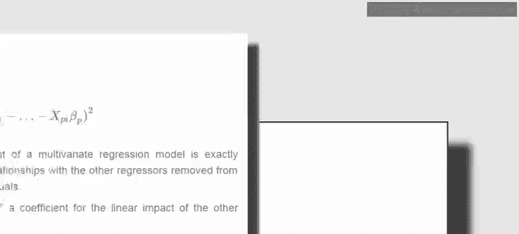

So let's demonstrate how this works， so I'm going to do a simulation where I have 100 observations and I'm going to generate three predictors in x。

X2 and x3 and are all just standard normals。And then my why。It's going to be an intercept。

 which I'm just setting to one。Plus x plus x2 plus x3。

 so all my coefficients are theoretically one so the population model used for simulation。

 they're all one。And then I'm going to add some random noise， that's the error term。

So let me get my residual for Y having regressed out x2 and x3。

 and remember LM by default contains an intercept。So Rizid takes the residual。

 And then let's do the same thing for X。 And remember， Lm takes an intercept。

 So this is the regression of x with x2 and x3 and an intercept removed。

 And then I'm going to get the regression through the origin estimate。With these two residuals。

And that's 0。11053， and I can also show this with LM because I can do LM the y is the residual y is the residual X。

 but I have to take out the intercept。And， let me get the cough。

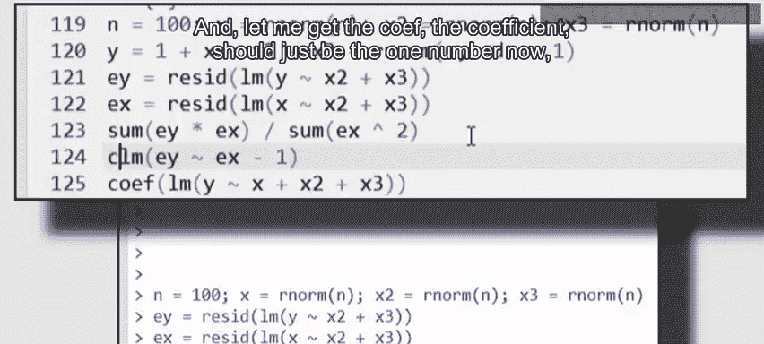

The coefficient should just be the one number now。showhow you that is it exactly the same thing。

 but now what I wanted to point out is that this coefficient is the same coefficient as if I regress y on X。

 x2 and x3 and an intercept。There you go， and you see the X term right here。

It is exactly the same as the regression through the origin estimate with the residuals， so again。

 that just goes to show you the way we interpret or the way in which linear models adjust the regression estimate with respect to the other variables it's sort of like the effect of the other variables has been removed from both the predictor and the response。

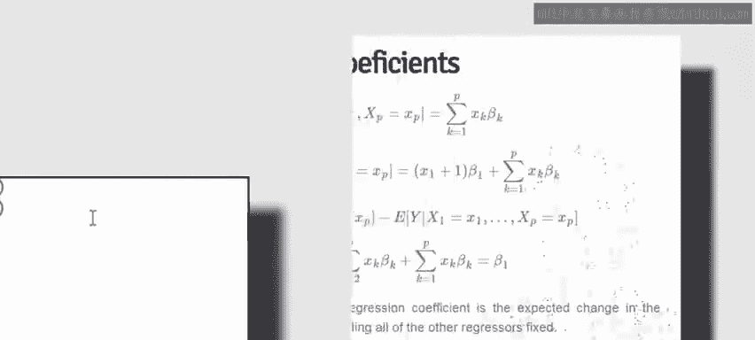

So let's go through how you interpret regression coefficients with respect to the model right now。

 and then again in the next lecture， we're going to go over specific contextual examples。

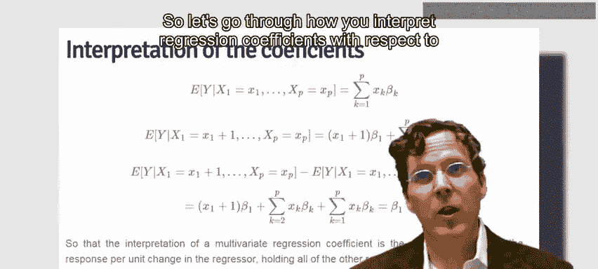

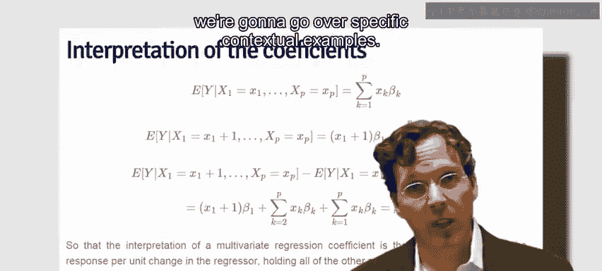

So our regression predictor， given that our collection of covariates take a specific value x1 to xp is just the sum of the x's times their coefficients。

 right that's our linear model。Well just think if one of those regression coefficients。

 let's just take in specific the first one is incremented by one right so instead of taking the value x1。

 it takes the value x1 plus 1。

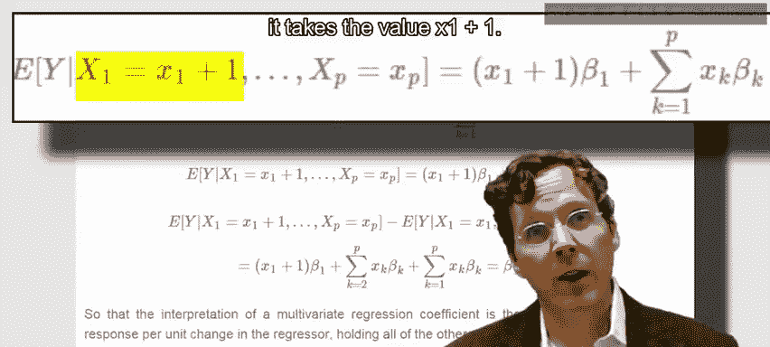

Well， then that's just the same equation， but that first one is now x1 plus1 rather than x1。

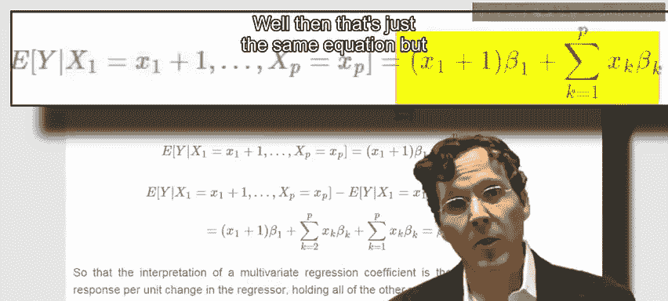

So if I were to subtract these two terms， the expected value of the response where the first coefficient takes the value x1 plus1 minus the expected value of the response where the collection of coefficients are just the X1 to Xp values。

Then you'll see that that works out to be beta 1。So notice all these other X2 to XP were held fixed in all my discussion。

 so X2 to XP were held fix and X1 was incremented by one unit， whatever the units of x1 is。

So the interpretation of a multivaririable regression coefficient is it's the expected change in the response for a unit change in the regressor。

 but holding all the other ones constant， that's the essential part of interpreting a multivaririable regression relationship is it's holding the other ones constant and that way it also the interpretation you can think of as being adjusting for the other variables because we have to hold the other variables constant。

So again， in the next lecture， we're going to go over a bunch of different contextual examples。

 but that's the mathematics behind the interpretation right there。

And then I'm just going to go right now through a laundry list interpret of the basic components of the linear model because they're just exactly the same as in simple linear regression so remember if our linear model is our outcome Y is just now instead of a simple linear regression is the sum of a bunch of predictors times their coefficients plus an error term and we're going to assume that error term is normally distributed。

 we get a bunch of properties。And so we're going to just rifle through these properties and then I think when you go through the examples you'll internalize them a little bit better。

 but these should all be pretty familiar because they're basically the same as what we did for linear regression。

 just now we're plugging in some more coefficients。So our fitted response， for example。

 why hat at any specific value is just plug in the fitted coefficients times those specific regressors。

 whether that's a new value or one of the observed values。

The residuals is just the fitted value Y hat being subtracted from the observed value。

 we're trying to minimize the sum of the squared residuals。

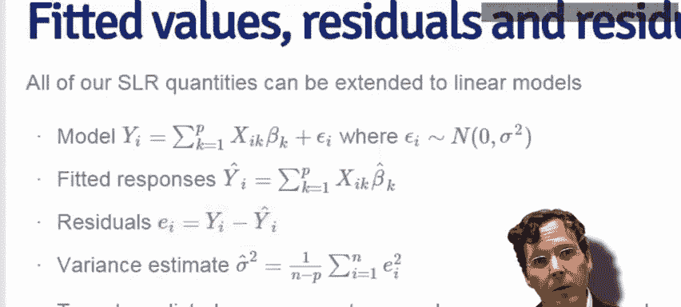

The variance estimate is just the average squared residuals。

 where just like remember in our linear regression case we divide by n minus2 now we divide by n minus p and that's kind of a technical point because if you know n minus p of the residuals。

 you know the last p of them due to some linear constraints。

 so that's why we divide by n minus P we don't really have n residuals we have n minus p of them。

 but that's a minor point， you can think of the residual variance estimate is nothing other than the average the average squared residuals for the most part。

 that n minus p part notwithstanding。

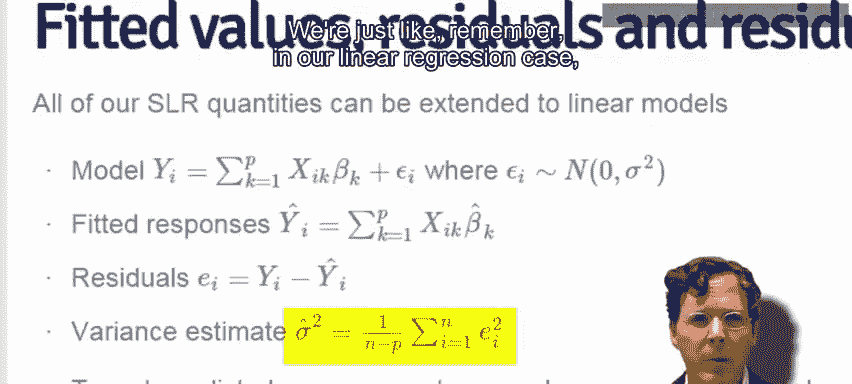

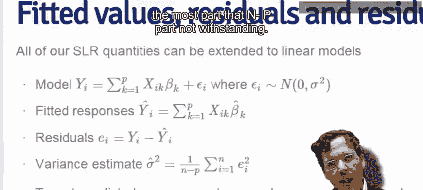

So again， to get a predicted response at some new values。

 just we're plugging them into the linear model， if we have a new X1 to XP。

 we multiply them each by their respective coefficients and add them up and that's our new predicted response。

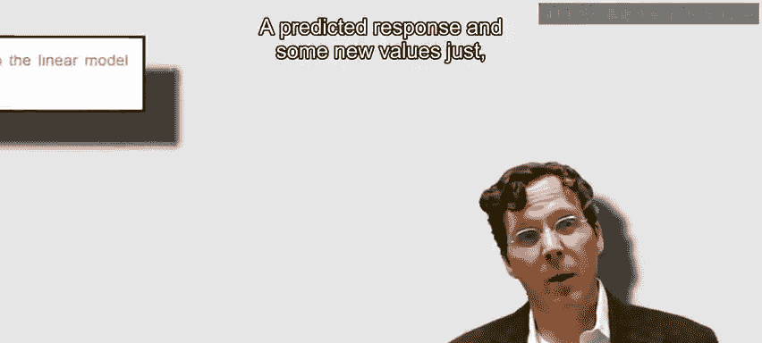

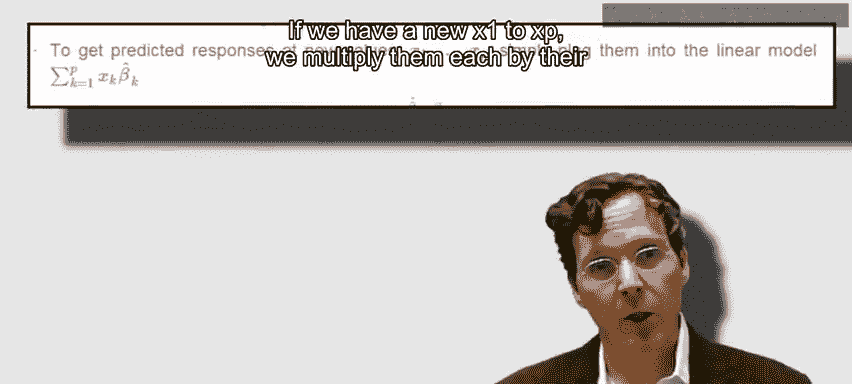

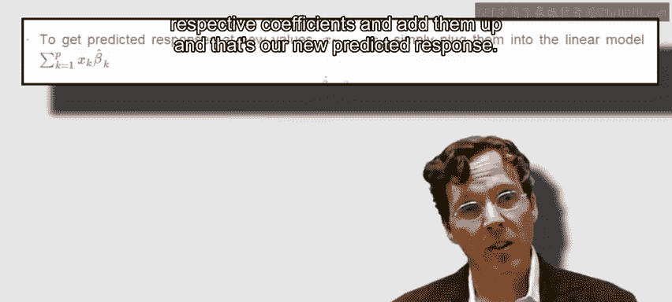

Our coefficients have standard errors， sigma beta hat， let's say。

 for sigma beta 1 hat for beta 1 sigma beta 2 hat for beta 2。

 and we can test for whether or not specific coefficients are zero with a T test because those the beta hat minus its true value divided by this standard error follows a t distribution。

 so all the things we knew about from linear regression carry over to multivariable regression。

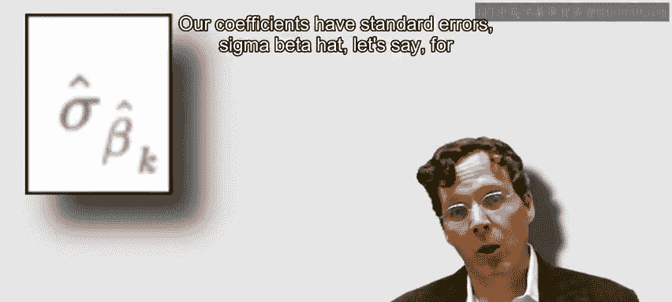

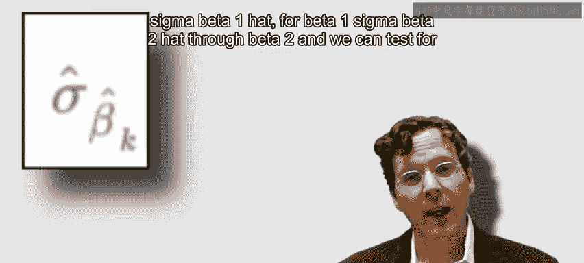

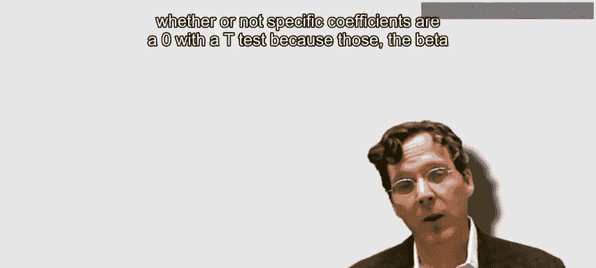

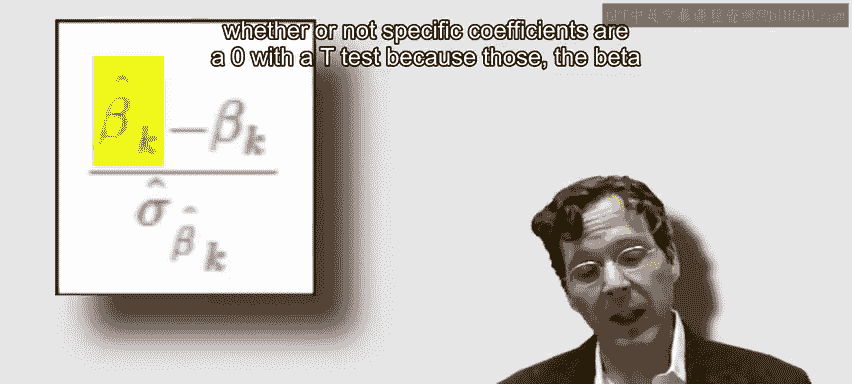

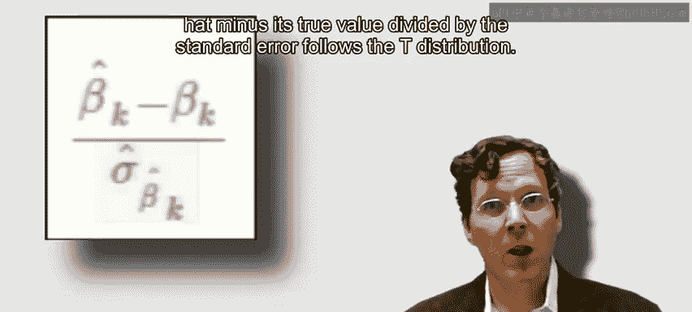

In addition， predicted responses have standard errors and we can calculate prediction intervals just like we did in linear regression again。

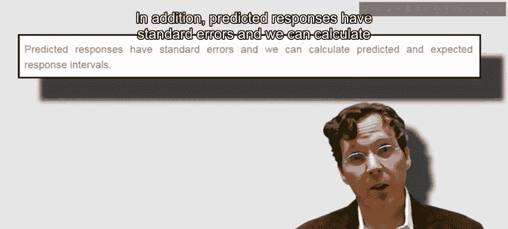

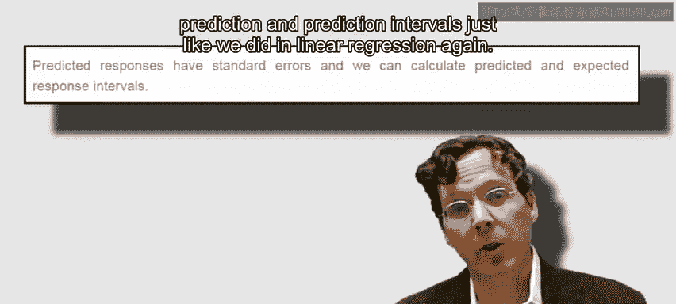

So again， I'm hoping that none of these facts are kind of news to you。

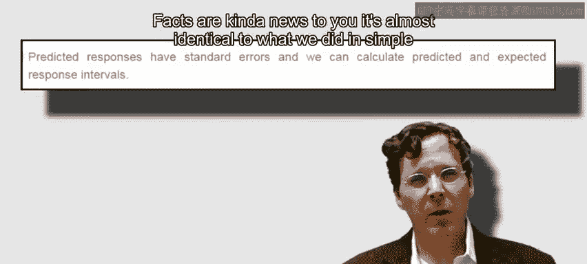

Almost identical to what we did in simple linear regression we just have more terms now and remember in linear regression we had two terms we had an intercept and a covariate now we're just adding more covariates potentially I want to end this lecture before we move on to some specific examples。

 I want to end this lecture with just a general discussion of how important linear models are to the data scientist。

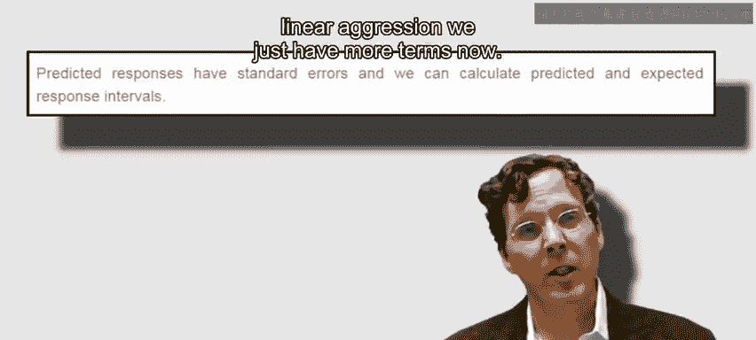

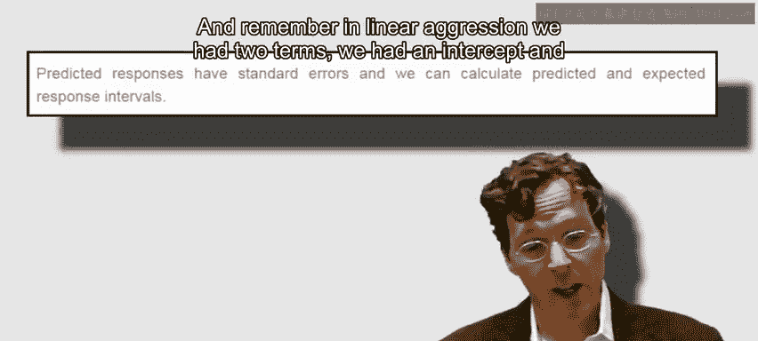

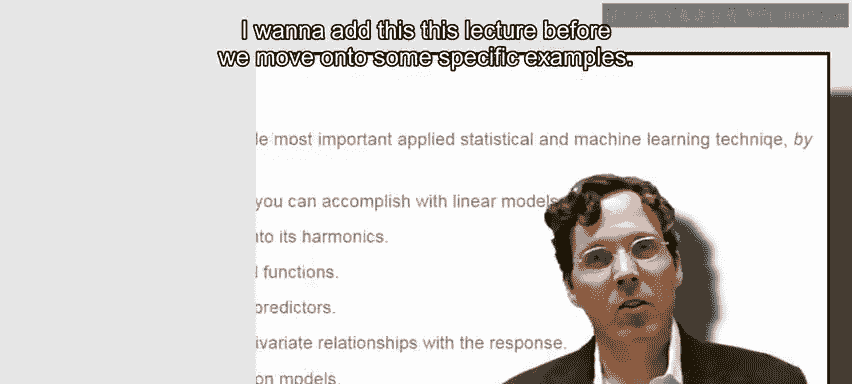

Before you do any machine learning or any complex algorithm， linear models。

Should be your first attempt。They。Offer parsimonious and well understood。

Easily describe relationships between predictors and response now to be fair。You know。

 some modern machine learning algorithms can beat some of the things like the imposed linearity。

Nonetheless， linear models should always be your starting point。😡。

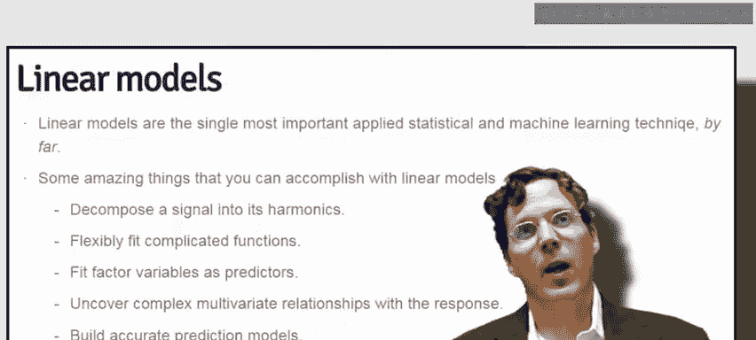

And there's some amazing things you can do with linear models that you may not just from this first treatment of them from this one lecture about think that that would be possible。

 for example， you can take a time series like a music sound or something like that and decompose it into its harmonics。

 the so-called discrete Fourier transform can be thought of as the fit from a linear model。

 you can flexibly fit rather complicated functions and curves and things like that using linear models。

You can fit factor variables as predictors， and NoVva is a special case of linear models。

 and COVA is a special case of linear models。You can uncover complex multivariate relationships with a response。

 and you can build fairly accurate prediction models。

