# 约翰霍普金斯大学数据科学课程7：《回归模型》｜regression-models｜ - P23：22_多变量回归例子第1部分.zh_en - GPT中英字幕课程资源 - BV1Xw411m7We

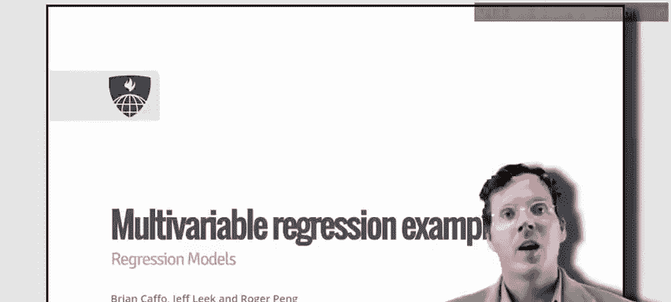

Hi and welcome to the class on Multivariable regression examples。

Let's start this discussion with a famous data set from a well known statistics textbook。

 which is this Swiss fertility data， and it's in the data sets package， So I want to do require。

Require。Data sets。And then I want to do data Swiss。And then if you do question mark Swiss。

It'll bring up the help file。 I have kind of a better formatted version of this on the slide。

 And so what's in this data set is a standardized fertility measure and some socioeconomic status indicators for 47 French speaking provinces of Switzerland in this is from 1888。

 So the variables are fertility。

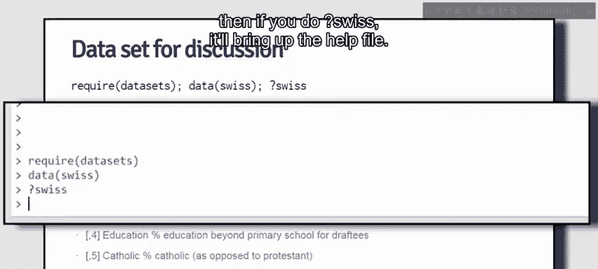

Agriculture， which is the percentage of the males involved in agriculture is an occupation。

 an examination， the percentage of drafteeies that scored a particular mark on a military examination in the province Education is the percent of the population that it made it beyond primary school Catholic is you know in this region at this time is just the percent Catholic as opposed to Protestant and infant mortality is the percentage of live births who live less than one year from the province So that's the data set andre going we're interested in looking into what explains fertility in this province so before we go any further let's do some basic scatter plots of the data。

So let me load the Swiss data set and。Do a pars plot of all the variables in the data。I got my R。

There we go。And this library here G Galley or GG Ally。

 I think is probably how it's pronounced is a collection of add on tools for G plot and in particularly they have a G pairs command that does an equivalent of the R pairs plot and I think you'll see it here in a second you'll understand what it does。

 It's a little bit of a slow plot。

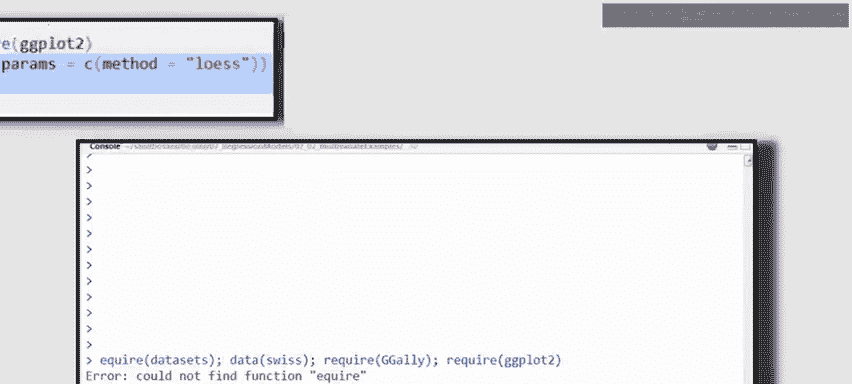

Let me zoom in on the plot here。And now what you see is， for example。

 fertility is on the X axis for all the plots in this first column。

 agricultureric is on the X axis for all of the or the horizontal axis for all of the。

Ploots in this column and it's on the vertical Y axis on this plot。

 so hopefully you see how it works。 so examination， for example。

 is on the Y axis for these two plots and then on the X axis for these three plots and so on。

The corresponding upper triangular part of this matrix gives the correlation between those two variables。

 So let's take， for example， fertility and agriculture。 Here's the scatter plot。

 you see it right here。Here's the low smooth， which turns out to be fairly linear in this case。

And a confidence prediction， confidence band around it。 And it suggests that the。

Correlation between the two， the empirical correlation is 035。

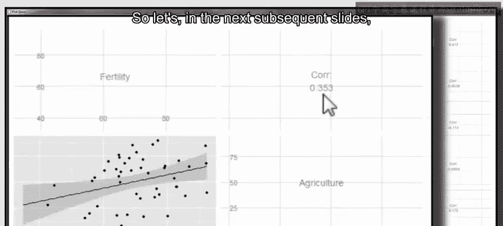

So let's in the next subsequent slides。Investiggate the relationship where agriculture。

 the percent of the province that works in the agricultural industry。With fertility。

Let's fit ourity fertility is an outcome， and the first model I want to fit includes all of the variables as predictors and I'm doing this more for illustration。

Than I am in the。To mimic a real data analysis， I would say in a real data analysis。

 your first model would probably be fertility with agriculture by itself or the marginal relationship of interest without considering the other variables。

 but I would just want to show you how to fit all of the variables at once。

 So if you do fertility tde period this period then adds all of the other variables in linearly no squared terms or anything like that。

 no interaction terms。All of the remaining variables in the data frame all at once。

Sayme data equals Swiss。Tells it that the data set that I want is the Swiss data set。

So that's the run of my LM and notice if you don't you often want to assign the output of your LM to a variable so you can say that later。

 but this is runs quick enough that I'm just printing the output now summary of the output from LM gives a much gives much more interesting output and then it and in particular it gives you this。

Table of all the coefficients， their standard errors， their T values and their P values。

 but it also gives you a lot of other information。 If you just want to grab that coefficient table。

 you can do dollar sign coefficient on the output of the summary statement and there's just the table by itself。

 So for example， if you want to use that in some subsequent code。

So let's focus on this number negative 0。17。This number is interpreted as the following。

We expect a 0。17 decrease now decrease because it's negative， right Okay， so we expect a 0。

17 decrease in standardized fertility for every 1% increase in the percentage of males involved in agriculture。

Holding the other variables constant， so that is interpreted as we hold examination， education。

 percent Catholic and infant mortality constant。This next column， the standard error 0。07。

 talks about how precise that variable is。 Oh， and before I move on。

 I should also mention it's important to note that the percent agriculture is expressed as a percentage rather than a proportion。

 right， because a percentage is the proportion times 100。

 So it would change the scale of the coefficient by a factor of 100。

 So it's important to note or not your whether or not these numbers are percentages or proportions that would make a big difference in the scale of the coefficient。

Okay。So the standard error talks about how precise this。

Coeient is talks about the statistical variability of that coefficient， and we get 。07。

 If we wanted to perform a hypothesis test that the coefficient for agriculture beta aggregate is what I have here on the slide。

If we want to test whether or not that's 0， then we would take the estimate。

 subtract off the hypothesized value， which in this case。

 is 0 and divided by the standard error of the estimate。

 So the T statistic is nothing other than the estimate divided by the standard error。

We could do that， of course， but our very conveniently goes ahead and gives it to us。

 it's negative 2。448， but that's simply obtained by dividing negative 0。17 divided by 0。07。

That T statistic， we can calculate the probability of getting a T statistic as extreme as that。

As small as negative 2。448 or smaller， and because we're doing a two sided test。

 we would double that P value so you can go through that T calculation， if you'd like。

The degrees of freedom are n minus the number of coefficients， including the intercept。

And that but again， R does that on our behalf， and that works out to be0 point。01，8。

 So by standard thresholdholding rules， you know， type 1 error rate of say 5%。

 that would be statistically significant。But let's。

Go through some other models and look at how the process of model selection changes our estimates。

So now let's contrast the model with a model。Having just agriculture in as a predictor so the previous model had all of our other variables in as predictors let's look at one that just looks at this association between fertility and agriculture so I'm running it and I'm just grabbing the coefficient table so don't we're not looking at the rest of the R's output but when you do this on your own you'll look at the rest of the summary output from LM。

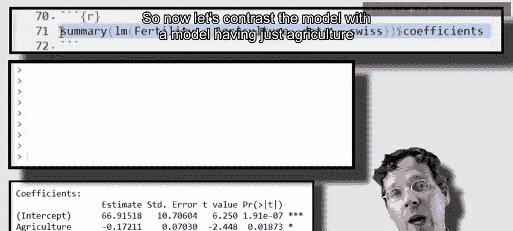

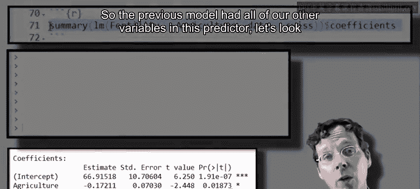

What's interesting is that the agriculture variable is about the same magnitude 0。19 instead of 0。17。

 However， it's changed signs。 instead of agriculture having a negative effect on fertility。

 It has a positive effect on fertility。 So adjusting for these other variables changes the actual direction of the effect of agriculture on fertility。

 and this is the impact of something socalled Simpson's paradox。

 or I should think it should be called Simpson's perceived paradox because there's nothing paradoxical about the possibility that accounting for other variables should change the nature of the relationship between a predictor and a response。

 It actually makes quite a bit of a sense。 sense that that would be the case。Notice， of course。

 both cases in both cases， the agriculture coefficient is strongly statistically significant。

 So what I'd like to do in the next slide is just create via simulation and example where an effect can reverse itself so that maybe it'll get us think about how this could happen In the end。

 regression is going to be a dynamic process where you're going to have to think about what variables to include and you're going to have to make the kind of scientific arguments if you want if there hasn't been randomization to protect you from confounding。

 you're going to have to go through a scientific dynamic process of putting confounders in and out in thinking about what they're doing to your effective interest in order to evaluate it。

 So let's invent a little simulation just to illustrate how this can happen but there's a variety of ways it can happen。

 so and this is just one but let's just just so you can see it happen as we code it from a real generating process that you can control where you can control everything。

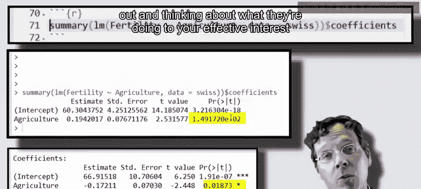

So I'm going to assume that I have 100 data points and is 100。

 and then my second regressor x2 is just going to be the values 1 to n， so if you look at x2。

It's just1 to 100， so think of x2 as something that we might measure regularly like days。

 so we measured 100 consecutive days。

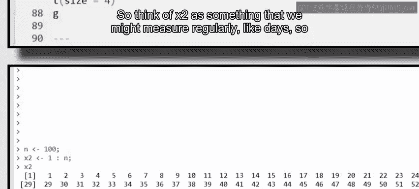

And then X1 is a variable that depends on X2 and it depends on random noise。

 So let's just make something up。 So X1 depends linearly on x2， so it grows linearly with time。

 So let's say maybe hopefully X1 is your bank account your money。

 It goes up with time linearly and then there's all these random fluctuations that impact your spending so your money doesn't necessarily always just go up。

 it goes up and down sporadically， but there's this linear trend of it going up。Okay。

 so there's my x1 and it's going to look different。Right， so if I were to， for example， plot。X1。

It goes up， but it's got all this random noise around the line。 Okay， now Y。

 let's say y is happiness。 some measure of happiness。 So what happens with Y。

 The true generating model is Y is negatively associated with X1 Oh oh。

 so money is so your happiness is negatively associated with your money。 I guess Mo money。

 Mo problems is what that's suggesting。 But then it's positively associated with x2。

 So it goes up with time and down with X1。 And this is the correct and then there's some random normal noise。

 And this is the correct model because we're using it for simulation。

 So we know that it's the actual truth。 Y our outcome that we're simulating。

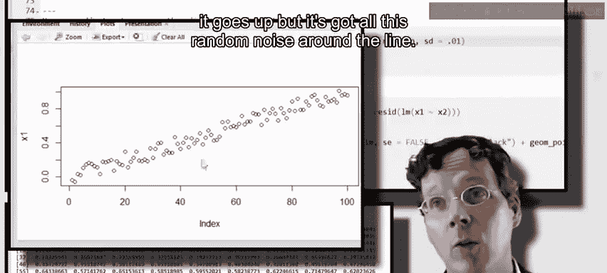

Depends negatively on x1 with a coefficient of 1 and depends positively on x2 with a coefficient of plus1 Okay。

 so let's simulate our y。And now let's see what happens if we fit x1 by itself。

And what we see is we get this enormous coefficient 95， which is clearly wrong。

 it's nothing near the negative one that it's supposed to be or that we would hope it would be。

 it's in fact quite the opposite and what's happening， it's sort of picking up this effect。

 this residual effect of x2， this big line， this big component of x2。

That's a big driver of Y is getting picked up in x1。Okay。

 but now what happens if we fit the correct model， X1 and x2 together Well there we get the two correct coefficients my about -1 for x1 and about -1 for x 2。

 So there you can see if you do the correct sort of adjustment。 Then it should work out。

 And you can you can imagine why this would happen。 What is regression doing。

 It's taking x1 and removing the linear effect of x 2。 So this part right here， this 01。

01 x2 should get removed。 And that uniform noise。 That's the correct part of x1 that's unrelated x2 will get related to the part of y that's unrelated to x 2 as well。

So let's do some plots to highlight this just to show us how it works a little bit。

So I'm going to create a data frame。Because G G plot likes data frames。

 and I can't remember if I loaded G plot， so let me reload it and then my。Ploot is going to be。

 it's going to have this data do and the aesthetic is just， I name my variables conveniently Y。

 and then my x variable is going to be x1。 so the kind of important variable x1。

 and then my color is going to be x2 okay。And thenm I want my points and I want the line。嗯。不。

And highlight the whole thing。There we go。And then I actually need to plot my plot， so there's my G。

 so there it is， so you can see the color gradient here is x1 as it relates to Y。

And you can see the line that it's fitting is not incorrect， there is a clear linear relationship。

 positive linear relationship between x1 and Y。However， you can see with x2。

 which is the color right that there's also this clear positive gradient as y goes up。

 so does x2 and also you can see as x1 goes up， so does x2 so you can see that sort of confounding that's happening here so why don't we now。

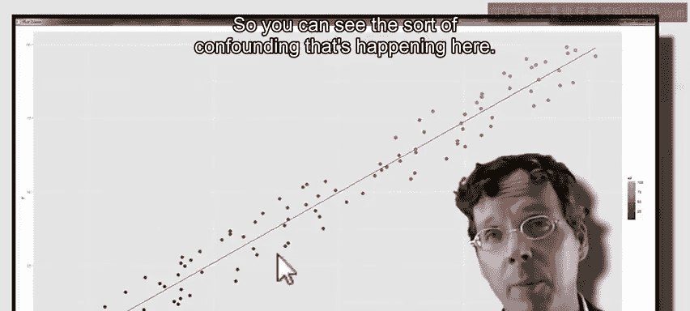

See what happens if we plot the residuals Okay， so I created in my data frame。

 I created the residuals where I fit x2 on y。And then I took the residual where I removed x2 from x1。

 so let's see what happens when we do the residual plot。

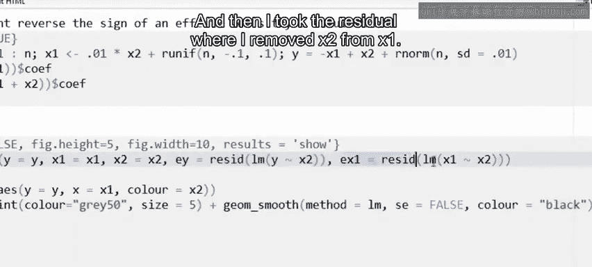

So this should be a plot that would give the slope of this line will be the coefficient from our linear model fit where we include both x1 and x2。

Okay， so I'm going to run that， I'm not going to go through the G plot commands because they're basically the same。

And here's the plot Now you can see that for the residual Y and the residual X1。

 there's a clear negative linear relationship。 And if you stare at enough。

 you realize that the slope of this line should be around negative 1。

And you can see that the x2 variable is clearly not related to the residual x1 variable。Okay。

 and so that's what linear models is doing。 It's removing the x2 from both x1 and Y。

 and that's why you get the sort of correct relationship when you fit both variables。

 Now this doesn't mean that throwing every variable into your regression model is the right thing to do。

 There's consequences to throwing in extra variables unnecessary variables into your regression relationship。

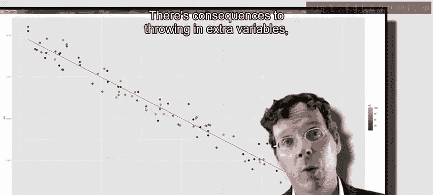

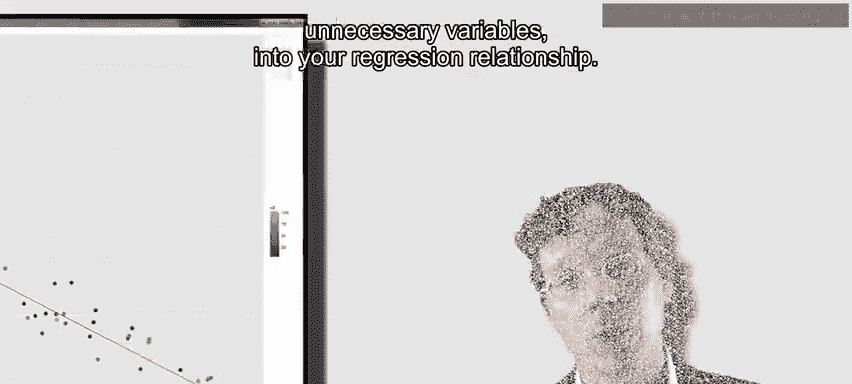

Let's go back to our data set now that we've thought about the idea of multivariable regression a little bit more。

Remember， our agriculture effect reversed itself after we included the other variables in the model。

 and particularly you'll find that this happens quite a bit when education and examination are included。

So educational attainment is negatively correlated with the percent working in agriculture。

 a correlation of negative 0。64， and you would kind of expect that given where the data was collected and the time period in which it was collected。

And addition， as I mentioned earlier， education and examination are kind of measuring the same thing。

 their correlation， those two variables is 0。7， so they're sort of measuring the same thing。

So the question arises， is this a positive association between agriculture and fertility by itself when done via ordinary linear regression？

Is that artifactual for not having a accounted for these other variables， education， by the way。

 does have a stronger effect。On fertility。So at the bare minimum。

Anyone claiming that they did a linear aggression with percent of the province working on agriculture and fertility is the outcome and claimed a causal relationship between agriculture and fertility causal positive relationship。

 that conclusion would definitely be suspect， first of all because from observational data like this。

 little it's always suspect to make strong causal conclusions without putting a lot of extra work and thought about your assumptions。

But even if you were just willing to claim an association between agriculture and fertility。

 that also would be suspect because you can so easily break that association and reverse it by the inclusion of other very reasonable variables。

I also wanted to show you really quickly what happens if you include a completely unnecessary variable in the model。

 and what I mean by completely unnecessary is that what if you include a variable that is simply a linear combination of the other variables that you've already included。

So you might include a variable that's unnecessary but you know is random noise for example。

 and that's a different issue。 we'll talk about that later but right now why don't we see what happens if we include a variable that in what I'm describing is completely unnecessary so for example。

 if I create this variable Z that's nothing other than agriculture plus education added together well that has no added value we've already included education and we've already included agriculture in our joint model so why don't I show you what happens when you fit all of the variables plus this additional variable Z and what you see is our agriculture coefficient hasn't changed it's negative 0。

17 just like before。

And our Z variable is giving an NA。And so whatever it does， whatever R does is it takes the last。

Sort of completely unnecessary variable included in the model and gives that one an NA coefficient。

So that's an important thing to remember if you see an NA in R after you fit a linear model。

 then probably the most likely culprit is you've included a variable that is either numerically or exactly a linear combination of the other variables。

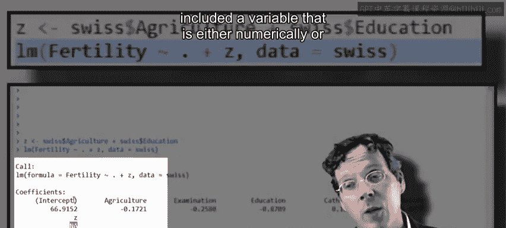