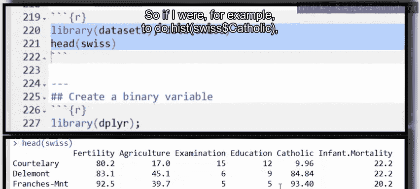
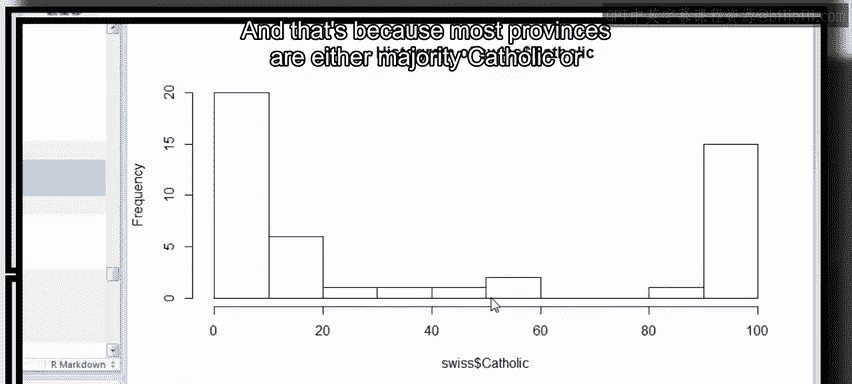
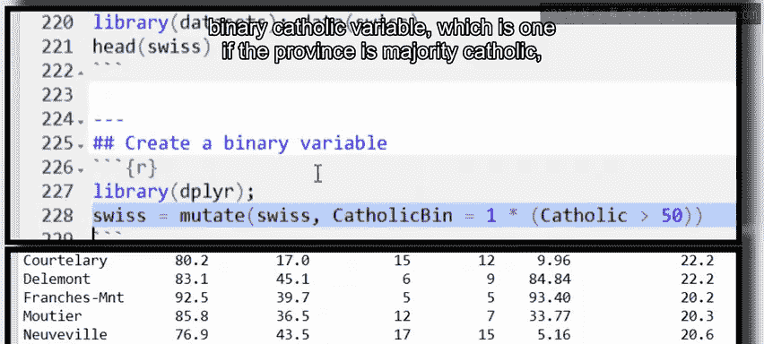
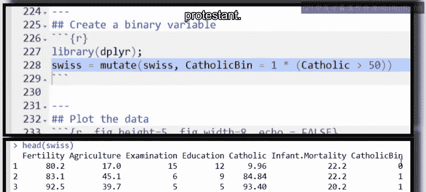
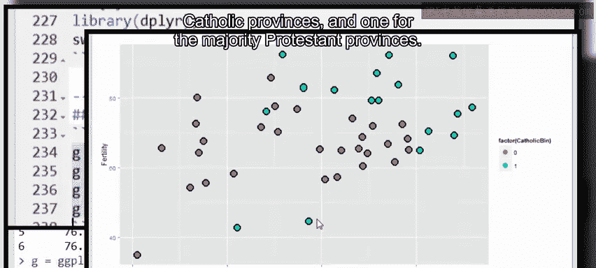
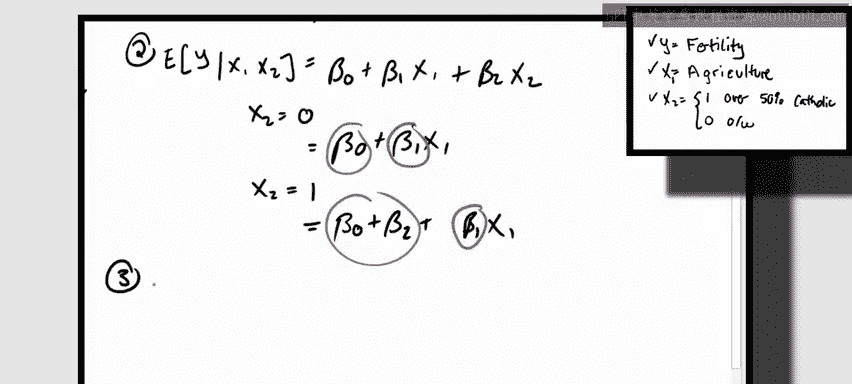
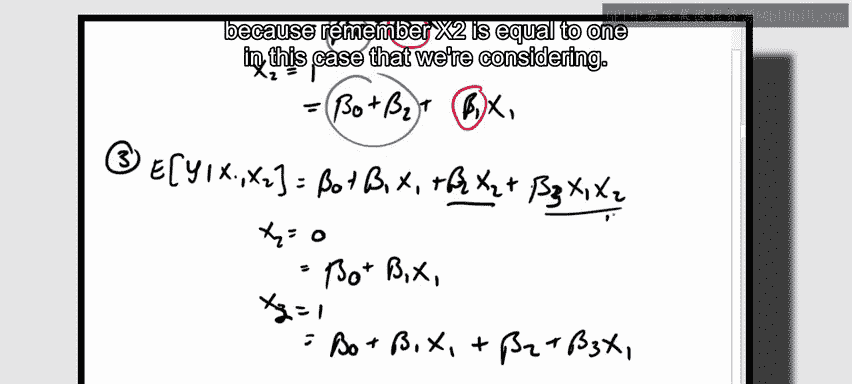

# 约翰霍普金斯大学数据科学课程7：《回归模型》｜regression-models｜ - P25：24_多变量回归例子第3部分.zh_en - GPT中英字幕课程资源 - BV1Xw411m7We

So let's move on to another example of multivariable regression。

 a very important example that underlies the topic of so called Ancova。I'd like to go through the。

An example to illustrate fitting multiple lines with different intercepts and different slopes。

 So I'm going to use the Swiss data set that we've looked at previously and recall。

 we are trying to model fertility as an outcome as a。

Function a linear function of agriculture， which is the percent of that province that was working in agriculture as the predictor。

Remember that examination and education really including those modified the effect of agriculture and fertility for the time being let's ignore that and I just want to show you how to fit different lines one for each group。

So let's take the Catholic variable， so if I were， for example， to do hist， Swiss。Star Catholic。

Notice that it's。Very bimodal， and that's because most provinces are either majority Catholic or majority Protestant。

From this time period。So now I'm going to create。

Using D plier， a Catholic a binary Catholic variable。

 which is one if the province is majority Catholic and zero， if it's majority Protestant。

 So there I now have that variable。 Let me do head Swiss and there see now I have this Catholic bin variable。

And then now let me plot the data。And what you see now is these two variables。

 the Catholic bin factor variable that's zero for majority Protestant and one for majority Catholic。

 and you can see the data there， there are some potential issues with the data and what I'm going to be describing which is to fit lines to the data。

Particularly these kind of outlyingish looking observations。

 but I'm going to ignore this now because later on in another lecture we're going to be talking about outliers and influence points and then also there's the impact of these other variables how they would relate to these model fit so let's ignore all that for the time being。

AndS work on fitting a line where here now we want two separate lines for one for the Catholic provinces。

 majority Catholic provinces， and one for the majority Protestant provinces okay。

 so let's see if we can do that。

Let me describe some models that we could fit， so here I have given some notation， why is fertility？

X1 is the percent of the province working in agriculture。

 and x2 is a binary variable where it's one if the province is over 50% Catholic and zero。

 if the province is over， is majority Protestant。So consider model1。

 where we model that our expected y given x1 and x2。

Is an intercept。Plus， a slope times x1。So that would just be a line， and it would disregard the。

The religion of the province entirely。Let's consider a second model。

Here we have expected I of y given x1 and x2 is beta n plus beta 1 x1 plus beta 2 x2。

Now let's think about this in the event that x2 is equal to zero。

 if the province is majority Protestant， then this works out to be beta n plus beta 1 x1。

In the event that x2 is equal to1， in the event that the province is majority Catholic。

 this works out to be beta n plus beta 2 because this term right here is now one。Plus beta 1 x1。

 So fitting this model， the model that includes x1 and x2， but no interaction。

Fits two models that have the same slope。These two models have the same slope。

But they have different intercepts， beta not， and then beta 1 plus beta 2 for the second intercept。

Okay， let's consider one third model。

I want now my expected outcome， given my predictors。

To be beta n plus beta 1 x1 plus beta 2 x 2 plus beta 3。Beta 3。X1 times x2。Now。

 let's look at what happens when x2 is0。This works out to be beta n， the beta 1 is still there。

 beta 1 x1 is still there。Beta 2 x2， this term is 0 and beta 3 x1 times x2 is also 0 because x2 is0 in both those cases。

Now， let's work on the case when the。XX2 is 1。Which is the case when the province is majority。

Catholic， so we get beta not plus beta 1 x1 plus now beta 2 is this term is present because x2 is 1 and this term is now beta 3 times x1 because remember x2 is equal to 1 in this case that we're considering。

Okay， now let's reorganize terms， and that's beta n plus beta 2 there。Plus。Beta 1 plus beta 3 x1。

Okay， so what we've seen is if we include an interaction term。Then we fit two lines。

 but now those two lines have different slopes。 if we omitted that interaction term。

 we fit two lines， but they had the same slope， if we include the interaction term， two lines。

 different slopes and different intercepts and the coefficient in front of the。

Catholic term by itself。Is going to be the change in the intercept going from Protestant to Catholic right。

 here's the intercept for Protestant and here's the intercept for Catholic。And the beta 3 term。

 the term in front of the interaction。Is going to be the change from the slope going from Protestant。

To Catholic right so the slope for the when x2 equals 1 this beta 1 plus beta 3。

 it's going to have that extra term in there okay， so let's try it with some code and I hope it'll make sense and I think it's a little bit easier to see when you actually do the code。

