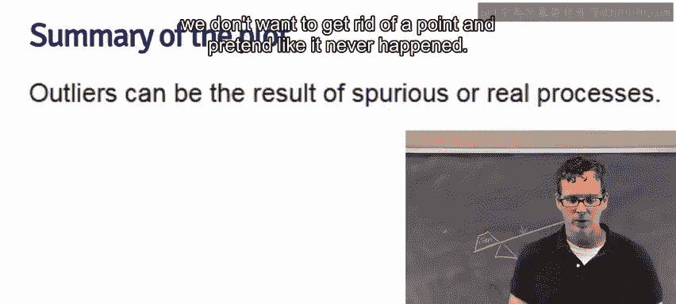
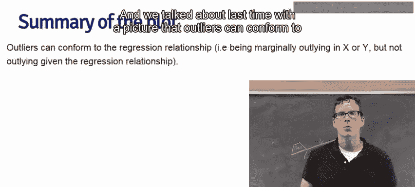
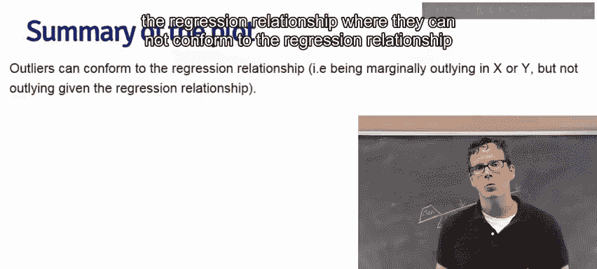

# 约翰霍普金斯大学数据科学课程7：《回归模型》｜regression-models｜ - P29：28_残差和诊断第2部分.zh_en - GPT中英字幕课程资源 - BV1Xw411m7We

So remember we're talking about outliers and leverage points。

This idea of just calling something an outlier is actually very vague。

And what we're going to try and do in this lecture is make these terms a little bit more precise。

So just to remind ourselves， outliers can be the result of real or spurious processes。

 obviously if it's a spurious process we want to remove that point from our fitted model and if it's part of a real process we don't want to get rid of a point and pretend like it never happened。

And we talked about last time with a picture that outliers can conform to the regression relationship where they cannot conform to the regression relationship。

 and there's various ways we can poke and proded outliers to ascertain how much influence they have。

 how much potential influence for how much potential influence they have。

AFairly complete laundry list of default。Diagnostic measures that you have can be done by the R command question mark influence do measures。

 and this will give you just a laundry list of potential influence measures。That you can use。

Our student and our standard are just。😡，Different variations of residuals。

TheOne of the problems with residuals is that they are。Unit specific。

 the residuals have the same unit if our y is measured in pounds that our residuals are in pounds。

 okay， so they're not necessarily comparable across settings and you can't， for example。

 just set a threshold and say， here's my residual threshold。

What would be nice if you wanted to ascertain whether or not something was an outlier。

 it' would be nice if you could just say， oh if it has a residual bigger than four declared an outlier。

 that would be something like an outlier test， well we' need to have a test or a good distribution to compare the residuals to the our student and our standard our attempts to standardize the residuals。

 basically divide by an appropriate standard error measure。

 and there's a slight distinction between whether or not they're internally standardized or externally standardized which basically amounts to whether or not you've deleted the point or not deleted the point when calculating the standard error。

 this has impact to whether or not the residual the standardized residual follows T distribution or not。

I don't find a great deal of help in the distinction between the standardized and unsstandardized residuals。

 I'm sorry the internally versus externally standardized residuals。

 I do like to use the standardized residuals because they're on a nicer scale。

 but I tend to look at them with respect to the overall cloud of data rather than trying to set strict thresholds。

啊。The hat values are another useful diagnostic measure， these are merely a measure of influence。

 So if you think back to our plot if we had a cloud of data a point that fell kind of far away from the X values。

 that point had high leverage but that didn't speak whether or not it actually chose to exert that leverage well leverage is just to measure that how kind of far outlying it is from the collection of x's。

 the further it is the more leverage it has now if we just have one x it's easy to visualize that if we have lots of x's in a multivariable regression it's hard to visualize and then stuff like hat values become very useful。

 one way in which hat values are tremendously useful is in finding data entry errors so you might look through your collection of rows of your data and look at the associated hat values one hat value per row in your model and if you see some that are extremely。

Large， not only would they potentially impact your model。

 but you should look at that row to ascertain whether there was a data entry error。

And then we get to how do we measure things like influence， actual influence。

 not just the potential for influence， well， almost all of the influence measures fall along the following lines。

Take out that data point。Reit the model。And then compare to whatever aspect of the model you're thinking about what happened between having the data point in and having the data point out so DF fits for every data point sees how much the fitted value at that X value changes depending on whether or not that point was included the DF betas look specifically at the slope coefficients。

 how much do the slope coefficients change， whether or not that particular data point is included。

 so for the DF fits， we get one D fit per data point for the DF betas， we get。One。

 we get a DF beta for every coefficient for every data point， so if we have a model。

 a linear regression model， we have two coefficients， the intercept。And then the slope term。

 so our DF betas will be a matrix of two by the number our data points。

Cook's distance is just an overall change in our coefficients。

 it summarizes the D of betas in a sense。Reid the function Reid returns the ordinary residuals。

 and then there's a really nice way to get the kind of cross validated residuals out so the idea again is to。

Leave out the data point。And then look at the predicted y value at that x value。

 whether that data point was included in the fit versus whether or not when it was not included in the fit。

 those the so-called press residuals so the sum of the squared press residuals is like the leave one out crossvalated error and what's interesting in linear regression is you don't actually have to refit the model for none of these things do you actually have to refit the model。

 there's linear algebra relationships that can get exploited so they're very fast and here I just show you that if you take the residuals and divide by one minus the hat values you actually get these so-called press residuals。

The press residuals are less specifically useful for detecting outliers and determining influence than they are for ascertaining things like model fit。

 okay， but I just put it here because it's related。

So let me just give a couple of words about how I use these things before we then go into some computer experiments。

So the first thing is I'm not a big fan of simple rules like thresholding rules。

 maybe if you have giant data sets and automated systems you need to get involved in that。

 but for me if you're kind of digging deep into a data analysis。

 you really want to not think of these in terms of simple thresholdholding rules for declaring things and outlier。

 you want to kind of take a more holistic approach。

Look at those collection residuals relative to the other residuals。

 look at the collection of hat values， relative to the other hat values， and some of the measures。

 some of these diagnostic measures don't have meaningful absolute scales and they might depend。

 for example， even standardized versions might depend on the sample size。

An important aspect of all these measures is that they probe your data to look lack at influence and whether or not something is an outlier in separate ways。

 so you want to really think of them as diagnostics in the same way a physician thinks of diagnostics as sort of poking and prodding at your data to try and figure out if there's any problem。

So。In residual plots， the main residual plot that everyone does always is to plot the residuals versus the fitted values and in these residual plots you're just looking for any systematic pattern。

 if there's any systematic pattern in your residual plot。

 that's evidence of some kind of lack of fit and we'll go through some examples。嗯。

Another plot from the collection of plots I showed before is the residual QQ plot that's trying to ascertain normality。

 the plot of the leverage values is again we've talked about leverage values this is just ascertaining it are there any points that have high leverage and you want to go look at those rows of data specifically maybe they were data entry errors。

And then the influence measures get to the bottom line if I remove this data point。

 how much does it impact the fitted model， the coefficients and so on okay so let's just go through some examples of using these things and I think you'll get the hang of it and from this you can read on these and other influence measures to incorporate them in your data analyses。

