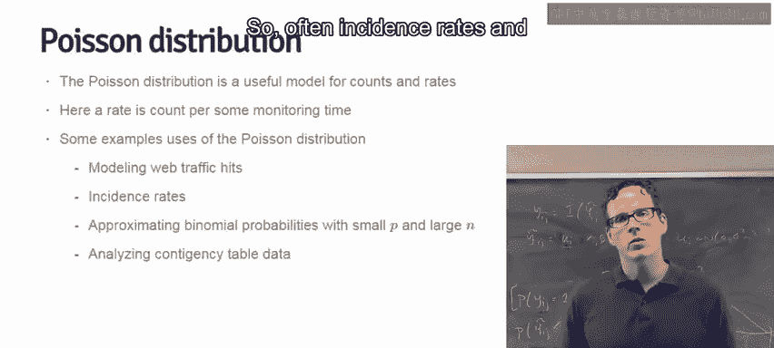
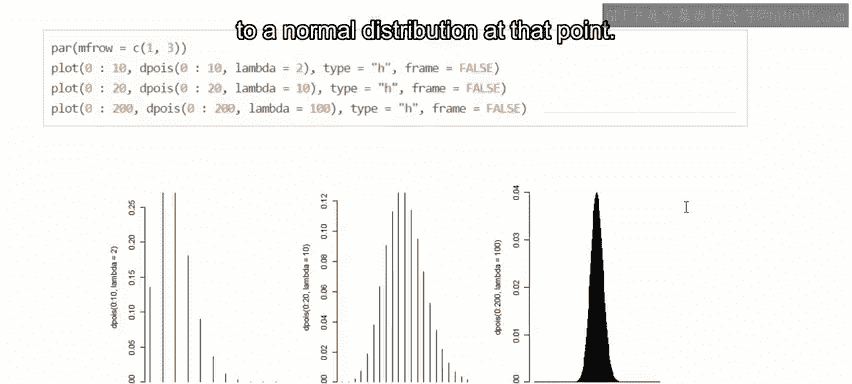
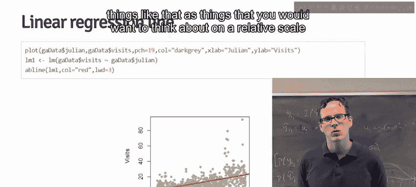
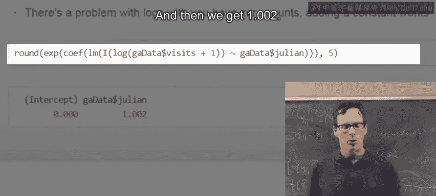
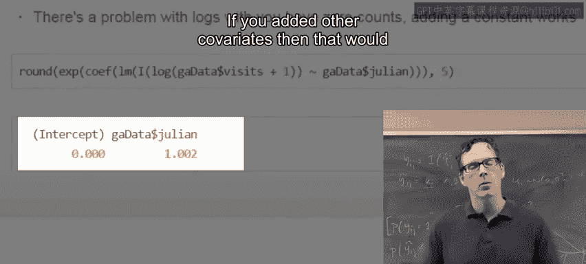

# 约翰霍普金斯大学数据科学课程7：《回归模型》｜regression-models｜ - P38：37_泊松回归第1部分.zh_en - GPT中英字幕课程资源 - BV1Xw411m7We

Hi and welcome to our second of the last lecture。 This lecture is on Poson GLMs。

And I should give some credit to Jeff Le， who I got much of this content from an earlier version of this class。

So modeling count data often count data arises quite frequently in applications， for example。

 the number of calls to a call center， the number of flu cases， and in each of these cases。

 the counts are unbounded in the sense of well， there might be some theoretical bound to the count。

 the total number of people in the world or whatever， however we don't really know what that is。

 or that number is really large relative to the number to the count that we're looking at。

So in addition to counts， data can come in the form of rates or proportions。

 such as the percentage of people passing a test， or in terms of rates。

 think about the number of cases or something like that that occur over a unit time。

 my favorite example is from a pump failure in nuclear pump failure experiment where we're looking at the number of instances that nuclear pumps failure failed per unit time。

 so that would be a rate。very common rate that occurs in biostatistics in public health where I work in is a socalled incidence rate。

 which is the number of newly developed cases per person time at risk okay so all these are instances of counts and rates and proportions are also you can think of as counts both because the numerators account and whatever you're dividing by either the person time at risk or the total time or the total sample the number of trials or something like that。

 that's a second number that are going to show you how to deal with as well when looking at the numerator or the count part okay and all of these can be handled with Poson GLMs。

So the plusson distribution is a useful model for counts and rates。And again。

 a rate is count per some monitoring time， so you know often incidence rates and web traffic and all these other things are modeled by Poisson distributions。

A very common use of the Poson distribution is approximating binomial probabilities where the success proba is very small and the n is very large。

 you can think of that as an instance of sort of approximateating in an unbounded count。

 even though the actual count is bounded。And then an application that I like quite a bit is so-called contingency table data。

 so if you have an instance where you've just counted the number of occurrences of a different collection of variables。

 so if I took a random sample of people and I counted the number of people that had blonde hair。

 brown hair and black hair and I cross tabulated that with the number of people who had blue eyes。

 brown eyes and hazel eyes， okay that table of counts is called a contingency table and Poson models are very useful for model and contingency table data they give a very elegant framework for doing that。

I give the Poisson mass function here and so the rate。

 the rate of counts per unit time is lambda whereas t is the total time。

 if x is Poisson with this mean then it expected value is t times lambda so the expected value of the Poisson is the t times lambda so our natural estimate of the rate would be the count over the total time okay so x over t and it's nice to know in this case that the expected value of x over t the expected value of our rate estimate is exactly lambda。

 the rate that we would like to estimate。

That's a useful property associated with the plusson the variance is equal to the means。

 the variance is t lambda so that's an assumption of our model that we can check and we have some potential solutions's not if it doesn't hold。

And another interesting fact is the Poisson tends to a normal as the mean gets large。

 so you can think of this in several ways， all that has to happen is for t lambda to get large。

 if this could occur if t is fixed and lambda gets large。

 if lambda is fixed and t gets large or both of them get large and in a lot of different applications the way in which the mean gets large could vary。

 but as long as it' gets large in some sense then the Poisson is going to approximate a normal distribution。

 and here I show you this via simulation， I simulate three different collections of Poisson random variables as the mean of the Poisson distribution gets larger and large and you can see by the rightmost panel that it's nearly identical to a normal distribution at that point。

And then we can't actually show that we don' if this isn't the appropriate class to actually show the mathematics that the mean and the variant are equal theoretically。

 so we could do that by simulation and I do that here where where not I'm sorry this isn't actually simulation where I actually try to show it using the density and summing up the density in the right way。

 so if you're interested， try that experiment and itll prove you that the mean in the variance are equal。

 try it for a bunch of different scenarios or you could just believe me， or you could take。

 for example， mathematical biostatistics， boot campamp one or two or my other coursesera classes where we cover how to do the actual mathematics for this。

So as an example， let's look at Jeff League his。His web traffic。This is his website， www。

biostat or I'm sorry， biostat。jjhsph。edu tilldejt leak。And。

The Poisson mean in this case is the interpreted as the number of web hits per day。

 so our unit our time in this case is t equal to1 now if we wanted to interpret the rate that we estimate as web hits per hour we would have to put t equal to 24 so I hope you understand that and if you wanted to have it to be seconds you'd need to put in t equal 24 times or minutes it would have to be t equal to 24 times 60 and so on。

Let's look at the data I show here how you can download it。

 and I convert the date from a standard character date time format to a Julia date Julian date counts the number of days since 1970。

 January 1t 1970， I believe。So the Julian date is nice to think about because it's just a count it's a number of days whereas the date is kind of a complicated format because it's character。

 so when you do head of the data here， you see the date， which is in character format。

 you see the number of visits and he's not doing so well at these early dates with zero visits on all those days。

 the number of visits that originate from simply statistics and the Julian date。

So here's a plot of the data set， it's the Julian date is on the X axis and the number of visits is on the Y axis。

Now we've covered in the last lecture what linear regression of the。Shortfalls of linear regression。

 We try to model count data， or in that case， binary data。 So let's not just rehash that same topic。

 There are some issues with modeling。如。Count data， as if it was。With a linear model directly。

 however， as we saw a couple slides ago， as the mean of the counts gets larger and larger。

 our concern over this decreases quite a bit simply because it's going to trend to a normal distribution so if we have extremely large counts this becomes a lot less objectionable。

So let's just for notation number of hits NH is going to be our outcome JD is the Julian Day that's going to be our predictor and this would be a linear regression model。

 we can plot it。And see the fitted line that we would get。

It has some issues clearly that there's some curvature there。

 maybe we should have put a next squared term in。But that's you know that would be our first approach to this and honestly it wouldn't be that bad。

 but the counts are kind of small， so it's maybe not the best thing in the world and the interpretation isn't great for linear models and we'll see some ways in the next couple slides how we can tweak linear models to maybe get a slightly better interpretation。

 I think of counts and web hits and things like that as things that you would want to think about on a relative scale and the linear model really treats it on a linear additive scale so let's think about how we could get relative interpretations from our linear model。

The first thing we might try is taking the log of the outcome here， I mean the natural log。

And this would be our model， log of NH is the linear regression model。

 B0 plus B1 times the Julian date plus the error term。

Now， let me speak a little bit about log and what it's accomplishing。

The quantity E to the expected value of the log of a random variable is what I would call the population geometric mean。

 and the reason I would call it the population geometric mean is the empirical or just geometric mean is the product of a sample。

 product YI raised to the one over n power。So the way to think about this。

 this product of YI to the 1 overN power， if we take a log of that， we get the arithmetic mean。

 the ordinary mean of the log data， so the geometric mean is just exponentiating the arithmetic mean of the log data。

And we know that if we collect a lot of data， a lot more data in our sample。

 the arithmetic mean will converge to something， so the geometric mean is what this quantity。

 the product of the data raised to the one of rent power， what it converges to。

So what it turns out is when you take of the natural log of the outcome in a linear regression。

 then your expd coefficients。Are interpretable with respect to geometric means。😡，So for example。

 E to the beta zero is the estimated geometric mean hits on day zero。

 and I should reiterate a point from earlier on in the class。

 this intercept doesn't mean that much because January 1st， 1970 is not a day that we care about。

In terms of number of webheads， so probably to make the intercept more interpretable。

 what we should have done is subtracted off the earliest date that we saw and started counting days from there from all of the remaining days in our data set and then the intercept would be the E to the estimated intercept would be the geometric mean hits on the first day of this data set okay。

So that's a small point， but it doesn't change the fitted model。

 doesn't change the slope or anything like that to shift around the intercept， however， nonetheless。

 if you want an interpretable intercept as we know from earlier on in the class。

 you have to do something like that。E to the beta 1 on the other hand， is the estimated increase。

 relative increase or decrease in the geometric mean hits per day。Okay， so the increase per day。

So I should also mention what there's a problem with logs if you have zero counts。

 you have to do something because you can't take the log of zero so you need to add a constant a very common constant that is plus one。

 so we do log of the。Log of the outcome plus one so if we do that here I fit the linear model to the log of the outcome plus one versus the Julian date we get the intercept which is kind of irrelevant in this case as we talked about before and then we get 1。

002 this is on the expd scale okay so what that means is our model is estimating a 。

2% increase in web traffic per day and that's a nice interpretation if you added other covaris then that would be a 0。

02% increase per day holding the other covariates fixed。

