# 约翰霍普金斯大学数据科学课程7：《回归模型》｜regression-models｜ - P40：39_大杂烩.zh_en - GPT中英字幕课程资源 - BV1Xw411m7We

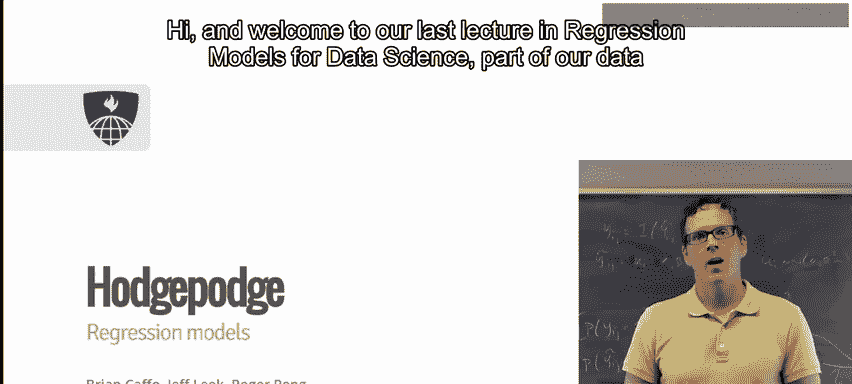

Hi and welcome to our last lecture in regression models for data science。

 part of our data science specialization。

In this lecture， I just hope to motivate you to continue to learn regression models in linear models。

 generalize linear models because of their extreme importance for data analysis。

 and I just wanted to show you a couple of things that at least I find interesting of ways in which we can extend them even further than maybe we thought。

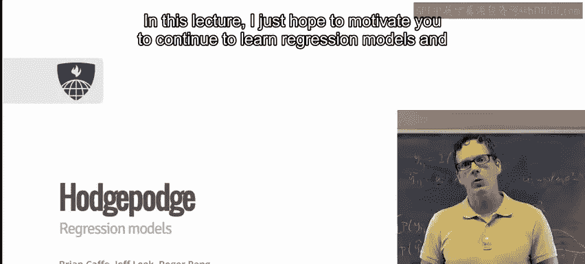

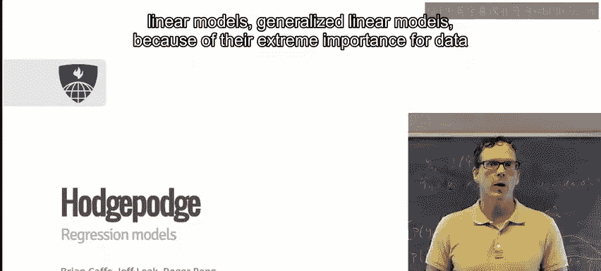

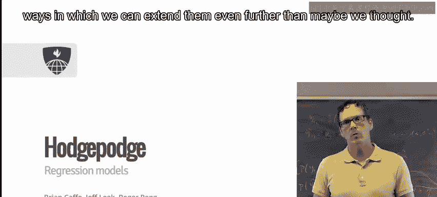

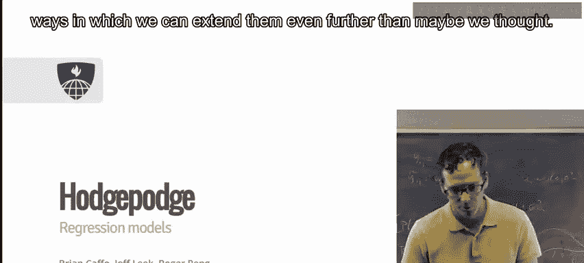

So the first thing that came to my mind when thinking about extending linear models was how that we can fit complicated functions using regression models。

So we've seen a little bit in how to do this by adding squared。

And cubic or polynomial terms into our regression model so that we can fit。Lower order functions。

 however。Imagine if you have a complicated function like a s curve or something that looks maybe like a sign curve。

 how would you fit that nonparmetrically using a linear model so we might specify our model as y is now equal to F of x plus epsilon where F might be a complicated function。

Well， it turns out that there's a pretty easy way to do this and what I'm going to show you is a simple first step。

 there's an entire literature on how to do this and we're just going to go over some of the basics。

 so a first step would be to use something called regression splines。

So going our model for y equal f of x plus epsilon is going to be y equal to an intercept beta not plus a line term。

 a regular slope term， beta 1 times x1。But then a bunch of terms like this。

 where it's the sum of a bunch of terms of x minus a knot point little plus on the bottom times gamma。

And I'll show you in a second what these actually mean， so the function with a little plus。

 that just returns the argument if that argument's positive and it returns zero otherwise。

And these little CasI terms C1 up to CassD， those are not points。

 so what we're going to do is we're going to take imagine imagine a stick that if you break it it just created a kink in it okay rather than break it apart it created a kink in it so what we're going to do is imagine we want to fit our function。

So imagine。If。Our data。Looks something like that and we have a stick and we want to fit this function。

 we might break it at a couple points like that。This is the idea。

We're going to actually mathematically model those breaks and that's what these little plus functions do。

And so I argued down here that if you're interested。

 you can just prove to yourself that this function is continuous， it doesn't have split。

 it doesn't you can draw this without ever lifting up your piece of chalk okay and so let's I think the easiest way to show this would be to go through an example and in this example I just simulate data that's a sign curve。

Plus noise， and you can see that in the blue points on the plot。

So what I'm going to do is grab a bunch of knots， so that's the bunch of the break points where the line will be continuous but not smooth at those points。

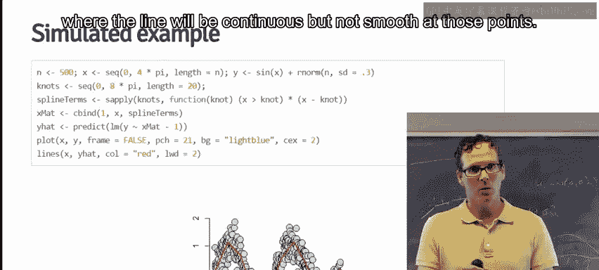

Calculate 20 of those points， and I just equally space them along the range of data that I've collected。

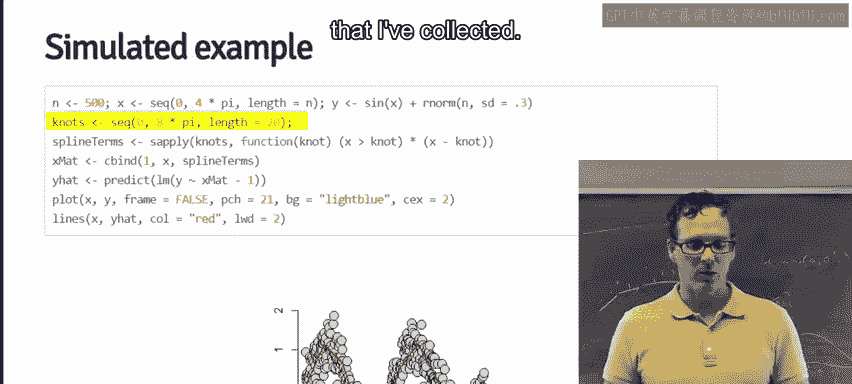

And then I show exactly here how to create my not terms。

 just executing that function that I had on the previous page so you can replicate this function and you can see there it's pretty easy so now I have a matrix of these not terms。

And I then create my X matrix by adding an intercept term， that's just a constant。

 my slope coefficient term， which is just the x by itself， and then these spme terms。

And then I just fit a linear model， why is this collection of predictors and I took out the intercept because I included the intercept in my X matrix。

Okay， and then I show my fitted plot and you can see it looks pretty good it actually fits the sign curve fairly well The only thing that's a little bosome is that we know you know the sign curve that we're trying to fit is likely kind of smooth and this is very。

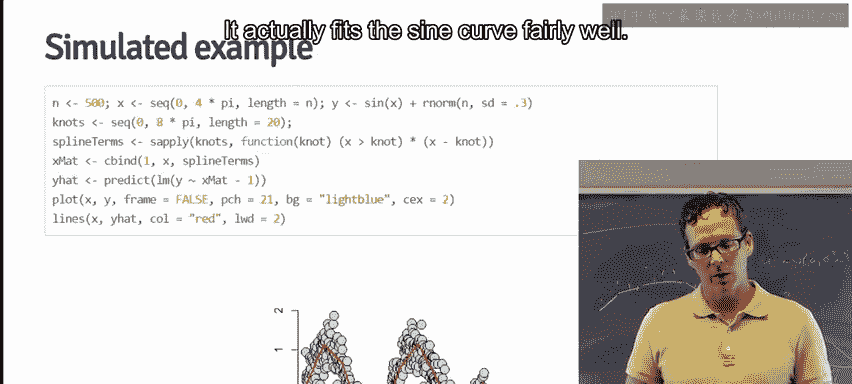

Sharp at these knot points。And the way that that happens mathematically is the function that we've used is。

Continuous， but it's not continuously differentiable if we take a derivative。

 it's the derivative is not continuous。And so we can actually。

Do a pretty simple trick and get a continuous derivative at the knot points and make them nice and smooth looking so it doesn't look like we're breaking the stick at each one of these points instead it looks like we're drawing a smooth curve and it's very easy to just add square terms is all we have to do。

So now our function is y equal beta n plus beta 1 x plus we add a squared term beta 2 x squared。

 and then you see we're using our same function as before only we're squaring it okay so instead of having x minus the knot points with a little plus symbol instead of just using that。

 we're squaring it， which just means if the x is further along than the knot point。

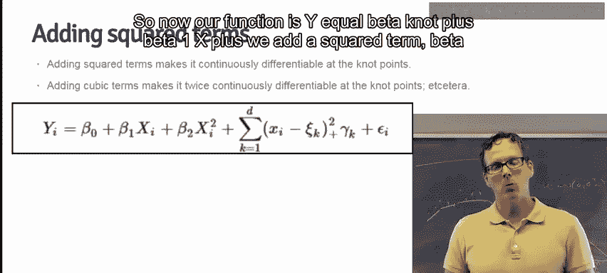

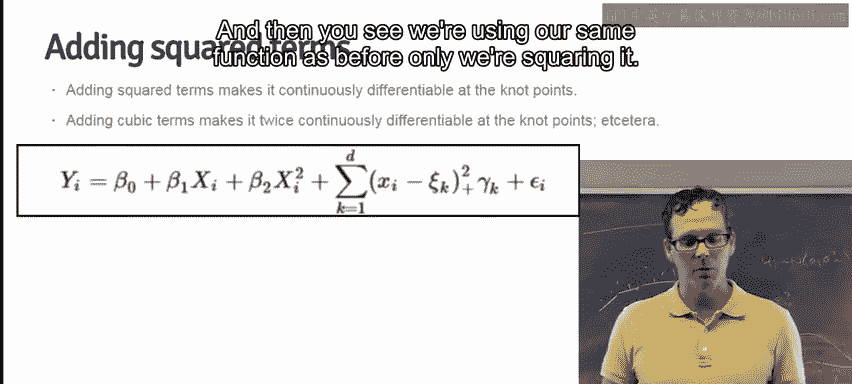

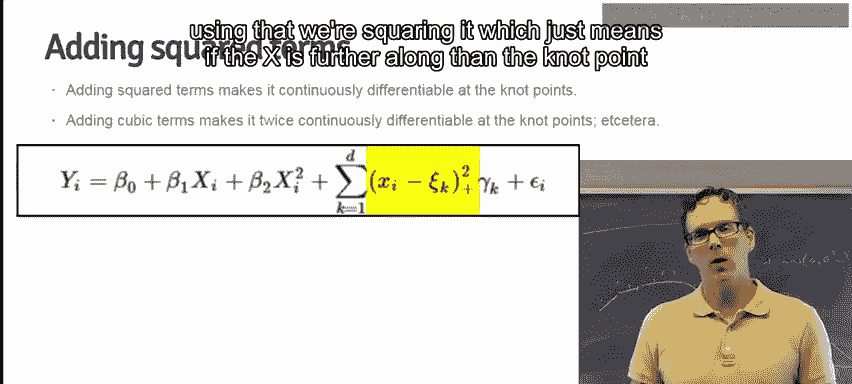

Then return that difference and square it。Okay if it's not， then it just returns zero。

 so that's what that function is， I give you the term here and you can see our code is identical with the exception of I'm just squaring the eventuality that our x' is further along than each of the knot points。

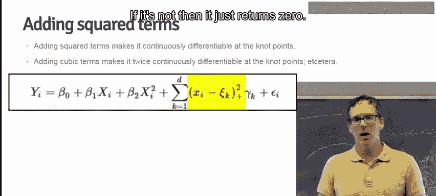

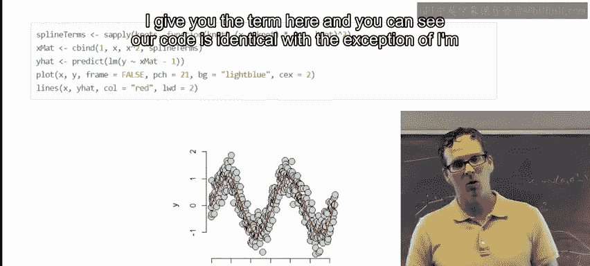

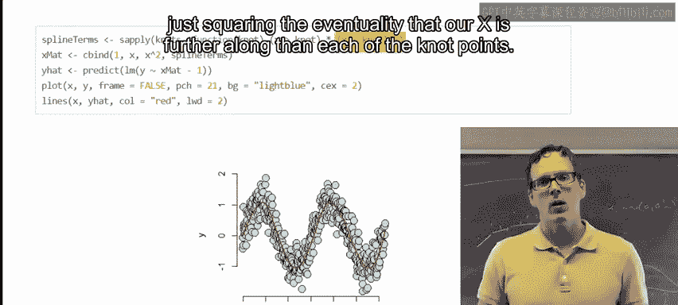

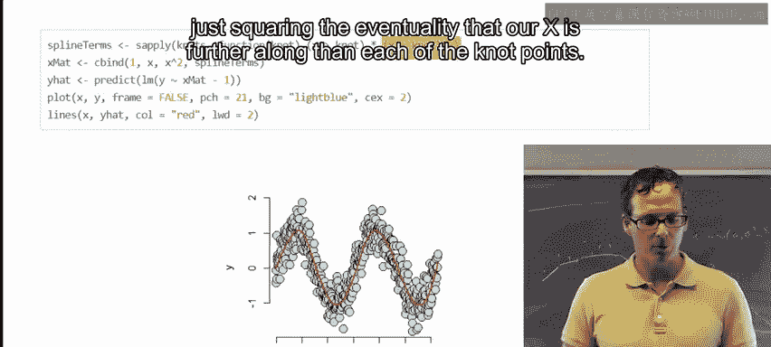

And I've added a x squared term。And then now when I fit it。

 you can see now the curve is nice and smooth and notice all we've done in this process is just ordinary regression。

 so we've fit a pretty complicated function。

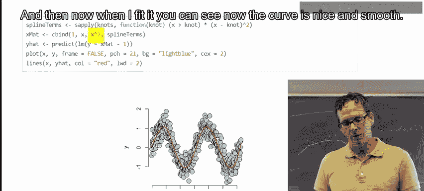

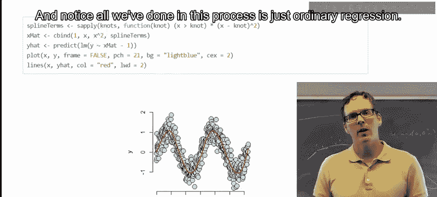

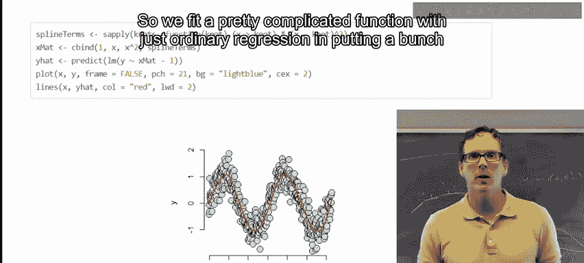

With just ordinary regression in putting a bunch of knot points now this is a pretty basic version of regression sps or basic version of splines called regression spinelines and there's some problems we have to know exactly where the knot points。

 we have to know where to put the knot points， there's potentially a problem if we put too many knot points and there's potentially a problem if we put too few knot points。

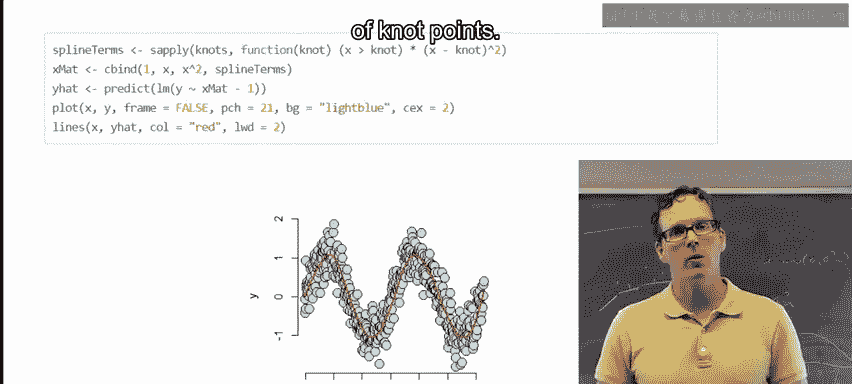

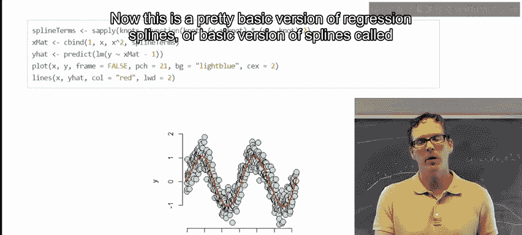

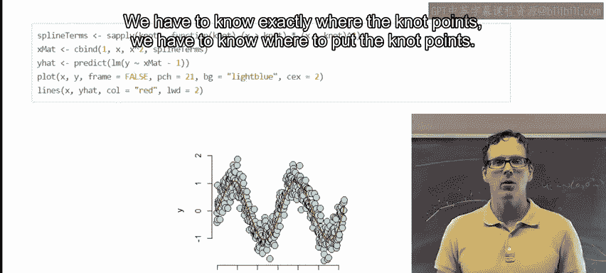

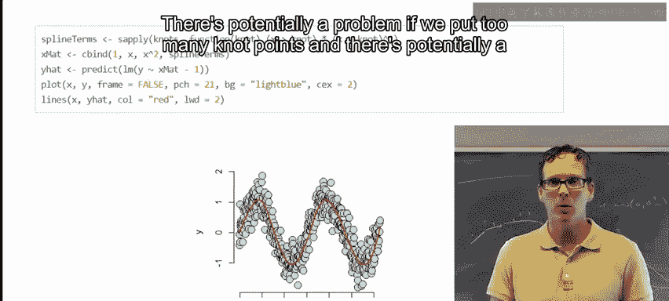

And so there are some solutions for that and in fact I have some notes on the next page that cover this so the first thing I'd like to point out in these notes。

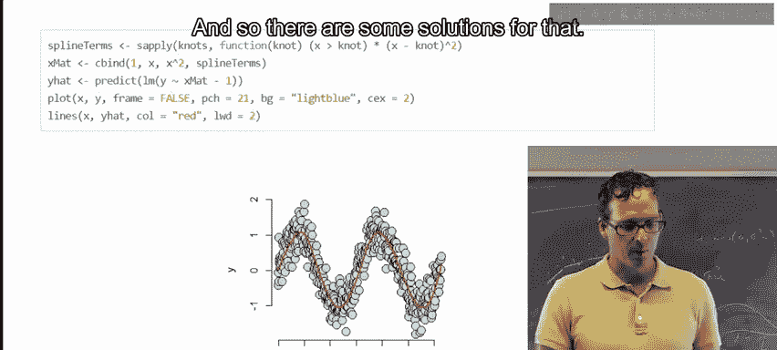

Is that this collection of sp terms， that's called a basis。

 it means it's a collection of building blocks for functions。

And this is just one way to create a set of building blocks for functions。

 there's a lot of other ways and in fact we're going to cover another way here in a minute。

 but this is one of the more popular ones， these regression spines and there's ways you can extend these to make them even more useful。

And so but I would just say people spend a lot of time thinking about these things and there's a lot of different kinds of basiss that you can look at and each basis has its strengths and weaknesses。

 some of the most notable bases are the Fourier basis that we'll talk about a little bit in a slide the wavelet basis and then sp bases like the ones that we're considering just considering there and there's a lot of different kinds of spline bases。

Another thing is if you want to fit data that looks。If you want to fit data。That looks like that。

 you can just have one knot point if you know where that knot point is exactly。

 you can just have the one knot point added in and you can get a hockey stick like model out of this now that might be controversial if you you have to know that it's really a hockey stick and an abrupt change like that。

 but if you really know that and you want to do that you could fit a hockey stick model with this approach。

And there's nothing particular to just doing these in linear models。

 we could do them in generalized linear models as well to just specify the regression spines in the linear predictor and that's all that it takes so in addition to showing you how to fit nonlinear functions in linear models we've basically just showed how to do it in generalized linear models too。

So like I said， a very consistent problem with this is that we don't know where the knot points are。

 there's a problem of putting in too few， there's a problem with putting in too many。

 so the modern solution to this problem is to put in lots and lots and lots of not points and add a so-called regularization term the regularization term will penalize the coefficients from the not terms。

 the sp terms will penalize larger coefficients so it keeps that。

It keeps the number of parameters in check and so that's a more advanced topic but if you take some more advanced linear models or regression modeling classes。

 they'll cover that。So anyway rate so now you have some basics to how you could fit a interesting nonlinear functions using linear models and generalized linear models and for the time being you'll have to play around with the knot placement and how many knots you put in。

 and then I would suggest taking some other classes in linear models to extend this。So let's。

Move on to the next example， the final example for the class。

 I wanted to talk about how you could make another basis， the Fourier basis。

 and how you could try to model harmonics using the furier basis。

 so I thought of this simple exercise。Imagine so a scale right is a major scale is just the kind of thing that you've heard of Do Rey Faasso lati dough。

 just like that， the standard that's an octave eight notes and chord is three notes played together so play any chord to see if you hear someone strum a guitar or play three notes and a piano they're playing a chord。

So I wondered if someone played a chord continuously。

For a little bit of time and we had it digitized and recorded and brought it into R。

 would R be able to figure out what ch it did or what the notes were。

 so that would tell exactly what chor it is， all it got was the sound and could have tell us what ch it was。

So here I took this data。I generated the data， but I got the frequencies for the various notes off a web page and this is the frequencies if you start on the middle the middle C key on a piano and go up one octave to the C key again。

 okay so that's the probably I don't know， maybe the most important part of the piano。And。

So what I've done is I've taken those notes and then I've created digitally sampled time points。

 so here I did the time goes from zero to two and I'm saying it's sampled every 0。001。

 so let's say it's two seconds so we have two seconds of data。And。I created three notes。

 a C and E and a G， I created those notes by just creating a sine wave at that frequency and you could R doesn't really have the capability of doing this。

 but it's actually pretty easy to do in MattLb you could if you were to take these frequencies and save them。

in a file and a wave file and play them， it would sound like like a very digital sound at the right note of that key。

 it was telling bo。Like that， okay？And so to build our chor， you just add these three notes together。

 so there I build my chor by adding my CEMIG notes together that's a C major chord。

 and now what I want to know is here I have a chord and if I could save it as a wave file and play it。

 it would sound like a chord。And what I want to know is， can R detect what chor it is？Okay。

 so what I did is I created a basis that was all the s functions for every node。

 so eight sign functions， and then I fit a linear model with my， my chord is an outcome。

The s functions as my predictors and I got rid of the intercept because everything's centered to have mean zero okay and let's see what happens when I plot the coefficients so here I've plotted the coefficients and I've connected them with a line and you see that R does it correctly and it estimates the C the E and the G chord as having very large coefficients and all the rest of them were kind of small relatively speaking so if you were to do this you would be able to guess the chord。

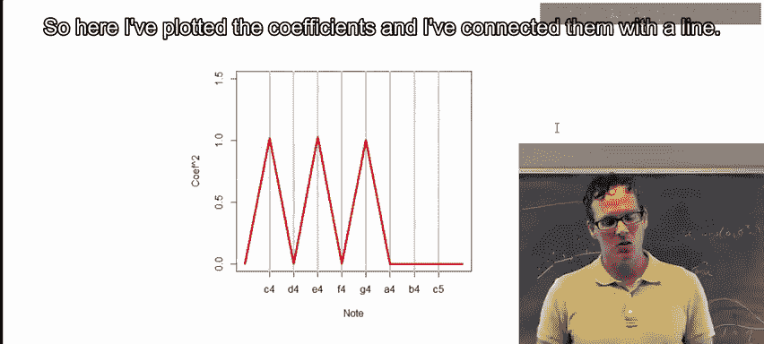

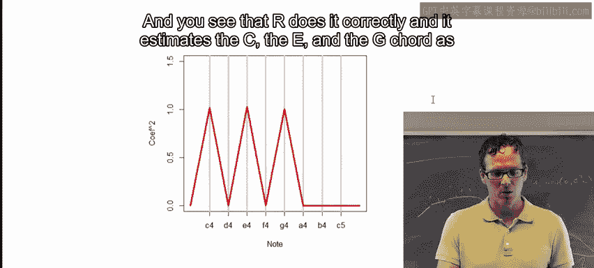

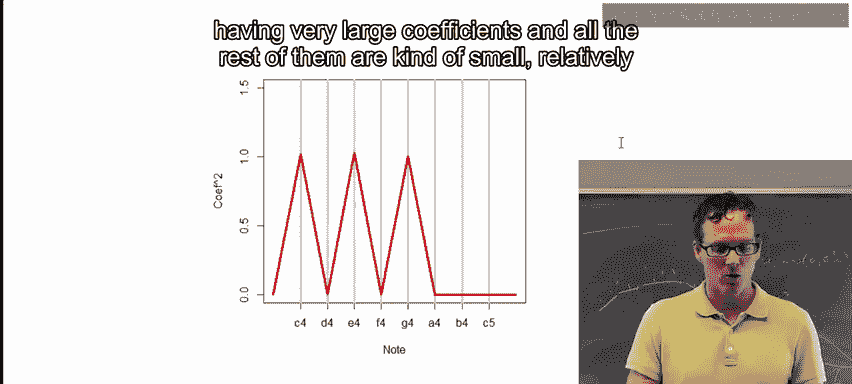

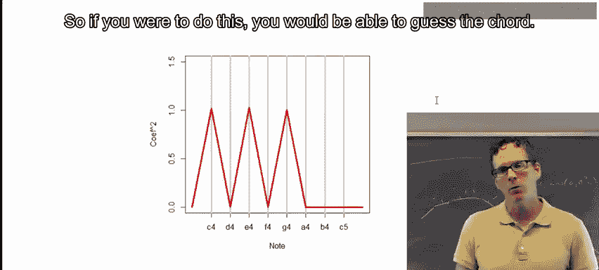

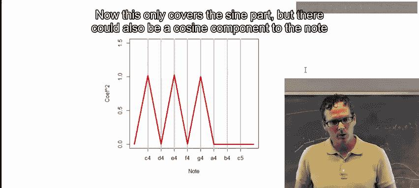

Now this only covers the sine part， but there could also be a cosine component to the node as well。

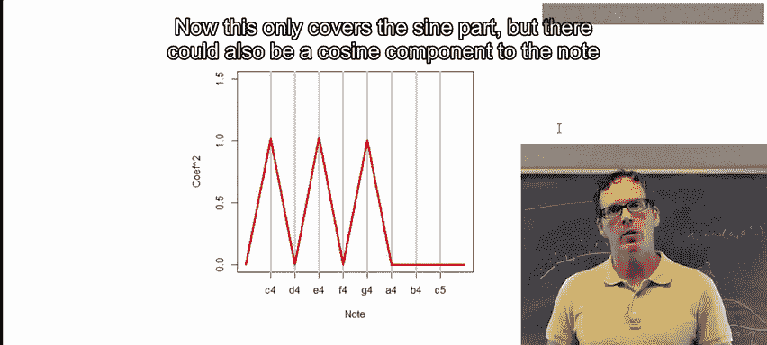

And。And so there is an automated way， a fairly automatic way to fit all the possible signs and cosine terms for you know two seconds of digitally sampled music。

 and that's called the discrete Fourier transform。

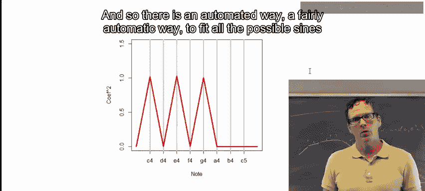

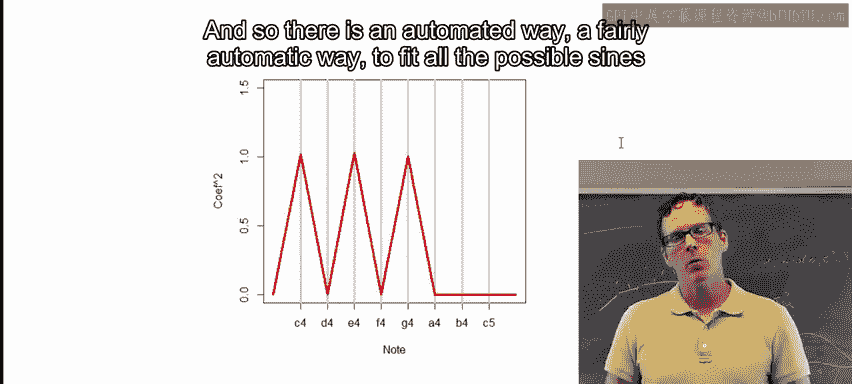

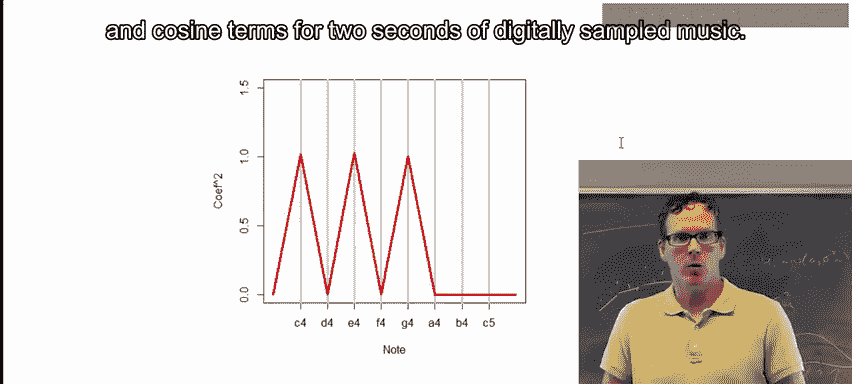

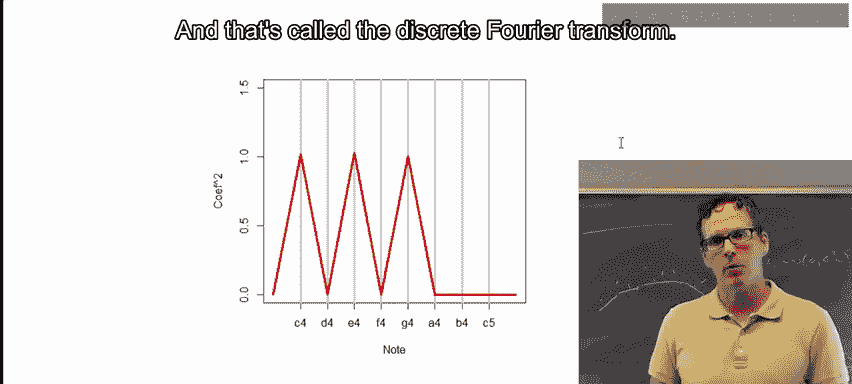

All the discrete Fourier transform is doing is exactly what we're doing here。

 it's fitting a linear model， but it has all of not just the sine terms， but all of the cosine terms。

 but all of the possible ones that that time series will allow at the rate at which it's been sampled。

 so it has a completely saturated completely so-called completely saturated model。

 so it has if you have a thousand time point sampled it has a thousand coefficients in the model。

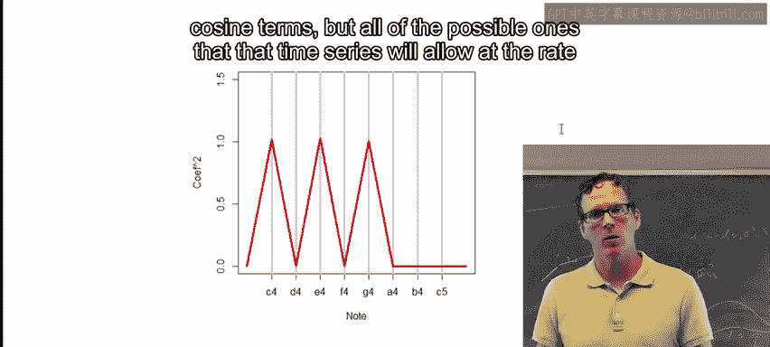

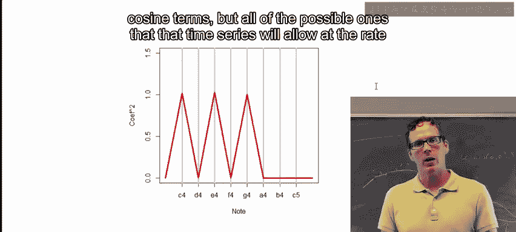

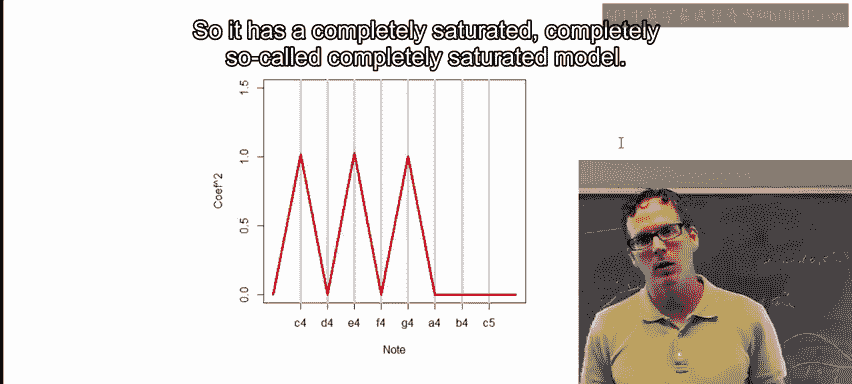

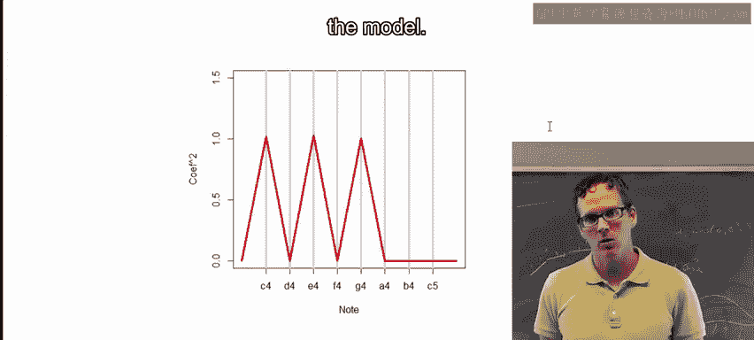

And so the discrete Fourier transform really just fits this linear model does it in kind of an interesting way with complex numbers and that sort of thing。

 but that's all that the discrete Fourier transform is doing。

 and so it would fit both the sine terms and the cosine terms。

 but if you were to plot the output of the discrete Fourier transform。

 I'll just show you how to do it right here， a is just my FFT of my chord and here I'm plotting because the FFT does does this calculation with imaginary numbers。

 I'm just plotting the squared real components of the。

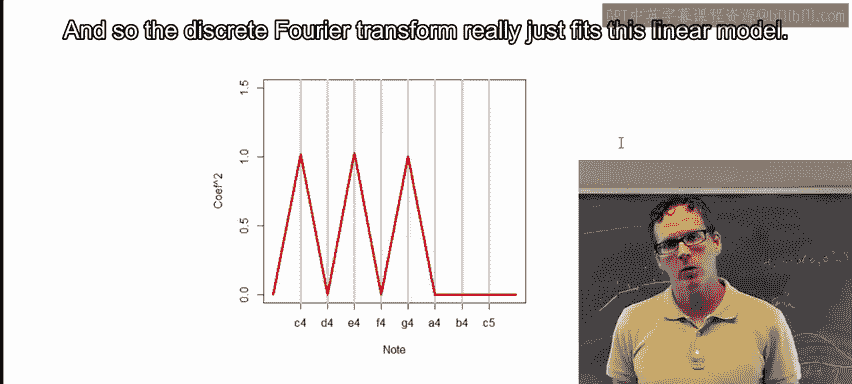

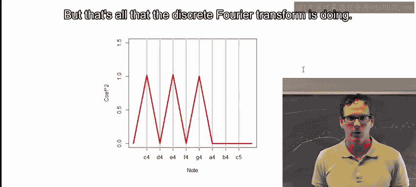

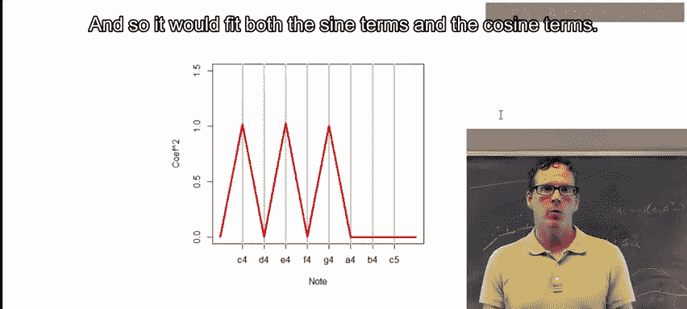

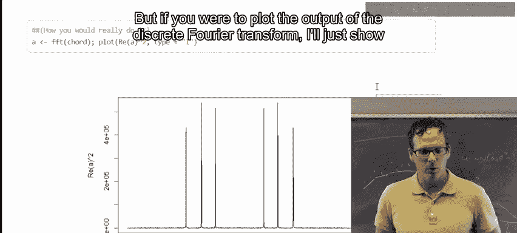

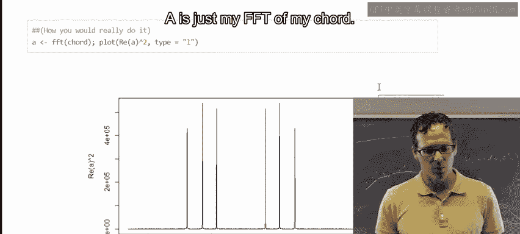

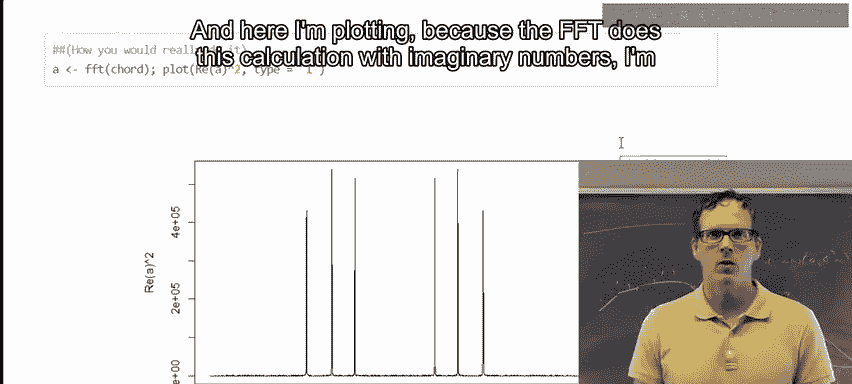

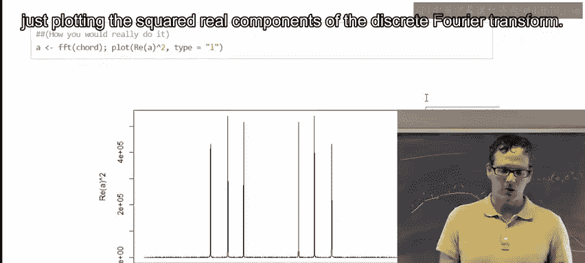

Of the discrete Fourier transform and you can see it loads on three very specific frequencies。

 you could back calculate what those frequencies are and those are the frequencies for C。

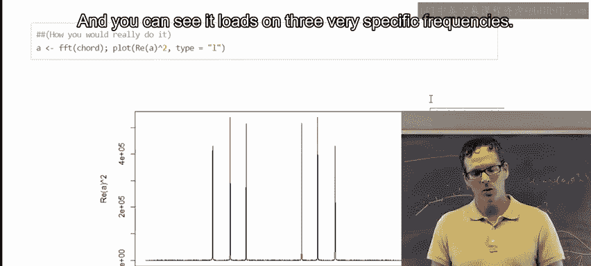

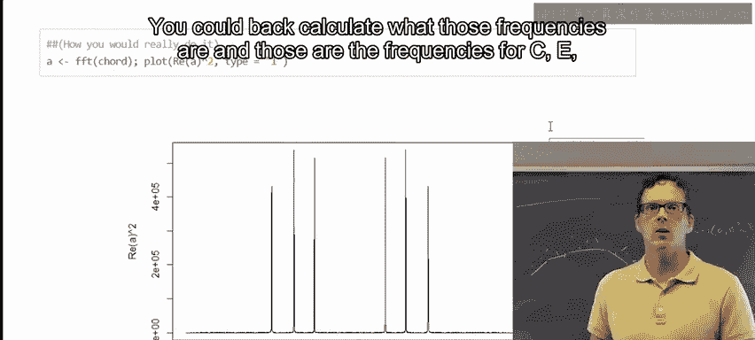

E and G so the C major chor so and that's actually a very common thing to do in music and sound processing so if you were to take a sound signal。

 a section of a sound signal and do a discrete furier transform and plot the so-called spectrum。

 which is what this is that is what sound engineers do all the time and ultimately underneath the hood what they're doing is a linear model with a lot of signine and cosine terms in as regressors。

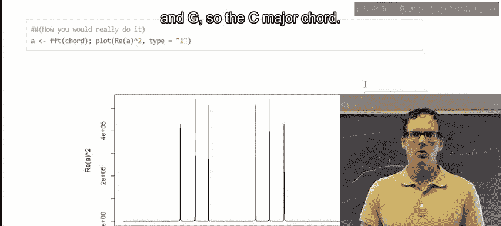

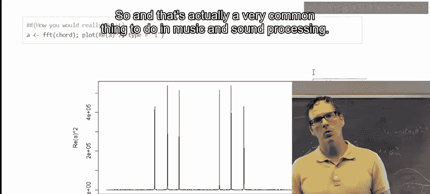

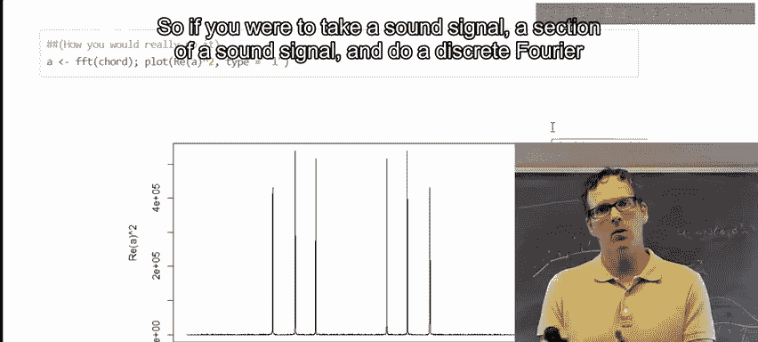

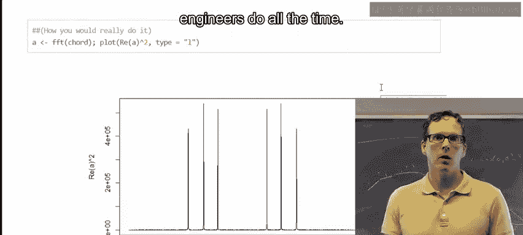

I should say that the discovery of the discrete Fier transform was a large advance and that the fact that the reason people do。

The calculation with the Fier transform rather than the linear model is because there was a discovery by a very famous statistician named Tki。

who discovered a way to do the Fourier transform very quickly， the so-called fast Fourier transform。

 and that's what everyone uses I think you can prove it's about as fast as you can take this Fourier transform and it's much faster than doing the linear model and so that's why if you were a sound engineer。

 you wouldn think of it as a linear model problem you would think of this as a Fourier transform problem and you would take fast Fourier transforms。

So that's in the end of the class， but I hope in this lecture。

 what you've seen is one a case where we can fit pretty complicated functions with a of lines of code。

 a couple of lines of our code。

Very easily and secondly， an instance where we can do something that maybe at first blush we would have thought that's not really in the scope of what linear models can do in diagnosing what are the various notes of a core。

 that's something we just wouldn't naturally think a linear model could do。

 we showed that not only are both those things possible linear models they're actually kind of easy with linear models't it's not reams of code we had to do。

 there was six or seven lines at the most versus these examples including generating the data。

So that just goes to show how powerful these techniques are and so I hope you've enjoyed the class and I especially hope that you take the knowledge from this class and build on it if you were to build on it my suggestion would be to learn a little bit more about generalized linear models because we only touched on them in this class and the second thing would be to approach correlated data and longitudinal data。

 another divergent aspect of linear models that's quite important everything we've done assumed independent errors and data that were exchangeable at some level and a very important subset is when that doesn't happen if we measure take measurements on a large collection of siblings。

 the measurements between the siblings are going to be closer together than in a different pair of siblings so handling that correlation is a big part of generalizing linear models to a broad collection of important topics so if I were to suggest two ways to go further with the stuff that would be a generalized。

Linear models and longitudinal multi level data。

So thanks again for taking the class and make sure to look for us me。

 Jeff Lee and Roger Pang on Twitter for all so for any interesting new stuff that's coming out of the data science lab here。

 our data science program we have some other programs coming out along the way and so keep we'll post them all on Twitter and other social media stuff if if we like what we've done in the data science specialization。

 we've got a lot more coming so thanks again。

