# 约翰霍普金斯大学数据科学课程7：《回归模型》｜regression-models｜ - P4：3_介绍性的数据示例.zh_en - GPT中英字幕课程资源 - BV1Xw411m7We

Up to this point， we haven't used the parents heights at all。

The first thing in this kind of data we would want to do is create a scatter plot of the child's heights by the parent height here I use a GG plot。

There's numerous failings in this plot。One of the primary failings is that these points are overplotted。

 there's lots of different paired parent child。X， Y values at each one of these specific points。

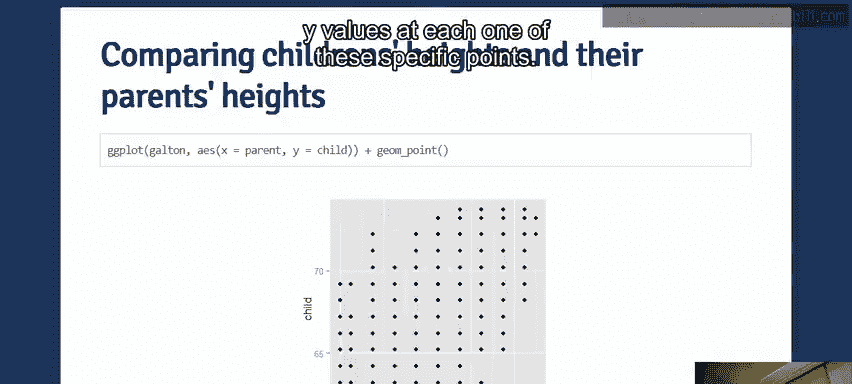

Here I give a better plot。😡，Where the size of the point represents the number of parent child combinations at that particular XY location。

Here the color of very light color represents a frequency near 40 and a very bluish or darker。

 relatively speaking bluish color represents a frequency of number toward 10 or down to  one at specific location。

 so the size of the point，And the color of the point are representative of the frequency of。

Parent child combinations that that specific X， Y player pair。

 and this is a much better plot because it。It gives you it doesn't lose that information。

I would say there is another failing of this plot， for example。

 I don't put the units of inches on either of the two axes and I think that's good practice to have the units on the axes so that's a little bit of a failing for this plot and if you want to see the code it's in the R markdown file。

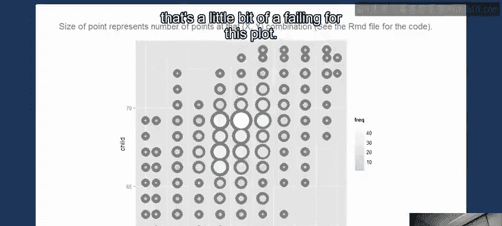

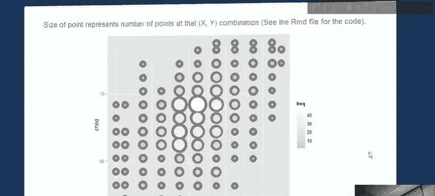

Now， let's suppose we wanted to explain the children's heights using the parents' heights。

And let's assume we wanted to do it with a line。Well。In order to make things easy for right now。

Let's force the line to go through the origin。Specifically， it has to go through the 0。00。

 so in other words it has a y interceptor0。Well， then the line is just x beta。

 right y x beta defines a line through an origin through the origin。In order to find the best line。

 all we have to find is the slope。

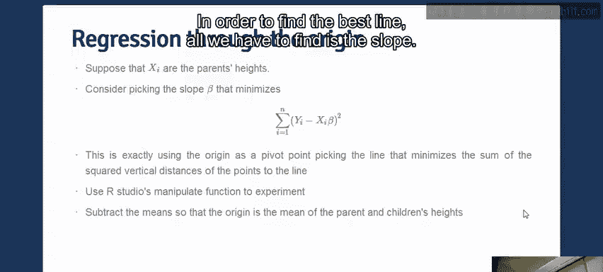

Well， here's how we could potentially do that， we would want to find the slope beta。

That minimizes the sum of the squared distances between the observed data points， the Y eyes。

And the fitted data points on the line， Xi beta。We'll square that distance and add them up。

 and this is directly analogous to finding the least squares mean that we did just a couple of slides ago。

So this is exactly sort of using the origin as a pivot point and picking the line that minimizes the sum of the squared vertical distances between the points in the line。

 so we're going to use our studios function manipulate to experiment with this and see if we can find that line。

Now there is a point and regression through the origin is useful for explaining things because we only have one parameter。

 or the slope and we don't have two parameters， the slope and the intercept。

 but it's generally bad practice to force regression lines through the  point00。

So an easy way around this is to subtract the mean from the。

Parents heights and the mean from the child's heights so that the00 point is right in the middle of the data。

And that will make this。Solution a little bit more palatable and we'll discuss it later on how this relates to real regression where you fit both a slope and an intercept。

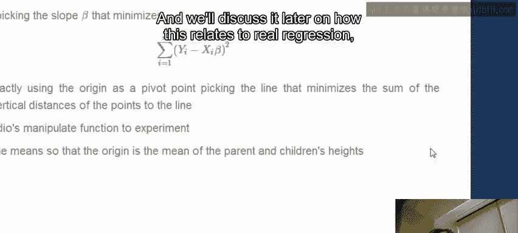

Let me just show a picture to illustrate some of these concepts。

 so here I have a scatter plot where I have some data on the Y axis and some data on the X axis。

 and I want to use my X variable to predict my Y variable。This is my X axis and this is my Y axis。

My red crosshairs are my data points。Regression through the origin in the way that we're doing it takes the point00 and treats it as a pivot point。

 it then tries to find the best。Line。Going through the points where the best line is as follows。

Let me take this line here。It's going to take。Each observed。Point y。

 it's going to calculate the vertical distance。So this is that's Y I。That height is Y I。Okay。

 this length is Xi。And that point is X beta on the line。

So this distance right here is Yi minus Xi beta。And then if we square it。

 we'll get the square distance so what？Regression to the origin is trying to find as it's trying to take all of these vertical distances like this between the fitted line。

And the observed heights。Square all those distances atom all up so that each one contributes equally to the error rate that it's calculating and tries to find the best slope because remember this line is defined by a simple equation y equal to x beta when you have a line going through the origin。

 you only need one parameter， that's the slope。Now。That line's not going to be very good。If you look。

 the line really should hit somewhere along here， so regression to the origin kind of doesn't make sense。

What we're doing by centering the data is we're setting the origin to be right in the middle of the data。

 So that point now is 0，0 by subtracting off the means。 So it's basically reorienting the axes。

 so that the 00 point lies right in the middle of the data。 Now。

 it seems a lot more reasonable to find。The regression line that goes through the data where we just consider a slope。

 so regression of the origin seems to make a little bit more sense if you subtract the means and we'll find out later that this yields equivalent to the solution if we were to both fit the intercept。

And the slope。So let's try and do this with our studio's manipulate function。

 and I think because this is one of the central themes of the next several lectures。

 we're going to go over these points over and over again， they're very fundamental。

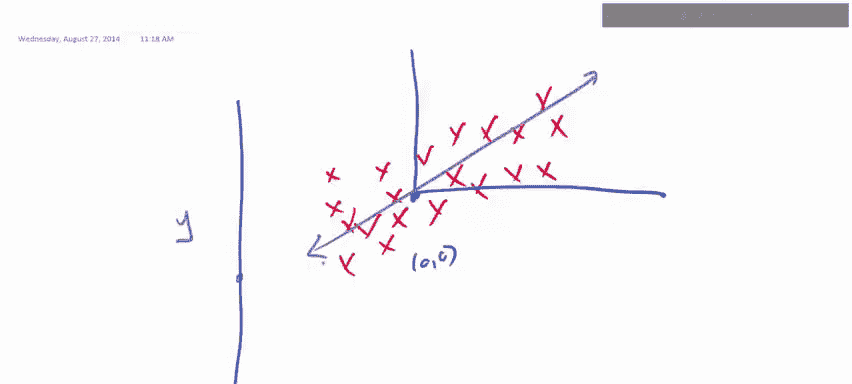

So I won't show running the code because you can grab it from the R Markdown file and I'm hoping at this point in the specialization you'll be familiar with running R code。

But here's my plot。And over it， I have a specific value。Of the regression line。

 notice that my child's height， if you the indices may。

Get downsampd a little bit in the video compression。

 but what you can see is the center of the child's heights here is it zero because I've subtracted the mean the center of the parent heights is zero so I have a pivot point right in the middle at zero zero。

I also want to point out that up here I give the slope be equal 0。6。

And the mean squared error where the mean squared error is， again， the sum of the y data points。

Subtracting off。The X data point， the parent height。Multipliied times this factor 06。

 So it's taking each one of these points。 Let's take this one。

 or let's take one that's more centered。 This one right here， it's calculating this distance。

 the vertical distance between the child's heights and the parents heights multiplied times the slope。

Calculating that， squaring it and adding them up， but here again。

 because there's multiple points at any XY combination。

 you can think of maybe multiplying this distance by the square distance by the appropriate number of points of that specific combination because of the overply。

At the 0。00， our line is going to pivot around that  point。

00 because we're only fitting lines that have to go through the origin because we're only considering the slope。

 Okay， so let's do it and see how our mean squared error changes as a function of our slope。

06 doesn't look so bad。 Let's move it to one that's not so good。 Okay。

 the mean squared error has gotten a lot worse， right， So it went from 5。004。 Say， it 0。68。

 Now let's move it all the way up now it's at 5。8。 and you can see。

The mean squared error getting lower。Right。As you get down to a slope。Looks， looks like。6。

 something is。Is doing pretty well。64 has 5。And then 0。62 has 5。002， so it's gone up。

 so it looks like about 0。64。 What's interesting is the slope of one。Is not good。

There's the slope of one。That's saying you want to predict your child's heights。

 just try the parent' height， A we have to multiply by a factor get the child' to get a better prediction of the child's height than just the parent's health by itself。

 we have to multiply it by a factor of 0。6 in this case， that's what the slope is doing for us。

Here I give the manipulate code and again all this code is in the R Markdown file。

 so don't retype it in from the slides， actually grab it。

 grab the actual text from the R Markdown file。Now that we've used Manip to find the slope。

 I'm going to show how you can do this very quickly in R， the function LM。Fits the linear model。

 And if you hear， I have the code where I。

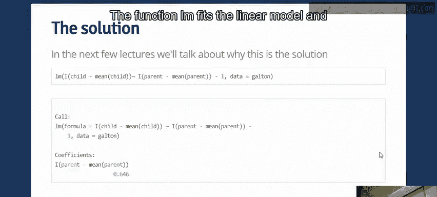

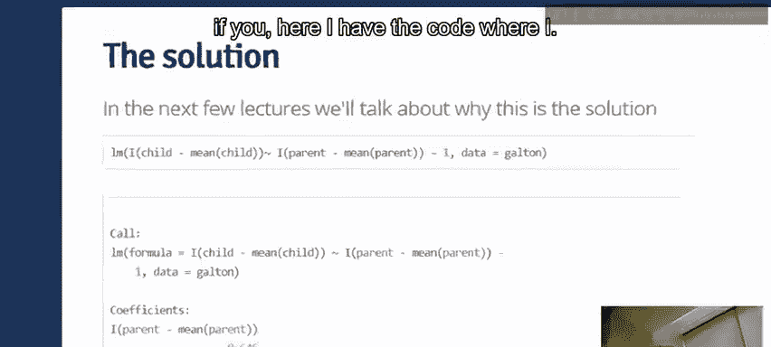

Here I have the code where I use LM。My outcome， my y value is the centered child's heights。

 so I've subtracted off the mean。And here。Is the centered parents heights where I've subtracted out the mean for the parents。

 This minus1 says get rid of the intercept because we're talking about regression through the origin。

Where we forget about a Y intercept and then telling them that the data set I want to fit is Galton。

 and it gives me the slope 0。646。

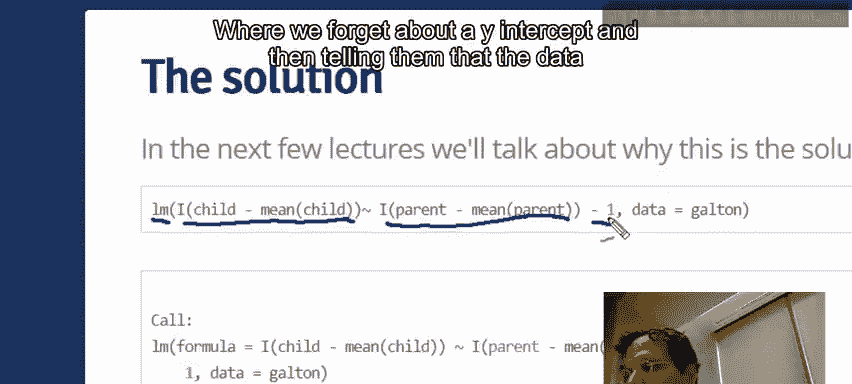

So we're going to talk about this a lot， we'll go through this in great detail throughout the rest of the class。

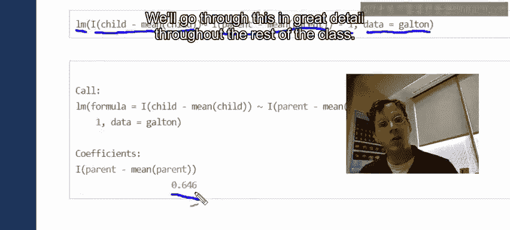

Here in the final slide of this lecture， I just give the fitted line now because of how we've forced。

The model， it has to go through the point。0ero zero for the centered child height and the centered parent' height。

 so it has to go through the mean of the child's height and the mean of the parent' height I've reshifted the plot so that that00 is back at the original point。

And so here is our line that has slope of 0。646。 and now what we're going to do in subsequent lectures is talk about。

How we get these， how the motivation behind it and all of the things we can do with this fitted line。

 we're going to spend maybe the next several lectures talking about this。

So welcome to Introduction to regressionion， we've actually covered a lot of material in this very first lecture。

 and I really look forward to working with you for the next couple weeks。

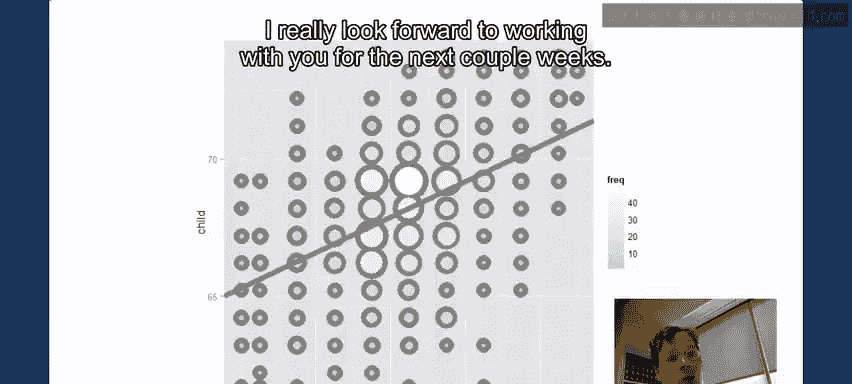