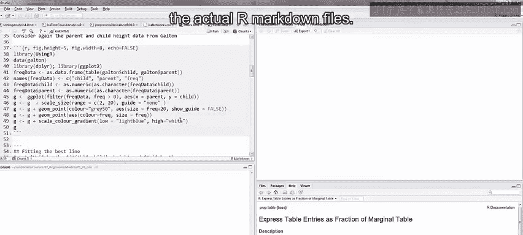
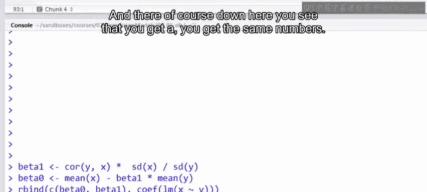
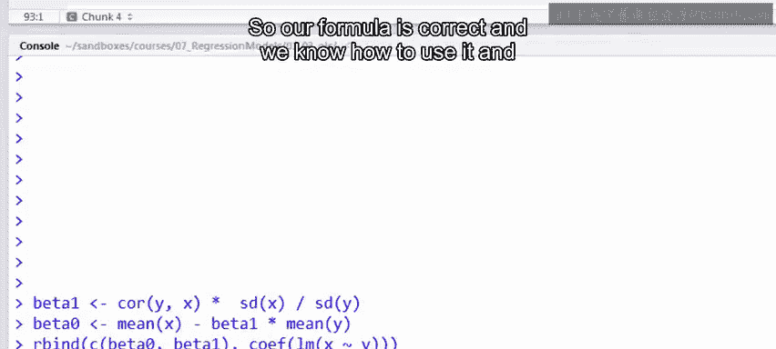
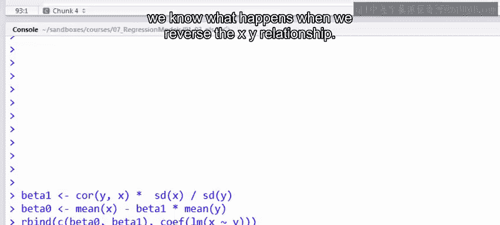
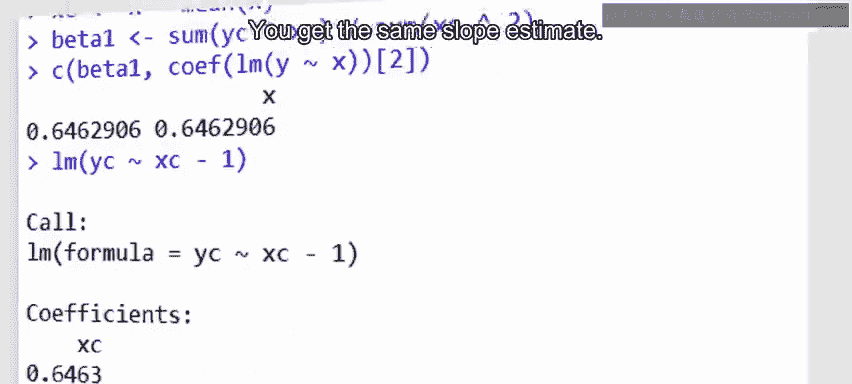
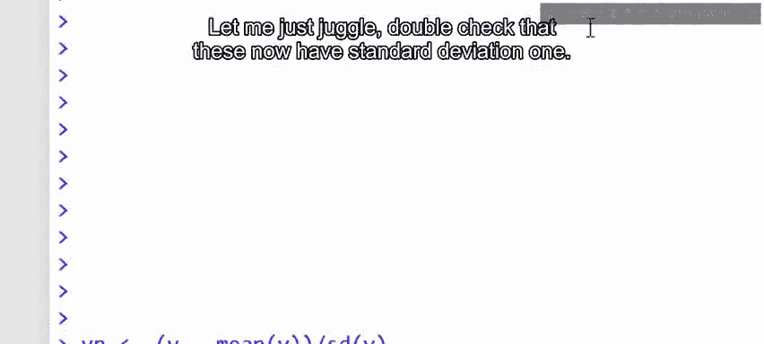
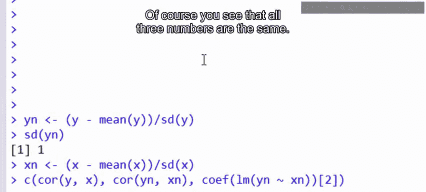
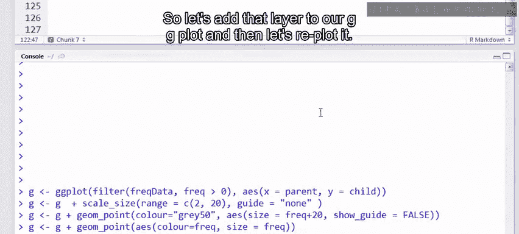

# 约翰霍普金斯大学数据科学课程7：《回归模型》｜regression-models｜ - P7：6_线性最小二乘法编码示例.zh_en - GPT中英字幕课程资源 - BV1Xw411m7We

So I wanted to show you the slides that I was working on now， the actual R markdown files。

 this is the dot RMD file。

And at first， I want to plot the data that I'm going to look at。

 This is the Galton's parents height and children's height data。

 So I'm going to plot it here using G plot， and there's my plot。

 Now I'd like to go with the information that is on the slide which is some R code。

 so I thought it'd be probably better to just show you show you the running of the R code rather than showing you a slide with the output of having run the R code。

 So here I for convenience， I've defined my outcome as the child's heights， Galton dollar sign child。

 So let me define those。 and I've defined the X， the predictors as the parents height。

 Galton Doll sign parent and this is just going to save me on some typing。Now。

 first I'd like to indicate that the solution that we've specified is the same solution that R will give you with its built in regression function。

So here's beta 1， it's the correlation between y and x times the standard deviation of y divided by the standard deviation of x。

 and here's my beta not。Whi is the mean of y minus the beta 1 that I just estimated times the mean of x。

 so I can， for example， look at these with beta 0 and beta 1。

In this C function for just creating a vector。Let me check that with the LM function。

 I'm going to copy the function and paste it down here and then I'll go through each of the components LM in R stands for linear Model。

 regression is a component of linear models， and so this function is the general function whether you want regression or you want some of the more elaborate versions of regression that we're going to cover later on in the class。

So we want LM。The outcome Y， tilde， the predictor X， and that does a linear regression by default。

 it includes an intercept。CoF takes the output of the linear model。And just grabs the coefficients。

 and of course， you see that we get the same numbers， 23。94 and 064。65。Very briefly now。

 I just want to show you that if I reverse the y and x relationship， the formula of course， holds。

 but now a standard deviation of x in the numerator and standard deviation of y in the denominator。

 so I'm going to now define my beta 1 as correlation of y and x。

 but now with standard deviation of x in the numerator and standard deviation of y in the denominator。

My intercept is now mean of x minus beta 1 times the mean of y。

Now I'm simply going to concatenate these。Slope and intercept estimates with those that you get with LM。

 where now x is on the left hand side of the Tilde and Y is on the right hand side of the Tilde reversed from what it was previously。

And there， of course， down here， you see that you get the same numbers。

So our formula is correct and we know how to use it and we know what happens when we reverse the XY relationship。

Another point that was made thus far in the lecture was that regression to the origin yielded the same slope as linear regression with a not necessarily zero intercept。

If you mean centered the Y's and mean centered the x's first。

So let's just check that computationally。My centered y is just going to be y minus the mean of y。

My centered x is just going to be x minus the mean of x。

And recall that the regression to the origin equation for the slope was just。

The sum of the y variable times the x variable divided by the sum of the x variable squared。

 so let's run that and get our coefficient that is estimated through regression to the origin。

And then now what I'm going to do is I'm going to take this beta 1 that I got through my equation for regression to the origin。

Where I've mean centered my data first。And then I'm going to compare it to the linear regression estimate using LM with y tilde x。

 meaning y is my outcome x is my response and LM automatically puts in an intercept。

 and I'm going to grab the second coefficient， which is the slope。When I do that。

 if you look down here， you see， of course， that you get the same numbers。

I want to very briefly also just show you how you can actually do regression to the origin using LM。

 how you get rid of the intercept， so in this case I'll get the same number if I take the centered y。

And use the centered X as a predictor， but I want to subtract out the intercept so you put a minus1 to get rid of the intercept and you'll see here 0。

6463， you get the same slope estimate。

Another point that was made in the lecture。Was that if we were to normalize the Y or the x's so that they have standard deviation1。

The slope would be the correlation。So let's just double check that really quickly here。

I'm normalizing my child's heights by subtracting up the mean and dividing by the standard deviation。

 Let me just double check that these now have standard deviation1。

There you go， and I'm going to do the same thing for my X variables now。

So now both my Y and my X variable， the YN and XN variables can be interpreted as standard deviations from the mean in the Y's case for the child's heights and in the x's case for the parent' heights。

 so we've gotten rid of the original units， the inches。

 and now they're in standard deviations from the mean。Now I simply want to show。

With this concatenation operator here that the correlation between the original y and the original X is the same as the correlation when I normalize the y。

 and I normalize the X， and it's the same as the coefficient for the linear regression when I fit the normalized Y as the outcome and the normalized X as the predictor。

And when I run it， if you go it down here， of course， you see that all three numbers are the same。

The last thing I'd like to do is simply show how to add a regression line to a GG2 scatter plot here over on the right。

 I'm showing the somewhat fancy plot I've been giving for this data where the sizes of the circles are the number of parents and child at that specific XY location。

 and the color of the circle is also representative of the frequency。

I've defined over here my aesthetic so that x is parent and y is child。And if you want to add。

A linear regression line to this point。You simply take your plot。

 which I've assigned to the variable G， and you want to add GO underscore smooth。

 you want to use the method as LM and you want to give it the formula Y till to X。

If you omit the formula， it's going to assume that the formula is y tilde x。

So let's add that layer to our GG plot and then let's reloot it。

And there you see the regression line overlaid on top of my scatter plot。

I would also note that GG plot2 does a very good thing for us on our behalf as they automatically give us a confidence interval around the line。

 we'll talk about how to generate this confidence interval later on in the lecture。

 but it's very nice that they're thinking of statistical uncertainty automatically。

