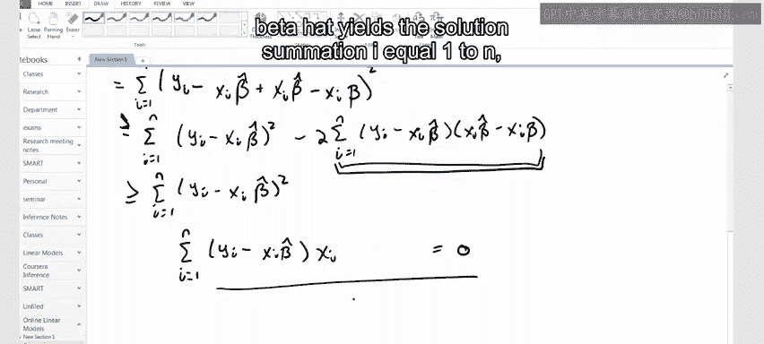
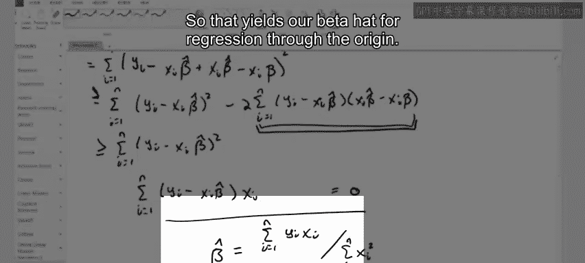
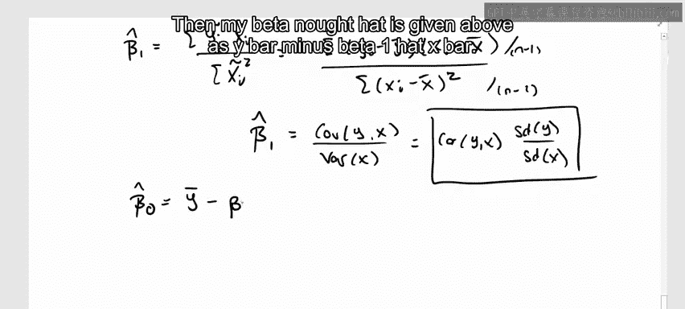

# 约翰霍普金斯大学数据科学课程7：《回归模型》｜regression-models｜ - P8：7_技术细节 如果你愿意跳过.zh_en - GPT中英字幕课程资源 - BV1Xw411m7We

The last thing I'd like to do is to demonstrate。That the linear regression slope estimate is。

Beta 1 hat equal to the correlation between y and x times the standard deviation of y divided by the standard deviation of x。

 I'd like to demonstrate that。It's going to take some doing and if you don't want to get this involved in the mathematics。

 now would be the good time to stop the lecture and move on to the next one。

 however if you are interested again I'm going to do this in a way that doesn't require advanced mathematics。

 but you have to be familiar with mathematical notation and pretty comfortable with it。

So before I do full regression， let me do regression through the origin。Let me draw this line here。

 so I want to fit the best line y equal to x beta。Through my data。

My data is y1 up to Yn and x1 up to Xn。I would like then to minimize the criteria， summation。

 Yi minus Xi beta squared。Where the sum is from i equal 1 to n。Let me let beta hat be the solution。

And we'll see what has to happen about that solution to make it work。So this equation here。

Is equal to the summation i equal 1 to n Y I minus X beta hat plus X beta hat simply because I've just added0。

Minus X beta squared。All I've done is add zero。I can expand this square， some asiaical 1 to N。

Y I minus X I beta hat squared， and I'm going to distribute my sum。

Minus twice summation I equal equal1 to n。Yi minus Xi beta hat。Times Xi beta hat minus Xi beta。Plus。

The summation。X I beta hat minus X beta squared。Now。If I get rid of this term。

 it's adding up a bunch of positive things。I'll only get。

Smaller because I' have thrown away something that's positive。So if I take six。

 which is  four plus two and throw away the two。I've gotten smaller。Okay。

 let's look at this term right here。If beta had。Forces this term to be zero。Then。

Let me just rewrite this if it's zero， I will get the following。I'll get。

That my least squares criteria for any beta is larger than。

What I get when I plug in beta hat specifically。So that beta hat would have to be the minimizer because every other beta is it creates a least squares criteria at least as large or larger。

So if we can make this term zero。Then we' found our estimate。So I want to solve sum Asian  equal 1。

To end。Y， I minus。X I beta hat。Xi times beta hat minus beta。

 I would like to solve that equal to zero。This term does not depend on I so I could divide it from both sides of the equation and it would simply go away。

😡，Solving this equation for beta hat yields the solution， summation i equal 1 to n。

Y I X I divided by summation， X squared， equal1。AndSo that yields our beta hat。

For regression through the origin。

Let's consider an example。That we've already shown otherwise。

So imagine if x1 all the way up to Xn are all equal to1。

In my equation where I want to minimize summation Yi minus。X I beta。

My regression to the origin equation works out to be summation Yi minus beta 20 squared。

 it's mean only regression。Our result says that beta hat。

For regression to the origin in this case is summation Yi Xi divided by summation Xi squared。

 which in this case is summation Yi divided by summation Xi squared Xi is1， so1 squared is1。

 and if I add them up I get n， so it's y bar， simply reiterating our proof earlier。

That y bar is the solution to the least scores criteria for mean only regression。

So let's consider general linear regression。Here's our equation for our line。

And here's the least squares criteria that we would like to obtain。

 we'd like to find the beta n and beta 1 that minimized that equation。

Our work already is going to make this very easy。Imagine for the moment the beta 1 is fixed and known。

Then I'm simply going to rewrite this equation as summation icle1。To end。Y， I minus beta 1 X I。

Minus beta 9。Quantity squared。And then I'm going to write that as summation  equal 1 to n y star minus beta n squared where y star is equal to yi minus beta 1xii。

We know the least square solution to this equation。It has to be， the solution has to be beta not。

Has to be equal to the average。I forgot my I subscript there。

 so why don't I put it right there and right there has to be the average of the YI stars。

Let's plug back in what Yi star is。 It's summation Y I minus beta 1。X I divided by n。

 If I distribute at that sum， I get y bar minus beta 1 x bar。So my least squares criteria。

Is only going to get smaller。If I plug in a beta not that satisfies y bar minus beta 1 x bar。😡。

So why don't I do that？And I get summation， I equal1 to n。YI。

 and now I'm simply going to plug in my new beta n because I know that whatever solution beta n and beta 1 are。

 they have to follow this relationship， which is again saying that the fitted regression line has to go through the average of the Y's and the average of the x's。

So it's Yi minus the beta n that I just solved for， y bar minus beta 1 x bar。Minus beta1。X I。

So we know our solution has to do that。Now。This is equal to summation。 I go one to n。Y。

 I minus y bar minus。X I minus x bar times beta 1 squared， and I forgot my square right there。Now。

 and I'm going to put some parentheses here， I'm going to rewrite this again。

This is summation I equal1 to n y tilde minus x tilde I in both cases， times beta 1 squared。

This is exactly regression through the origin where now my outcome is y tilde and my predictor is x tilde where yi tilde is equal to the centered y's yi minus y bar。

 and my X tilde is equal to the centered x's， X minus x bar。Well。

 we know what the least squares estimate for this equation is the beta1 hat。

Has to be summation Yi tilde times Xi tilde divided by summation Xi tilde squared。

Let's just plug in what Y I tilde and X I Tilde are。 that summation Y， I minus Y bar。

Times X I minus x bar。Divided by summation X I minus x bar。Squared。Thus。

I can divide both sides by n1， both the numerator and the denominator by n minus1。

And this works out to be the covariance between y and x。Divided by the variance of x。

Which I can write as the correlation between y and x。

Times the standard deviation of y over the standard deviation of x。So my beta went hot。

Has to be this， the formula that we gave。Then my beta not hat is given above as y bar minus beta 1 hat。

X bar。