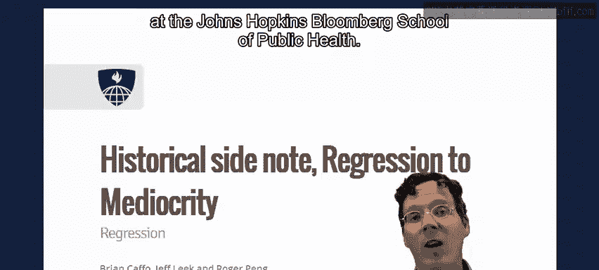
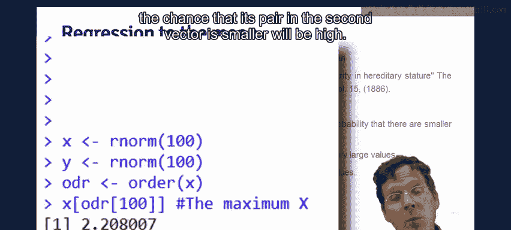
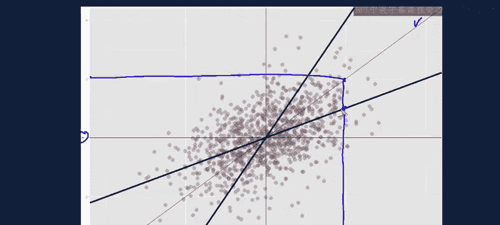

# 约翰霍普金斯大学数据科学课程7：《回归模型》｜regression-models｜ - P9：8_回归至均值.zh_en - GPT中英字幕课程资源 - BV1Xw411m7We

Hi， my name is Brian Cafo， and this is a lecture on progression to the Me as part of the Coursera regression class in the data science specialization。

 This class is co taught with my co instructors， Jeff Li and Roger Pang。

 We're all in the Department of Biosstatistics at the Johns Hopkins Bloomberg School of Public Health。

😊。

Regression to the mean was an important milestone in the discovery of regression。

 so we're going to talk about it。 It was discovered by Francis Galalton。

Regression of the mean asks questions like this。 Why is it that the children of very tall parents。

Also tend to be tall。But not quite as tall as their parents。And also。

 why do the children of very short parents tend to also be very short。

 but not quite as short as their parents。We can also reverse whether we're talking about the parents and the children。

 Why do the parents have very。Short children tend to also be short。

 but not quite as short as their children。 And why the parents of very tall children tend also to be tall。

 but not quite as tall as their children。This often comes up when talking about athletes。

Athletes who are the best performing one year tend to do a little bit worse the next year。

 and athletes that are the worst performing one year tend to do a little bit better the next year。

 Often people talk about stocks in the same way some of the best performing stocks tend to go down。

We'll talk about why this is and whether or not something is intrinsic or whether it's a regression to the mean effect。

 which is the important question。These phenomena are all examples of so called progression of the mean。

Regression of the mean， as I mentioned in the previous slide。

 was invented by Francis Galton in this famous paper，Reion toward Mediocrity and hereditary stature。

I like to think of regression to the meanme。By thinking of the case where it's 100% regression to the mean。

So imagine if I were to simulate pairs of standard normals， so they have nothing to do with linear。

 they're independent standard normals。Well， in this first vector of sand normals that I generate。

 if I were to take the largest one， the chance that its pair in the second vector is smaller would be high。

And this is simply saying that the probability that y is less than x given x is going to get bigger as x heads to very large values。

The same thing， in other words， is that probably y is greater than x。

 given that x equals x is going to get bigger x heads to smaller values。

This extreme version of regression of the mean where there's 100% regression to the mean is what I like to think about。

 however。In most cases。There's some blend of some intrinsic component and the noise。Take。

 for example， if I were to give every student in this class。Two quizzes， two very hard quizzes。Well。

 the top performers likely do know the material very better， do know the material better。However。

Quzzes are imperfect instruments and heaven knows if I gave the quiz。

 there's going to be a lot of error in the quizz is an instrument。So there's some noise。

So the top performer might is probably little knows the material a little bit better than everyone else。

 but also may have benefited from some noise， so in the second quiz they might perform a little bit worse。

 probably still well， but a little bit worse， the same thing for the worst performers。

It's often kind of fun to think about。How much of the discussion of sports is really just talking about regression to the meanme。

 a person who has a phenomenal year in baseball in their batting average one year has a slightly lower one the next year。

 Is that just regression to the meanme， will be nice to figure out how to quantify it。

 This is what Franciscon did with regression in the first treatment of regression to the meanme。

We want to talk about how Francis Schton used the idea of regression and particularly correlation。

 which we know is intimately related to linear regression。

So particularly correlation to quantify regression to the mean and we're going to basically do it with a picture。

 but I want to set up the picture first before I go through the R code。In this case。

 my x is going to be the child's height and y is going to be the parent's height。

 I'm going to use a data set where the parent is a single parent， the father in this case。

These data have all been normalized， the Y and the x， so they have zero mean and unit variance。

 and we should be very familiar with this by now being able to do that。So recall， if I've done that。

 then my regression line is going to pass to the 0。00。And also the slope。

 regardless of whether the child's height is the outcome or the parent's height is the outcome。

 is now simply the correlation。I want to also mention just a quick kind of quirk of creating the plot is if x is the outcome。

And you happen to plot the outcome on the horizontal axis。

 the slope of the line that you plot needs to have the slope one over the correlation。

 and that's just simply because I plotted it on the exit。

 I plotted the outcome on the X axis so just to remind you that if you get a little confused with the code。

So let's go through the code and then once we get the plot that I'm going to show you。

 we'll go through the different parts of the plot to talk about how looking at the correlation。

 quantified regression of mediocrity。So let's go through the code and how I'm creating my plot。

So the data set is in the using our library， the datasfather。son。

I'm going to define my y as the sun's height， but I'm going to subtract of the mean and divide by the standard deviation。

I'm going to define my x as the father's heights and I'm going to do the same Now x and Y should both have mean zero in variance  one and you can check that yourself。

Row is the standard Greek letter that we use to represent correlations。

 so I'm going to define rh as my correlation between my x and my Y。I need to load G plot2。

And before I show you the plot， let's check a couple of things。Let's see what row works out to be。

 it works out to be about 0。5。So the correlation between the father's heights and the son's height was 0。

5。So now let's go back up here and I'll create my plot。

I'm going to create assigned to the variable G， my G plot。I'm going to。Add the points。

 but I'm going to do it in a way that I have black on the background and a salmon color on the foreground。

 and that alpha blending makes the points kind of transparent。

 I want my X limits to be -4 to plus4 on both axes。 I want my axes to be the same。

 I also know that -4 to plus 4 should be。Pretty much all encompassing of the data。The probably that。

 for example， standard normal。Is below-4 or above plus4 is extremely low。

 and Cheby Che's theorem also helps。 So if you've had the inference class。

 you'll know that a standardized random variable-4 to plus4 is pretty far out into the tail。

I'm going to let me show you this plot before I add anything more any more layers to it。

 So there's my plot now I'm going to add a layer that is the identity line。

Okay， let's show that。Then I'm going to add。The axes， the horizontal and vertical axes。

Let's show that。U， and there's a slight mistake that this should be H line。

Let's show that so that now I actually have my two axes。 Okay， and now I'm going to create。The line。

Where I treat the son's height as the outcome and the father's height is the predictor。

 and I'm going to add the line now where I treat the son's height as the predictor and the father's height as the outcome。

 of course the axes are。Rotated as I discussed on the previous slide。

 and so I need the slope to be one over row。Now let me get the plot I've created for the two fitted lines。

 I've doubled the width of the fitted lines。So next。

 let's just talk about regression to the mean as it relates to this plot。

Let's look at this plot and describe use it to describe regression to the meme if the observations fell perfectly on a line。

It would have to be， in this case， the identity line because we've normalized both the x and the Y。

 so they would fall exactly on this identity line here， just as a reminder。

 the father's height is plotted as the x variable。And the sun's height is plotted as the Y variable。

So if we have a father's height of two and there were no noise。We would。

Predict the sun's height to also be two here are the two representing two standard deviations above the mean for the fathers and two standard deviations above the mean。

For the suns。However， there is lots of noise when we look at the data， there's quite a bit of noise。

So the prediction is now not two， but it's on the regression line right here。

And because of how we set things up， this is simply multiplying to。Times the slope。

 which is the correlation。 And now the prediction comes over here， which is。Between two and zero。

And in fact it's exactly two multiplied times the correlation that is the regression to the mean。

 that multiplication is how Francis Galton measured regression to the mean。How shrunken？

This correlation is towards。A horizontal line gives you the extent of the regression to the mean。

If we talked about the case where there was no noise and this line would fall perfectly on the identity line。

 consider the case where it's all noise， the father's height had no information about the son's height。

 then this line the correlation would be zero， this line would be right on the horizontal axis。

 then if you had to predict the father son's height from the father's height。

 you would always wind up with a prediction of zero。So this phenomenon is regression to the mean。

 and of course we can do the same thing with it flipped。

If we consider the son's height as the predictor and the father's height as the outcome。

 and you can visualize this on this plot because I've shown basically that plot with this line right here。

And the regression to the mean is how shrunken it is toward the vertical axis。

Is a pretty clever idea， and I think this this was one of the。

Fundamental ideas that led to what we now think of as modern regression， however。

 the idea of regression to the mean still has an important place in statistics， for example。

 when you study longitudinal data， it's important to think about the idea of regression to the mean。

