# 约翰霍普金斯大学数据科学课程8：《实际机器学习课程（约翰霍普金斯大学）》｜practical-machine-learning｜ - P15：14_协变量创造.zh_en - GPT中英字幕课程资源 - BV1Lm4y1M7BL

This lecture is about covariate creation Covariates are sometimes called predictors and sometimes called features。

 they're the variables that you will actually include in your model that you're going to be using to combine them to predict whatever outcome that you care about。

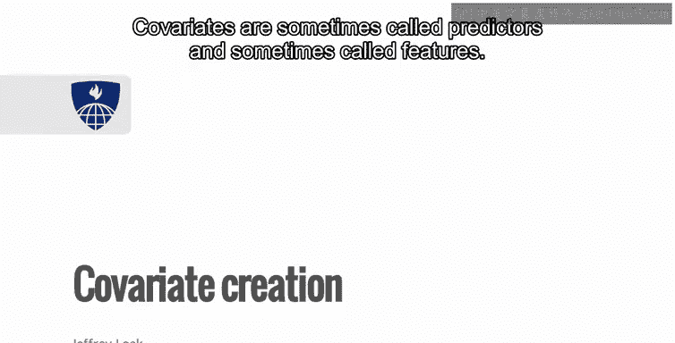

There are two levels of covariate creation or feature creation The first level is taking the raw data that you have and turning it into a predictor that you can use。

 so the raw data often takes the form of an image or a text file or website that kind of information is very hard to build a predictive model around when you haven't summarized the information in some useful way into either a quantitative or qualitative variable。

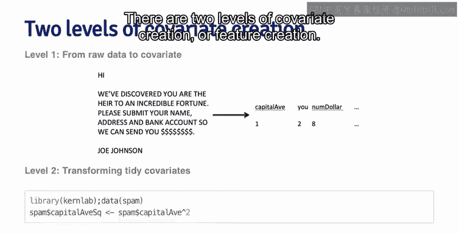

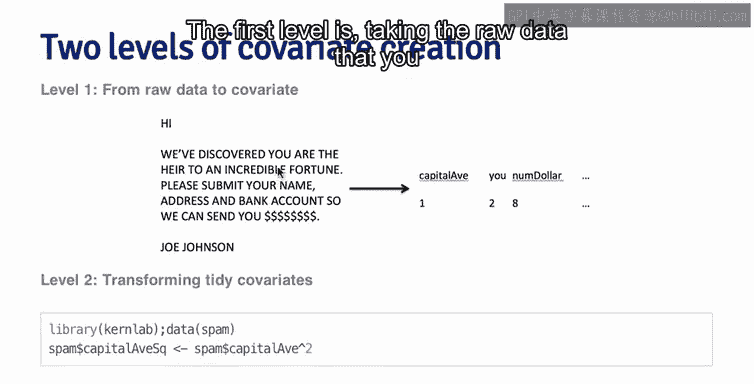

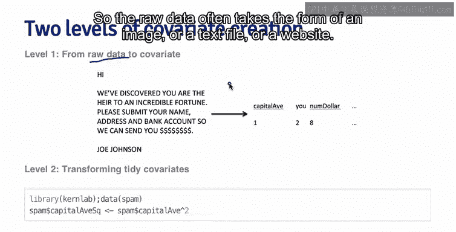

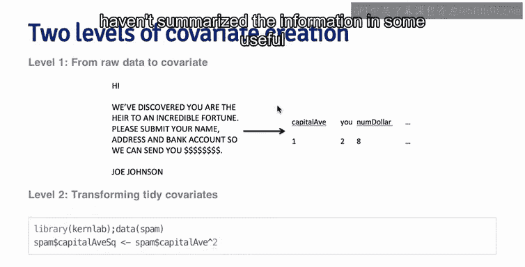

So what we want to do is take that rawD data and turn it into features or covariates。

 which are variables that describe the data as much as possible while giving some compression and making it easier to fit standard machine learning algorithms。

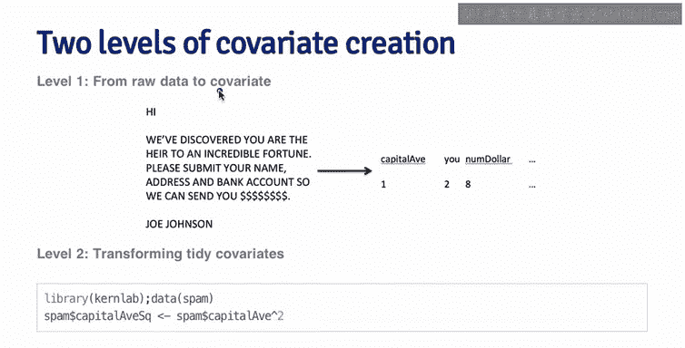

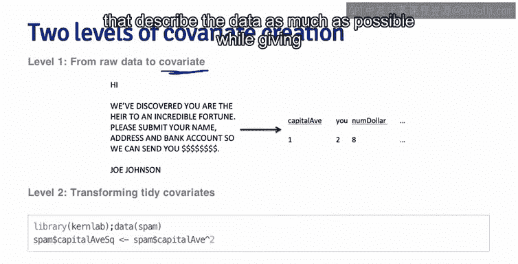

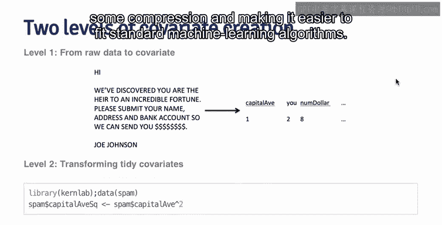

So the idea here is so suppose you have an email， this is an email。

 an example email here on the left， and so it's very hard to plug the email itself into a prediction function because most prediction functions are based on the idea of taking a small number of variables and building a quantitative model around them and it doesn't work for a free text。

 for example。

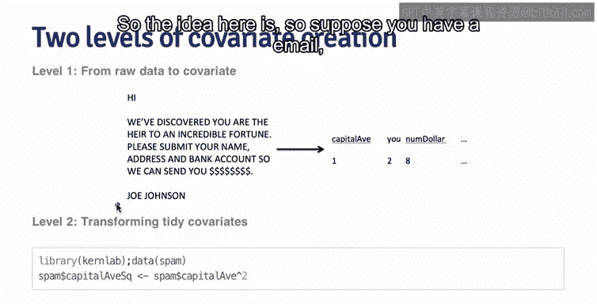

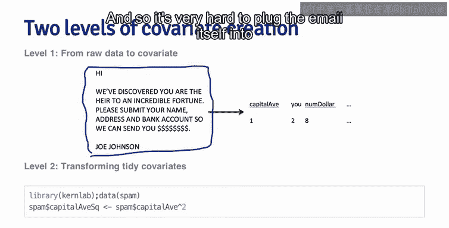

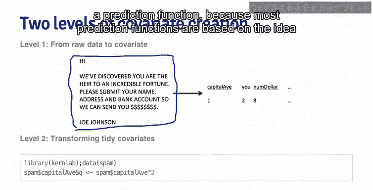

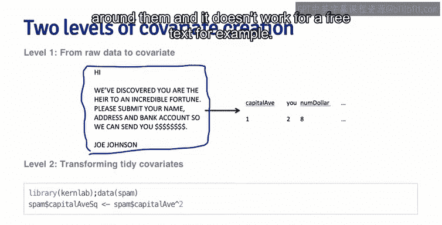

So the first thing that you need to do is create some features and those features are just variables that describe the raw data。

 so in this case in the case of an email， we might think of different ways that we could describe this email。

 for example， we might calculate the average number of capitals that are in the email in this case。

 100% of the letters in the email or capital letters。

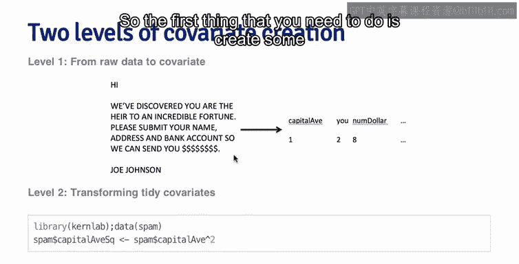

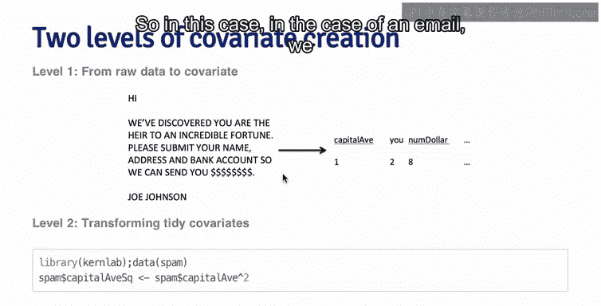

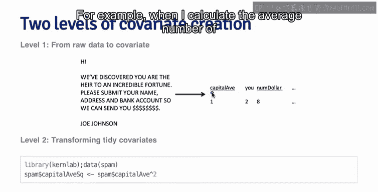

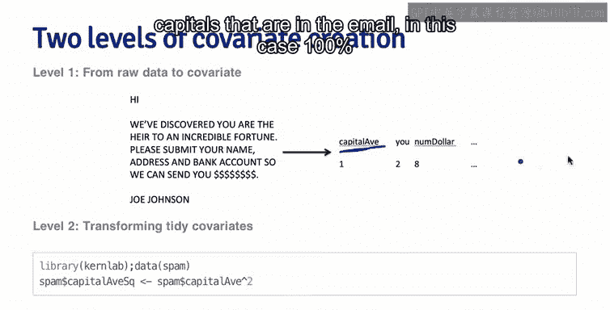

You might say what's the frequency a particular word appears so for example you might say how often does you appear and you appears twice in this email so we say that we calculate two for this email that's a feature。

 you might also calculate the number of dollar signs this might be a really good predictor of whether an email is spam or not and so here you can see there are large number of dollar signs there are eight of them so we calculated another feature of that dataset。

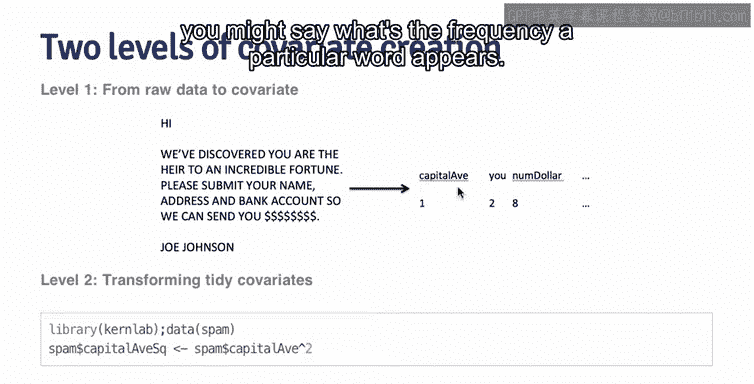

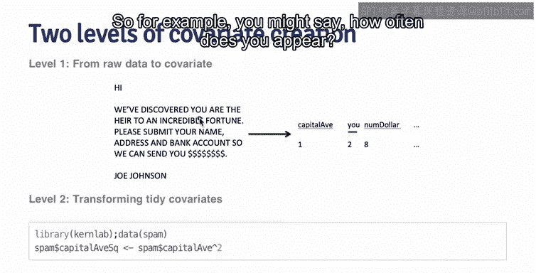

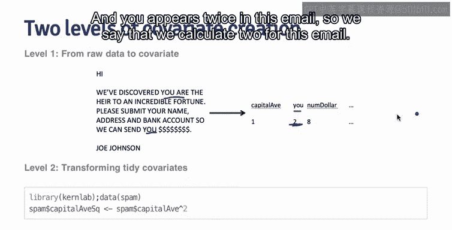

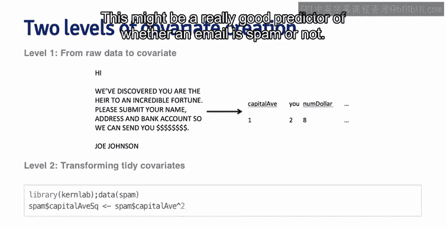

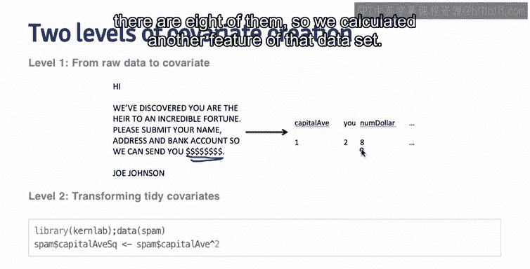

So this step， the raw data to Covariate， usually involves a lot of thinking about the structure of the data that you have and what is the right way to extract the most useful information in the fewest number of variables that captures everything that you want。

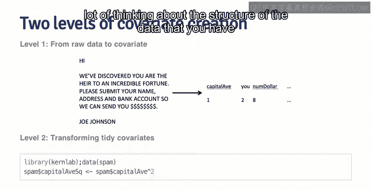

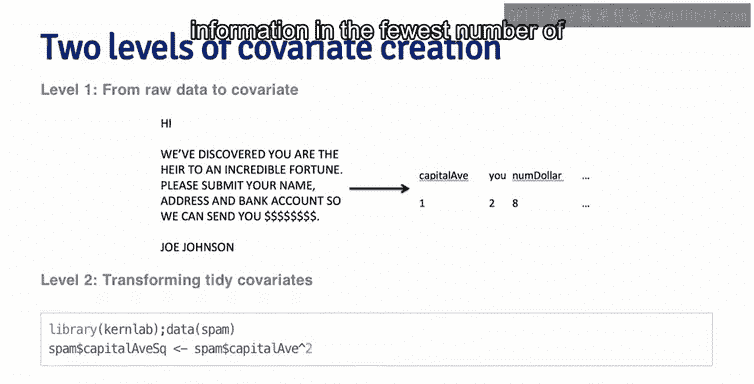

The next stage is transforming ti de e covariates， in other words we calculated this number。

 say capital average， the average number of capitals in a data。

 but it might not be the average number that's related very well to the outcome that we care about it might be the average number of capital squared or cubed or it might be some other function of that and so the next stage is transforming the variables into sort of more useful variables so for example。

 if we load the current lab data and spam data set。

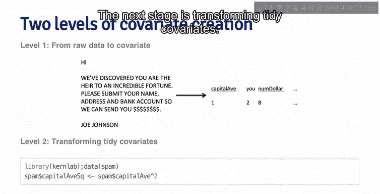

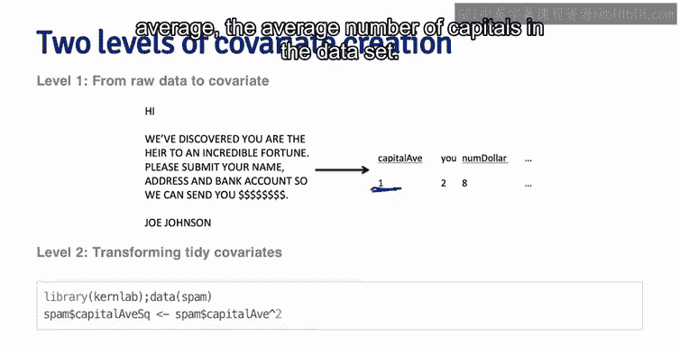

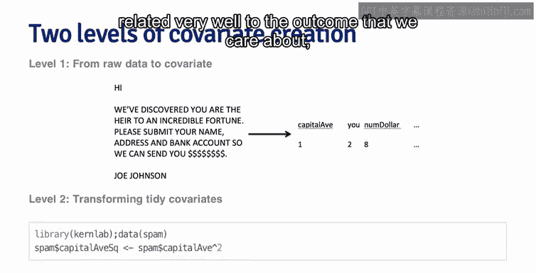

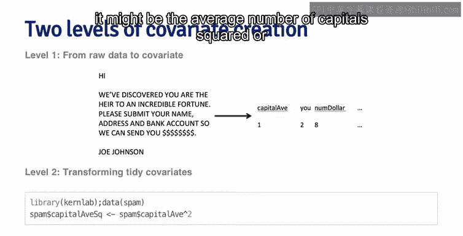

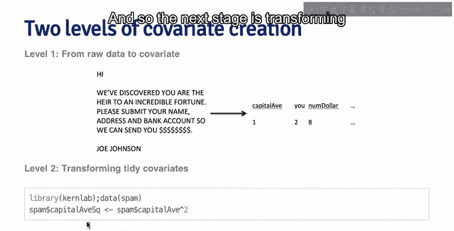

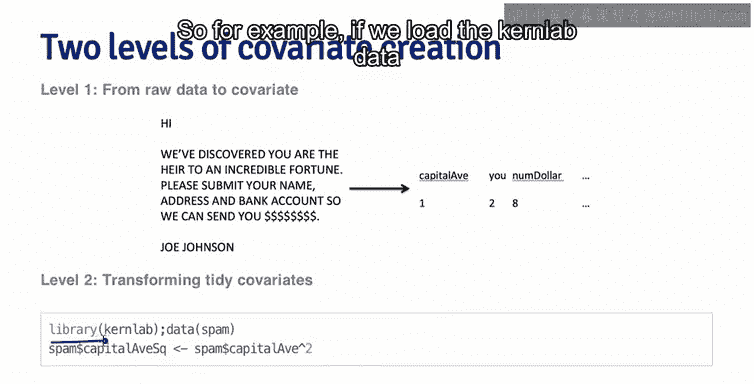

We can take the capital average so this is basically this variable right here。

 the fraction of letters that are capitals and we could square that number and assign it to a new variable capital average squared that might be useful later in our prediction algorithm so those are the two steps in creating covariates So the first step the raw data the covariance really depends heavily on the application so like I showed you on the previous slide in an email case it might be extracting the fraction of times a word appears or something like that in the case of voice it might be knowing something about the frequency or the timber of which voices are typically fall in the case of images it might be identifying features of the images so if it faces where the nose is or the ears or the eyes are and it will depend greatly what your application is and the balancing act here is definitely summarization versus information loss in other words the best features are features that capture only the relevant information in say the image or the。

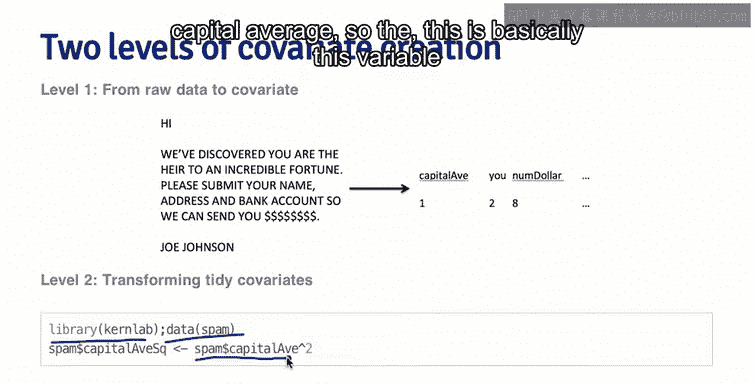

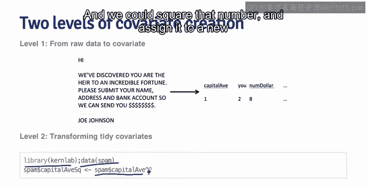

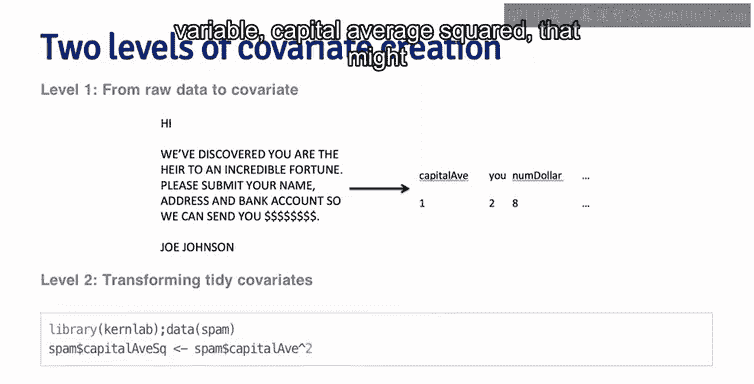

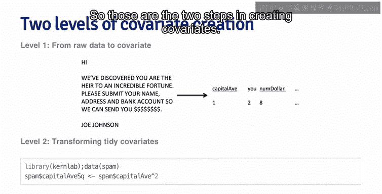

mailAnd throw out all the information that's not really useful at all and so the idea is you have to think very carefully about how to pick the right features that explain most of what's happening in your raw data。

So some examples here for text files it might be the frequency of words or frequency of phrases。

 there's this cool site Google Engrams which tells you about the frequency of different phrases that appear in books going back in time。

 for images it might be edges and corners， blobs and ridges for example。

 these are all ideas about how do you identify different structures in an image for websites it might be the number and type of images where buttons are colors and videos。

 this is a huge area of importance in web development which is called AB testing which is called randomized trials and statistics。

 which is basically showing different versions of a website with different values of these different features and predicting which one will introduce more clicks or get more people to buy products。

For people you can imagine features of people are their height， weight， hair color， etc。

 it's basically any summary of the raw data that you can make is a potential feature and often this involves quite a bit of scientific thinking and business acumen to know what the right covariates are for a particular problem so the more knowledge you have of a system the better job you'll do at feature extraction in general in general it's a good idea to have a really clear understanding of why this set of data is useful predicting the outcome you care about。

So there's this balance between summarization and information loss and in general it's better to err on the side of creating more features。

 you lose less information and then filter some of those features out during your model building process this can all be automated and it has been automated in various different ways but you generally have to use a lot of caution when using that approach because sometimes a particular feature will be very useful in the training set that you've created but won't be very useful in a new set of data and a test set won't generalize well。

So the second level is taking tidy covariates， so these are features you've already created on the data and then creating new covariates out of them。

 usually this is transformations or functions of the covariates that might be useful when building a prediction model this can sometimes be more necessary for methods like regression or support vector machines that might depend a little bit more on what the distribution of the data are and a little bit less for things like classification trees where the idea here is you don't necessarily have as much modelbased prediction in other words。

 you don't depend quite so much on the data looking a particular way。

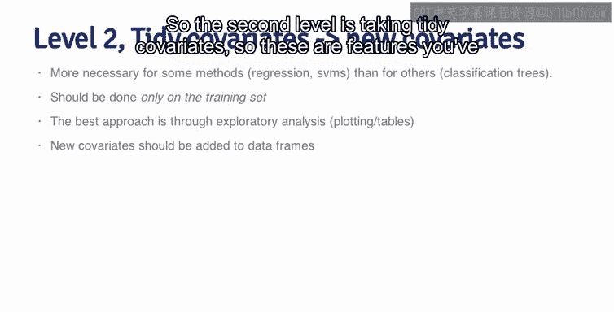

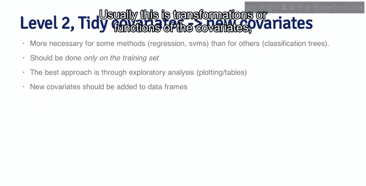

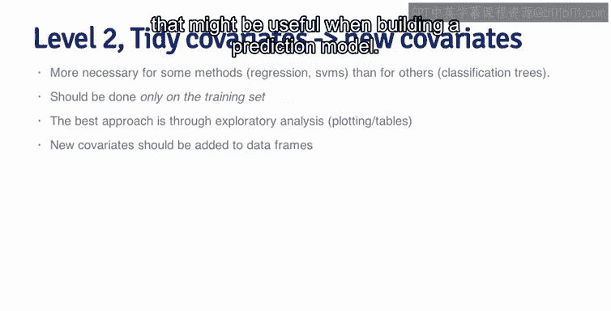

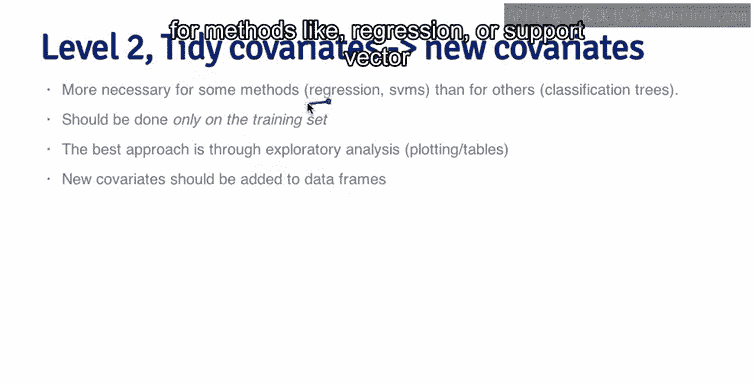

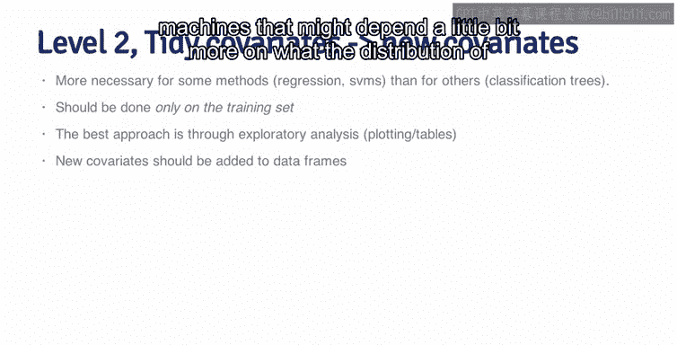

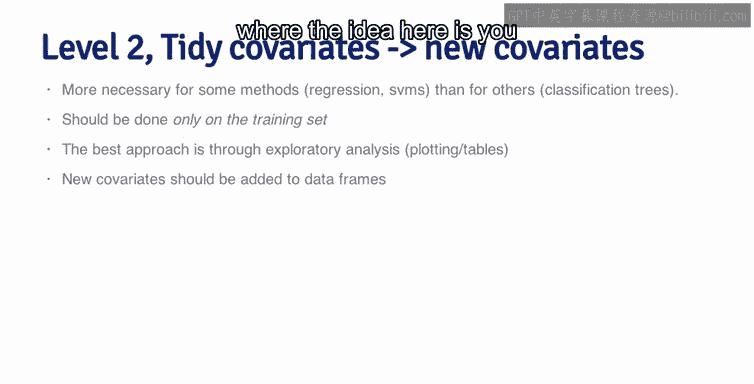

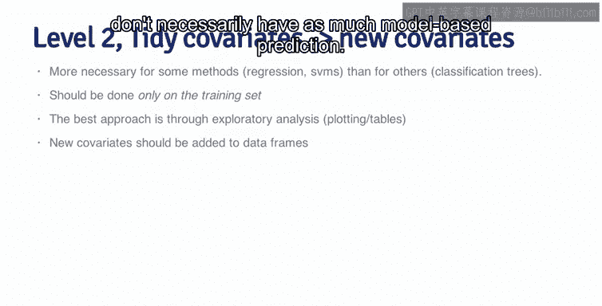

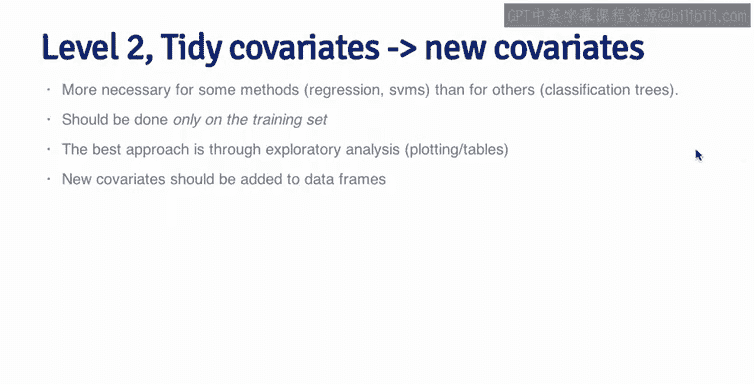

On the other hand， in general， it's a good idea to spend some time making sure you have the right covariance in your model。

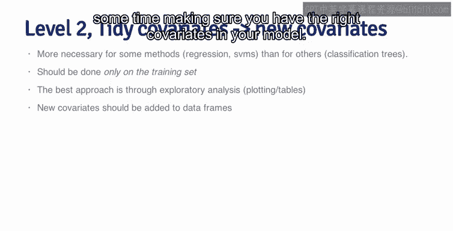

So when you create these functions or decide on these functions。

 you have to do it only in the training set， this is a common theme of machine learning。

 building features can only happen in the training set。

 it can't happen in the test set later when you apply your prediction your function to the test set。

 you will make that same function of the covariates so you can apply your predictor。

 but the original creation or thinking about what covariates to build has to happen only in the training set otherwise you'll lead to overfitting。

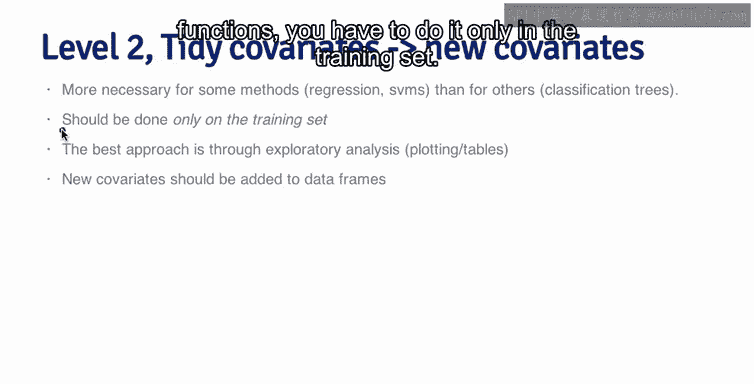

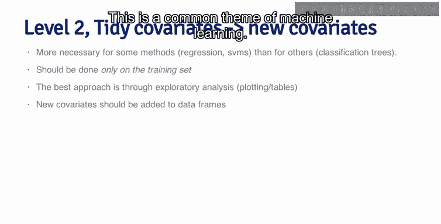

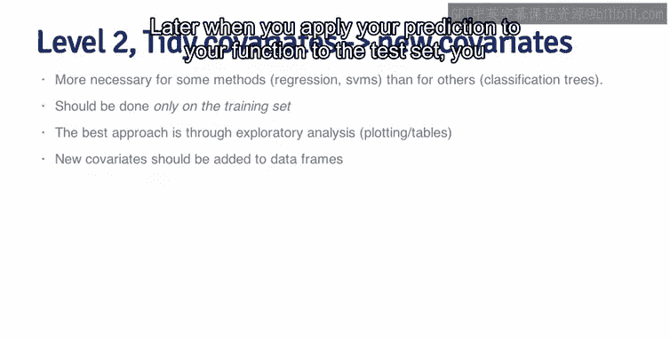

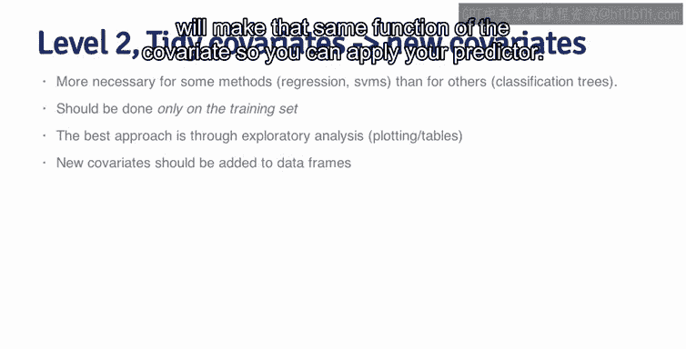

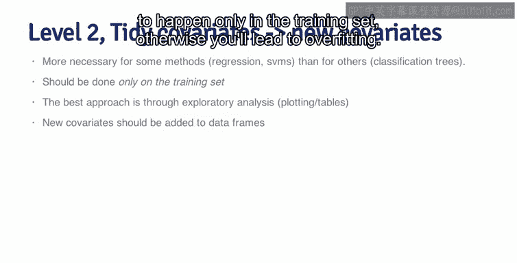

And the best approach I've found is through exploratory analysis。

 so basically making plots and making tables of the data and trying to understand what are the patterns of variation in your data and how they might relate to the outcome。

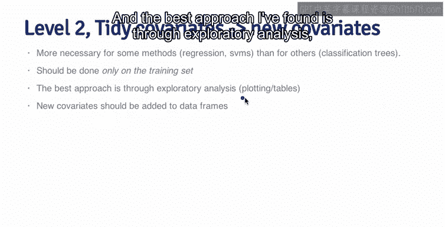

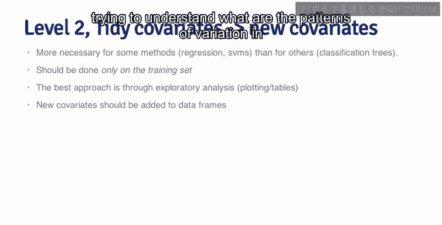

When you're using the care package or doing this analysis in R。

 the new covariates need to be added to data frames so that they can be used in downstream prediction。

 and it's important to make sure that the names of the new variables are recognizable so that you can use the same name on your testing dataset。

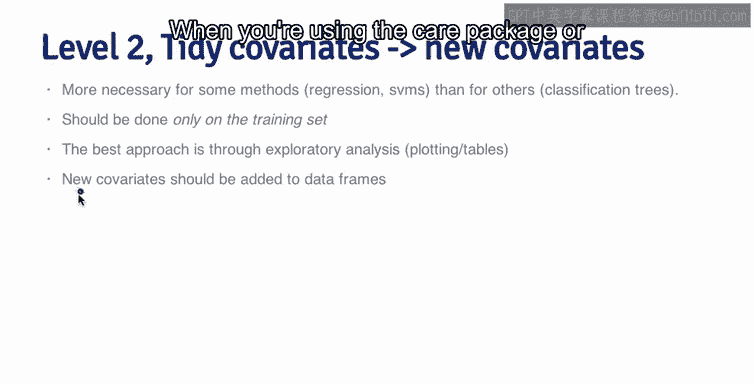

So here's an example data set， so here we're loading in this data from the ISLR package and we're loading the CAt package and we're getting this data on wages so here again I'm going to build a training and test set so that I can do all the covariate creation in the training set so I use the create data partition function to create the indices for the two data sets。

 then I separate the data into a training set and into a test set。

So one idea is that's very common when building machine learning algorithms is to turn covariates that are qualitative or factor variables into what are called dummy variables。

 so you probably learned a little bit about this in your regression modeling class if you've taken it through this data science specialization。

 but the basic idea is suppose we have a variable in this case。

 let's look in the training set at the variable called job class So that job class has two different levels it's either industrial or its information So one thing that we could do is try to plug that variable directly into a prediction model。

 but the values of that variable will be actually a set of characters that'll either be industrial or it'll be information and it's sometimes hard for prediction algorithms to use those qualitative variables in order to actually do the prediction。

So one thing we might want to do is turn it into a quantitative variable and the way that you can do that with the care packages with this dumio variables function。

 so basically it says we're going to pass it a model so the outcome is wage job class is going to be the predictor variable and training set is the set where we're going to be building those dummy variables and then if you predict if you use the predict function。

 this dummies object and a new data set in this case we're just going to apply it to the training data you get a two new variables out so the first is an indicator that you are industrial and the second is an indicator that your' information。

If the indicator that your industrial is one， it means that for that person they had an industrial job if it's zero。

 it means for that person they had not an industrial job so the same thing is true for information if it's zero that means they had not an information job and if it's one they have an information job so in this case where there's only two different levels of this variable there's only industrial and information then whenever you're one for industrial you're zero for information and whenever you're zero for industrial you're one for information and so forth but if you had three variables here it would probably have every column would have two zeros because those are the two classes you don't belong to and a one for the class that you belong to so this is taking these factor or qualitative variables and turning them into quantitative variables。

Another thing that happens is that some of the variables are basically have no variability in them。

 So it's often that you'll create a feature， for example。

 if you create a feature that says for emails doesn't have any letters in it at all almost every single email will have lots have at least one letter in it so that variable will always be equal to true。

 it's always got letters in it so it has no variability and it's probably not going be a useful covariate。

 So one thing that you can use is this near zero variable or function in carrot to identify those variables that have very little variable and will likely not be good predictors so you apply it to a data frame that's the training data and here I'm telling it to save the metrics so that we can see how it's calculating what the variables are So for example here we can see that it tells us the percentage of unique values for a particular。

😊。

Variable so in this case， the variable has about 。33% unique values and it's not a not near zero variable。

 near zero variance variable， but for example， sex。

 the variable sex only is basically males and so it has a very low frequency ratio in other words。

 it's basically all one category and so this ends up being near zero variable and so it will be you could use this column of the matrix to throw out all those variables like sex and in this case like region that are variables that don't really have any variable in them and shouldn't be used in prediction algorithms。

 So it's a nice way to throw those sort of less meaningful predictors out right away。

The other thing that you might do is so instead of fitting if you do linear regression or generalize linear regression as your prediction algorithm which we'll talk about in a future lecture。

 the idea will be to fit basically straight lines through the data sometimes you want to be able to fit curvy lines and one way to do that is with the basis functions and so you can find those for example in this splines package and so one thing that you can do is create the BS function will create a polynomial variable so in this case we pass it a single variable in this case the training set we take the age variable and we say we want a third degree polynomial for this variable so when you do that you essentially get you'll get a three column matrix out so this is now three new variables this variable corresponds to age the actual age values they're scaled for computational purposes。

The second column will correspond to something like age squared。 So in other words。

 you're allowing it to fit a quadratic relationship between age and the outcome and the third column will correspond to H cubed。

 So you'll allow a cubic relationship between age and the outcome So this will if you include these covariates in the model instead of just the age variable when you're fitting a linear regression。

 you allow for curvy model fitting So just to show you an example of that here I fit a linear model。

 you'll remember that from your linear modeling class。 So the wage is the outcome again。

 the Tilda tells you what' we're predicting it with here we pass it that BS basis。 In other words。

 we pass it all the predictors that we generated from the polynomial model。 So in this case。

 it's age a squared and age cubed。😊。

And then we can plot the age data versus the wage data， so that's age on the X axis。

 wage on the y axis， and you can see that there's a kind of a curve a linear relationship between these two variables and so we can plot age and the predicted values from our linear model including the。

The curvy terms， polynomial terms， and you see you get a curve fit through the data set as opposed to just a straight line。

 so that's one way that you can generate new variables is by allowing more flexibility in the way that you model specific variables。

So then on the test set you'll have to predict those same variables。

 So this is the idea that's incredibly critical for machine learning when you create new covariates。

 you have to create the covariates on the test data using the exact same procedure that you use on the training set so you can do that by saying I'm going to predict from this variable that I created using the BS function a new set of values。

 this is the testing set age values， So these are the values that I'm going to actually plug into my prediction model when I'm testing it out on the test set This is as opposed to creating a new set of predictors based on just applying the BS function directly to this age variable which would be creating a new set of variables on the test set that isn't related to the variables that you created on the training set and may introduce some bias。

So a little bit about this idea these ideas and some future reading for you so level one feature creation is basically all about science or application specific knowledge I' found that the best way to do it find things for a specific application that I haven't talked about here that you don't know about or you're new to is googling feature extraction for the type of data that you're trying to analyze feature extraction for images。

 feature extraction for voice things like that you can also just look up that particular data type and see as much information as you can about it in particular you're looking for what are the salient characteristics that are likely to be different between individual samples。

In general， you want to err on the side of overcreation of features because you can always filter them out later in the machine learning algorithm process in some applications like images and voices。

 it's often both possible and pretty much necessary to create features that aren't necessarily just things that you imagine out of your mind it's very hard to know exactly what the right components of an image to include as features in a model and so there are things like you may have heard of deep learning which is basically a way of creating features for things like images and voice and this is a nice tutorial I've linked to here that kind of explains how that feature creation process works for those things but in general automatic feature creation requires an equal level of thinking to make sure that the features being generated by your feature creation process makes sense。

Level 2 feature creation covariates to new covariates can be done a lot with the preprocess components of the carrot package。

 you can create new covariates using basically any of the functions in R if they make sense to you。

 the key is again making lots of plots and doing exploratory analysis to see where the connections between the predictors and the outcome are。

You can create new covariates if you think they will improve fit， again。

 you can kind of err on the side of overcreation of features。

 but sometimes features just are sort of nonsensical and you shouldn't create them。

Be careful about overfitting in the sense that if you create lots of features that are particularly good for just your training set。

 they may not work well in the test set and so a good idea is if you overcreate lots of features to do some filtering before you actually apply your machine learning algorithm this tutorial on preprocessing with carrot is very good as a good place to start for really basic pre-processing and if you want to spme models like the ones I talked about with flexible curves。

 you can use the gaA method in the carrot package which allows smoothing a multiple variables using a different smooth for every variables。

And more on feature creation and data tiing is in the data。

 getting and cleaning data course from the data science specialization。

