# 约翰霍普金斯大学数据科学课程8：《实际机器学习课程（约翰霍普金斯大学）》｜practical-machine-learning｜ - P9：8_应该使用什么数据.zh_en - GPT中英字幕课程资源 - BV1Lm4y1M7BL

After defining the question of interest， the next most important thing is to identify the data set that will allow you to create the best possible predictions with your machine learning algorithm。

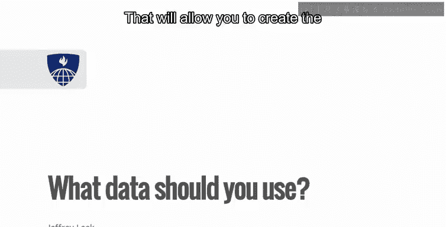

So an example of a really successful predictor here in the United States is something called 538。

 this was a blog that was designed to build an election forecasting model to predict who would win the presidential and other elections in the United States。

And to do that， the statistician behind 538， one of the most famous statisticians in the world。

 Nate Silver， used polling information from a wide variety of polls and averaged them together to try to get a best prediction of who was going to win。

 which votes and which states in order to get the best vote prediction of who would vote for who when it came time for the election。

 and he was very successful in predicting vote the 2008 and 2012 elections。

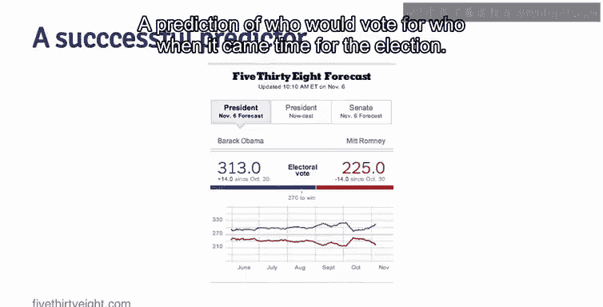

This is an example of using like data to predict like， in other words。

 he took polling data from organizations like the Gallup polling agencies in the United States and he took all that data that was asking people directly whoho are you likely to vote for in the upcoming election。

 in other words he used data where people were asked the exact same question they were going to be asked when they went in to pull the ballot and decide who they're going to vote for。

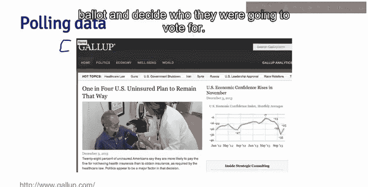

And so the one thing that he did， which is sort of clever and I think that improves his predictions compared to a lot of other people is that he took that data and he recognized the actual quas of the data。

 so he realized that some polls were actually biased in one way or the other， in other words。

 a particular pollster might ask questions that led people to say that they would vote for one candidate more than the other。

 even when they might not necessarily vote that way when it came time to vote。

For real so what he would do is he would actually weight the polls by how close they were to being sort of unbiased polls or accurate polls and so this is an example where finding the right data set and combining with a simple understanding of what's really going on scientifically can have maximum possible benefit in terms of making strong predictions。

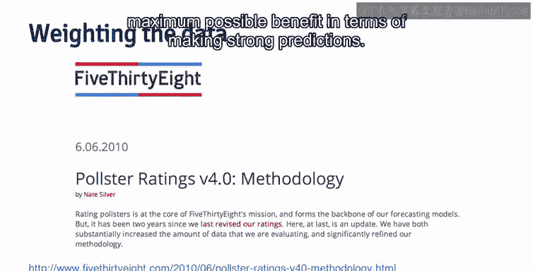

And the key idea here is if you want to predict something about X use data that's as closely related to X as you possibly can there are a bunch of other examples of this。

 so one example is what's called moneyball so this is actually turned into a movie that starred Brad Pitt but at the beginning it was just there were some people that were trying to predict how well players would perform and in particular how well they would perform and gaining wins for a baseball team in the United States and what they would do is they would actually use information about that player's performance as well as other players that were similar to them in the past in order to predict predict how well that player would perform so again like predicting like。

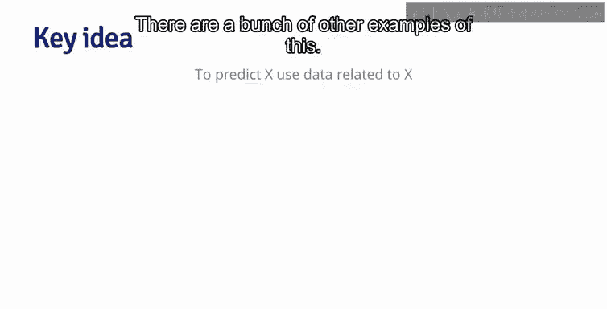

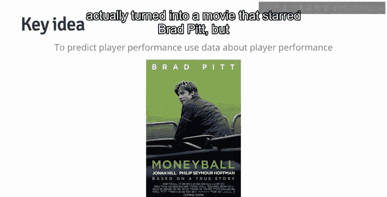

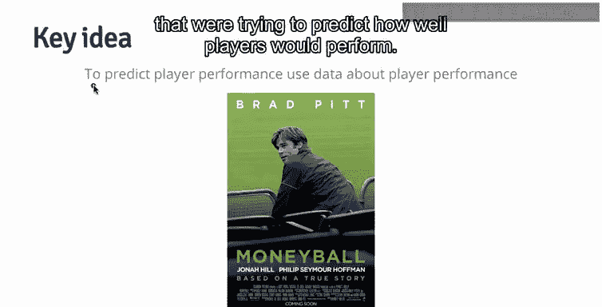

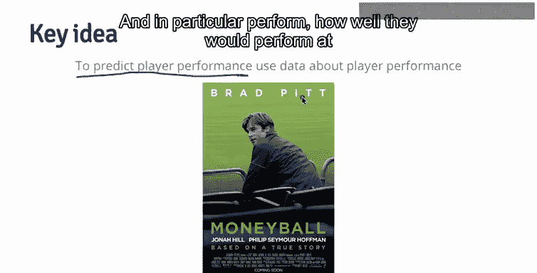

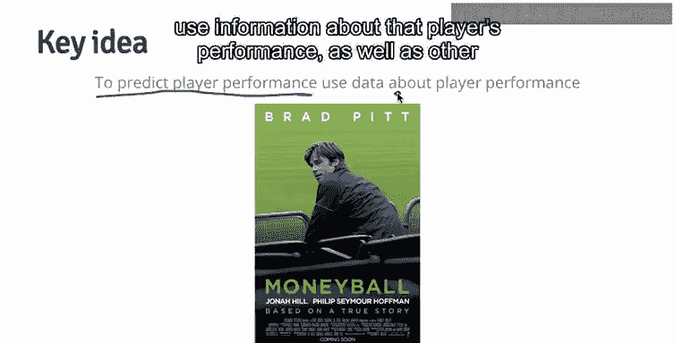

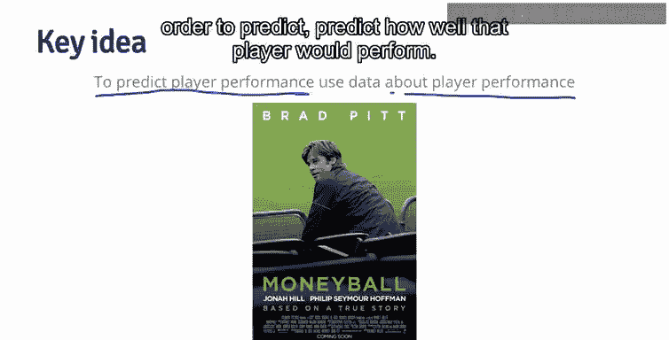

This theme repeats itself in the Netflix Prize where people were trying to predict movie preferences or what movies people would like and they did that based on the past movie preferences of those people In other words they found movie preference data and used it to predict movie preference data。

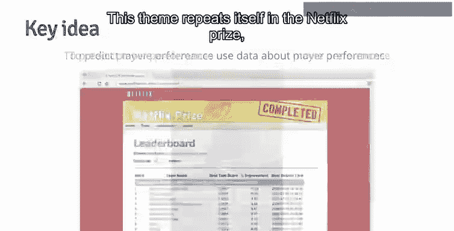

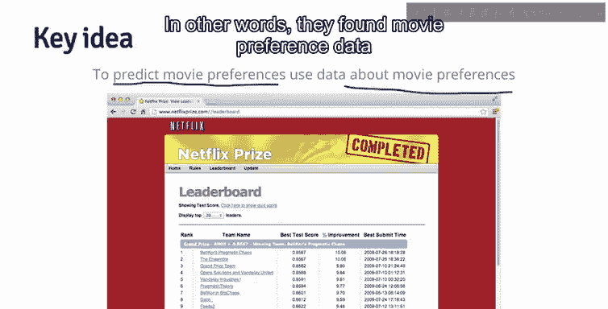

It was also the background to the Heritage Health Prize。

 where the goal was to try to predict which people would be hospitalized and they use data about previous hospitalizations。

 again， using data about the exact same process that they were trying to predict in the future。

 so the closer that you can be to the actual data about the process that you care about。

 the more often than not that the better your predictions will be。

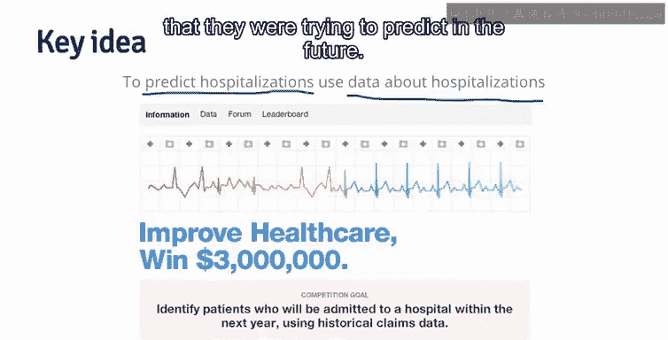

It's not necessarily a hard rule， so for example， people used Google searches to try to predict flu outbreaks。

 but this was recently pointed out to have major flaws in the sense that if people's searches changed or if the properties of the way those searches were connected to the flu changed。

 their predictions would actually be quite far off and some people have suggested that Google flu trends is not necessarily a very good way to estimate the prevalence of flu。

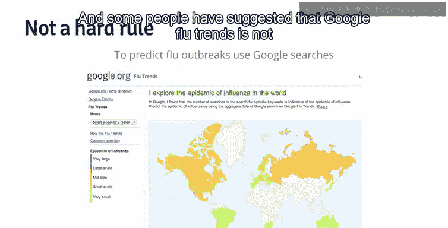

The looser the connection the harder of the prediction may be， so for example。

 oncotype DX is a prediction algorithm based on gene expression。

 which is a measure of a molecule inside your body and or actually a subset of molecules in your body and they use that to predict how long you will live or how well you'll do under different therapies when you have breast cancer and so here the connection is a little bit looser。

 but it's still a connection that you can definitely make in your head。The data properties do matter。

 so for example， if you measure the people that would have sort of a high prevalence of flu like symptoms。

 you could do that using the CDC data or flu near you and algorithms like Google flu trends might overestimate the number of flu cases if there was something that was causing them to search for similar search terms that had nothing to do with how often they were flu related symptoms so this is an example where knowing how the data actually connects to the thing that you're trying to predict is crucially important。

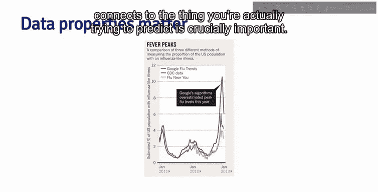

This is， in fact the most common mistake in machine learning。

 So machine learning is often thought of as this black box procedure that computer scientists have created where they just push input data in one end and outcomes of prediction in the other end。

 This is an example of a prediction that's a little bit silly So this it comes from a paper that appeared in the New England Journal of Medicine and they plotted chocolate consumption and kilograms per year per capita on the X axis。

 And on the Y axis， the number of Nobel Prizes per 10 million10 million people in the population。

 And so you can see that there's a trend here that as you consume more chocolate you tend to get more Nobel Prizes per million people。

 And so they reported here on R squared and a P value suggesting this was a highly significant relationship。

 but you can think there are a whole bunch of other variables that might relate these two things to each other。

 So for example， you might eat more chocolate if you come from Europe and these are mostly European nations up here and the Nobel Prizes given out by a European organization。

 And so you might imagine that more European people also win Nobel Prizes。

 This has nothing to do with the ability of chocolate。😊。

umption per se to predict whether you will get the Nobel Prize or not and so this is an example where if you just naively build a prediction algorithm。

 you'll claim that you're being able to predict very well。

 but if the characteristics change so for example if the Nobel committee starts giving out more prizes to say Asian nations as opposed to European nations。

 you'll see that this prediction algorithm won't work very well anymore so the key point to take home is that as often as possible you like data to predict like and when you're using data that isn't related。

 be very careful about interpreting why your prediction algorithm works or doesn't work。

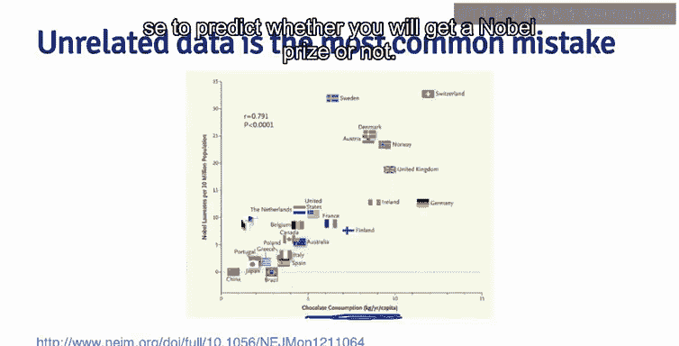

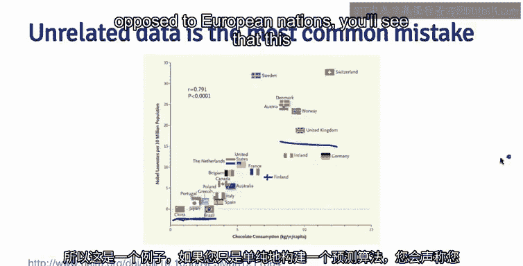

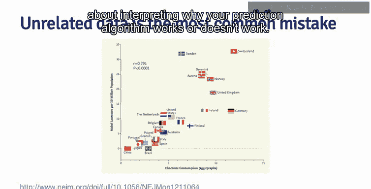