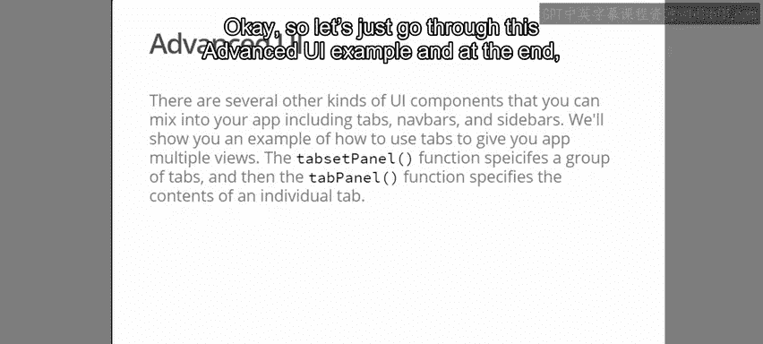
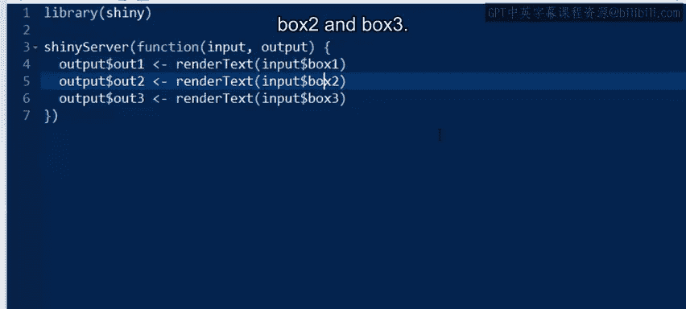
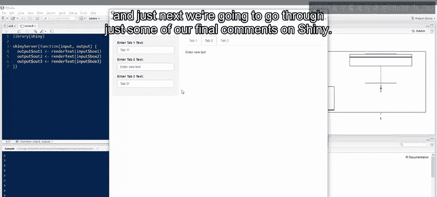

# 约翰霍普金斯大学数据科学课程9：《开发数据产品》｜data-products｜ - P10：9_shiny 2 4.zh_en - GPT中英字幕课程资源 - BV19N411v7Y2

So let's just go over now a couple of different ways we can tweak the UI for shinyny。

 you already have kind of a default theme with a sidebar panel。

 let's go over one with a tab and I think once you've gone through these two versions。

You'll kind of notice the patterns and you'll be able to tweak it with the different with a lot of different settings。

 Also we'll talk a little bit at the end about how you can actually do。

Shiny with a custom HTML function。 Okay， so let's just go through this advanced UI example。

 and then at the end， we'll have some final discussion。

Okay， so I copied the code from the R markdown document。

 Hopefully the first couple of lines are very familiar to you at this point。

 we're still going to have a sidebar layout and you can do tabs within a single panel know just with no sidebar just the tabs you just need to change the layout so you can have a different layout with tabs。

 but we're gonna to have a sidebar layout where the sidebar is going have the inputs and then the main panel is going to have tabs Okay but you can you can also just have one big panel not with a sidebar and have it have tabs or as we'll talk about later。

 you can tweak the UI infinitely with custom HTMLm。

So our sidebar panel is just going to have three text input boxes and the labels for those inputs are going to be box one。

 box2， box 3， the prompts to the user are going to be En tabab 1 text， En tabab2 text。

 En tabab3 text。And then the starting value is going to be tab1。

 tab2 and tab3 Okay now in the main panel， we're going to have a subset of the main panel called a tab set panel。

 and this is kind of this nested user interface structure that shiny allows with its you know with its syntax here So we have a main panel and then we have a tab set panel。

Inside that function okay and type equals tabs。 And then we have three tab panels。

 And these tab panel statements are working just like our main panel and sidebar panel functions。

 They work in the same way。 We just have them strung out into one line because they're very short in this case。

 So our tab panel is going to have a label that says tab1。

 It's going to have you know basically a carriage or turn to go down a line。

 and then it's going to have text output out one。 So it's going to be looking for out one from the server。

 R function。 text output out two。 again， it's going to be looking for something labeled output dollar sign out2 from the server server。

 R file and so on。Okay， so now let's look at our server。 Okay， it's going to be a very simple one。

 Shi server function， input output。 So this should all be very familiar。 Okay。

 and there's our output dollar sign out one， and it's going to be render text。

 Okay because remember what we want to do in this case when we go back to the UI。

 we want to display the text。 And we're just going to do nothing。

 We're just going to spit back out whatever the person entered in box 1。

 box 2 and box 3 So let's go ahead and run that。

All right， so here's our three boxes， text boxes for entering in text， and here's our three tabs。

Okay。So you could just， if you put in， let's put it in tab2。So if I just put in enter new text。

 okay and I go to tab2， it says enter new text okay so that's just a nice little tweak of UI and hopefully as you're doing it you're starting to get a sense of the syntax and how it works a little bit better you know make sure when you're doing all your UI tweaks and everything that you don't have any errors in the R code R studio will give you a little Xes in the code if you've forgotten a comma or something like that and I think that's probably the biggest challenge with the UI programming in R is making sure you've closed all your parentheses and added all the necessary commas and that sort of thing and I think proper indentation and doing doing your coding good in a nice environment like Rt will really help that tremendously okay so your homework now is to develop a tabbed user interface for shiny。

Just next， we're going to go through just some of our final comments on Shi。

