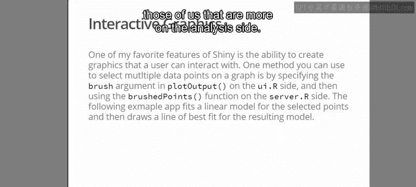
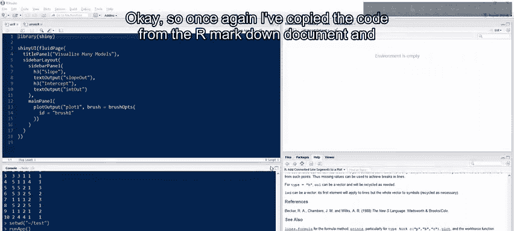
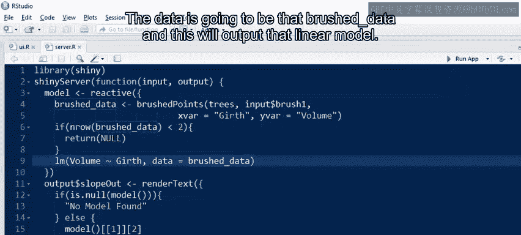
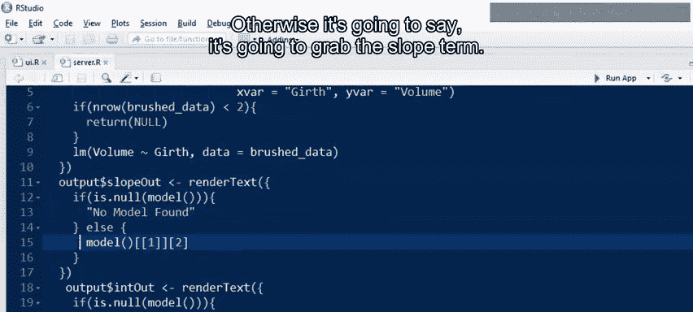
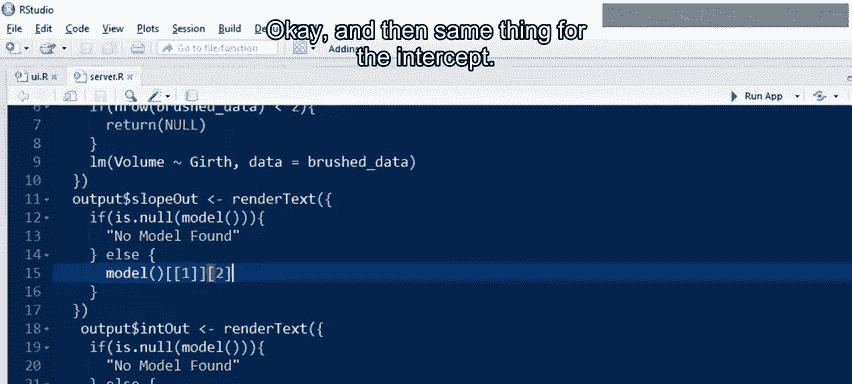
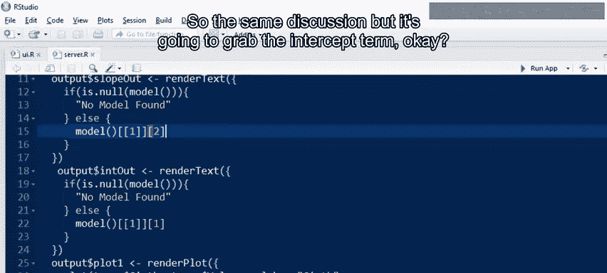
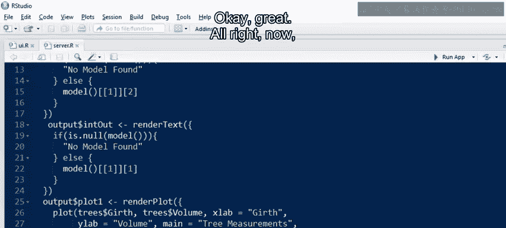
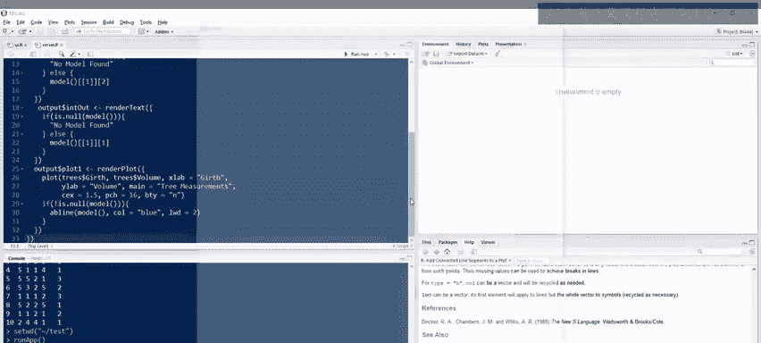
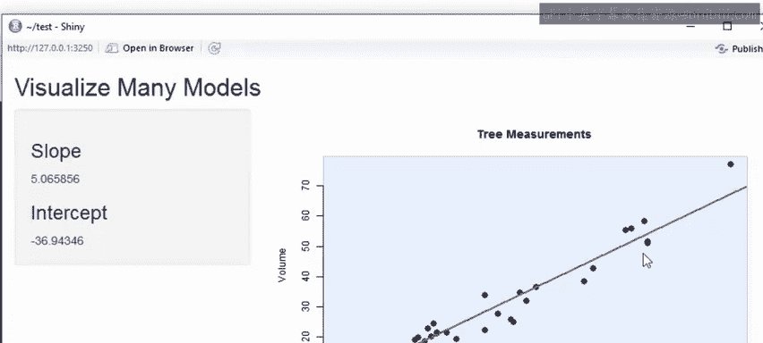

# 约翰霍普金斯大学数据科学课程9：《开发数据产品》｜data-products｜ - P12：11_shiny 2 6.zh_en - GPT中英字幕课程资源 - BV19N411v7Y2

In this final example， we're going to show how to use the brush argument in the UI and the brush points argument in the server to generate an interactive graphic。

 And in this case， what we're going to do is highlight points and then show in a scatter plot and then show the fitted line just for those points。

 Okay so this is a nice example of interactive graphics。

 which I think is one of the key functionalities of shiny and one of its primary uses for those of us that are more on the analysis side。

 Okay so let's get right Okay so once again， I've copied the code from the R markdown document and I'm just going to go through the various lines and then hopefully you'll get the gist。

 but I'd like you at home also to try it out。 it only takes a second to copy the code and run the text and I think you'll see a lot more by doing it yourself than than by having me describe it。

 So once again， we're gonna to have the standard layout sidebar and in the side panel it's going to have a display of the slope。

Slope out。Intercept。Int out。 So the text output in out。

 we're going to be looking for that label from the server function。 text output slope out。

 We're going to be looking for that label from the shiny server。

 Okay so we got to remember to have both those Otherwise they won't display right。

 And then we want plot output plot1。 we got to make sure that we're getting the plot output that we're creating a plot in the server。

 labeled plot1。 And then here's the ID brush equals brush1， that label。

 we're going to need to use that on the server side。

And this brush equal and then brush for the brush options okay， now let's look at the server。Okay。

 so the shiny server input takes an input and output lists。 Okay， now it's going to create a model。

 The model is going to be reactive。 it's going to be reactive to the data。 Okay。

 so this is going to be reactive as we input new things from the user interface。

 This is going to change so in remember， it has this notation of being inside the curly braces also inside the parentheses for the reactive function。

 Okay brush data is just going to be shorthand for grabbing the data from brush1。 Okay。

 so here's our input input brush1。Okay， and our brush points。Are going to be from the data set trees。

Okay， the x variable is going to be giths， y variable is going to be volume。

 and this will create a little data frame with girth and volume。And if it's null。Or I'm sorry。

 if there's fewer than two points， then it's just going to return null。Okay。And then otherwise。

It's going to fit a linear。 It's fit in return。 a linear model where volume is the Y variable。

 gith is the X variable。 and the data here is that brush data。

And then we don't need to put a parentheses here because this is inside the reactive statement， okay。

 the data is going to be that brush data and this will output that linear model okay。

Now， if that model is fit， our output slope out， remember we're looking for some text with that label。

 Okay， here's our render text telling shinyny that this is going to be text。

 Its going to be rendered in the user interface。 We've got our curly braces， okay and。If it's null。

 then it's just going to say no model found。 Otherwise。

 it's going to say it's going to grab the slope term。

Okay， and then same thing for the intercept so same discussion。

 but it's going to grab the intercept term Okay， oh and here's plot one。

 which we really which we need to display and that's going to be render plot okay。

 and it has the reactive notation of having the curly braces there inside the function argument。

And it's going to be plot trees， the girth by tree's volume， so girth is x volume is y。

 it's got nice X labels and y labels， okay， it's got a title says tree measurements。

Let's go down here and just see if the model is not nu， then it's going to add a line。Just now。

 because it's through the model， right， through the model。

That that was fit just on the point grabbed from the brush。

It's going to fit the line's going to plot the line that is only for those specific data points。Okay。

 great。All right。

Now let's run it。And see how it looks。

Okay， ran the app， okay， so now see no model has been fit。

 so it's correctly saying no model found for the slope and no model found for the intercept。Okay。

 so if I highlight this cluster of points。That's the line that you would fit and it gives you the slope and the intercept。

 but if I were to grab all of those。That's the line and that's the universe of。

 let's grab over here where there's no point， see what happens。 Okay。

 it it correctly says no model found and no model found。

 then if you do the whole thing oh everything except that last point。There it goes。

 Let's see if we can get the whole thing There we go。

 that would be the line that you'd fit if you grabbed all the data points Okay so this is a nice little interaction。

 nice little interactive graph that you can create using shiny and I'd like you to go ahead and try to recreate this example but then also maybe try to create your own example of interactive graph using one of Rs default like kind of can datas and I think this is one of the primary uses for shiny and I think at this point you should also have enough to go on to start making shiny useful for you and there's a lot of other things you can do with shiny such as input and output datas data frames you know you can actually embed RGL Rs 3D graphics library in a shiny webp page using using webGL but that stuff's maybe a little bit more fringy especially the RGL stuff right now I think you have enough to get started and and I think you should give you definitely should give shiny and try and work it into your standard toolbox。

