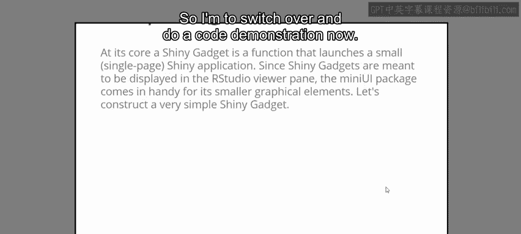
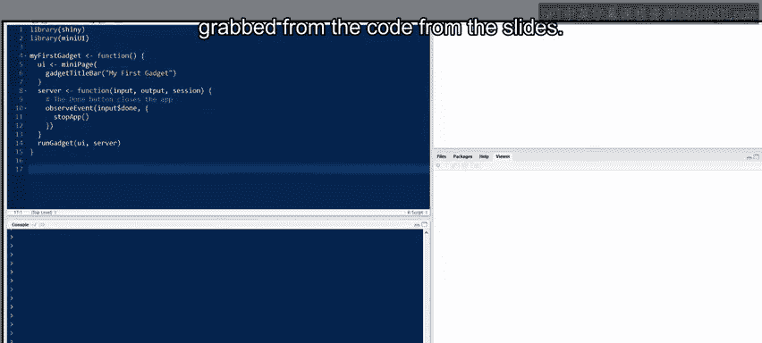
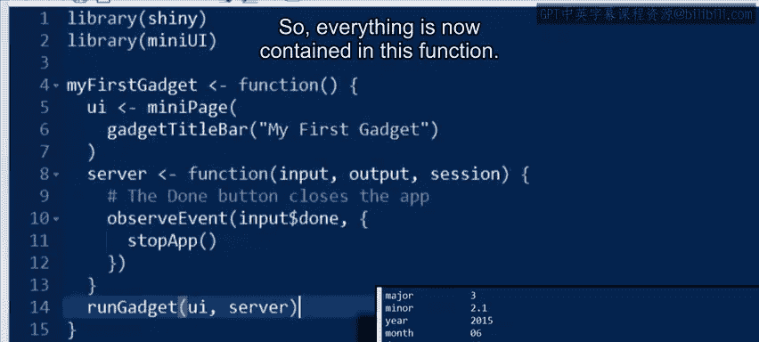
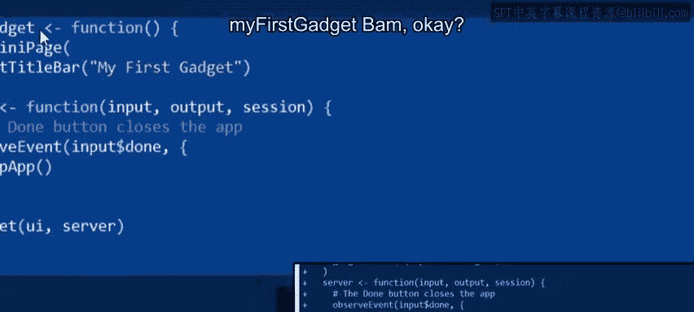
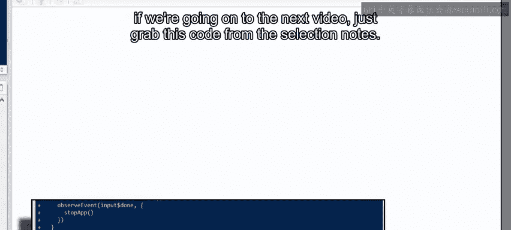

# 约翰霍普金斯大学数据科学课程9：《开发数据产品》｜data-products｜ - P13：12_shiny小工具1 1.zh_en - GPT中英字幕课程资源 - BV19N411v7Y2

So hi， my name is Brian Kaffho and I'm going to talk about shiny gadgets during this lecture。

 I'd like to thank Sean Cross who works with the Data science labb here with us for preparing these slides。

So we to have we used to cover a topic called manipulateip and manipulate was a little R package that was produced and created for by our studio for use in ourt for simple interactive and easy data analysis。

 So if you need some interactive plots or something like that in a data analysis。

 manipulate was a nice way to do it。 however， they seem to have stopped developing or manipulate。

 and I think I know why because the shiny environment is just kind of a better way to do it。

 and with shiny gadgets， you can now do the same thing within the Rt program and it basically serves the same function of what manipulate used to do。

 So just just to discuss。The shiny gadgets is going to provide a way to just use shiny interactivity but in data analysis so it's going to be an easier and kind of quicker way to use it and it's not going to be the full web development that we're going to be using shiny for where we want kind of a forward facing app that other people are going to use shiny gadgets is more for us or maybe for a handful of other people that are working with us on a data analysis and then since we're going to display the app in the small screen in the ourSt program。

 we're going to use the mini UI package which gives us which helps us create the interfaces for the smaller screen。

Okay， so I'm going to read a little bit of this slide just。

Just because I think this is the core here， so a shiny gadget is a function that launches a small。

 single page， shiny application in the R studio of your Pay。And again。

 since since they're going to be viewed in the R Studio of Euro， the mini UI package comes in handy。

 so what we're going to do next is we're going to create a simple shiny gadget and we're going to reduce it down to the simplest possible program and go through the elements so I'm going to switch over and do a code demonstration now。

Okay， so here I am in our studio。 I've got the simplest possible shining gadget that I grab from the code from the slides。

 Okay， the first two things I'm going to do is。

Read in make sure shiny and mini Ui are loaded。 And if you don't have them。

 just make sure to do installed up packages or you can， of course。

 you add in the patches by clicking your way to victory up here with with the toolbars。

 but just do installed up packages。 it works for my version of R right now， my version is 3。2。1。

 So it's a little bit old。 but I think if you have a really old version of R。

 you probably want to update since this is some relatively new developments from our studio。

 So know if you're running a very old version of R。

 then just update it's pretty easy to do So I would go ahead and do that。

 So your gadget is going to be a function。 My first gadget here is R function。

 no arguments right now。 we'll get to that later。And just like a shiny app。

 it's got a user interface and a server function。 So my U I here says mini page。

 and that's just the layout we're going to use。 That's from the mini UI library。 And so。

We have the simplest possible page that we could create。 All it's going to have is a title bar。

 So the command for adding a title bar bar element is gadget title bar。 And let's just call it。

My first gadget。Okay， now my server is also a function， and it takes some arguments， input。Output。

And session。 Okay， and then all our server is going to do now is it's just going to check the input for this variable done。

Okay。And use the observe event function for when that's true to stop the app， okay。

So just kind of I know the syntax like shinyhi is a little bit weird and a little bit unusual relative to how we normally program in R。

 but I think once you get used to it， you know one thing you want to make sure is all the rules about reactivity and things like that are going to carry over from shiny into our shiny gadgets okay and then we have our function that is run gadget UI and server okay so everything's now contained in this function。

 so I need to source it。

There we go。And now let's run it， my first gadget。

Bam， okay now see it says listening， listening， So it's created a little web server。

 and now our studio is rendering that web the web page and listening to the server right here in this viewer pane and it just says my first gadgets。

 so it doesn't do much right now but if you click done it just brings you back to the R prompt there。

 Okay so this is an important first step to getting used to shiny gadgets。

 but as you've already taken and done some shiny， I think a lot of the more complex ideas and shiny like reactivity and things like that will come very naturally as we move further along in shiny gadgets。

 So what I'd like everyone to do now is before going on to the next video just grab this code from the lecture notes run it once and then we'll move on to some more complex things。

