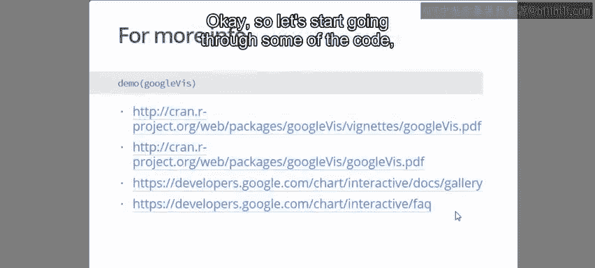
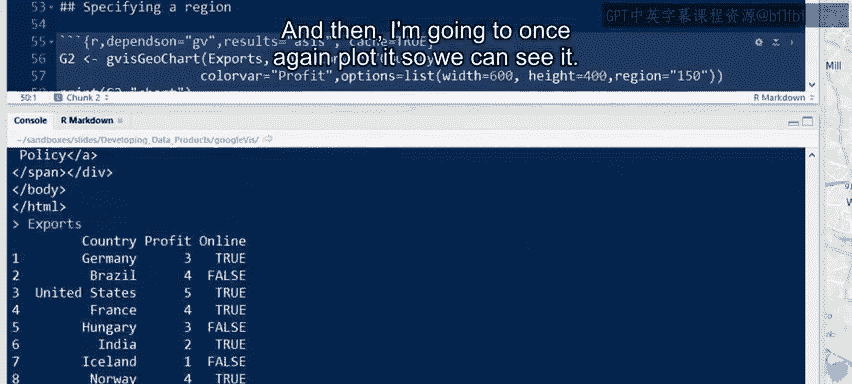
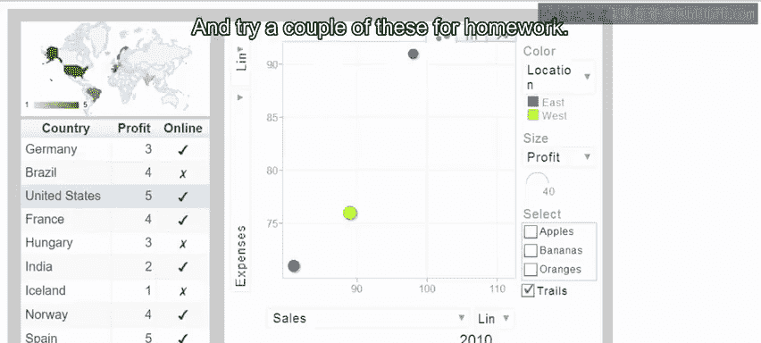

# 约翰霍普金斯大学数据科学课程9：《开发数据产品》｜data-products｜ - P17：16_googlevis 1 2.zh_en - GPT中英字幕课程资源 - BV19N411v7Y2

So Google Viiz is a pretty amazing package， it gives you access to most of Google's visualization tools that they have so motion charts we are to covered interactive maps will go over in a minute you know interactive tables。

 line charts， bar charts， they even have things that'll make like a little speedometer based on a graph or a metric that you want and so on so just go to the documentation for Google Viz and it'll show you a bunch of them it's really well documented。

 they both have a vignette and of course the package documentation。

So interactive graphs are a great way to do a great way to use Google Viz because the mapping stuff is hard。

 but Google's done a lot of it for you already， so if you want to create JavaScript maps that have little pop- ups over the countries that you specify and have it nice so that you can embed it in a web page or slideify presentation or a knitter presentation or a knitter document or so on。

 it's not so bad。So here's an example right here， and you can see in our markdown presentation。

 it actually does the interactivity。Okay and of course you can zoom in if you want and do things like this so that you know this is just specifying the options Now while we're on the topic of options。

 there's a million different options， I give you the link down here that show you where the options occur what page that you can pass as arguments to your Google Viz chart So how that works is just ast an options command as a list you need to name them right and give them the right value and then you need to use this this syntax that is like I guess it's just JSOsonN syntax but as long as you can but you probably don't need to know any any JSson。

 you just actually need to you know kind of look at it once or twice and you know get used to it and then I think it should be no problem。

Okay， so here's an example of just doing a line chart and。

The last thing I want to talk about is the idea that you can just merge multiple plots together。

 so that's just using GVz merge and then here's an example。After you've done it。

 here's the left hand plot you see our。Our plot。You see a table and you see a chart altogether Okay。

 so we'll go through a code example of all these things。 Here's how you can just see， of course。

 the code we already talked about that just print， will'll print out the code。

And then you know like we mentioned， you can embed the results in a markdown document just like we've done in this exact document。

 The and important thing I think there's two things。

 One is make sure you have the most current versions of everything are slideify knitter。

 whatever it is you're using。 and then the second important thing is results as equals as is in the chunk options I haven't had it it won't work otherwise。

 but then you can get it to work after that。 and I've done this a bunch of times between the last iteration of this class and the next one。

 and I've I've seen that this is a pretty finicky process and you know you tend to have to tweak around with it a little bit but usually get it in the end Often I have to reinstall things make sure you clear the knitter cache and that sort of thing and eventually you'll get it but it seems to be a little bit of a personsnicty thing but once you get it once then it'll be fine。

Okay， so let's start going through some of the code and generate some interesting graphs。

Okay， so let's as a first thing， generate this chart。 So before I show you anything， let me。

 let me just show you the data frame that we're going to。Display， okay， so there's the country names。

Okay， it has a value that's going to go into the pop up and then online true true or false。

 I think at this point， we're just going to。We're just going to use the country and the profit variable。

 Okay， now when we look up at our code， what we see is we're Gviz geochar， Okay， exports。 Okay。

 that's just the data frame。 Lo var is equal to country。 That's just the variable name country。

 It's going to look for a text field that has the country label names。

 and the color variable is profit。Okay， and then the options， this is just formatting options。 Okay。

 so let's do that。 And then I'm going to once again plot it so we can see it。

Okay， and it brings up a web page， there you go。Look at that。 Prety cool。

 That is pretty fancy for almost no effort。Okay， now let's go down to specifying a region。Okay。

 Gvas geochar again。And then here we specify region equals 150 that's going to zoom in on that region。

 let's try it。G2。Okay， now if we do plot。G2。Bam。Right there， Western Europe。Okay， looks good。Okay。

 so now let's just go through some of our options and see how they're set again。

 this we're just going to create a very simple line chart。Okay。

 let's create this data frame right here。There it is， okay， there's our data frame， you know。

 maybe US， Great Britain， Brazil， value 1 value 2。Okay， now let's create our Gvas chart。

 we'll call it line with a capital L。 and then if we do plot。Line。Now brings it up。Hello， world。

 it says， and then it's just got this simple plot。So look at the way we're setting the options there and connect them back to the plot。

 I think it'll be pretty clear to you the JavaScript notation is a little bit annoying if you're not used to it。

 but you know that's you're really just passing the options exactly as。

Google Chars wants you to pass them， right， There's no translation going through。

 So it's good to know because at some point， you might want to create a Google chart using like Google Docs or something like that and have the options set in the same way that you have them set here。

Okay last thing we want to do is create multiple plots together okay here we've created our geochart just like we did before。

 here's a table， so this is just an example of creating a table。

 but again this is just taking our data as is and creating and creating the table。

The motion chart that we had from before， okay， and then。What I'm going to do is merge the。

Gochart and the GVz table in one plot， and then horizontal equals false means it's going to stack them up one on top of each other。

 and then I'm going to merge this new plot and the other one together horizontal equals true side by side okay now if I print。

 I'm sorry plot。GTM。There it's going to bring it up and there you see now it looks pretty nice right。

 it's got the plot up here right， it's got the printout of the data frame there in an interactive。

Interactive table， and then it's got the motion chart over here。Okay， so that's pretty。

 And you can see some of the options you can set the background color and that sort of thing。

 but like this is a pretty pretty nifty little plot with relatively little code so and it's really just because Google's plotting library is going to be doing all the hard work in the back end。

And that's why this takes so little code so play around with this。

 create some Google charts I think' you'll be happy at how easy it makes Google charts and you know try a couple of these for homework。

