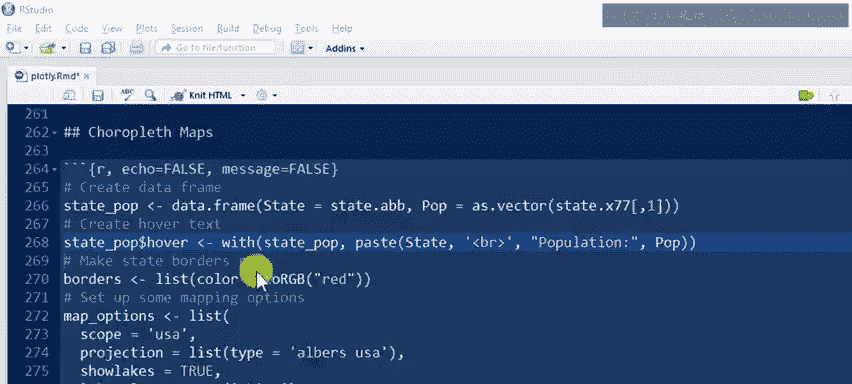
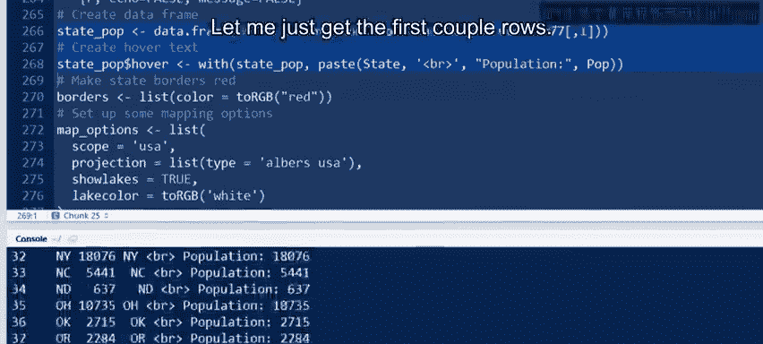
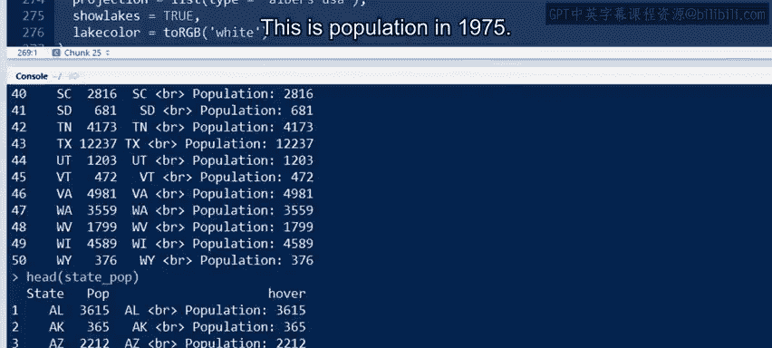
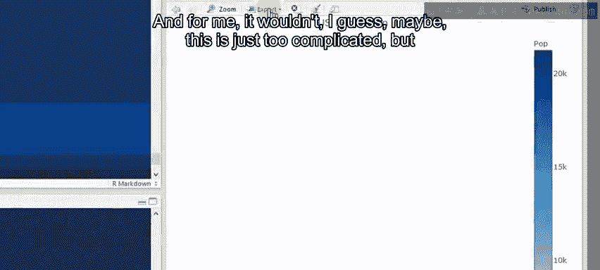
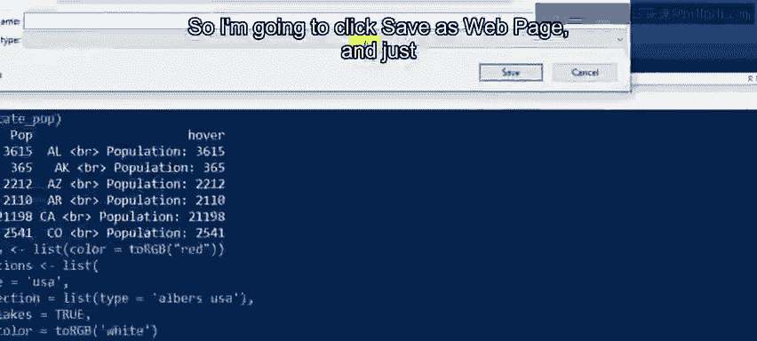
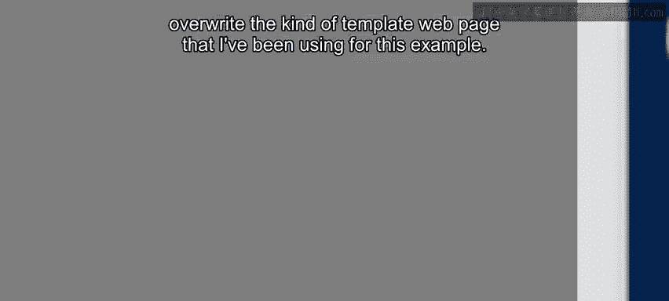
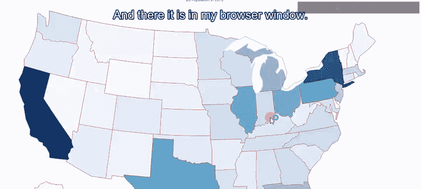
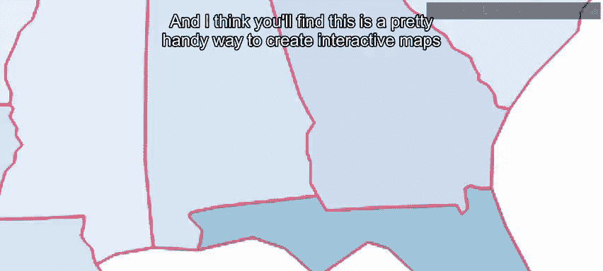

# 约翰霍普金斯大学数据科学课程9：《开发数据产品》｜data-products｜ - P23：22_plotly 1 6.zh_en - GPT中英字幕课程资源 - BV19N411v7Y2

Alright， so let's create a map with some nice hover over effects。

 So first thing I'm going to do is these two statements right here。

 there's a little bit of code in this example， so I'm not going to go over every single little detail。

 but let me just create this data set。And then show it to you。U， let me just get there。

First couple。Rose。Okay， so notice there's 50 of them you can see at the end here。

 there's 50 of them so for each state we have its abbreviation okay， so take Alabama for example。

 we have its population in millions and then we have some hoverover text so this hoverover text is going to be the state abbreviation in Alabama then a wine break and then population 3615。

000， this is population in 1975。

Okay。The borders， this is just going to be an option， this is kind of unnecessary。

 but we're just going to make those red。Okay。And then map options， again， it's going to be a list。

The scope， we want the USA to be the scope。And you know， just play around with these options。

 I think I think you'll have to just， you know， if you want to dramatically change this map。

 do it for a different different area or country， you'll have to flu your way through it a little bit。

 but I think a lot of it is quite obvious like show lake equals trues just means you're going to show。

Show the lakes。UL color late color white yeah， so in this case I think we changed the late color to white just because the color coding we're using is blue for population so we didn't want the lakes to the lakes to be blended in with the states with with the same color blue okay so then plotly again is the command the state pop is just the data frame okay。

Z is the population text equals hover that just means we want some hover over text。

 the locations are given by the column named state type is chloropl， location mode is USA states。

Color color is we're going to color code by the population。 the colors。

 This is just the the palette it's using in this case， just the blues。

 which is just a continuous shade of blue。 And then this this gives the。

TheHow it's going to draw the markers in this case on the borders。And this is then passed。

 the output of plotly is then passed the layout， which also then gives it a not only a title。

 but then it brings in these map options。 Okay， so let's go ahead and run that。And for me。

 it wouldn't， I guess maybe this is just too complicated。

 but it wouldn't display in the viewer for me。 So I'm going to click saveve as web page。

And。Just overwrite the kind of template web page I've been using for this example。

 And there it is in in in my browser window。 So now when I hover over a state， it's got。

It's got the state's population so we could go to Alabama， for example。

 you can see that's the exact text we wanted right there， Alabama， okay。All right。

So try and create a map， you know first thing I would say is take this data frame that we're looking at。

 it's got other columns in it， not just population and try and create some other maps and output'll them to web pages and see and I think as you go through it you'll get a better feel for the options so at a start just recreate this map and then try and recreate one with some of the different variables。

 try to have the color mean a different thing and I think you'll find this is a pretty handy way to create interactive maps。

