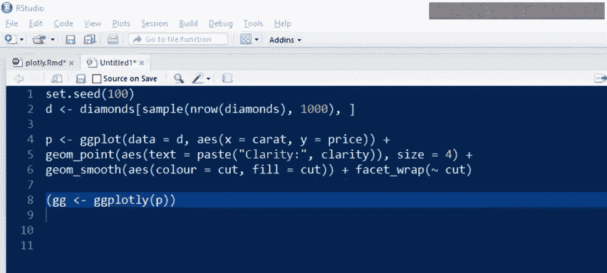
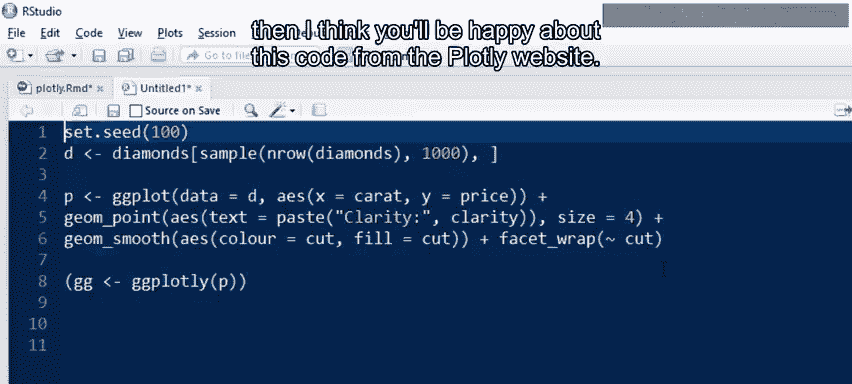
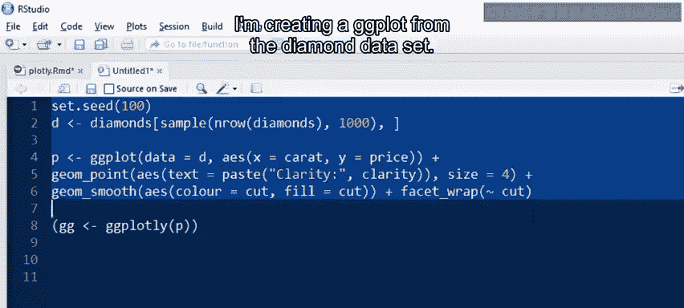
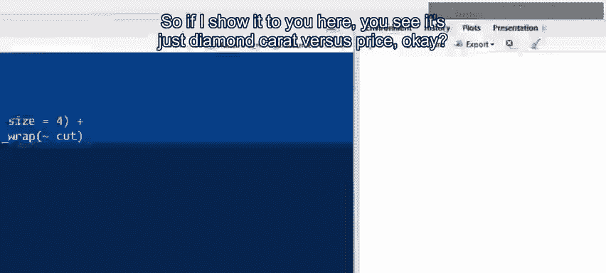
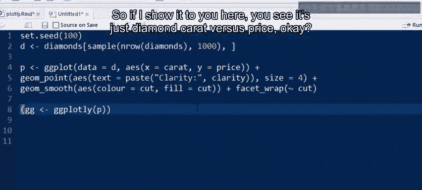

# 约翰霍普金斯大学数据科学课程9：《开发数据产品》｜data-products｜ - P24：23_plotly 1 7.zh_en - GPT中英字幕课程资源 - BV19N411v7Y2

So if you're a fan of GG plot， then I think you'll be happy about this code from the Ply website。

 so here I'm just going to show it to you really quick。

 I'm creating a GG plot from the diamondd data set， so if I show it to you here you see。

It's just diamond carrot versus price Okay， now what I wanted to show you is that plotly has this command G plotly where you can just immediately convert agg plot into a plotly interactive HTML graphic。

 So up here in the top window it's an R graphic in the in the R studio。

Viewer pane， I'm sorry in the R studio plotloting pane， and then in the bottom one。

 it's an HTML graphic in the R studio viewer pane。 So the bottom one's just displaying it as you would see it in a web browser。

