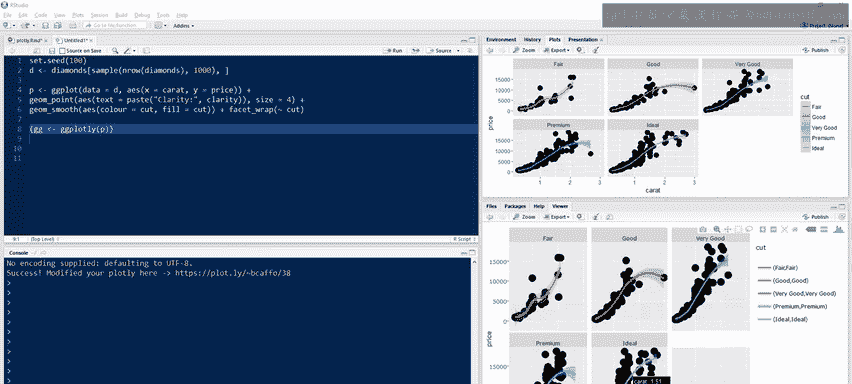
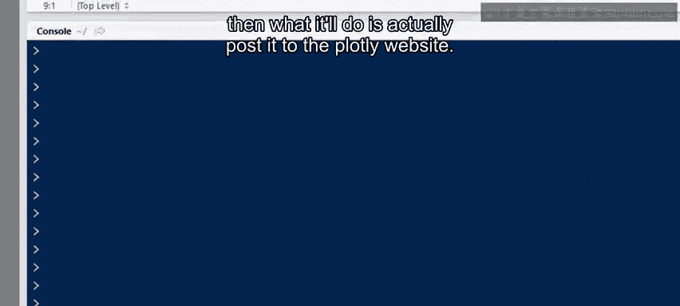
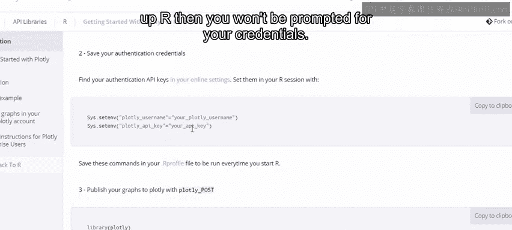

# 约翰霍普金斯大学数据科学课程9：《开发数据产品》｜data-products｜ - P25：24_plotly 1 8.zh_en - GPT中英字幕课程资源 - BV19N411v7Y2

So the last thing I want to do is just show you how to post a plotly directly。

 so I created in the last video this GG plot example and here it is over here。

 it was labeled GG so if I type GG in the in the R prompt it's going to bring it up in the viewer pane。

 but if I typed plotly underscore post。Qhiiz。

Then what it'll do is actually post it to the plotly website and the plotly website there's all different things that you can do you know this is the sort of output but if you click on edit here it you'll give you all different tools to edit it with their graphical user their webbased graphical user interface So I think plotly is fairly self-explanatory。

 but they also have videos on how to use it and a lot of tutorials and things like that So try exporting a graphic to plotly and working with their user interface for playing around with it changing the axes。

 changing the variable names and so on the last thing I want to say before I finish is that in order for this to kind of work seamlessly you have to set these two environment variables if you just look at know Google search on post to plotly from R it will direct you to this page basically。

You have to set a plotly username and plotly API key to get your API key。

 you just go in plotly to settings and there's and just copy and paste it from there Okay。

 and so then when you set these two environment variables。

 especially if if you put those in your do R profile so that they're set every time you start R。

 then you won't be prompted for your credentials。

