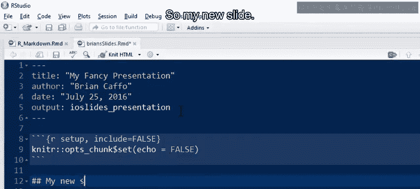
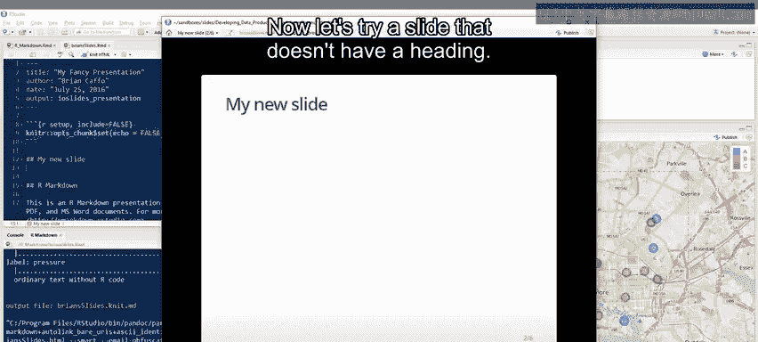
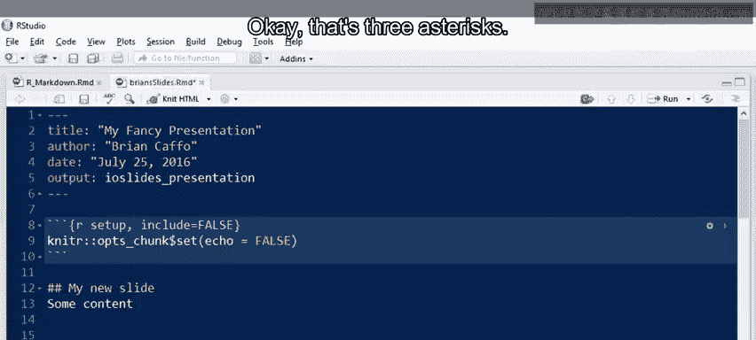
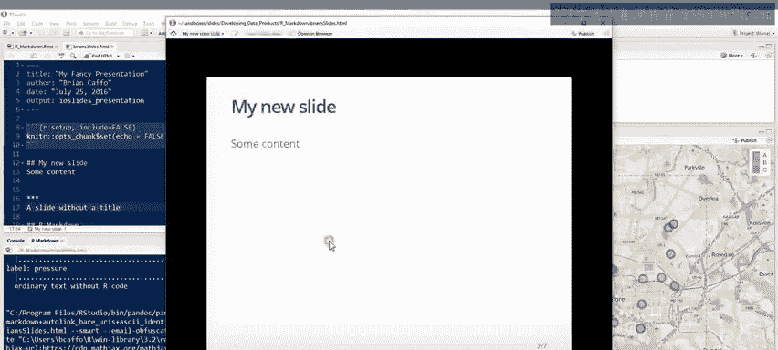
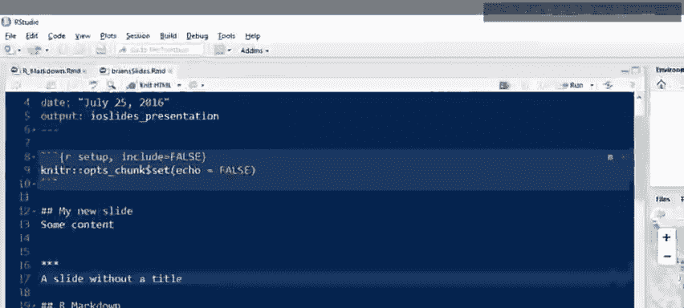
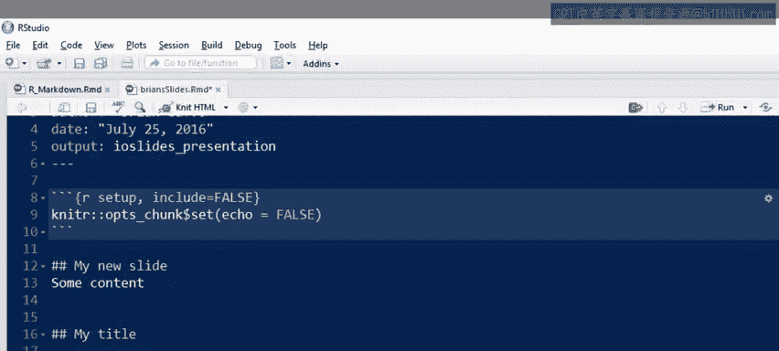
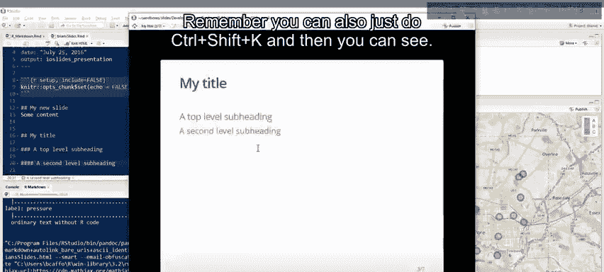
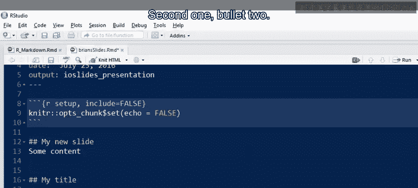
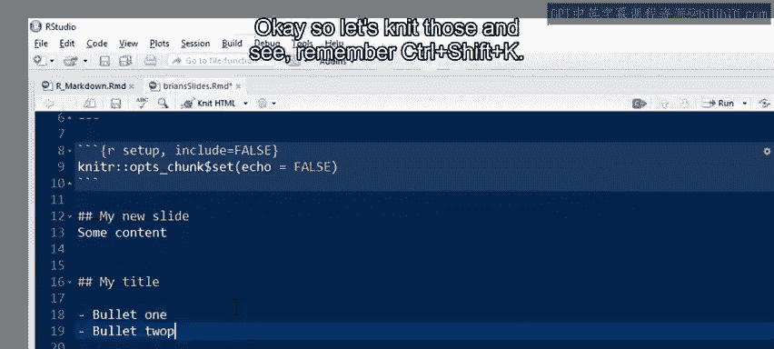
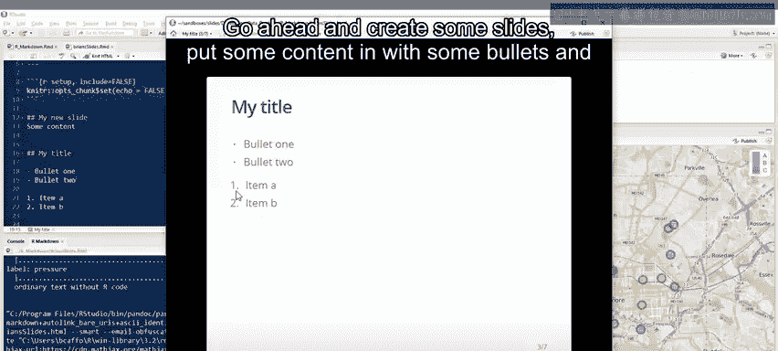

# 约翰霍普金斯大学数据科学课程9：《开发数据产品》｜data-products｜ - P28：27_r markdown 1 3.zh_en - GPT中英字幕课程资源 - BV19N411v7Y2

Okay， so let's look at some of the preamble here。 this Yaml part is surrounded by three dashes here。

 and so for example， the title you can change the title now at this point what you put in in the dialog box isnt you can change at this point change the author change the date and then the output IO slides that also means you can change the format if you want it to be slidey instead the knitter options by default this just means it's not going to echo code that you include by default Okay so now let's let's just create a new slide so new slide is two pound signs Okay so my new slide。

Okay， now let's knit it。There it's going。There we go， my new slide。Okay， that slide too。

 So remember it starts with my fancy presentation， my new slide Now let's try a slide that doesn't have a heading。

 So this one has this one has some。

Some content on it。And then let's try。A slide。Without。A slide without a title。Okay。That's three。

Asters。

Now there's my new slides with some content， and then now here's a slide without a title。

Okay， so now let's try putting a subheading。 So that's 3 pound pound signs， which is。

A top level subheading。Let's say actually， let's have it like this， two pound signs for my title。

Three pound signs for a top levels subheading。And four pound signs for a second level subheading。

Now let's try knitting it。Remember， you can also just do control。

Control shift K。 and then you can see。Now let's add some more content。

 so let's get rid of these subheadings。Okay， a list。Buullet one。Second one， bullet 2。

Okay， and notice those are just two dashes to start my bulleted list and then if I want an ordered list。

 one is item1， item 1，2 is item2， and so on， okay or let's call it item A and IMB so there's no confusion over what's going on and let's just call bullet。

One and bullet2， okay。

So let's knit those and see， remember control shift K。There we go， Okay， so now next step。

Go ahead and create some slides， put some content in with some bullets， and some order lists。

 some titles and some headings and subheadings。

