# 约翰霍普金斯大学数据科学课程9：《开发数据产品》｜data-products｜ - P29：28_r markdown 1 4.zh_en - GPT中英字幕课程资源 - BV19N411v7Y2

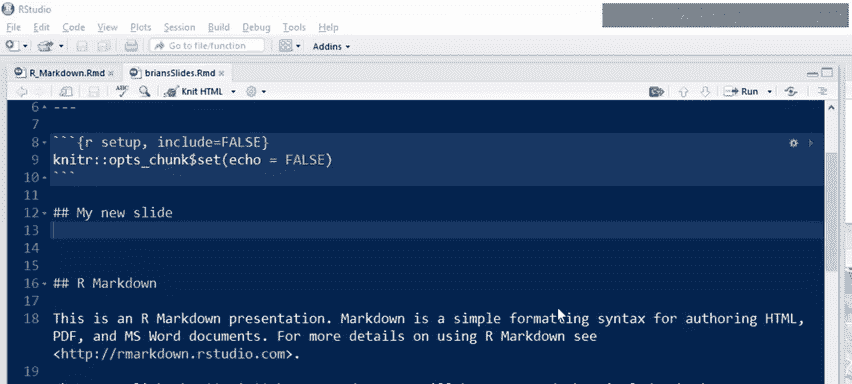

Okay， let's show some formatting options。So if I just put in。

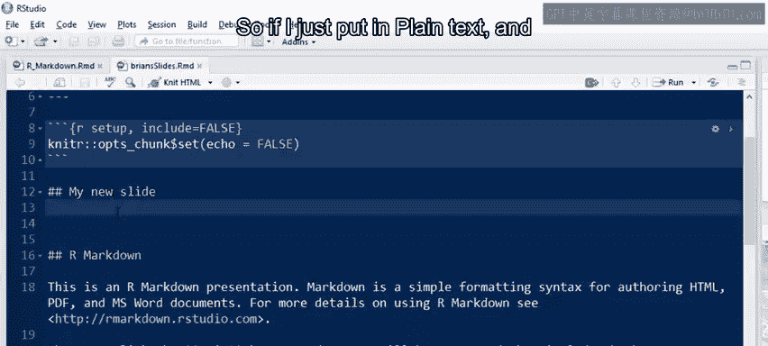

Plain text， then。alized。

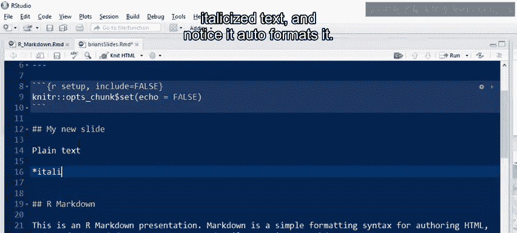

Tax。Notice it auto formats it。

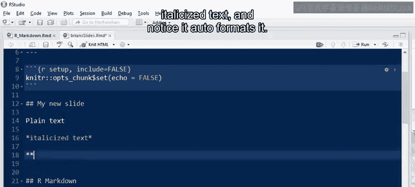

And bold。Text。OrI'm sorry， it syntax highlights that I should say。

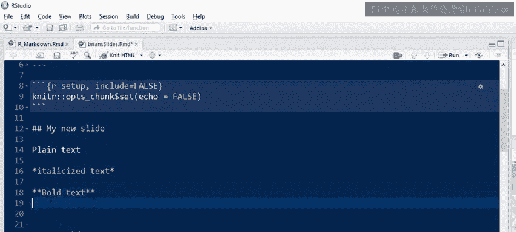

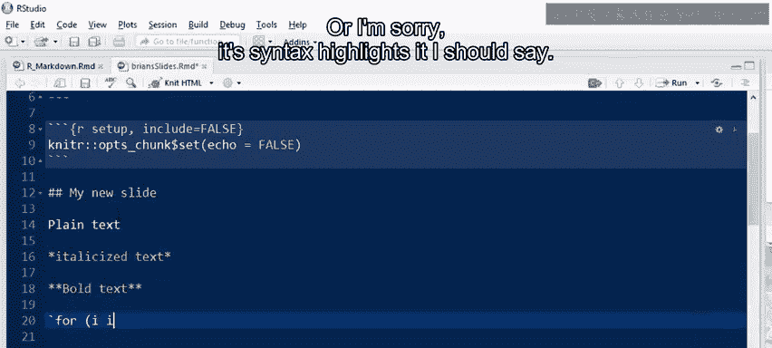

And one。Heres some code， Okay， so the code has single right。

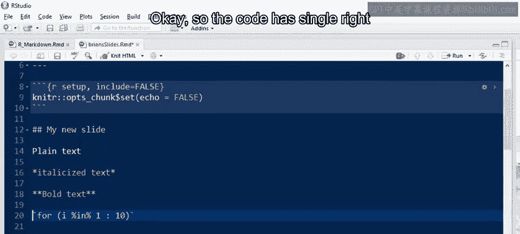

Facing quotation marks， boldold has two asterisks。

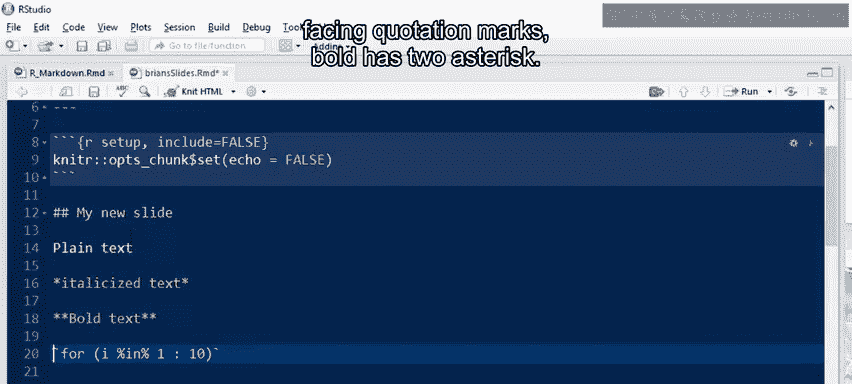

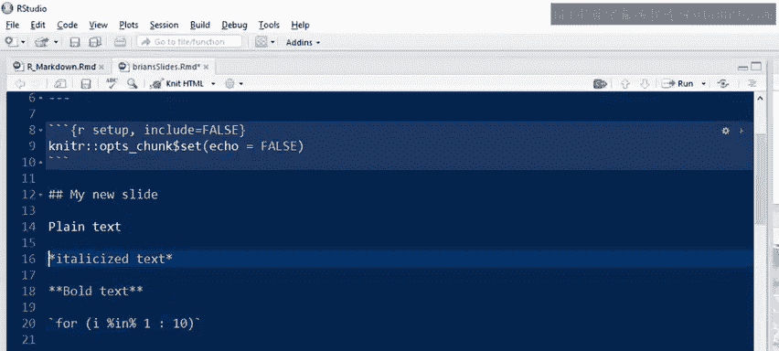

Itals has one asterisk and then plain， of course， has nothing。

 The asterisk has to be next to the leading character。 So if you， if you do it like that。

 I noticed it doesn't work sometimes。 so have it next to the leading character。

 I think that's necessary。

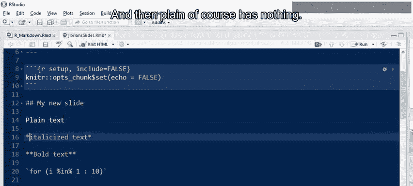

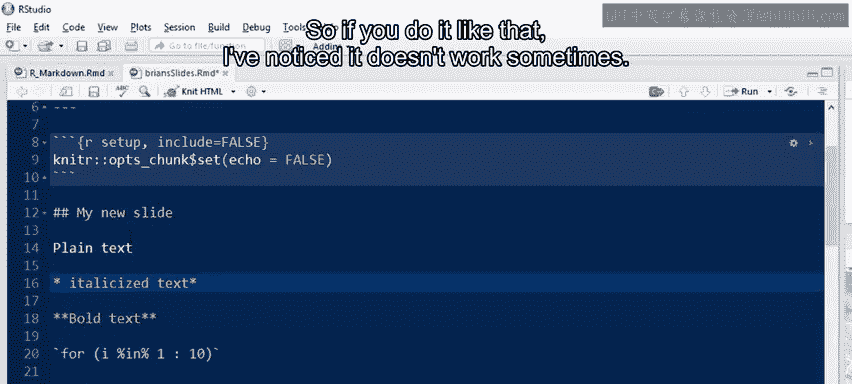

And then let's run it。